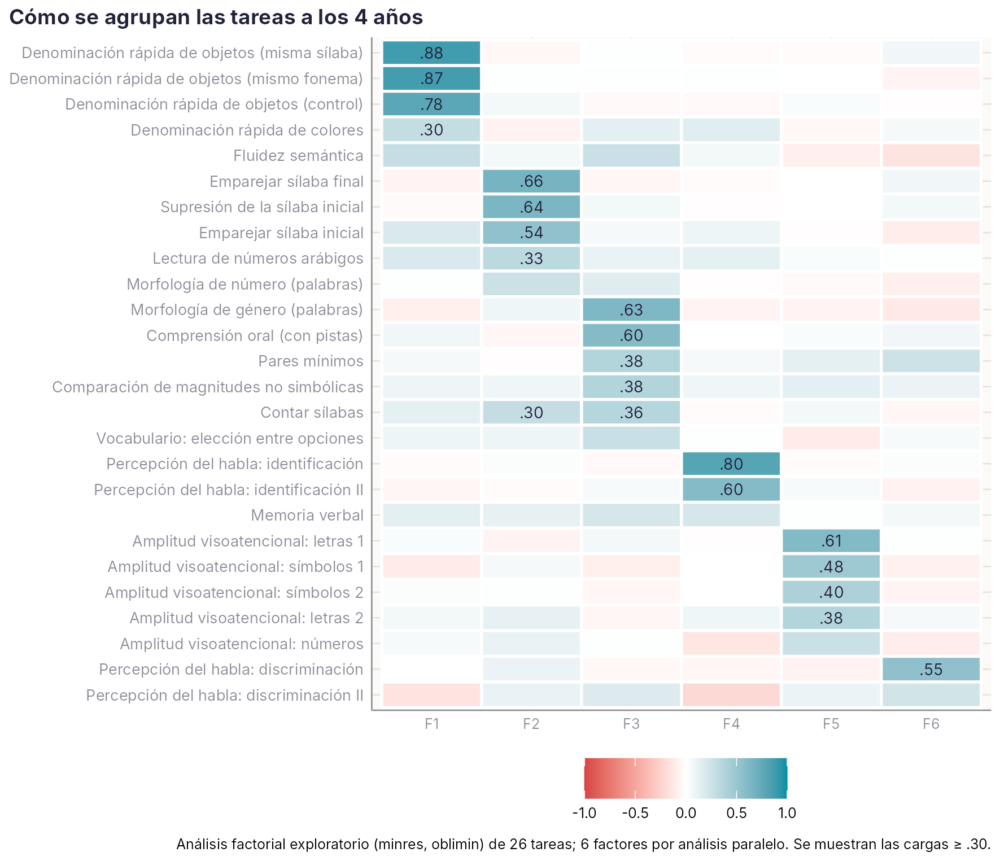
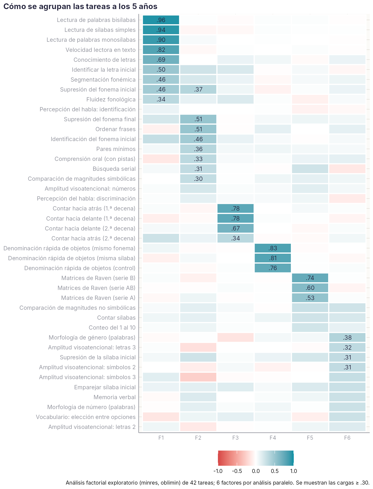
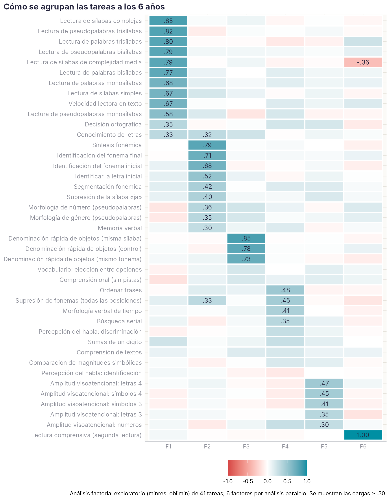
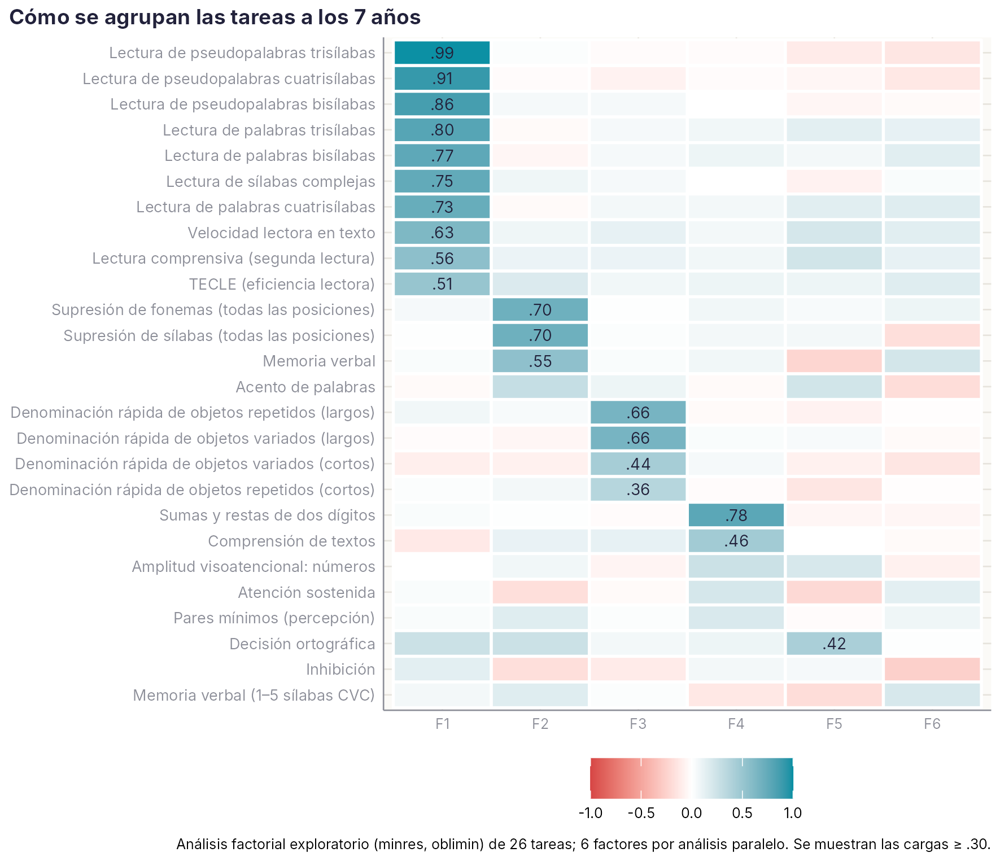
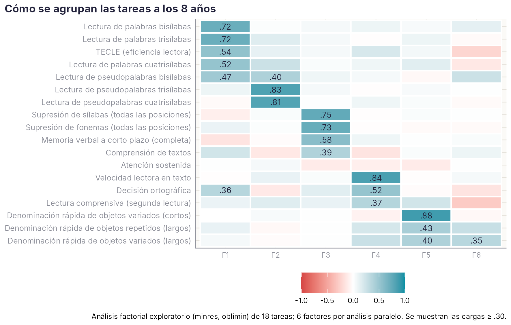
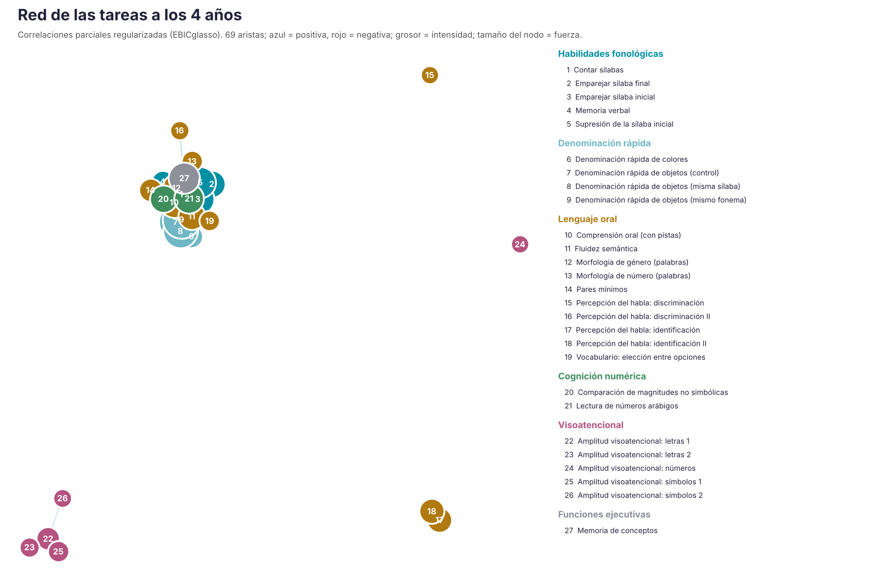
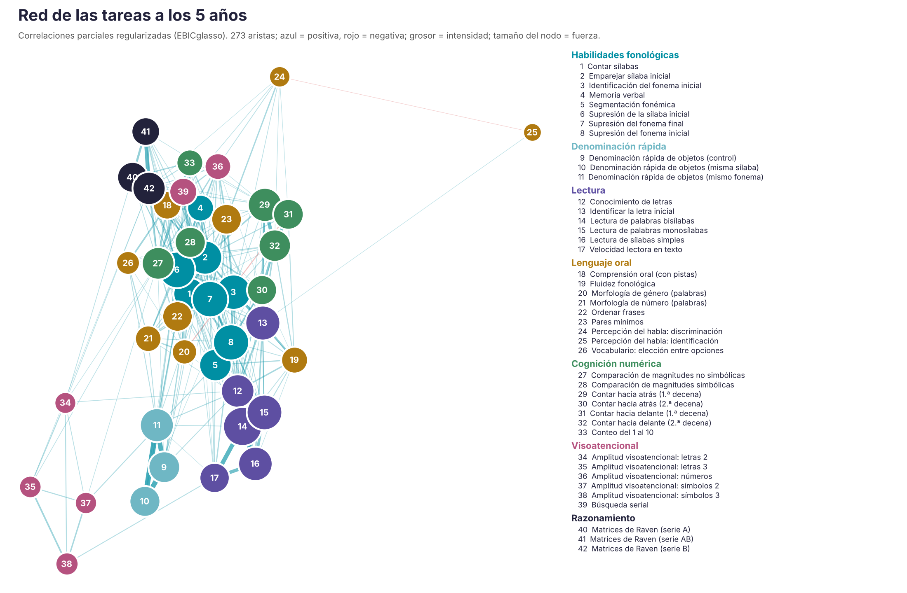
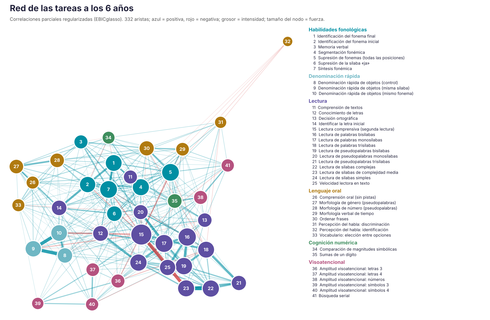
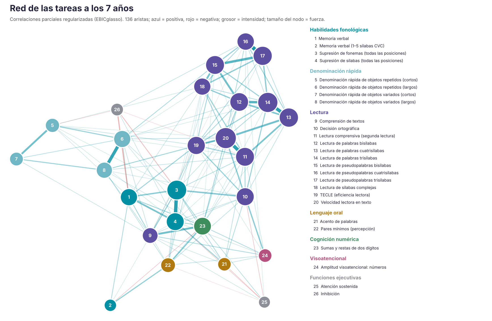
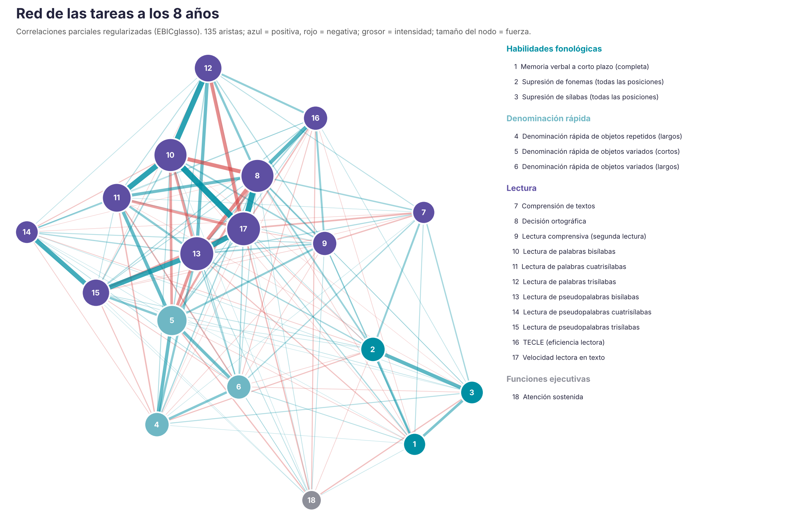

# How tasks are grouped {#sec-agrupacion}

```{r}
#| include: false
source(file.path(dirname(knitr::current_input(dir = TRUE)), "R", "libro.R"))
RS <- leer("ESTRUCTURA", "Resumen")
RR <- leer("REDES", "Resumen")
RN <- leer("REDES", "Nodos")
C <- utils::read.csv(file.path(raiz_libro(), "datos", "agregados", "CATALOGO", "Catalogo.csv"), encoding = "UTF-8", check.names = FALSE, stringsAsFactors = FALSE)
C <- C[C$estado == "evaluación", ]
nf <- function(f) sum(C$familia == f)
```

::: {.callout-note appearance="minimal"}
**Status:** proposal of October 21, 2026, for discussion within the group. The empirical grouping is exploratory; the confirmatory analysis is pending. *Translated from the Spanish version of November 28, 2026. The structure and network figures have labels in Spanish.*
:::

The platform's tasks can be grouped in two ways, and the manual needs both:

- **By how they measure** (task sheet families). Tasks that share the same main measure, the same direction and the same type of measurement error are analyzed, normed and presented in the same way. This is what makes it possible to **generate task sheets automatically**.
- **By what they measure** (empirical structure). Which tasks behave as measures of the same skill at each age. This is the basis of the composite scores and of the overall results chapter.

## Task sheet families {#sec-familias}

A rule common to all families: **in the manual, every score is presented so that higher is better**, and a low percentile always indicates difficulty. That way there is no need to remember that in rapid naming a long time is bad, or that in a decision task a short time is good. The original direction is kept in the data, and the task sheet states it.

**What is measured and what is reported**

| Family | Tasks | Main measure (original direction) | What is reported |
|---|---|---|---|
| **A · Accuracy** | `r nf("A")` | Correct responses (↑ better) | Correct responses and percentile |
| **B · Rapid naming** | `r nf("B")` | Time (↓ better) | Stimuli per second (inverse of time) and percentile |
| **C · Oral reading fluency** | `r nf("C")` | Efficiency (↑ better) | Correct per minute (words per minute) |
| **D · Time-limited efficiency** | `r nf("D")` | Correct − errors/3 (↑ better) | Score corrected for guessing |
| **E · Decision with response time** | `r nf("E")` | Correct (↑) and time (↓) | Accuracy and median time of correct responses, or inverse efficiency |
| **F · Span and memory** | `r nf("F")` | Correct or span (↑ better) | Maximum span and correct responses |
| **G · Comprehension** | `r nf("G")` | Correct responses (↑ better) | Correct responses and percentile |

**How each family is analyzed**

| Family | Appropriate reliability | Norms and cut-off | Caveats |
|---|---|---|---|
| **A** | ω or KR-20 with the items; test–retest | Percentile; cut-off in the lower tail | Ceiling effect; few items |
| **B** | Test–retest; parallel forms | Percentile on the inverted scale | Skewed distribution; errors reported separately |
| **C** | Test–retest; forms A and B | Percentile; expected growth | Time mixes speed and giving up |
| **D** | Test–retest (α and split-half overestimate) | Percentile by school year | Items not reached |
| **E** | Split-half of time; test–retest | Percentile for each component | Speed–accuracy trade-off |
| **F** | ω; test–retest | Percentile | Floor at early ages |
| **G** | ω; test–retest | Percentile | Few items; text dependence |

Each task's family appears in the [Task catalog](catalogo.en.qmd), where tasks can also be filtered by family.

**From the family to the automatic task sheet.** Each family fixes the parameters of its task sheet: main measure, direction, transformation, reliability method, type of norms, figures and caveats. With that, generating a new task sheet only requires three things:

1. Choose the task in the catalog; this gives the codes, sessions, family and the text for publications.
2. Run the common script with the parameters of its family; it produces sample, descriptives, reliability, validity, norms and figures.
3. Write by hand what cannot be automated: theoretical framework, interpretation and the studies it opens up.

The five pilot task sheets were made almost this way. The next step is to turn the draft task sheet script into a common one for all families.

## Empirical structure by age

For each age, an exploratory factor analysis was run with the main measure of all assessment tasks:

- Time was oriented so that higher is better (−log of time).
- Each task was standardized within its cohort and session.
- The number of factors was set by parallel analysis, and factors may correlate with each other (oblimin rotation).

Since not all cohorts took the same tasks, correlations are computed pairwise, with at least 150 children per pair.

```{r}
#| label: tbl-estructura
#| tbl-cap: "Summary of the exploratory factor analysis by age."
tabla(RS[, c("edad", "tareas", "n_mediana_por_par", "factores", "varianza_explicada_pct", "cor_entre_factores_media", "RMSR")],
      c("Age", "Tasks", "Children per pair (median)", "Factors", "% variance explained", "Mean correlation between factors", "RMSR"), digitos = 2)
```

::: {.panel-tabset}

## Age 4



## Age 5



## Age 6



## Age 7



## Age 8



:::

**What it shows:**

- **Rapid naming is a factor of its own at all ages.** The object versions load together (.74–.88 from age 4 to 6; .37–.88 at ages 7 and 8) and separately from phonological awareness, as the double-deficit hypothesis predicts. The color version separates at age 4: another reason to review it (see the warning in the catalog).
- **At age 4**, the syllabic tasks (matching and deleting syllables) form a factor. Oral language (morphology, comprehension, vocabulary) forms another, and speech perception and visual-attentional span, two more.
- **At age 5** an **early reading** factor already appears: letters, initial letter, syllables and first words, together with phoneme segmentation and deletion. Phonemic awareness joins letter knowledge. A counting factor and a reasoning factor (Raven) also separate out.
- **At age 6**, **decoding** is a single, very strong factor: syllables, words, pseudowords and text speed, with loadings from .63 to .86. Phonemic awareness (blending, identification) remains in a separate factor.
- **At age 7** reading begins to differentiate. Words, pseudowords and TECLE remain in one factor, and text speed forms another with orthographic decision.
- **At age 8** words (with TECLE) and pseudowords are already separate factors. Phonological awareness and verbal memory remain together.
- **Text comprehension does not form a factor of its own.** It shares a factor with calculation at age 7 and with phonological awareness at age 8, with moderate loadings (.39–.45).

**Implications for the manual:**

1. Composite scores by age should follow these factors: rapid naming, phonological awareness (syllabic at age 4 and phonemic from age 5), decoding, text fluency and oral language.
2. Reading comprehension is not just "more decoding": it needs its own validity criterion.
3. Tasks with low loadings on all factors are candidates for review or for moving to appendix D: some visual-attentional, speech perception and attention tasks.

**Caveats.** This is an exploratory analysis with pairwise correlations across different cohorts. At age 6 the fit is worse and there is a loading of 1.00 (reading comprehension), a sign that this task overlaps almost entirely with another. What is needed now is a confirmatory analysis by cohort, with the same children on all tasks, and a test of invariance across ages and cohorts.

## Task networks

Factor analysis assumes that behind the tasks there are a few latent skills. **Network analysis** starts from a different idea: skills support one another and form a system. What is estimated is the network of **partial correlations** between tasks, that is, how much two tasks are related after removing all the others. Technically it is a regularized **Gaussian graphical model** (EBICglasso). The network's groupings (communities) can be compared with the factors, as in exploratory graph analysis (EGA).

```{r}
#| label: tbl-redes
#| tbl-cap: "Task networks by age: edges, communities and agreement with the factors (adjusted Rand index)."
tabla(RR[, c("edad", "tareas", "aristas", "densidad", "aristas_negativas", "comunidades", "modularidad", "ARI_con_factores")],
      c("Age", "Tasks", "Edges", "Density", "Negative edges", "Communities", "Modularity", "Agreement with the factors (ARI)"), digitos = 2)
```

::: {.panel-tabset}

## Age 4



## Age 5



## Age 6



## Age 7



## Age 8



:::

**What the network adds to the factors:**

- **Communities largely coincide with the factors** (ARI from `r num_es(min(RR$ARI_con_factores), 2)` to `r num_es(max(RR$ARI_con_factores), 2)`). That two methods with different assumptions reach similar groupings gives more confidence in them.
- **The network becomes denser with age.** Density goes from `r num_es(RR$densidad[RR$edad == 4], 2)` at age 4 to `r num_es(RR$densidad[RR$edad == 8], 2)` at age 8: skills become integrated as children learn to read. This is what the mutualism model of cognitive development predicts.
- **Rapid naming is a community of its own at all ages.** At ages 4 and 5 it connects to the rest of the network through phonological awareness and oral language. From age 6 it connects almost only to reading, and barely to phonological awareness. This is to be expected if rapid naming is related mainly to reading fluency.
- **Bridge tasks.** Some tasks connect different communities: at age 5, phoneme identification and deletion; at age 6, letter knowledge and phoneme deletion. They are natural candidates for composite scores and for intervention.
- **Strong negative edges** (for example, between the two readings of the same text at age 6) indicate nearly redundant tasks or overlapping measures. It is a signal for review, not a real relation.

**Caveats.** Like the factor analysis, it combines cohorts pairwise, so it is exploratory. The stability of the edges still needs to be checked (bootstrap) with child-level data. That analysis and longitudinal network models (how the network changes from one school year to the next) are a methodological study in their own right: see the [Research agenda](https://abarejo.github.io/leeduca-manual/agenda.html) (*in Spanish*).
