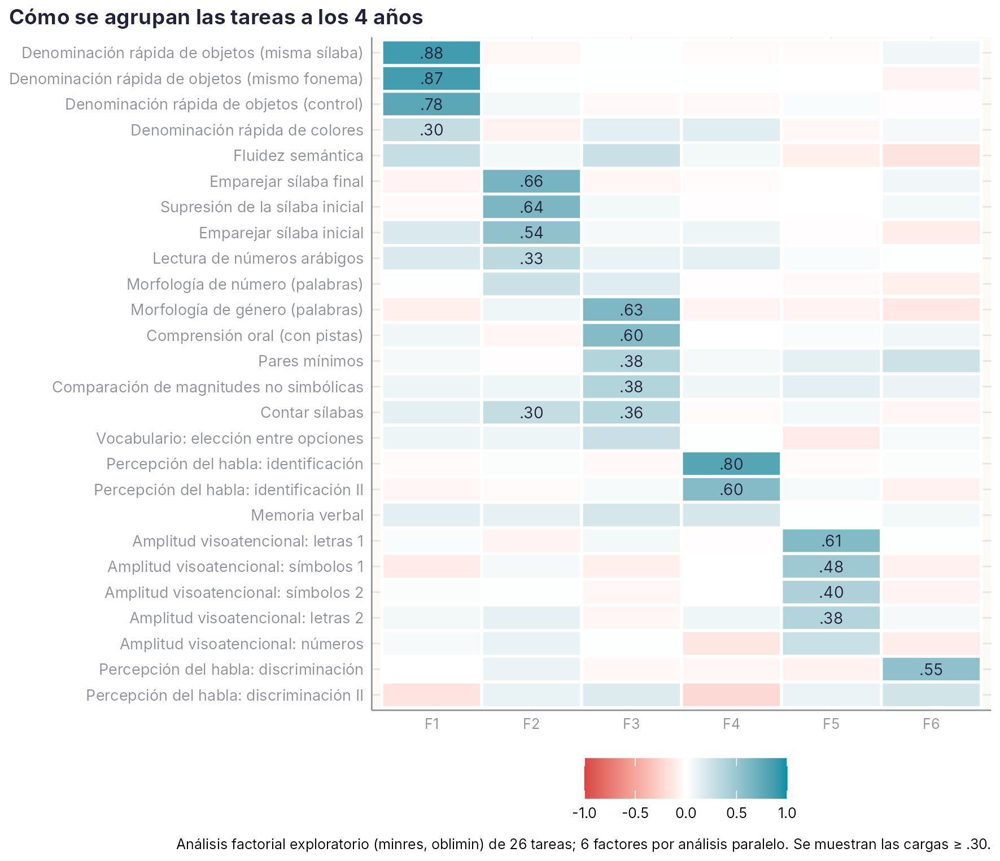
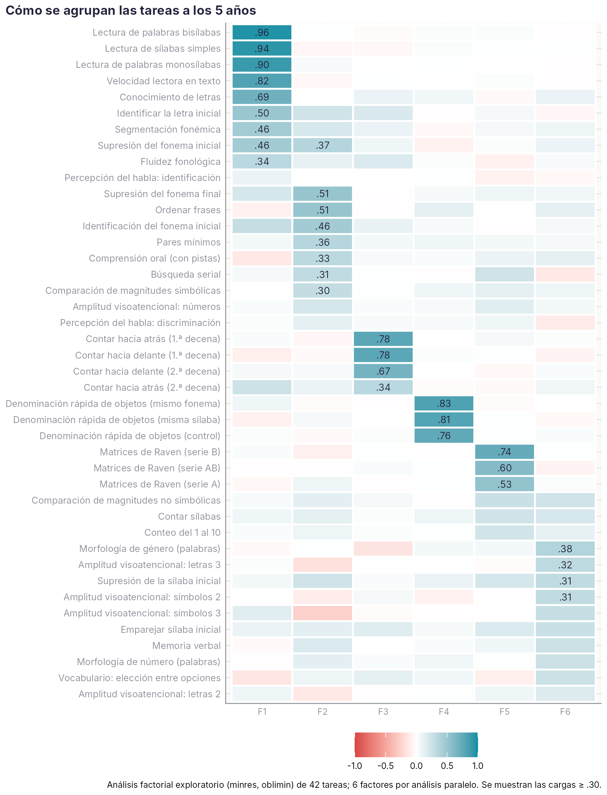
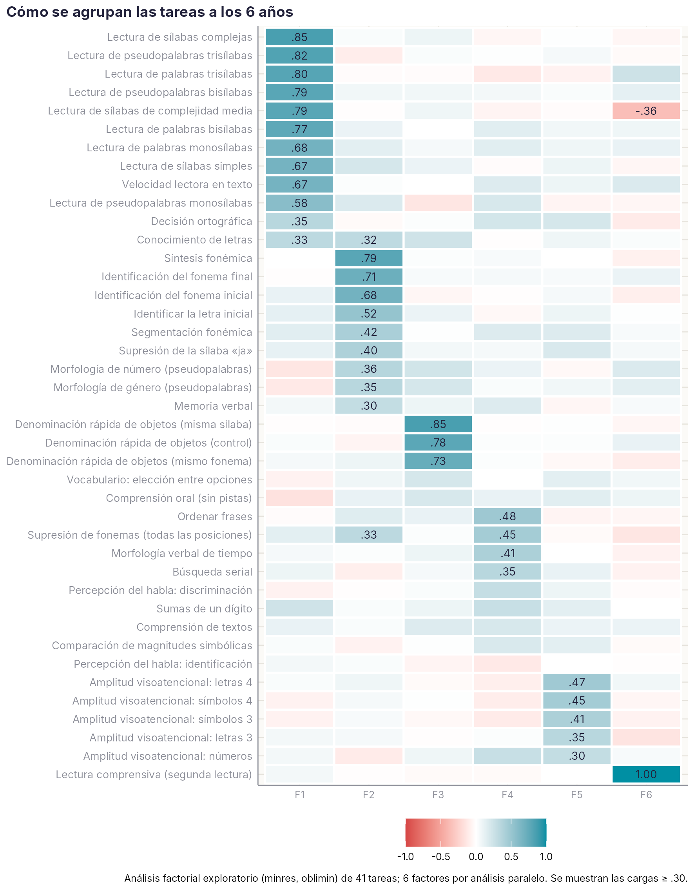
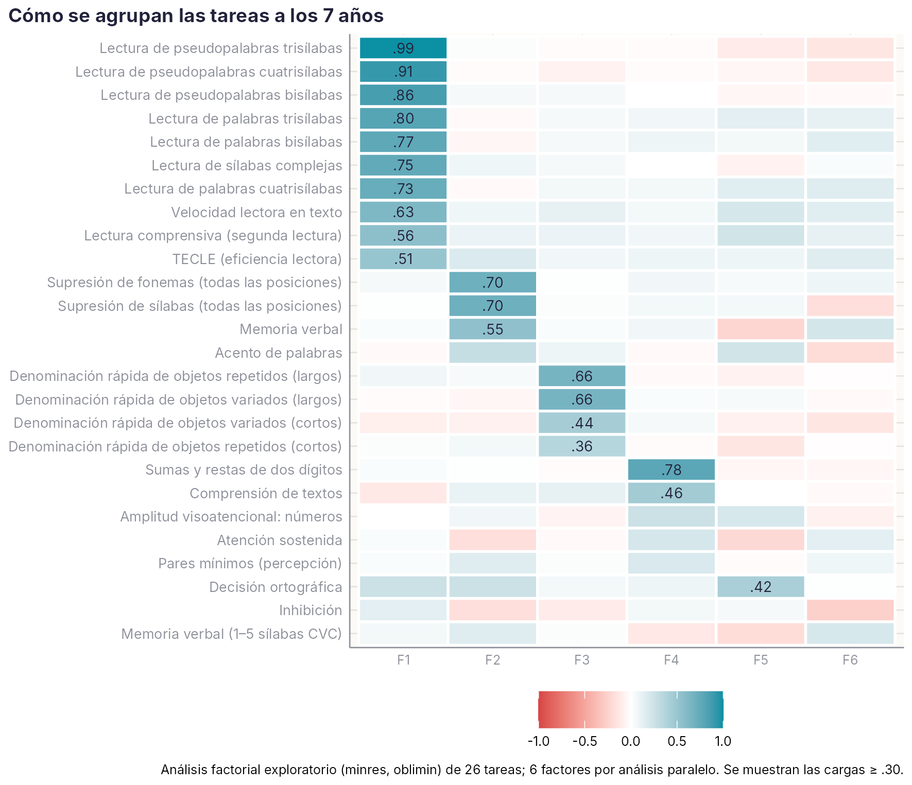
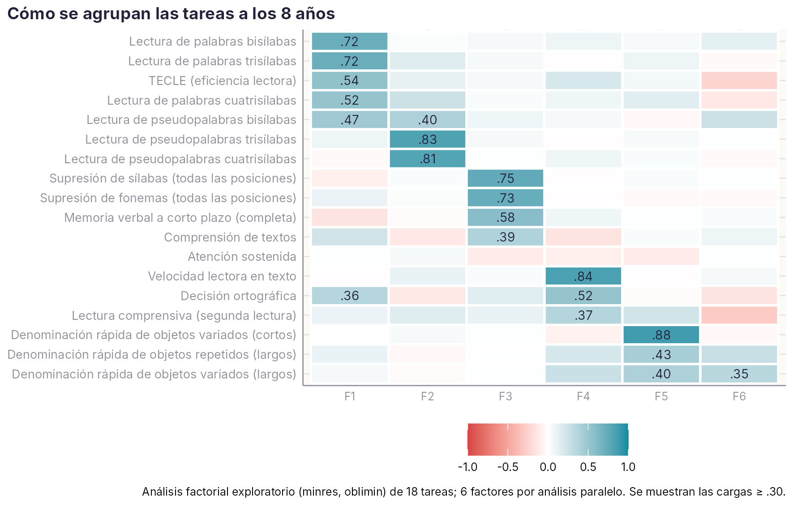
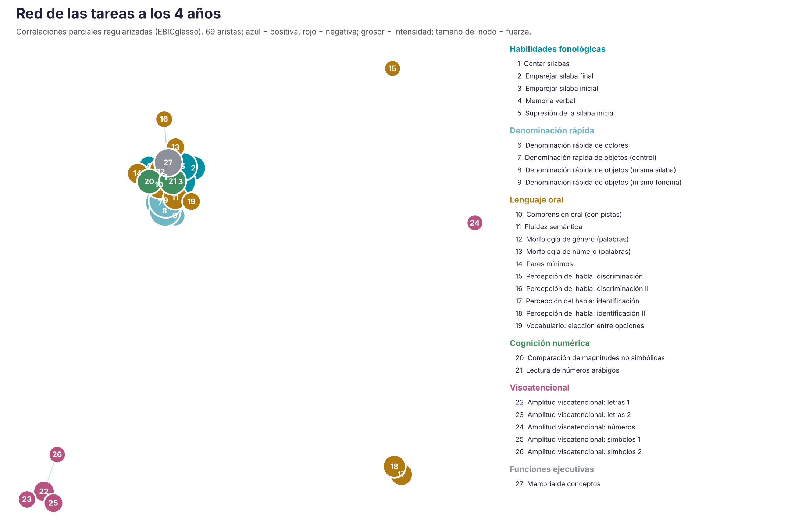
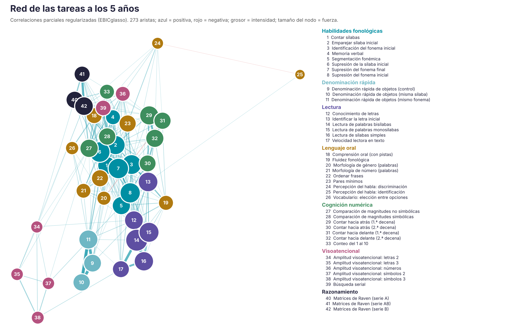
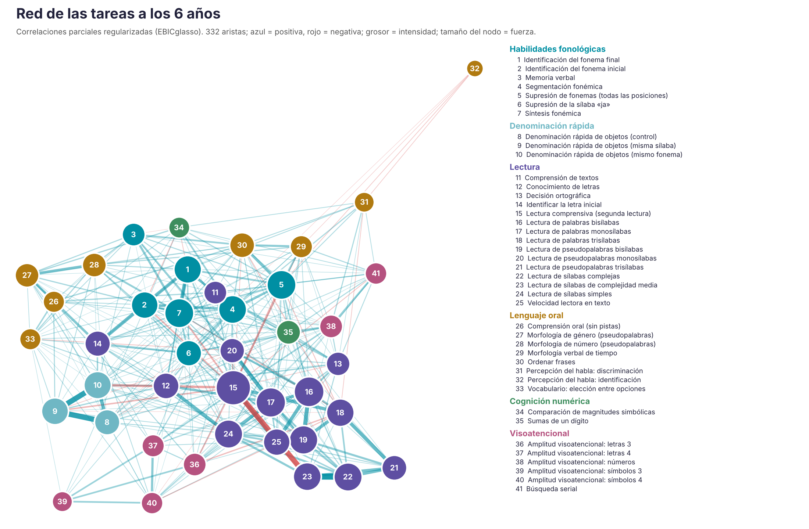
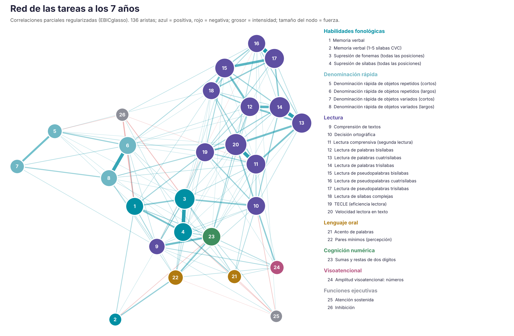
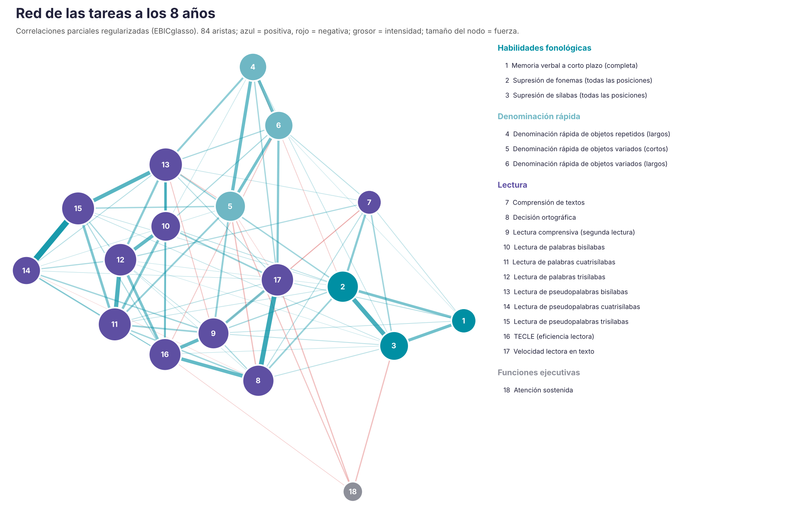

# Cómo se agrupan las tareas {#sec-agrupacion}

```{r}
#| include: false
source(file.path(dirname(knitr::current_input(dir = TRUE)), "R", "libro.R"))
RS <- leer("ESTRUCTURA", "Resumen")
RR <- leer("REDES", "Resumen")
RN <- leer("REDES", "Nodos")
C <- utils::read.csv(file.path(raiz_libro(), "datos", "agregados", "CATALOGO", "Catalogo.csv"), encoding = "UTF-8", check.names = FALSE, stringsAsFactors = FALSE)
C <- C[C$estado == "evaluación", ]
nf <- function(f) sum(C$familia == f)
```

::: {.callout-note appearance="minimal"}
**Estado:** propuesta del 21/10/2026 para discutir en el grupo. La agrupación empírica es exploratoria; el análisis confirmatorio queda pendiente.
:::

Las tareas de la plataforma se pueden agrupar de dos maneras, y el manual necesita las dos:

- **Por cómo se miden** (familias de ficha). Las tareas que comparten la misma medida principal, el mismo sentido y el mismo tipo de error de medida se analizan, se bareman y se presentan igual. Es lo que permite **generar las fichas de forma automática**.
- **Por lo que miden** (estructura empírica). Qué tareas se comportan como medidas de una misma habilidad a cada edad. Es la base de las puntuaciones compuestas y del capítulo de resultados globales.

## Familias de ficha {#sec-familias}

Una regla común a todas las familias: **en el manual, toda puntuación se presenta de modo que más alto es mejor**, y un percentil bajo indica siempre dificultad. Así no hay que recordar que en la denominación rápida un tiempo alto es malo, o que en una decisión un tiempo bajo es bueno. El sentido original se conserva en los datos, y la ficha lo indica.

**Qué se mide y qué se informa**

| Familia | Tareas | Medida principal (sentido original) | Qué se informa |
|---|---|---|---|
| **A · Precisión** | `r nf("A")` | Aciertos (↑ mejor) | Aciertos y percentil |
| **B · Denominación rápida** | `r nf("B")` | Tiempo (↓ mejor) | Estímulos por segundo (inverso del tiempo) y percentil |
| **C · Fluidez lectora oral** | `r nf("C")` | Eficiencia (↑ mejor) | Aciertos por minuto (palabras por minuto) |
| **D · Eficiencia con tiempo limitado** | `r nf("D")` | Aciertos − errores/3 (↑ mejor) | Puntuación corregida del azar |
| **E · Decisión con tiempo de respuesta** | `r nf("E")` | Aciertos (↑) y tiempo (↓) | Precisión y tiempo mediano de los aciertos, o eficiencia inversa |
| **F · Amplitud y memoria** | `r nf("F")` | Aciertos o amplitud (↑ mejor) | Amplitud máxima y aciertos |
| **G · Comprensión** | `r nf("G")` | Aciertos (↑ mejor) | Aciertos y percentil |

**Cómo se analiza cada familia**

| Familia | Fiabilidad adecuada | Baremo y corte | Cautelas |
|---|---|---|---|
| **A** | ω o KR-20 con los ítems; test-retest | Percentil; corte en la cola baja | Efecto techo; pocos ítems |
| **B** | Test-retest; formas paralelas | Percentil sobre la escala invertida | Distribución asimétrica; errores aparte |
| **C** | Test-retest; formas A y B | Percentil; crecimiento esperado | El tiempo mezcla velocidad y abandono |
| **D** | Test-retest (α y división en mitades sobrestiman) | Percentil por curso | Ítems no alcanzados |
| **E** | División en mitades del tiempo; test-retest | Percentil de cada componente | Compensación velocidad–precisión |
| **F** | ω; test-retest | Percentil | Suelo a edades tempranas |
| **G** | ω; test-retest | Percentil | Pocos ítems; dependencia del texto |

La familia de cada tarea aparece en el [Catálogo de tareas](catalogo.qmd), donde también se puede filtrar por familia.

**De la familia a la ficha automática.** Cada familia fija los parámetros de su ficha: medida principal, sentido, transformación, método de fiabilidad, tipo de baremo, figuras y cautelas. Con eso, generar una ficha nueva solo requiere tres cosas:

1. Elegir la tarea en el catálogo; de ahí salen los códigos, las sesiones, la familia y el texto para publicaciones.
2. Ejecutar el guion común con los parámetros de su familia; produce muestra, descriptivos, fiabilidad, validez, baremo y figuras.
3. Escribir a mano lo que no se puede automatizar: marco teórico, interpretación y estudios que abre.

Las cinco fichas piloto se hicieron casi así. El paso siguiente es convertir el guion de las fichas borrador en uno común para todas las familias.

## Estructura empírica por edad

Para cada edad se ha hecho un análisis factorial exploratorio con la medida principal de todas las tareas de evaluación:

- El tiempo se ha orientado para que más alto sea mejor (−log del tiempo).
- Cada tarea se ha tipificado dentro de su cohorte y sesión.
- El número de factores se ha fijado con análisis paralelo, y los factores pueden correlacionar entre sí (rotación oblimin).

Como no todas las cohortes hicieron las mismas tareas, las correlaciones se calculan por pares de tareas, con al menos 150 niños por par.

```{r}
#| label: tbl-estructura
#| tbl-cap: "Resumen del análisis factorial exploratorio por edad."
tabla(RS[, c("edad", "tareas", "n_mediana_por_par", "factores", "varianza_explicada_pct", "cor_entre_factores_media", "RMSR")],
      c("Edad", "Tareas", "Niños por par (mediana)", "Factores", "% varianza explicada", "Correlación media entre factores", "RMSR"), digitos = 2)
```

::: {.panel-tabset}

## 4 años



## 5 años



## 6 años



## 7 años



## 8 años



:::

**Qué se ve:**

- **La denominación rápida es un factor propio a todas las edades.** Las versiones de objetos cargan juntas (.74–.88 de 4 a 6 años; .37–.88 a los 7 y 8) y aparte de la conciencia fonológica, como predice la hipótesis del doble déficit. La de colores se separa a los 4 años: es otra razón para revisarla (ver el aviso en el catálogo).
- **A los 4 años**, las tareas silábicas (emparejar y suprimir sílabas) forman un factor. El lenguaje oral (morfología, comprensión, vocabulario) forma otro, y la percepción del habla y la amplitud visoatencional, otros dos.
- **A los 5 años** aparece ya un factor de **lectura inicial**: letras, letra inicial, sílabas y primeras palabras, con la segmentación y la supresión de fonemas. La conciencia fonémica se une al conocimiento de las letras. También se separan un factor de conteo y uno de razonamiento (Raven).
- **A los 6 años**, la **decodificación** es un único factor muy fuerte: sílabas, palabras, pseudopalabras y velocidad de texto, con cargas de .63 a .86. La conciencia fonémica (síntesis, identificación) queda en un factor aparte.
- **A los 7 años** la lectura empieza a diferenciarse. Palabras, pseudopalabras y TECLE siguen en un factor, y la velocidad de texto forma otro con la decisión ortográfica.
- **A los 8 años** las palabras (con TECLE) y las pseudopalabras ya son factores distintos. La conciencia fonológica y la memoria verbal siguen juntas.
- **La comprensión de textos no forma un factor propio.** Comparte factor con el cálculo a los 7 años y con la conciencia fonológica a los 8, y con cargas moderadas (.39–.45).

**Implicaciones para el manual:**

1. Las puntuaciones compuestas por edad deberían seguir estos factores: denominación rápida, conciencia fonológica (silábica a los 4 años y fonémica desde los 5), decodificación, fluidez de texto y lenguaje oral.
2. La comprensión lectora no es solo «más decodificación»: necesita su propio criterio de validez.
3. Las tareas con cargas bajas en todos los factores son candidatas a revisión o a pasar al anexo D: algunas tareas visoatencionales, de percepción del habla y de atención.

**Cautelas.** Es un análisis exploratorio con correlaciones por pares entre cohortes distintas. A los 6 años el ajuste es peor y hay una carga de 1,00 (lectura comprensiva), señal de que esa tarea se solapa casi por completo con otra. Lo que corresponde ahora es un análisis confirmatorio por cohorte, con los mismos niños en todas las tareas, y comprobar la invarianza entre edades y cohortes.

## Redes de tareas

El análisis factorial supone que detrás de las tareas hay unas pocas habilidades latentes. El **análisis de redes** parte de otra idea: las habilidades se apoyan unas en otras y forman un sistema. Lo que se estima es la red de **correlaciones parciales** entre tareas, es decir, cuánto se relacionan dos tareas descontando todas las demás. Técnicamente es un **modelo gráfico gaussiano** regularizado (EBICglasso). Las agrupaciones de la red (comunidades) se pueden comparar con los factores, como en el análisis exploratorio de grafos (EGA).

```{r}
#| label: tbl-redes
#| tbl-cap: "Redes de tareas por edad: aristas, comunidades y acuerdo con los factores (índice de Rand ajustado)."
tabla(RR[, c("edad", "tareas", "aristas", "densidad", "aristas_negativas", "comunidades", "modularidad", "ARI_con_factores")],
      c("Edad", "Tareas", "Aristas", "Densidad", "Aristas negativas", "Comunidades", "Modularidad", "Acuerdo con los factores (ARI)"), digitos = 2)
```

::: {.panel-tabset}

## 4 años



## 5 años



## 6 años



## 7 años



## 8 años



:::

**Qué añade la red a los factores:**

- **Las comunidades coinciden en lo esencial con los factores** (ARI de `r num_es(min(RR$ARI_con_factores), 2)` a `r num_es(max(RR$ARI_con_factores), 2)`). Que dos métodos con supuestos distintos lleguen a agrupaciones parecidas da más confianza en ellas.
- **La red se densifica con la edad.** La densidad pasa de `r num_es(RR$densidad[RR$edad == 4], 2)` a los 4 años a `r num_es(RR$densidad[RR$edad == 8], 2)` a los 8: las habilidades se integran a medida que se aprende a leer. Es lo que predice el modelo de mutualismo del desarrollo cognitivo.
- **La denominación rápida es una comunidad propia a todas las edades.** A los 4 y 5 años se une al resto de la red por la conciencia fonológica y el lenguaje oral. Desde los 6 años se une casi solo a la lectura, y apenas a la conciencia fonológica. Es lo esperable si la denominación rápida se relaciona sobre todo con la fluidez lectora.
- **Tareas puente.** Algunas tareas conectan comunidades distintas: a los 5 años, la identificación y la supresión de fonemas; a los 6, el conocimiento de las letras y la supresión de fonemas. Son candidatas naturales para las puntuaciones compuestas y para la intervención.
- **Aristas negativas fuertes** (por ejemplo, entre las dos lecturas del mismo texto a los 6 años) indican tareas casi redundantes o medidas que se solapan. Es una señal para revisar, no una relación real.

**Cautelas.** Como el análisis factorial, combina cohortes por pares, así que es exploratorio. Falta comprobar la estabilidad de las aristas (bootstrap) con los datos por niño. Ese análisis y los modelos de red longitudinales (cómo cambia la red de un curso al siguiente) son un estudio metodológico propio: ver la [Agenda de investigación](agenda.qmd).
