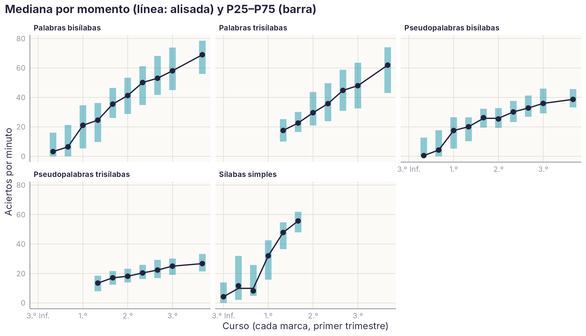
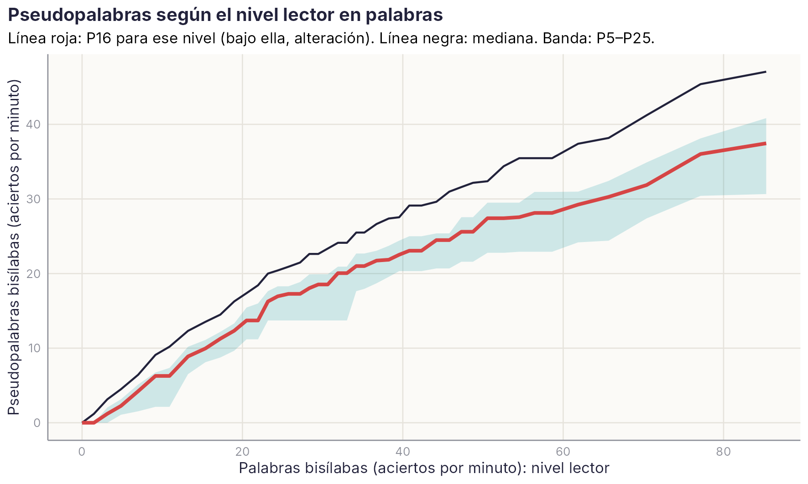

# Norms by reading level {#sec-nivel-lector}

```{r}
#| include: false
source(file.path(dirname(knitr::current_input(dir = TRUE)), "R", "libro.R"))
A1 <- leer("NIVEL_LECTOR", "A1_Medianas_por_momento"); A2 <- leer("NIVEL_LECTOR", "A2_Nivel_lector_equivalente")
B1 <- leer("NIVEL_LECTOR", "B1_Baremo_por_nivel_lector"); C1 <- leer("NIVEL_LECTOR", "C1_Retraso_y_alteracion")
C2 <- leer("NIVEL_LECTOR", "C2_Comprension_posterior"); AN <- leer("NIVEL_LECTOR", "0b_Grupos_anomalos")
CUR <- c(`5` = "Pre-K5", `6` = "G1", `7` = "G2", `8` = "G3", `9` = "G4")
etq <- function(t) { t <- as.numeric(t); ifelse(!is.finite(t), "", { e <- floor(t + 1e-6); tr <- round((t - e) * 3) + 1
  e2 <- ifelse(tr > 3, e + 1, e); tr2 <- ifelse(tr > 3, 1, tr); paste0(CUR[as.character(e2)], " T", tr2) }) }
pc <- function(par) C1[C1$par == par, ]
p1 <- unique(B1$par)[1]
PAR <- c("Ruta fonológica (pseudopalabras) frente al nivel en palabras" = "Phonological route (pseudowords) vs. reading level in words",
         "Ruta visual (palabras) frente al nivel en pseudopalabras" = "Visual route (words) vs. reading level in pseudowords",
         "Ruta fonológica (pseudopalabras trisílabas) frente al nivel en palabras trisílabas" = "Phonological route (three-syllable pseudowords) vs. reading level in three-syllable words")
TAR <- c("Palabras bisílabas" = "Two-syllable words", "Palabras trisílabas" = "Three-syllable words", "Pseudopalabras bisílabas" = "Two-syllable pseudowords",
         "Pseudopalabras trisílabas" = "Three-syllable pseudowords", "Sílabas simples" = "Simple syllables")
TIPO <- c("dentro de lo esperado para la edad" = "within the expected range for age", retraso = "delay", "alteración" = "deviance")
tr <- function(x, m) ifelse(x %in% names(m), m[as.character(x)], x)
```

::: {.callout-note appearance="minimal"}
**Status:** proposal of October 21, 2026. Script `scripts/R/baremo_nivel_lector.R`; output `baremo_nivel_lector_R_v1.xlsx`. It responds to the reading-level comparison in the course's diagnostic guide (J. L. Luque, Unit 5). *Translated from the Spanish version of November 28, 2026. Time points are written as school year and term: Pre-K5 = final year of preschool (age 5), G1–G4 = Grades 1–4, T1–T3 = terms. The figures have labels in Spanish.*
:::

## What it is for

In a dyslexia assessment, each test is interpreted twice. Against **chronological age**, the child is compared with children of the same age: this documents the difficulty. Against **reading level**, the child is compared with younger children who read at the same level. This distinguishes a **delay** (the child progresses more slowly, but like a younger reader of the same level) from a **deviance** (the child fails even compared with younger readers of the same level). Deviance indicates greater severity.

This second comparison can almost never be made properly, because it requires norms from younger children measured with the same test. The platform has them: it measures the same tasks in the same children from the final year of preschool to Grade 3, three times per school year. This chapter offers two tools:

- **Reading-level equivalent.** For a given score, the school year and term in which that score is the median.
- **Norms conditional on reading level.** The percentiles of one task (for example, pseudowords) among children of any age who have the same level in another task (for example, words).

All scores are correct responses per minute, with the non-Preleo group as reference.

## Reading-level equivalent

The median at each time point is smoothed so that it does not decrease with age. A score is then translated into the time point whose median matches it.

{#fig-nl-curvas width=100%}

```{r}
#| label: tbl-nl-equivalente
#| tbl-cap: "Reading-level equivalent: school year and term in which each score (correct responses per minute) is the median. Empty: outside the range of the data."
A2e <- A2; A2e$tarea <- tr(A2e$tarea, TAR)
W <- reshape(A2e[, c("tarea", "puntuacion", "momento_equivalente")], idvar = "puntuacion", timevar = "tarea", direction = "wide")
names(W) <- sub("^momento_equivalente\\.", "", names(W)); W <- W[order(W$puntuacion), ]
for (j in 2:ncol(W)) W[[j]] <- etq(W[[j]])
names(W)[1] <- "Correct per minute"
tabla(W)
```

**Example.** A Grade 3 child who reads 30 two-syllable words per minute reads like the median of `r etq(A2$momento_equivalente[A2$tarea_canonica == "LEC_PAL_2sil" & A2$puntuacion == 30])`. Their reading level on that task is that of a child almost two school years younger.

## Norms conditional on reading level

For each level on the reference task, children of any age with that level are grouped, in bands of at least 80, and the percentiles of the other task are computed. A child below P16 on that task, for their reading level, shows a **deviance**. If they are low only relative to their age, they show a **delay**.

{#fig-nl-cond width=90%}

```{r}
#| label: tbl-nl-condicionado
#| tbl-cap: "Two-syllable pseudowords (correct per minute) by reading level in two-syllable words. Values interpolated between bands."
b <- B1[B1$par == p1, ]; xs <- seq(5, 70, 5)
it <- function(col) round(approx(b$X_mediana, b[[col]], xout = xs, rule = 2)$y, 1)
T <- data.frame(`Level in words (correct/min)` = xs, `Equivalent to` = etq(approx(A2$puntuacion[A2$tarea_canonica == "LEC_PAL_2sil"], A2$momento_equivalente[A2$tarea_canonica == "LEC_PAL_2sil"], xout = xs)$y),
                P10 = it("P10"), P16 = it("P16"), P25 = it("P25"), P50 = it("P50"), check.names = FALSE)
tabla(T, digitos = 1)
```

The full tables for the three pairs are in `datos/agregados/NIVEL_LECTOR/B1_Baremo_por_nivel_lector.csv`:

- pseudowords against the level in words, for the phonological route;
- words against the level in pseudowords, for the visual route;
- three-syllable pseudowords against three-syllable words.

## Delay and deviance in the data

```{r}
#| include: false
f <- pc(p1)
```

Of the children at or below P16 for their age on pseudowords, most do not have only a delay. Compared with readers of the same level in words, they are also low: `r num_es(f$pct_alteracion_de_los_bajos[f$edad == 6], 0)`% at age 6 and `r num_es(f$pct_alteracion_de_los_bajos[f$edad == 8], 0)`% at age 8.

```{r}
#| label: tbl-nl-tipos
#| tbl-cap: "Children below P16 for their age, split into delay and deviance, by task pair and age."
T <- C1[, c("par", "edad", "N", "bajo_edad", "retraso", "alteracion", "pct_alteracion_de_los_bajos")]
T$par <- tr(T$par, PAR)
tabla(T, c("Comparison", "Age", "N", "≤ P16 for age", "Delay", "Deviance", "% deviance"), digitos = 1)
```

**Is the distinction useful?** It was checked with a criterion that does not use these tasks: poor reading comprehension (bottom quartile) one or two school years later.

```{r}
#| label: tbl-nl-validez
#| tbl-cap: "Percentage of children with poor reading comprehension one or two school years later, by type at ages 6–7."
T <- C2; T$tipo <- factor(T$tipo, c("dentro de lo esperado para la edad", "retraso", "alteración")); T <- T[order(T$par, T$tipo), ]
T$par <- tr(T$par, PAR); T$tipo <- tr(as.character(T$tipo), TIPO); rownames(T) <- NULL
tabla(T, c("Comparison", "Type at ages 6–7", "n", "% with poor comprehension later"), digitos = 1)
```

The gradient is clear in all three pairs. About 24% of children without difficulty have poor comprehension later, 34 to 39% of those with a delay and 42 to 46% of those with a deviance. This is what the diagnostic guide predicts: deviance indicates greater severity. The difference between delay and deviance is moderate; it serves to grade severity, not as a diagnosis on its own.

## Caveats

- **Time points combine different cohorts.** From age 7 onward, the reference is mainly the 2010 cohort.
- **Measurement error.** The score used as reading level also has error. A child who scores low by chance on the reference task is compared with a lower level than their real one. With a single reference task, classification near the cut-off is unstable. It is advisable to confirm a deviance at two time points.
- **Cleaning.** The 2021/22 sessions (948–950, to be reviewed) and values above P99 + 3 SD for their time point were excluded. Groups whose median does not fit with that of neighboring time points were also excluded: `r nrow(AN)` groups, the two from the 2011 cohort at 8.2. There, the median for three-syllable words is very low (`r num_es(AN$Md[AN$tarea_canonica == "LEC_PAL_3sil"][1], 1)` correct per minute, compared with about 46 at neighboring time points) and that for three-syllable pseudowords is very high (`r num_es(AN$Md[AN$tarea_canonica == "LEC_PSEUDO_3sil"][1], 1)`, compared with about 22). This is session 905 (2019/20), which already had anomalous times in EDICOLE. In it, code 1932 (three-syllable words) records 23 correct, 13 errors and almost 5 minutes as medians: it cannot be a list of 12 words. Code 1935 (pseudowords), on the other hand, has the profile of a word list. The codes are probably swapped or misassigned in that session (**new data issue**; to be reviewed with the engineer and, meanwhile, session 905 should not be used for these tasks).
- **Text speed.** Left out: it mixes versions with different scales. Its norms in words per minute are in the [reading speed task sheet](fichas/VEL.en.qmd).

## How to use it in the DIS-ESP summary chart

1. In the row "Deviation criterion: reading level", take as the reading level the child's score on two-syllable words (or, for the visual route, on pseudowords).
2. Look up the P16 for that level in the table for the corresponding pair. If the other task falls below it, it is a deviance (✗); if not, the mechanism works as in readers of the same level (✓).
3. If the declared cut-off is different (for example, P10), use that column.
