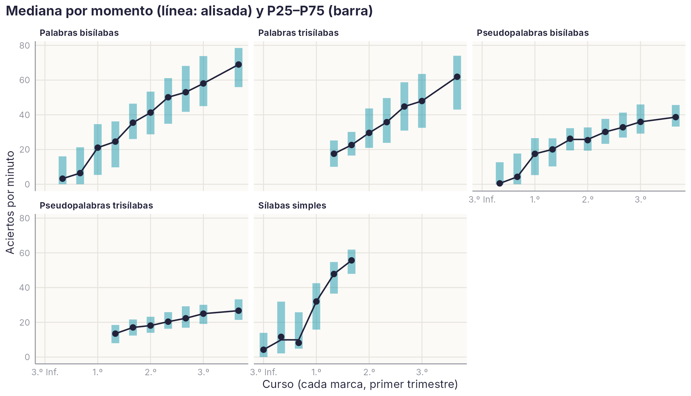
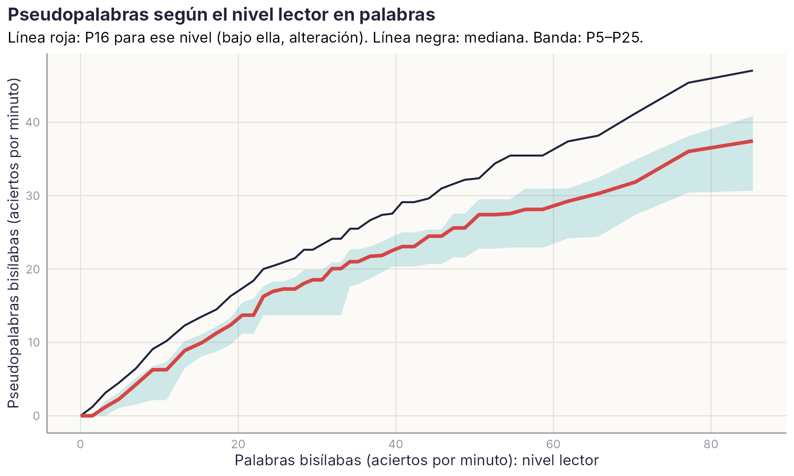

# Baremos por nivel lector {#sec-nivel-lector}

```{r}
#| include: false
source(file.path(dirname(knitr::current_input(dir = TRUE)), "R", "libro.R"))
A1 <- leer("NIVEL_LECTOR", "A1_Medianas_por_momento"); A2 <- leer("NIVEL_LECTOR", "A2_Nivel_lector_equivalente")
B1 <- leer("NIVEL_LECTOR", "B1_Baremo_por_nivel_lector"); C1 <- leer("NIVEL_LECTOR", "C1_Retraso_y_alteracion")
C2 <- leer("NIVEL_LECTOR", "C2_Comprension_posterior"); AN <- leer("NIVEL_LECTOR", "0b_Grupos_anomalos")
CUR <- c(`5` = "3.º Inf.", `6` = "1.º", `7` = "2.º", `8` = "3.º", `9` = "4.º")
etq <- function(t) { t <- as.numeric(t); ifelse(!is.finite(t), "", { e <- floor(t + 1e-6); tr <- round((t - e) * 3) + 1
  e2 <- ifelse(tr > 3, e + 1, e); tr2 <- ifelse(tr > 3, 1, tr); paste0(CUR[as.character(e2)], " T", tr2) }) }
pc <- function(par) C1[C1$par == par, ]
p1 <- unique(B1$par)[1]
```

::: {.callout-note appearance="minimal"}
**Estado:** propuesta del 21/10/2026. Guion `scripts/R/baremo_nivel_lector.R`; salida `baremo_nivel_lector_R_v1.xlsx`. Responde a la comparación por nivel lector de la guía de diagnóstico de la asignatura (J. L. Luque, Tema 5).
:::

## Para qué sirve

En una evaluación de la dislexia, cada prueba se interpreta dos veces. Frente a la **edad cronológica**, el niño se compara con los de su edad: así se documenta la dificultad. Frente al **nivel lector**, se compara con niños más pequeños que leen igual que él. Así se distingue un **retraso** (va más despacio, pero como un lector más joven de su nivel) de una **alteración** (falla incluso frente a lectores más jóvenes del mismo nivel). La alteración indica mayor gravedad.

Esta segunda comparación casi nunca se puede hacer bien, porque exige baremos de niños más pequeños medidos con la misma prueba. La plataforma los tiene: mide las mismas tareas a los mismos niños de 3.º de Infantil a 3.º de Primaria, tres veces por curso. Este capítulo ofrece dos herramientas:

- **Nivel lector equivalente.** Para una puntuación, el curso y el trimestre en que esa puntuación es la mediana.
- **Baremo condicionado al nivel lector.** Los percentiles de una tarea (por ejemplo, pseudopalabras) entre los niños de cualquier edad que tienen el mismo nivel en otra (por ejemplo, palabras).

Todas las puntuaciones son aciertos por minuto, con el grupo sin Preleo como referencia.

## Nivel lector equivalente

La mediana de cada momento se alisa para que no baje con la edad. Una puntuación se traduce después en el momento cuya mediana coincide con ella.

{#fig-nl-curvas width=100%}

```{r}
#| label: tbl-nl-equivalente
#| tbl-cap: "Nivel lector equivalente: curso y trimestre en que cada puntuación (aciertos por minuto) es la mediana. Vacío: fuera del rango de los datos."
W <- reshape(A2[, c("tarea", "puntuacion", "momento_equivalente")], idvar = "puntuacion", timevar = "tarea", direction = "wide")
names(W) <- sub("^momento_equivalente\\.", "", names(W)); W <- W[order(W$puntuacion), ]
for (j in 2:ncol(W)) W[[j]] <- etq(W[[j]])
names(W)[1] <- "Aciertos por minuto"
tabla(W)
```

**Ejemplo.** Un niño de 3.º de Primaria que lee 30 palabras bisílabas por minuto lee como la mediana de `r etq(A2$momento_equivalente[A2$tarea_canonica == "LEC_PAL_2sil" & A2$puntuacion == 30])`. Su nivel lector en esa tarea es el de un niño de casi dos cursos menos.

## Baremo condicionado al nivel lector

Para cada nivel en la tarea de referencia, se agrupa a los niños de cualquier edad con ese nivel, en bandas de al menos 80, y se calculan los percentiles de la otra tarea. Un niño por debajo del P16 de esa tarea, para su nivel lector, tiene una **alteración**. Si solo está bajo frente a su edad, tiene un **retraso**.

{#fig-nl-cond width=90%}

```{r}
#| label: tbl-nl-condicionado
#| tbl-cap: "Pseudopalabras bisílabas (aciertos por minuto) según el nivel lector en palabras bisílabas. Valores interpolados entre bandas."
b <- B1[B1$par == p1, ]; xs <- seq(5, 70, 5)
it <- function(col) round(approx(b$X_mediana, b[[col]], xout = xs, rule = 2)$y, 1)
T <- data.frame(`Nivel en palabras (aciertos/min)` = xs, `Equivale a` = etq(approx(A2$puntuacion[A2$tarea_canonica == "LEC_PAL_2sil"], A2$momento_equivalente[A2$tarea_canonica == "LEC_PAL_2sil"], xout = xs)$y),
                P10 = it("P10"), P16 = it("P16"), P25 = it("P25"), P50 = it("P50"), check.names = FALSE)
tabla(T, digitos = 1)
```

Las tablas completas de los tres pares están en `datos/agregados/NIVEL_LECTOR/B1_Baremo_por_nivel_lector.csv`:

- pseudopalabras frente al nivel en palabras, para la ruta fonológica;
- palabras frente al nivel en pseudopalabras, para la ruta visual;
- pseudopalabras trisílabas frente a palabras trisílabas.

## Retraso y alteración en los datos

```{r}
#| include: false
f <- pc(p1)
```

De los niños que están en el P16 o por debajo de su edad en pseudopalabras, la mayoría no tiene solo un retraso. Frente a lectores del mismo nivel en palabras, también están bajos: lo están el `r num_es(f$pct_alteracion_de_los_bajos[f$edad == 6], 0)` % a los 6 años y el `r num_es(f$pct_alteracion_de_los_bajos[f$edad == 8], 0)` % a los 8.

```{r}
#| label: tbl-nl-tipos
#| tbl-cap: "Niños por debajo del P16 de su edad, separados en retraso y alteración, por par de tareas y edad."
T <- C1[, c("par", "edad", "N", "bajo_edad", "retraso", "alteracion", "pct_alteracion_de_los_bajos")]
tabla(T, c("Comparación", "Edad", "N", "≤ P16 por edad", "Retraso", "Alteración", "% alteración"), digitos = 1)
```

**¿Sirve la distinción?** Se comprobó con un criterio que no usa estas tareas: la baja comprensión lectora (cuartil inferior) uno o dos cursos después.

```{r}
#| label: tbl-nl-validez
#| tbl-cap: "Porcentaje de niños con baja comprensión lectora uno o dos cursos después, según el tipo a los 6–7 años."
T <- C2; T$tipo <- factor(T$tipo, c("dentro de lo esperado para la edad", "retraso", "alteración")); T <- T[order(T$par, T$tipo), ]
tabla(T, c("Comparación", "Tipo a los 6–7 años", "n", "% con baja comprensión después"), digitos = 1)
```

La gradación es clara en los tres pares. Tienen baja comprensión después alrededor del 24 % de los niños sin dificultad, del 34 al 39 % de los que tienen un retraso y del 42 al 46 % de los que tienen una alteración. Es lo que predice la guía de diagnóstico: la alteración indica mayor gravedad. La diferencia entre retraso y alteración es moderada; sirve para graduar la gravedad, no para un diagnóstico por sí sola.

## Cautelas

- **Los momentos combinan cohortes distintas.** De 7 años en adelante, la referencia es sobre todo la cohorte 2010.
- **Error de medida.** La puntuación que sirve de nivel lector también tiene error. Un niño que puntúa bajo por azar en la tarea de referencia queda comparado con un nivel más bajo que el suyo real. Con una sola tarea de referencia, la clasificación cerca del corte es inestable. Conviene confirmar la alteración en dos momentos.
- **Limpieza.** Se excluyeron las sesiones de 2021/22 (948–950, pendientes de revisar) y los valores por encima de P99 + 3 DT de su momento. También se excluyeron los grupos cuya mediana no encaja con la de los momentos vecinos: `r nrow(AN)` grupos, los dos de la cohorte 2011 a 8.2. Allí la mediana de palabras trisílabas es muy baja (`r num_es(AN$Md[AN$tarea_canonica == "LEC_PAL_3sil"][1], 1)` aciertos por minuto, frente a unos 46 en los momentos vecinos) y la de pseudopalabras trisílabas, muy alta (`r num_es(AN$Md[AN$tarea_canonica == "LEC_PSEUDO_3sil"][1], 1)`, frente a unos 22). Es la sesión 905 (2019/20), que ya tenía tiempos anómalos en EDICOLE. En ella, el código 1932 (palabras trisílabas) registra 23 aciertos, 13 errores y casi 5 minutos de mediana: no puede ser una lista de 12 palabras. En cambio, el 1935 (pseudopalabras) tiene el perfil de una lista de palabras. Probablemente los códigos están cruzados o mal asignados en esa sesión (**incidencia nueva**; revisar con el ingeniero y, mientras tanto, no usar la sesión 905 para estas tareas).
- **Velocidad en texto.** Queda fuera: mezcla versiones con escalas distintas. Su baremo en palabras por minuto está en la [ficha de velocidad](fichas/VEL.qmd).

## Cómo usarlo en el cuadro de síntesis de la DIS-ESP

1. En la fila «Criterio de desviación: nivel lector», tomar como nivel lector la puntuación del niño en palabras bisílabas (o, para la ruta visual, en pseudopalabras).
2. Buscar en la tabla del par correspondiente el P16 para ese nivel. Si la otra tarea queda por debajo, es una alteración (✗); si no, el mecanismo funciona como en lectores de su nivel (✓).
3. Si el corte declarado es otro (por ejemplo, el P10), usar esa columna.
