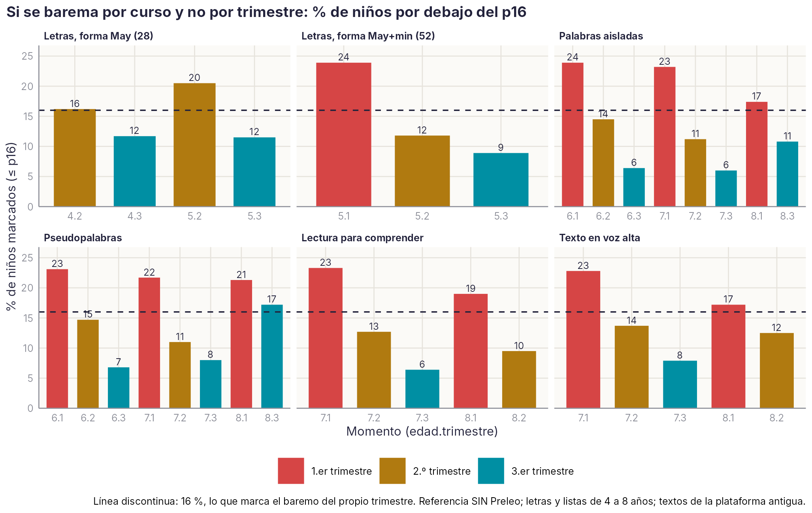

# Norms by school year or by term

```{r}
#| include: false
source(file.path(dirname(knitr::current_input(dir = TRUE)), "R", "libro.R"))
TAREA <- c("Lectura para comprender" = "Reading for comprehension", "Letras, forma May (28)" = "Letters, uppercase form (28)",
           "Letras, forma May+min (52)" = "Letters, upper and lowercase form (52)", "Palabras aisladas" = "Isolated words",
           "Pseudopalabras" = "Pseudowords", "Texto en voz alta" = "Text read aloud")
```

::: {.callout-note appearance="minimal"}
*Translated from the Spanish version of November 28, 2026. The figure has labels in Spanish.*
:::

**Question.** Are norms by school year enough, or are norms needed for each term? Between ages 4 and 7 children progress a great deal in a few months, and single norms for the school year would compare a child assessed in November with one assessed in May.

**How it was checked.** For each task and school year with at least two terms with 100 children from the reference sample, the percentage of children falling below the 16th percentile with single norms for the school year was computed. With the norms for their own term, that percentage is, by construction, 16%.

{#fig-trimestre}

```{r}
#| label: tbl-trimestre
#| tbl-cap: "Summary by task and school year: range of the percentage flagged with norms by school year, children reclassified and progress within the school year (d between the first and the last term)."
r <- leer("GEN_trimestre", "1_Resumen")
r$tarea <- ifelse(r$tarea %in% names(TAREA), TAREA[r$tarea], r$tarea)
r$rango_p16_baremo_curso <- sub(" %", "%", r$rango_p16_baremo_curso)
tabla(r, c("Task", "School year (age)", "% ≤ P16 with norms by school year", "% reclassified", "d first–last term"))
```

**Result.** With norms by school year, more children than expected are flagged in the first term (up to 22–24% between ages 5 and 7) and fewer in the last (6–9%). Within a school year, children progress between 0.7 and 0.9 SD from ages 5 to 7, and only 0.2–0.4 at age 8.

**Proposal [D].** Norm by school year and term at least up to age 7. From age 8, norms by school year are acceptable.

Script: `analisis` → `baremo_trimestre_vs_curso.R` (on the project computer). Tables: `datos/agregados/GEN_trimestre/`.
