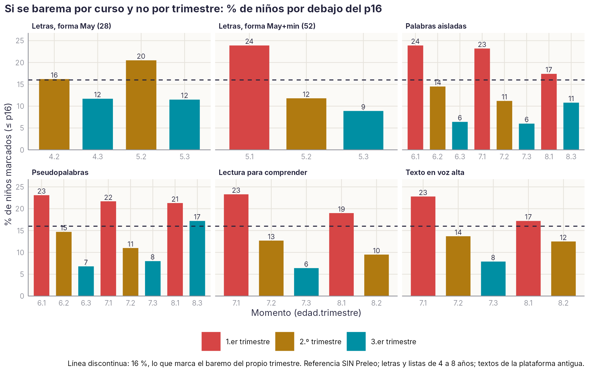

# Baremo por curso o por trimestre

```{r}
#| include: false
source(file.path(dirname(knitr::current_input(dir = TRUE)), "R", "libro.R"))
```

**Pregunta.** ¿Basta con un baremo por curso o hace falta uno por cada trimestre? Entre los 4 y los 7 años los niños avanzan mucho en pocos meses, y un baremo único por curso compararía a un niño de noviembre con otro de mayo.

**Cómo se ha comprobado.** Para cada tarea y curso con al menos dos trimestres con 100 niños de la muestra de referencia, se calculó qué porcentaje de niños queda por debajo del percentil 16 con un baremo único del curso. Con el baremo de su propio trimestre ese porcentaje es, por construcción, del 16 %.

{#fig-trimestre}

```{r}
#| label: tbl-trimestre
#| tbl-cap: "Resumen por tarea y curso: rango del porcentaje marcado con baremo por curso, niños reclasificados y avance dentro del curso (d entre el primer y el último trimestre)."
r <- leer("GEN_trimestre", "1_Resumen")
tabla(r, c("Tarea", "Curso (edad)", "% ≤ p16 con baremo por curso", "% reclasificados", "d primer–último trimestre"))
```

**Resultado.** Con un baremo por curso, en el primer trimestre se marca a más niños de los esperados (hasta un 22–24 % entre los 5 y los 7 años) y en el último a menos (6–9 %). Dentro de un mismo curso, los niños avanzan entre 0,7 y 0,9 DT de los 5 a los 7 años, y solo 0,2–0,4 a los 8.

**Propuesta [D].** Baremar por curso y trimestre al menos hasta los 7 años. A partir de los 8 años un baremo por curso es aceptable.

Script: `analisis` → `baremo_trimestre_vs_curso.R` (en el PC del proyecto). Tablas: `datos/agregados/GEN_trimestre/`.
