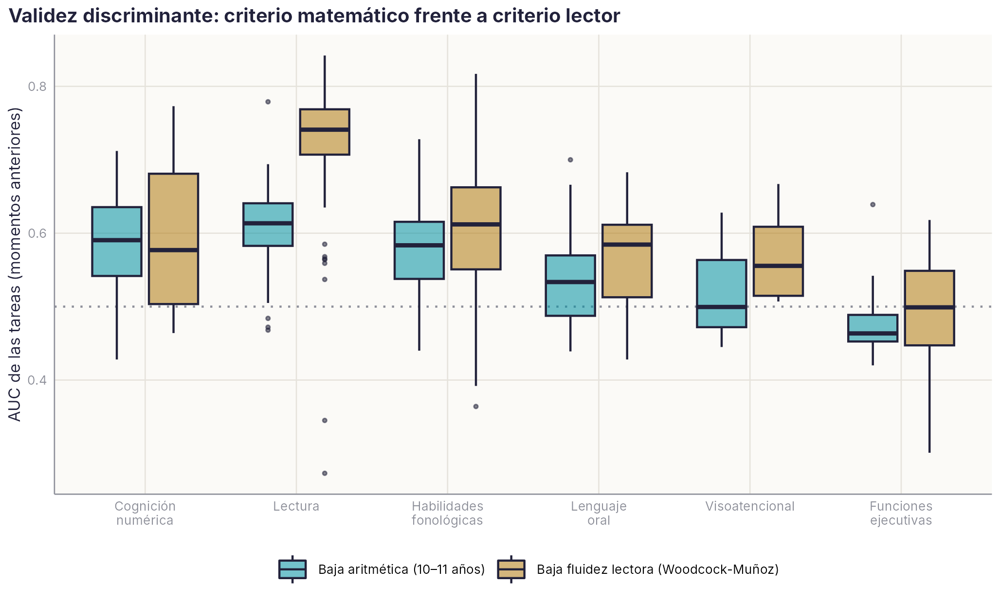

# Numerical cognition {#sec-matematicas}

```{r}
#| include: false
source(file.path(dirname(knitr::current_input(dir = TRUE)), "R", "libro.R"))
C <- utils::read.csv(file.path(raiz_libro(), "datos", "agregados", "CATALOGO", "Catalogo.csv"), encoding = "UTF-8", check.names = FALSE, stringsAsFactors = FALSE)
M <- C[C$dominio == "MATE", ]
PRO <- c(ARITMETICA = "Arithmetic", CONTAR = "Number sequence", ET_VERB = "Verbal and Arabic code", SEN_NUM = "Number sense (magnitudes)")
K1 <- leer("MATE_CRITERIO", "1_Criterio_por_cohorte"); KV <- leer("MATE_CRITERIO", "2a_Validez_tarea_momento")
KR <- leer("MATE_CRITERIO", "2b_Resumen_por_tarea"); KD <- leer("MATE_CRITERIO", "3a_Discriminante_dominio")
KC <- leer("MATE_CRITERIO", "4_Comorbilidad")
DOM <- c(LECTURA = "Reading", HFON = "Phonological skills", L_ORAL = "Oral language", MATE = "Numerical cognition", HVIS = "Visual-attentional",
         F_EJEC = "Executive functions", INTELIGENCIA = "Reasoning", ESCRITURA = "Spelling and writing", EXPERIMENTO = "Experimental")
kd <- function(d, col) KD[[col]][KD$dominio == d]
kv <- function(t, m, col = "AUC_mate") KV[[col]][KV$tarea_canonica == t & KV$mom == m]
p_rdc <- sum(K1$N_con_magnitudes * K1$pct_riesgo_discalculia) / sum(K1$N_con_magnitudes)
nombre_en <- function(tc, es) { en <- C$name_en[match(tc, C$tarea_canonica)]; ifelse(!is.na(en) & nzchar(en), en, es) }
```

::: {.callout-note appearance="minimal"}
**Status:** draft of October 21, 2026, with a theoretical framework added on November 8, 2026, based on the teaching materials of J. L. Luque Vilaseca's course (Speech-language intervention in written language disorders and dyscalculia, University of Málaga), which he shared with P. J. López-Pérez together with much of the documentation of the platform and Preleo. The group decided to include the mathematics tasks in the manual. This chapter opens their task sheets: it brings together what exists, validity against a later criterion and what is missing. It builds on the published article on the comorbidity between dyslexia and dyscalculia with platform data [@loredo2025prevalencia]. Criterion script: `scripts/R/criterio_matematicas.R`. *Translated from the Spanish version of November 28, 2026. The figure has labels in Spanish.*
:::

## Theoretical framework: learning mathematics and dyscalculia {#sec-mate-marco}

### What dyscalculia is

Developmental dyscalculia is a neurodevelopmental disorder that specifically and persistently affects mathematics learning, especially understanding quantities, counting and calculation, despite adequate schooling and average intelligence. The DSM-5-TR includes it as specific learning disorder with impairment in mathematics [@apa2022dsm5tr], and ICD-11 as developmental learning disorder with impairment in mathematics [@oms2019cie11]. It affects 3 to 7% of schoolchildren, a proportion similar to that of dyslexia, and its consequences are at least as serious, although it receives much less attention [@butterworth2011dyscalculia].

Like dyslexia, it is **dimensional**: it is the low end of a continuum of ability, and the same genes that influence normal differences in mathematics influence the disorder [@kovas2007genetic]. It also **persists** into adulthood if there is no intervention.

### Number sense

The foundation is **number sense**: the ability, present even in infants, to perceive and compare quantities approximately. It shows in three phenomena:

- **Subitizing:** up to three or four items are perceived at a glance, without counting.
- **Distance effect:** it is easier to decide which of two numbers is larger the further apart they are (8 vs. 2 is easier than 8 vs. 7).
- **Mental number line:** numbers are represented in space, from smaller to larger. At first that line is compressed (distances between large numbers seem smaller) and with instruction it becomes linear. Accuracy in placing numbers on a line predicts later mathematics achievement [@booth2006estimation].

The **triple-code** model distinguishes three formats of number, with partly different brain circuits: **magnitude**, in the intraparietal sulcus of both hemispheres; the **verbal code** (number words and memorized arithmetic facts), in the left angular gyrus; and the **Arabic code** (digits) [@dehaene2003parietal].

### How it develops

The model of von Aster and Shalev [-@vonaster2007number] describes four linked steps, each building on the previous one and with greater working memory demands:

1. **Magnitude system:** concrete quantities, subitizing and comparison (from infancy).
2. **Verbal system:** counting with number words, counting strategies and fact retrieval (preschool).
3. **Arabic system:** digits, written calculation (school).
4. **Mental number line:** ordinality, approximate calculation and arithmetic reasoning (school).

To **count** correctly, five principles must be mastered: one-to-one correspondence, stable order, cardinality (the last number said is the total), abstraction and order irrelevance [@gelman1978number]. With practice, calculation moves from **counting all** (2 + 3: "one, two, three, four, five") to **counting on from the larger** ("three, four, five"), to decomposing and, finally, to **retrieving** the result from memory.

### What fails in dyscalculia

Children with dyscalculia use immature calculation strategies for longer and have difficulty retrieving arithmetic facts from memory [@geary2004math]. The difficulties cluster along four axes:

- **Magnitude representation:** comparing quantities and placing numbers on the line is slower and less precise. For many authors this is the core deficit, which spreads to the following steps [@vonaster2007number; @butterworth2011dyscalculia].
- **Counting:** the principles are mastered later and finger counting persists longer.
- **Memory for number facts:** few results become automatic, partly because frequent errors give few opportunities to practice the correct one.
- **Working memory and attention:** errors in holding numbers while operating, and more errors the more operations are carried out at once.

The proposed subtypes (procedural, semantic memory, visuospatial and number sense) have not been confirmed as clearly separate categories [@geary2004math]. As with dyslexia, the most accepted explanation is **multilevel**: genetic factors, development of the intraparietal sulcus and its connections, a deficit in the representation of quantities and, finally, difficulties in calculation and problem solving [@butterworth2011dyscalculia].

### Dyslexia and dyscalculia together

The two difficulties co-occur more than would be expected by chance. They share risk factors, such as rapid naming and verbal memory, which affect arithmetic facts memorized in verbal format, and each also has its own factors: phonological awareness in reading and magnitude representation in mathematics [@koponen2013counting]. That is why the same screening can look for both. The platform data on this comorbidity are below.

### From theory to the platform

| Component | Step of the model | Platform tasks | What to look at |
|---|---|---|---|
| Magnitude | 1 | Magnitude comparison with dots and with digits | Accuracy and time; distance effect |
| Verbal sequence and counting | 2 | Counting forward and backward | Whether the child stops or skips numbers; which ten they reach |
| Arabic code | 3 | Reading numbers (verbal and Arabic code) | Transcoding errors (e.g., "one hundred and five" written as 1005) |
| Number line | 4 | Mental line (1745; not a comparison task) | Accuracy of placement |
| Facts and procedures | 2–4 | One- to three-digit addition and subtraction, timed | Correct per minute; type of strategy (by observation) |
| Domain-general factors | — | Rapid naming, verbal memory, attention | Whether they explain the difficulty together with, or instead of, magnitude |

As an external test to validate the tasks, the closest reference is the **BERDE** battery (a battery for the rapid assessment of developmental dyscalculia) of the Numerical Cognition Laboratory at the University of Málaga, for ages 5 to 12, with modules on quantity representation, verbal-numerical tasks, number dictation and a mathematics anxiety questionnaire (see "What is missing" below). For intervention, the evidence supports intensive, adaptive work on magnitude and its link with symbols, as in the program *The Number Race* [@wilson2006numberrace].

## What the platform measures

The platform has `r nrow(M)` numerical cognition tasks, from age 4 to 11, grouped into four processes:

- **Number sequence**: counting forward and backward.
- **Verbal and Arabic code**: reading numbers.
- **Number sense**: comparing magnitudes, with dots or with digits.
- **Arithmetic**: addition and subtraction, from one to three digits.

```{r}
#| label: tbl-mate-inventario
#| tbl-cap: "Numerical cognition tasks on the platform. Quality class according to the rules in the chapter \"Limitations and data quality\"."
M <- M[order(match(M$proceso, names(PRO)), M$edades), ]
T <- data.frame(Process = unname(PRO[M$proceso]), Task = nombre_en(M$tarea_canonica, M$tarea), Codes = M$codigos, Ages = M$edades, Items = M$n_items,
                `α 2021` = M$alfa_2021, `Max. N per session` = M$N_max_sesion, Class = M$clase, check.names = FALSE)
tabla(T, digitos = 2)
```

Today only `r sum(M$clase == "A")` tasks are class A: counting forward and backward and reading Arabic numerals, all at ages 4 to 5. Their task sheets follow this chapter. The others do not reach class A for one of three reasons:

- **They were given in one or two sessions**, so there is no stability across time points.
- **They have no α**, because item-level responses were missing from the 2021 analysis. The new platform does store them.
- **They mix versions.** Symbolic magnitude comparison brings together three versions with different content and numbers of items: the Grade 1 version (2006), the 2021/22 version at ages 10–11, with 62 items of one to three digits (10747), and the 2021/22 version at ages 6–9 (10750). They need to be separated before norming. The same happens with code 10759, which the dictionary assigns to two tasks.

### How they are programmed on the platform {.unnumbered}

```{r}
#| results: asis
plataforma_tabla(codigos = c(1707, 2029, 2030, 2031, 2032, 1676, 1744, 10752, 2006, 10750, 10747, 2005, 10759, 10760, 2258, 10751, 10753, 10748, 1745))
plataforma_capturas(c(1707, 2029, 2030, 2031, 2032, 1676, 1744, 10752, 1745, 2006, 10750, 10747, 2005, 2258, 10759, 10760, 10751, 10753, 10748), pre = "", ncol = 4)
```

With the configuration in view, three things become apparent that should be kept in mind when analyzing these tasks:

- **The response format changes.** At ages 5–6 the child solves the operation and the examiner marks correct or incorrect (2005). In the 2021/22 versions (107xx) the child sees the operation already solved and decides whether the result is correct (verification), with a time limit and no examiner. They do not measure the same thing: verification allows responses based on familiarity with the result.
- **Timed tasks are scored by efficiency**, so the number of items in the activity is a ceiling, not the actual length of the test.
- **The "mental line" (1745) is a different task**: estimating on a number line, not comparing magnitudes. It needs to be separated from non-symbolic magnitudes in the dictionary.

## What is already known from these data

**Phonological skills and mathematical development.** The group has an ongoing longitudinal study on the relation between phonological awareness, rapid naming and mathematics from ages 5 to 7. Its results will be incorporated here once published.

**Risk of dyslexia, of dyscalculia and their comorbidity** [@loredo2025prevalencia]. With 691 students in Grades 5 and 6 assessed in 2021/22, on tablets:

- risk of dyscalculia is defined as being at −1 SD or below in symbolic magnitude comparison and in arithmetic;
- risk of dyslexia, as being at −1 SD or below in lexical decision and Woodcock-Muñoz reading fluency;
- prevalence is 8.5% for dyslexia, 4.2% for dyscalculia and 2.0% for both;
- comorbidity exceeds what is expected by chance and is asymmetric: half of the children at risk of dyscalculia also have reading difficulties.

## Validity against arithmetic at ages 10–11 {#sec-mate-criterio}

For reading, the manual has an external criterion, Woodcock-Muñoz fluency ([chapter](criterio-woodcock.en.qmd)). For mathematics there is neither an external test nor school grades. The provisional criterion is **arithmetic at ages 10–11**: two-digit addition and subtraction, in the 2021/22 session, 2010 and 2011 cohorts (`r num_es(sum(K1$N), 0)` children). It is the same task used in the definition of dyscalculia risk by Loredo et al. "Low arithmetic" means being at −1 SD or below the mean of one's cohort (`r num_es(mean(K1$pct_baja_aritmetica), 0)`% of the sample). With the definition of Loredo et al. (low in arithmetic and in symbolic magnitudes), the risk of dyscalculia is `r num_es(p_rdc, 1)`%, very close to the published 4.2%.

Each earlier task from the same children is compared with two criteria: low arithmetic and low reading fluency. If the tasks have **discriminant validity**, the numerical ones should predict mathematics better and the reading ones, reading.

{#fig-mate-discr width=100%}

```{r}
#| label: tbl-mate-discr
#| tbl-cap: "Median AUC by domain against the two criteria (2010 and 2011 cohorts; tasks with at least 80 children and 8 cases)."
T <- KD[KD$dominio %in% c("MATE", "LECTURA", "HFON", "L_ORAL", "HVIS", "F_EJEC"), c("dominio", "tareas", "tarea_momentos", "AUC_mate", "AUC_lectura")]
T$dominio <- unname(DOM[T$dominio]); rownames(T) <- NULL
tabla(T, c("Domain", "Tasks", "Task × time point", "AUC against low arithmetic", "AUC against low reading fluency"), digitos = 2)
```

**What the data say:**

- **Reading has discriminant validity; mathematics does not yet.** Reading tasks predict low reading fluency much better (median AUC `r num_es(kd("LECTURA", "AUC_lectura"), 2)`) than low arithmetic (`r num_es(kd("LECTURA", "AUC_mate"), 2)`). Numerical tasks predict low arithmetic barely as well as low reading (`r num_es(kd("MATE", "AUC_mate"), 2)` vs. `r num_es(kd("MATE", "AUC_lectura"), 2)`), and no better than the reading tasks.
- **Some numerical tasks are specific.** Counting backward in the second ten at age 5 predicts low arithmetic (AUC `r num_es(kv("MATE_CONTAR_H_ATRAS_2A_DECENA", "5.3"), 2)`) and not low reading (`r num_es(kv("MATE_CONTAR_H_ATRAS_2A_DECENA", "5.3", "AUC_lectura"), 2)`). Counting from 1 to 10 and non-symbolic magnitude comparison at age 4 show the same, weaker pattern. Single-digit addition at age 6 is the best numerical predictor (`r num_es(kv("MATE_ARITMETIC_SUMA_1_DIGITO", "6.2"), 2)`), but it predicts reading equally well or better.
- **Comorbidity appears here too.** Of the `r KC$n` children with both criteria, `r KC$ambas` have low arithmetic and low fluency at the same time, whereas `r num_es(KC$esperado_azar, 0)` would be expected by chance. `r num_es(KC$pct_lectura_entre_bajos_arit, 0)`% of children with low arithmetic also have low reading fluency. With the stricter definition of Loredo et al., that proportion rises to half.

**Why the criterion is weak.** There are three reasons, and all three point to the criterion more than to the tasks:

- it is a single, timed task, group-administered on tablets, with no known reliability in that administration;
- arithmetic at age 11 is very far from the preschool tasks: what is required changes in between (mental calculation, written procedures), so it is a distant criterion;
- timed addition and subtraction also require processing speed and number reading, which it shares with reading.

Testing a composite criterion (arithmetic + symbolic magnitudes) did not change the results.

```{r}
#| label: tbl-mate-tareas
#| tbl-cap: "The 12 tasks that best predict low arithmetic at ages 10–11, with their AUC against low reading fluency for comparison."
T <- head(KR[!is.na(KR$dominio), c("tarea_canonica", "tarea", "dominio", "clase", "momentos", "AUC_mate_mediana", "AUC_mate_max", "momento_max", "AUC_lectura_mediana")], 12)
T$tarea <- nombre_en(T$tarea_canonica, T$tarea); T$tarea_canonica <- NULL
T$dominio <- unname(DOM[T$dominio]); rownames(T) <- NULL
tabla(T, c("Task", "Domain", "Class", "Time points", "Median AUC (arithmetic)", "Maximum AUC", "Time point of maximum", "Median AUC (reading)"), digitos = 2)
```

## What is missing for them to enter the manual with full task sheets

1. **Separate the versions** of symbolic magnitudes and of the codes with two tasks (10759).
2. **Compute α or ω** with the item-level responses of the new platform (2018 onwards), especially for the 2021/22 tasks.
3. **Improve the validity criterion.** Arithmetic at ages 10–11 remains a provisional criterion. There are two ways to get a better one:
    - a closer criterion: arithmetic and magnitudes at ages 6–7;
    - an external mathematics test in a subsample, for example the BERDE battery once it is digitized.
4. **Task sheets by family.** The counting and number-reading tasks are accuracy tasks (family A). Magnitude comparison is decision with response time (family E). Timed addition and subtraction are efficiency tasks and need their own score (correct in 1 minute).
5. **Coordinate with the BERDE battery** (rapid assessment of dyscalculia), so that the platform tasks and those of BERDE share names and criteria.
