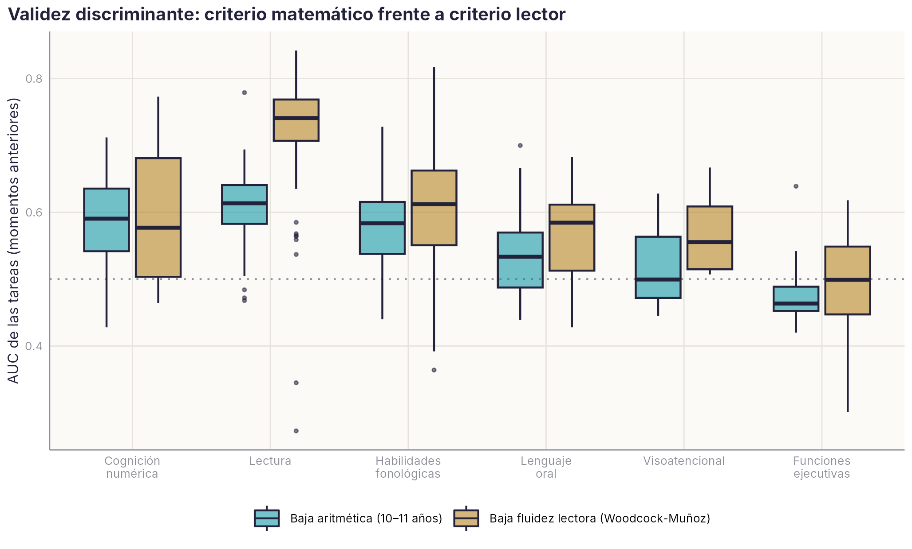

# Cognición numérica {#sec-matematicas}

```{r}
#| include: false
source(file.path(dirname(knitr::current_input(dir = TRUE)), "R", "libro.R"))
C <- utils::read.csv(file.path(raiz_libro(), "datos", "agregados", "CATALOGO", "Catalogo.csv"), encoding = "UTF-8", check.names = FALSE, stringsAsFactors = FALSE)
M <- C[C$dominio == "MATE", ]
PRO <- c(ARITMETICA = "Aritmética", CONTAR = "Secuencia numérica", ET_VERB = "Código verbal y arábigo", SEN_NUM = "Sentido numérico (magnitudes)")
K1 <- leer("MATE_CRITERIO", "1_Criterio_por_cohorte"); KV <- leer("MATE_CRITERIO", "2a_Validez_tarea_momento")
KR <- leer("MATE_CRITERIO", "2b_Resumen_por_tarea"); KD <- leer("MATE_CRITERIO", "3a_Discriminante_dominio")
KC <- leer("MATE_CRITERIO", "4_Comorbilidad")
DOM <- c(LECTURA = "Lectura", HFON = "Habilidades fonológicas", L_ORAL = "Lenguaje oral", MATE = "Cognición numérica", HVIS = "Visoatencional",
         F_EJEC = "Funciones ejecutivas", INTELIGENCIA = "Razonamiento", ESCRITURA = "Escritura", EXPERIMENTO = "Experimentales")
kd <- function(d, col) KD[[col]][KD$dominio == d]
kv <- function(t, m, col = "AUC_mate") KV[[col]][KV$tarea_canonica == t & KV$mom == m]
p_rdc <- sum(K1$N_con_magnitudes * K1$pct_riesgo_discalculia) / sum(K1$N_con_magnitudes)
```

::: {.callout-note appearance="minimal"}
**Estado:** borrador del 21/10/2026. El grupo decidió incluir las tareas de matemáticas en el manual. Este capítulo abre sus fichas: reúne lo que hay, la validez frente a un criterio posterior y lo que falta. Se apoya en el artículo publicado sobre la comorbilidad entre dislexia y discalculia con datos de la plataforma [@loredo2025prevalencia]. Guion del criterio: `scripts/R/criterio_matematicas.R`.
:::

## Qué mide la plataforma

La plataforma tiene `r nrow(M)` tareas de cognición numérica, de 4 a 11 años, agrupadas en cuatro procesos:

- **Secuencia numérica**: contar hacia delante y hacia atrás.
- **Código verbal y arábigo**: leer números.
- **Sentido numérico**: comparar magnitudes, con puntos o con cifras.
- **Aritmética**: sumas y restas, de un dígito a tres.

```{r}
#| label: tbl-mate-inventario
#| tbl-cap: "Tareas de cognición numérica de la plataforma. Clase de calidad según las reglas del capítulo «Límites y calidad de los datos»."
M <- M[order(match(M$proceso, names(PRO)), M$edades), ]
T <- data.frame(Proceso = unname(PRO[M$proceso]), Tarea = M$tarea, Códigos = M$codigos, Edades = M$edades, Ítems = M$n_items,
                `α 2021` = M$alfa_2021, `N máx. por sesión` = M$N_max_sesion, Clase = M$clase, check.names = FALSE)
tabla(T, digitos = 2)
```

Hoy solo `r sum(M$clase == "A")` tareas son de clase A: contar hacia delante y hacia atrás y leer números arábigos, todas de 4 a 5 años. Sus fichas siguen a este capítulo. Las demás no llegan a la clase A por una de tres razones:

- **Se aplicaron en una o dos sesiones**, así que no hay estabilidad entre momentos.
- **No tienen α**, porque faltan las respuestas ítem a ítem en el análisis de 2021. La plataforma nueva sí las guarda.
- **Mezclan versiones.** La comparación de magnitudes simbólicas reúne tres versiones con contenido y número de ítems distintos: la de 1.º de Primaria (2006), la de 2021/22 a los 10–11 años, con 62 ítems de una a tres cifras (10747), y la de 2021/22 a los 6–9 años (10750). Hay que separarlas antes de baremarlas. Lo mismo ocurre con el código 10759, que el diccionario asigna a dos tareas.

### Cómo están programadas en la plataforma {.unnumbered}

```{r}
#| results: asis
plataforma_tabla(codigos = c(1707, 2029, 2030, 2031, 2032, 1676, 1744, 10752, 2006, 10750, 10747, 2005, 10759, 10760, 2258, 10751, 10753, 10748, 1745))
```

Con la configuración a la vista se ven tres cosas que conviene tener en cuenta al analizar estas tareas:

- **Cambia el formato de respuesta.** A los 5–6 años el niño resuelve la operación y el evaluador marca acierto o error (2005). En las versiones de 2021/22 (107xx) el niño ve la operación ya resuelta y decide si el resultado es correcto (verificación), con tiempo límite y sin evaluador. No miden lo mismo: la verificación admite respuestas por familiaridad con el resultado.
- **Las tareas con tiempo límite se puntúan por eficiencia**, así que el número de ítems de la actividad es un techo, no la longitud real de la prueba.
- **La «línea mental» (1745) es otra tarea**: estimar en una línea numérica, no comparar magnitudes. Hay que separarla de las magnitudes no simbólicas en el diccionario.

## Lo que ya se sabe con estos datos

**Habilidades fonológicas y desarrollo matemático.** El grupo tiene en curso un estudio longitudinal sobre la relación entre la conciencia fonológica, la denominación rápida y las matemáticas de 5 a 7 años. Sus resultados se incorporarán aquí cuando estén publicados.

**Riesgo de dislexia, de discalculia y su comorbilidad** [@loredo2025prevalencia]. Con 691 alumnos de 5.º y 6.º evaluados en 2021/22, en tableta:

- el riesgo de discalculia se define como estar a −1 DT o por debajo en comparación de magnitudes simbólicas y en aritmética;
- el riesgo de dislexia, a −1 DT o por debajo en decisión léxica y en fluidez lectora de Woodcock-Muñoz;
- la prevalencia es del 8,5 % para la dislexia, del 4,2 % para la discalculia y del 2,0 % para ambas;
- la comorbilidad supera lo esperado por azar y es asimétrica: la mitad de los niños con riesgo de discalculia tiene también dificultades lectoras.

## Validez frente a la aritmética de 10–11 años {#sec-mate-criterio}

Para la lectura, el manual tiene un criterio externo, la fluidez de Woodcock-Muñoz ([capítulo](criterio-woodcock.qmd)). Para las matemáticas no hay prueba externa ni notas escolares. El criterio provisional es la **aritmética de 10–11 años**: sumas y restas de dos cifras, en la sesión de 2021/22, cohortes 2010 y 2011 (`r num_es(sum(K1$N), 0)` niños). Es la misma tarea que usa la definición de riesgo de discalculia de Loredo et al. «Baja aritmética» es estar a −1 DT o por debajo de la media de su cohorte (el `r num_es(mean(K1$pct_baja_aritmetica), 0)` % de la muestra). Con la definición de Loredo et al. (baja en aritmética y en magnitudes simbólicas), el riesgo de discalculia es del `r num_es(p_rdc, 1)` %, muy cerca del 4,2 % publicado.

Cada tarea anterior de los mismos niños se compara con dos criterios: la baja aritmética y la baja fluidez lectora. Si las tareas tienen **validez discriminante**, las numéricas deberían predecir mejor las matemáticas y las lectoras, mejor la lectura.

{#fig-mate-discr width=100%}

```{r}
#| label: tbl-mate-discr
#| tbl-cap: "AUC mediano por dominio frente a los dos criterios (cohortes 2010 y 2011; tareas con al menos 80 niños y 8 casos)."
T <- KD[KD$dominio %in% c("MATE", "LECTURA", "HFON", "L_ORAL", "HVIS", "F_EJEC"), c("dominio", "tareas", "tarea_momentos", "AUC_mate", "AUC_lectura")]
T$dominio <- unname(DOM[T$dominio]); rownames(T) <- NULL
tabla(T, c("Dominio", "Tareas", "Tarea × momento", "AUC frente a baja aritmética", "AUC frente a baja fluidez lectora"), digitos = 2)
```

**Lo que dicen los datos:**

- **La lectura tiene validez discriminante; las matemáticas, todavía no.** Las tareas de lectura predicen mucho mejor la baja fluidez lectora (AUC mediano `r num_es(kd("LECTURA", "AUC_lectura"), 2)`) que la baja aritmética (`r num_es(kd("LECTURA", "AUC_mate"), 2)`). Las tareas numéricas predicen la baja aritmética apenas igual que la lectora (`r num_es(kd("MATE", "AUC_mate"), 2)` frente a `r num_es(kd("MATE", "AUC_lectura"), 2)`), y no mejor que las de lectura.
- **Algunas tareas numéricas sí son específicas.** Contar hacia atrás en la segunda decena a los 5 años predice la baja aritmética (AUC `r num_es(kv("MATE_CONTAR_H_ATRAS_2A_DECENA", "5.3"), 2)`) y no la lectora (`r num_es(kv("MATE_CONTAR_H_ATRAS_2A_DECENA", "5.3", "AUC_lectura"), 2)`). Contar del 1 al 10 y la comparación de magnitudes no simbólicas a los 4 años muestran el mismo patrón, más débil. Las sumas de un dígito a los 6 años son el mejor predictor numérico (`r num_es(kv("MATE_ARITMETIC_SUMA_1_DIGITO", "6.2"), 2)`), pero predicen igual o mejor la lectura.
- **La comorbilidad aparece también aquí.** De los `r KC$n` niños con los dos criterios, `r KC$ambas` tienen baja aritmética y baja fluidez a la vez, cuando por azar se esperarían `r num_es(KC$esperado_azar, 0)`. El `r num_es(KC$pct_lectura_entre_bajos_arit, 0)` % de los niños con baja aritmética tiene también baja fluidez lectora. Con la definición más estricta de Loredo et al., esa proporción sube a la mitad.

**Por qué el criterio es débil.** Hay tres razones, y las tres apuntan al criterio más que a las tareas:

- es una sola tarea, de tiempo limitado y aplicada en tableta de forma colectiva, sin fiabilidad conocida en esa aplicación;
- la aritmética de 11 años está muy lejos de las tareas de Infantil: entre medias cambia lo que se exige (cálculo mental, procedimientos escritos), así que es un criterio lejano;
- sumar y restar con tiempo exige también velocidad de procesamiento y lectura de números, que comparte con la lectura.

Probar un criterio compuesto (aritmética + magnitudes simbólicas) no cambió los resultados.

```{r}
#| label: tbl-mate-tareas
#| tbl-cap: "Las 12 tareas que mejor predicen la baja aritmética de 10–11 años, con su AUC frente a la baja fluidez lectora para comparar."
T <- head(KR[!is.na(KR$dominio), c("tarea", "dominio", "clase", "momentos", "AUC_mate_mediana", "AUC_mate_max", "momento_max", "AUC_lectura_mediana")], 12)
T$dominio <- unname(DOM[T$dominio]); rownames(T) <- NULL
tabla(T, c("Tarea", "Dominio", "Clase", "Momentos", "AUC mediano (aritmética)", "AUC máximo", "Momento del máximo", "AUC mediano (lectura)"), digitos = 2)
```

## Qué falta para que entren en el manual con ficha completa

1. **Separar las versiones** de magnitudes simbólicas y de los códigos con dos tareas (10759).
2. **Calcular α u ω** con las respuestas ítem a ítem de la plataforma nueva (2018 en adelante), en especial para las tareas de 2021/22.
3. **Mejorar el criterio de validez.** La aritmética de 10–11 años queda como criterio provisional. Para tener uno mejor hay dos vías:
    - un criterio más cercano: la aritmética y las magnitudes de 6–7 años;
    - una prueba externa de matemáticas en una submuestra, por ejemplo la batería BERDE cuando esté digitalizada.
4. **Fichas por familia.** Las tareas de contar y leer números son de precisión (familia A). La comparación de magnitudes es de decisión con tiempo (familia E). Las sumas y restas con tiempo limitado son de eficiencia y necesitan su propia puntuación (aciertos en 1 minuto).
5. **Coordinar con la batería BERDE** (evaluación rápida de discalculia), para que las tareas de la plataforma y las de BERDE compartan nombres y criterios.
