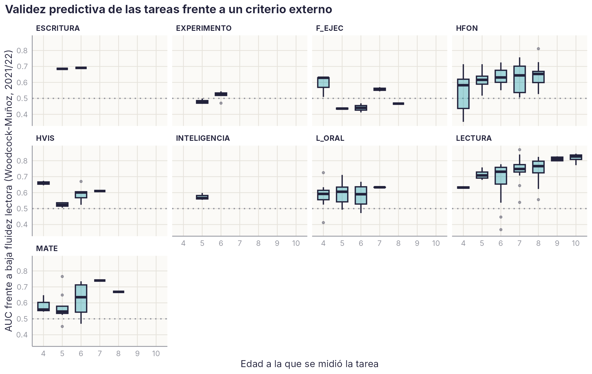

# Validity against an external criterion: Woodcock-Muñoz reading fluency {#sec-woodcock}

```{r}
#| include: false
source(file.path(dirname(knitr::current_input(dir = TRUE)), "R", "libro.R"))
D1 <- leer("WOODCOCK", "1_Descriptivos_por_edad"); V <- leer("WOODCOCK", "2a_Validez_tarea_momento")
VR <- leer("WOODCOCK", "2b_Resumen_por_tarea"); VD <- leer("WOODCOCK", "2c_Por_dominio_y_edad")
E3 <- leer("WOODCOCK", "3a_Etiqueta_DL_y_Woodcock"); E3b <- leer("WOODCOCK", "3b_Etiqueta_DL_como_prueba")
DOM <- c(LECTURA = "Reading", HFON = "Phonological skills", L_ORAL = "Oral language", MATE = "Numerical cognition", HVIS = "Visual-attentional",
         F_EJEC = "Executive functions", INTELIGENCIA = "Reasoning", ESCRITURA = "Spelling and writing", EXPERIMENTO = "Experimental")
lec <- VD[VD$dominio == "LECTURA", ]
CAT <- utils::read.csv(file.path(raiz_libro(), "datos", "agregados", "CATALOGO", "Catalogo.csv"), encoding = "UTF-8", stringsAsFactors = FALSE)
nombre_en <- function(tc, es) { en <- CAT$name_en[match(tc, CAT$tarea_canonica)]; ifelse(!is.na(en) & nzchar(en), en, es) }
```

::: {.callout-note appearance="minimal"}
**Status:** analysis of October 21, 2026. Script `scripts/R/criterio_woodcock.R`; output `criterio_woodcock_R_v1.xlsx`. The test is commercial: no norms or items are published here, only relations with the platform's tasks. *Translated from the Spanish version of November 28, 2026. The figure has labels in Spanish.*
:::

## What it is and why it matters

In the 2021/22 school year, the platform included the **reading fluency** subtest of the Batería III Woodcock-Muñoz [@munoz2005woodcock]. The child silently reads simple sentences and decides whether they are true or false (for example, "my mother eats buses"), with a 3-minute limit. The score is correct minus errors.

The test was given at the same time to all six cohorts, from age 6 to 11 (`r num_es(sum(D1$N), 0)` children), in group administration on tablets because of pandemic restrictions [@loredo2025prevalencia]. It is the best **external criterion** available to the manual, for three reasons:

- it is a standardized, published test, independent of the platform;
- it measures reading with comprehension, not the decoding with which the persistent difficulty label is built, so validity against it **is not circular**;
- it was administered years after the preschool and early-grade tasks, to the same children.

"Low reading fluency" means being one standard deviation or more below the mean for one's age in our sample (around P16).

## The persistent reading difficulty label, validated

The certainty levels in the chapter [How we estimate risk](riesgo.en.qmd) are built from word, pseudoword and text reading at ages 6 to 8. Woodcock-Muñoz fluency, measured later and with another test, is ordered in exactly the same way:

```{r}
#| label: tbl-wm-etiqueta
#| tbl-cap: "Woodcock-Muñoz reading fluency (2021/22) by certainty level of reading difficulty."
NIV <- c(`DL-A` = "DL-A: severe persistent difficulty", `DL-B` = "DL-B: persistent difficulty", TR = "TR: transient", INT = "INT: intermediate", TE = "TE: stable typical")
T <- data.frame(Level = unname(NIV[E3$etiqueta]), n = E3$n, `Mean (z)` = E3$wz_media, `% with low fluency` = E3$pct_baja, check.names = FALSE)
tabla(T, digitos = 2)
```

`r num_es(E3$pct_baja[E3$etiqueta == "DL-A"], 0)`% of children with severe persistent difficulty (DL-A) have low fluency years later, compared with `r num_es(E3$pct_baja[E3$etiqueta == "TE"], 1)`% of stable typical children. As a test of later low fluency, the DL-A + DL-B label is correct for `r num_es(100 * E3b$esp, 0)`% of children without low fluency (specificity) and detects `r num_es(100 * E3b$sens, 0)`% of those who have it (sensitivity). This is a good result for a label that is closed at age 8.

## Which tasks anticipate reading fluency

For each task and time point, AUC against low fluency in 2021/22, in the same children.

{#fig-wm width=100%}

```{r}
#| label: tbl-wm-dominio
#| tbl-cap: "Median AUC by domain and age of the predictor (tasks with at least 100 children)."
T <- VD[VD$dominio %in% names(DOM), ]; T$dominio <- unname(DOM[T$dominio])
T <- reshape(T[, c("dominio", "edad_pred", "AUC_mediana")], idvar = "dominio", timevar = "edad_pred", direction = "wide")
names(T) <- sub("AUC_mediana\\.", "", names(T)); names(T)[1] <- "Domain"
T <- T[, c("Domain", intersect(as.character(4:10), names(T)))]; names(T)[-1] <- paste("Age", names(T)[-1]); rownames(T) <- NULL
tabla(T, digitos = 2)
```

- **The platform's own reading is the best predictor**, increasingly so with age: median AUC of `r num_es(lec$AUC_mediana[lec$edad_pred == 5], 2)` at age 5, `r num_es(lec$AUC_mediana[lec$edad_pred == 7], 2)` at age 7 and `r num_es(lec$AUC_mediana[lec$edad_pred == 10], 2)` at age 10.
- **Phonological skills** are lower (AUC from .58 to .65), and **oral language** lower still (.59–.63). This fits what Catts, Haynes and Joshi [-@catts2026definicion] say: precursors are useful for early prognosis but lose value once there is reading to measure.
- **Some numerical cognition tasks** anticipate reading fluency as well as the phonological ones, for example single-digit addition at age 6. This is consistent with the comorbidity between dyslexia and dyscalculia [@loredo2025prevalencia].
- Executive function tasks (AUC from .44 to .63, with no pattern by age) and experimental tasks (.48–.53) barely predict.

```{r}
#| label: tbl-wm-tareas
#| tbl-cap: "The 15 tasks with the highest median AUC against later low fluency."
T <- head(VR[order(-VR$AUC_mediana), c("tarea_canonica", "tarea", "dominio", "clase", "momentos", "AUC_mediana", "AUC_max", "momento_max")], 15)
T$tarea <- nombre_en(T$tarea_canonica, T$tarea); T$tarea_canonica <- NULL
T$dominio <- unname(DOM[T$dominio]); rownames(T) <- NULL
tabla(T, c("Task", "Domain", "Class", "Time points", "Median AUC", "Maximum AUC", "Time point of maximum"), digitos = 2)
```

## Concurrent validity in 2021/22

In the same 2021/22 sessions, **lexical decision** tasks ("is this a word?") and **sentence comprehension with homographs** tasks were also given on tablets. Their relation with Woodcock-Muñoz fluency is high (AUC up to .82 for homographs at ages 10–11). This clarifies an earlier data issue: the "too low" 2021/22 scores in word reading were not an error. They were a different task, group lexical decision, which the dictionary had wrongly assigned to reading lists aloud. It has been corrected (`correcciones_tarea_canonica_v2.csv`).

## Caveats

- **Group administration on tablets**, during the pandemic, without an external examiner in most schools. The reliability of the original version is high (.90), but it has not been checked in this administration.
- **A single measurement** per child.
- **Sample loss.** At ages 10–11 fewer children remain from the 2010 and 2011 cohorts, and not at random: those who changed school drop out of the follow-up.
- **No published norms.** The distributions by age are in an internal sheet (`P_Woodcock_NO_PUBLICAR`), for the group's use only.

## What changes in the manual

1. The validity of the reading task sheets will have, in addition to later comprehension, this **non-circular external criterion**. It still needs to be added to the automatic task sheet.
2. The persistent difficulty label now has **external validity evidence**, which should be cited in articles L2 and L3.
3. For the 2021/22 lexical decision and homograph tasks, this chapter is the only source of validity. They have a single session and do not enter class A.
