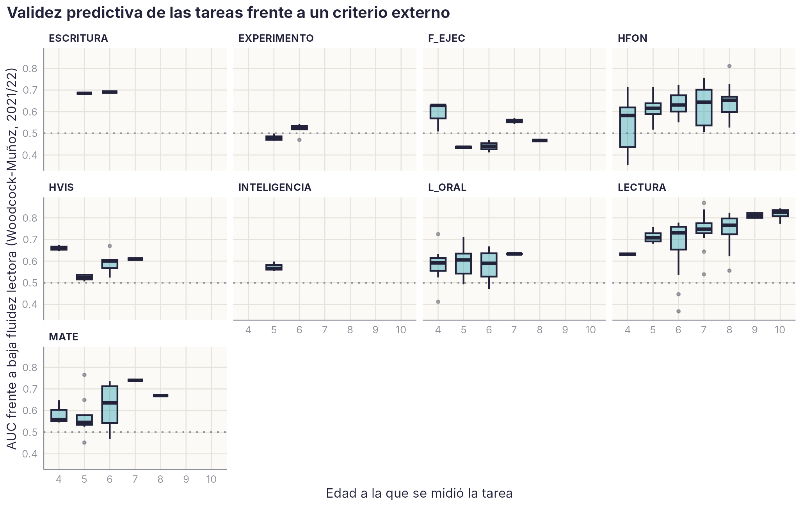

# Validez frente a un criterio externo: la fluidez lectora de la batería Woodcock-Muñoz {#sec-woodcock}

```{r}
#| include: false
source(file.path(dirname(knitr::current_input(dir = TRUE)), "R", "libro.R"))
D1 <- leer("WOODCOCK", "1_Descriptivos_por_edad"); V <- leer("WOODCOCK", "2a_Validez_tarea_momento")
VR <- leer("WOODCOCK", "2b_Resumen_por_tarea"); VD <- leer("WOODCOCK", "2c_Por_dominio_y_edad")
E3 <- leer("WOODCOCK", "3a_Etiqueta_DL_y_Woodcock"); E3b <- leer("WOODCOCK", "3b_Etiqueta_DL_como_prueba")
DOM <- c(LECTURA = "Lectura", HFON = "Habilidades fonológicas", L_ORAL = "Lenguaje oral", MATE = "Cognición numérica", HVIS = "Visoatencional",
         F_EJEC = "Funciones ejecutivas", INTELIGENCIA = "Razonamiento", ESCRITURA = "Escritura", EXPERIMENTO = "Experimentales")
lec <- VD[VD$dominio == "LECTURA", ]
```

::: {.callout-note appearance="minimal"}
**Estado:** análisis del 21/10/2026. Guion `scripts/R/criterio_woodcock.R`; salida `criterio_woodcock_R_v1.xlsx`. La prueba es comercial: aquí no se publican baremos ni ítems, solo relaciones con las tareas de la plataforma.
:::

## Qué es y por qué importa

En el curso 2021/22, la plataforma incluyó la subprueba de **fluidez lectora** de la Batería III Woodcock-Muñoz [@munoz2005woodcock]. El niño lee frases sencillas en silencio y decide si son verdaderas o falsas (por ejemplo, «mi madre come autobuses»), con 3 minutos de límite. La puntuación es aciertos menos errores.

La prueba se aplicó a la vez a las seis cohortes, de 6 a 11 años (`r num_es(sum(D1$N), 0)` niños), en aplicación colectiva con tabletas por las restricciones de la pandemia [@loredo2025prevalencia]. Es el mejor **criterio externo** de que dispone el manual, por tres razones:

- es una prueba estandarizada y publicada, ajena a la plataforma;
- mide lectura con comprensión, no la decodificación con la que se construye la etiqueta de dificultad persistente, así que la validez frente a ella **no es circular**;
- se aplicó años después de las tareas de Infantil y de los primeros cursos, a los mismos niños.

«Baja fluidez lectora» es estar una desviación típica o más por debajo de la media de su edad en nuestra muestra (en torno al P16).

## La etiqueta de dificultad lectora persistente, validada

Los niveles de certeza del capítulo [Cómo estimamos el riesgo](riesgo.qmd) se construyen con la lectura de palabras, pseudopalabras y texto de 6 a 8 años. La fluidez de Woodcock-Muñoz, medida después y con otra prueba, se ordena exactamente igual:

```{r}
#| label: tbl-wm-etiqueta
#| tbl-cap: "Fluidez lectora de Woodcock-Muñoz (2021/22) según el nivel de certeza de dificultad lectora."
NIV <- c(`DL-A` = "DL-A: dificultad persistente grave", `DL-B` = "DL-B: dificultad persistente", TR = "TR: transitoria", INT = "INT: intermedio", TE = "TE: típico estable")
T <- data.frame(Nivel = unname(NIV[E3$etiqueta]), n = E3$n, `Media (z)` = E3$wz_media, `% con baja fluidez` = E3$pct_baja, check.names = FALSE)
tabla(T, digitos = 2)
```

El `r num_es(E3$pct_baja[E3$etiqueta == "DL-A"], 0)` % de los niños con dificultad persistente grave (DL-A) tiene baja fluidez años después, frente al `r num_es(E3$pct_baja[E3$etiqueta == "TE"], 1)` % de los típicos estables. Como prueba de la baja fluidez posterior, la etiqueta DL-A + DL-B acierta en el `r num_es(100 * E3b$esp, 0)` % de los niños sin baja fluidez (especificidad) y detecta al `r num_es(100 * E3b$sens, 0)` % de los que la tienen (sensibilidad). Es un buen resultado para una etiqueta que se cierra a los 8 años.

## Qué tareas anticipan la fluidez lectora

Para cada tarea y momento, AUC frente a la baja fluidez en 2021/22, en los mismos niños.

{#fig-wm width=100%}

```{r}
#| label: tbl-wm-dominio
#| tbl-cap: "Mediana del AUC por dominio y edad del predictor (tareas con al menos 100 niños)."
T <- VD[VD$dominio %in% names(DOM), ]; T$dominio <- unname(DOM[T$dominio])
T <- reshape(T[, c("dominio", "edad_pred", "AUC_mediana")], idvar = "dominio", timevar = "edad_pred", direction = "wide")
names(T) <- sub("AUC_mediana\\.", "", names(T)); names(T)[1] <- "Dominio"
T <- T[, c("Dominio", intersect(as.character(4:10), names(T)))]; names(T)[-1] <- paste(names(T)[-1], "años"); rownames(T) <- NULL
tabla(T, digitos = 2)
```

- **La lectura de la propia plataforma es el mejor predictor**, y cada vez más con la edad: AUC mediano de `r num_es(lec$AUC_mediana[lec$edad_pred == 5], 2)` a los 5 años, `r num_es(lec$AUC_mediana[lec$edad_pred == 7], 2)` a los 7 y `r num_es(lec$AUC_mediana[lec$edad_pred == 10], 2)` a los 10.
- **Las habilidades fonológicas** quedan por debajo (AUC de .58 a .65) y **el lenguaje oral**, más aún (.59–.63). Encaja con lo que dicen Catts, Haynes y Joshi [-@catts2026definicion]: los precursores sirven para el pronóstico temprano, pero pierden valor cuando ya hay lectura que medir.
- **Algunas tareas de cognición numérica** anticipan la fluidez lectora tanto como las fonológicas, por ejemplo las sumas de un dígito a los 6 años. Es coherente con la comorbilidad entre dislexia y discalculia [@loredo2025prevalencia].
- Las tareas de funciones ejecutivas (AUC de .44 a .63, sin pauta por edad) y las experimentales (.48–.53) apenas predicen.

```{r}
#| label: tbl-wm-tareas
#| tbl-cap: "Las 15 tareas con mayor AUC mediano frente a la baja fluidez posterior."
T <- head(VR[order(-VR$AUC_mediana), c("tarea", "dominio", "clase", "momentos", "AUC_mediana", "AUC_max", "momento_max")], 15)
T$dominio <- unname(DOM[T$dominio]); rownames(T) <- NULL
tabla(T, c("Tarea", "Dominio", "Clase", "Momentos", "AUC mediano", "AUC máximo", "Momento del máximo"), digitos = 2)
```

## Validez concurrente en 2021/22

En las mismas sesiones de 2021/22 se aplicaron, también en tableta, tareas de **decisión léxica** («¿esto es una palabra?») y de **comprensión de frases con homógrafos**. Su relación con la fluidez de Woodcock-Muñoz es alta (AUC hasta .82 en homógrafos a los 10–11 años). Esto aclara una incidencia anterior: las puntuaciones «demasiado bajas» de 2021/22 en lectura de palabras no eran un error. Eran otra tarea, la decisión léxica colectiva, que el diccionario tenía asignada por error a la lectura en voz alta de listas. Se ha corregido (`correcciones_tarea_canonica_v2.csv`).

## Cautelas

- **Aplicación colectiva en tableta**, en la pandemia, sin evaluador externo en la mayoría de los centros. La fiabilidad de la versión original es alta (.90), pero no se ha comprobado en esta aplicación.
- **Una sola medición** por niño.
- **Pérdida de muestra.** A los 10–11 años quedan menos niños de las cohortes 2010 y 2011, y no al azar: los que cambiaron de centro salen del seguimiento.
- **Sin baremos publicados.** Las distribuciones por edad están en una hoja interna (`P_Woodcock_NO_PUBLICAR`), solo para uso del grupo.

## Qué cambia en el manual

1. La validez de las fichas de lectura tendrá, además de la comprensión posterior, este **criterio externo no circular**. Queda pendiente añadirlo a la ficha automática.
2. La etiqueta de dificultad persistente tiene ahora una **prueba de validez externa**, que conviene citar en los artículos L2 y L3.
3. Para la decisión léxica y los homógrafos de 2021/22, este capítulo es la única fuente de validez. Tienen una sola sesión y no entran en la clase A.
