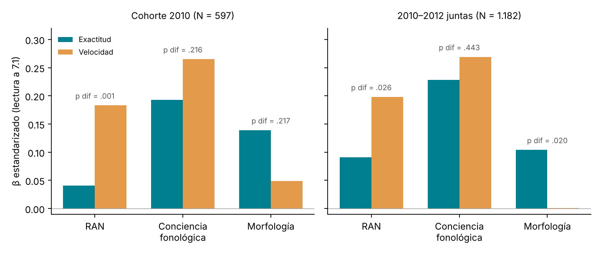

# M10 · Subtipos de exactitud y de velocidad — análisis exploratorio {.unnumbered}

*Desarrollo de un estudio de la Agenda · versión 1, 24/10/2026; revisión de literatura, 28/10/2026*

::: {.callout-warning}
**Página de trabajo del grupo.** Es un análisis exploratorio, no un resultado del manual. No aparece en el índice del libro: se llega desde el título del estudio en la [Agenda](../agenda.qmd#sec-agenda). No citar ni difundir fuera del grupo. Solo contiene datos agregados.
:::

[← Volver a la Agenda](../agenda.qmd#sec-agenda)

## Pregunta

¿Lleva el RAN bajo en Infantil a una lectura lenta pero exacta, y la conciencia fonológica baja a una lectura lenta e inexacta, como en hebreo y árabe [@catts2026definicion]? Se añade la morfología (género y número), porque en árabe el subgrupo con déficit fonológico y morfológico es el que lee lento e inexacto.

## Decisiones tomadas

| Tema | Decisión |
|---|---|
| Muestra principal | Cohorte 2010, con la condición Preleo de la tesis de Auxi (versión estable) como covariable |
| Referencia para los cortes | Todos los SIN fiables de cualquier cohorte: SIN en las dos versiones de la asignación. En la práctica, 2010 SIN + 2012 (N = 429) |
| Cortes | P10 primero y P25 después. P25 deja menos niños en riesgo sin atender |
| Réplicas | 2011 (sensibilidad: condición Preleo dudosa), 2012 y las tres cohortes juntas |
| Cohortes que no sirven | 2013, 2014 y 2015: en sus listas el tiempo está fijado (~43 s) y no se separa exactitud de velocidad |

## Medidas

- **Lectura a 7.1** (2º de primaria, 1er trimestre). Son las mismas cuatro listas en 2010, 2011 y 2012: palabras y pseudopalabras de 2 y 3 sílabas, de 12 ítems cada una.
  - **Exactitud** = aciertos (0–48).
  - **Velocidad** = tiempo total.
  - Réplica en los mismos niños a 7.2.
- **RAN**: colores y números en Infantil (2010 a 5.1; 2011 a 4.1; 2012 a 4.3). Sensibilidad con RAN de objetos.
- **Conciencia fonológica**: compuesto de 4–6 tareas de 5.1–5.2 (α = .76–.84).
- **Morfología**: género y número (α = .25–.55). En 2010 está medida a 6.1, no en Infantil.

## Cortes en la referencia SIN (7.1)

| Corte | Exactitud baja | Velocidad baja |
|---|---|---|
| P10 | ≤ 37 / 48 aciertos | ≥ 161 s en las cuatro listas |
| P25 | ≤ 42 / 48 aciertos | ≥ 123 s en las cuatro listas |

Solo el 20 % de la referencia está en el techo (48/48), así que a esta edad la exactitud aún discrimina.

## Perfiles en 2010

| Corte | Preleo | N | Típico | Solo lento | Solo inexacto | Mixto |
|---|---|---|---|---|---|---|
| P10 | CON | 506 | 83 % | 4 % | 8 % | 5 % |
| P10 | SIN | 241 | 83 % | 4 % | 6 % | 7 % |
| P25 | CON | 506 | 59 % | 10 % | 17 % | 14 % |
| P25 | SIN | 241 | 59 % | 8 % | 18 % | 15 % |

Con P25 se señalan unos 25 puntos más de niños. Las proporciones son iguales con y sin Preleo.

## ¿Hay doble disociación?

### Por perfiles (regresión multinomial, 2010, P10)

Las cifras son OR por cada desviación típica peor en el precursor, frente al grupo típico. Los errores típicos se ajustan por colegio.

| Precursor | Solo lento (n = 23) | Solo inexacto (n = 36) | Mixto (n = 21) |
|---|---|---|---|
| RAN | 1,36 (0,89–2,10) | 1,14 (0,82–1,59) | **1,66** (1,16–2,39) |
| Conciencia fonológica | 1,15 (0,78–1,70) | 1,35 (0,95–1,93) | **2,82** (1,40–5,69) |
| Morfología | 1,18 (0,74–1,88) | **1,62** (1,13–2,33) | **1,58** (1,11–2,24) |

La doble disociación por perfiles **no se confirma en 2010**: las diferencias entre "solo lento" y "solo inexacto" no son significativas, y los grupos son pequeños. Solo aparece en 2011 (CF: p = .001; RAN: p = .06), la cohorte con la condición Preleo dudosa.

### Como continuo (exactitud y velocidad en el mismo modelo)

{width=100%}

- **RAN → velocidad.** Pesa más en la velocidad que en la exactitud. Se replica con el RAN de objetos (p = .008) y con las tres cohortes (p = .026).
- **Morfología → exactitud.** Predice la exactitud y no la velocidad (tres cohortes: p = .020). Se mantiene controlando la recepción gramatical.
- **Conciencia fonológica → ambas** por igual.
- **Preleo** no tiene efecto en ninguna de las dos.

**Lectura provisional:** la disociación es parcial. El RAN bajo lleva a una lectura lenta pero exacta, como en árabe [@catts2026definicion]. En cambio, el componente de inexactitud lo aporta la morfología, no la conciencia fonológica.

## Qué dice la literatura

*Revisión con SciSpace del 28/10/2026.*

- **El doble déficit tiene apoyo parcial y un problema estadístico de base.** @wolf1999double proponen dos fuentes separables de dificultad, fonológica y de velocidad de nombrar, y un subgrupo con ambas que sería el más grave. @vukovic2006double revisan la evidencia y concluyen que no apoya un déficit central persistente en la velocidad de nombrar. Señalan que los estudios varían en cómo definen y clasifican la dislexia, y que la correlación entre CF y RAN produce un artefacto estadístico. En alemán, el déficit de RAN afectó la fluidez y el de CF no afectó la decodificación fonológica [@wimmer2000double]. En portugués europeo (N = 85), el RAN predijo la fluidez pero no la exactitud más allá de la CF. El 62,4 % tenía doble déficit, el 24,7 % solo fonológico y el 8,2 % solo de RAN, y el doble déficit no leía peor [@moura2020double]. **Coincide** con nuestro resultado RAN → velocidad. **Coincide** también con la debilidad de los perfiles: en 2010 los grupos «solo lento» y «solo inexacto» no se separan.

- **En hebreo y árabe hay subtipos «duros» de exactitud y de velocidad, y la morfología va con la exactitud.** En una muestra representativa de 4º en hebreo vocalizado, @shany2011subtypes hallaron un subgrupo solo de exactitud y otro solo de velocidad, cada uno cerca del 10 % de la población. El de velocidad mostraba lentitud general de procesamiento y RAN lento con material impreso. El de exactitud mostraba déficits en CF y en conocimiento morfológico. En árabe (N = 236, 4º), un tercio de los niños con dislexia era lento pero exacto y otro tercio inexacto pero rápido, con perfiles cognitivos sin solapamiento [@shany2022arabic]. Siguiendo a niños hebreos desde preescolar, el grupo con RAN bajo leía lento pero exacto en 1º. El grupo con CF y morfología bajas era inexacto y además lento [@gott2026preschool]. **Coincide** con M10: RAN → velocidad y morfología → exactitud. Nuestro grupo «mixto» (CF: OR 2,82; morfología: OR 1,58) se parece al grupo CF + morfología de @gott2026preschool.

- **En ortografías transparentes, el RAN predice la velocidad; la CF, sobre todo la exactitud inicial.** En cinco ortografías (N = 1.120), el RAN fue el predictor estable de la fluidez y la relación de la CF con la lectura fue compleja [@landerl2019pa]. En alemán, con la exactitud casi en techo, el RAN fue el mejor predictor de la fluidez durante 8 años [@landerl2008fluency]. En danés (N = 172), la CF predijo cuánto tardaba el niño en llegar al 70 % de exactitud. Controlando ese tiempo, el RAN fue el único predictor de la velocidad [@juul2014speed]. En español (N = 2.971, 6–16 años; preimpresión), el RAN explicó el 16 % de la varianza de la eficiencia lectora y dominó en las medidas de velocidad, y el componente fonológico en las de exactitud [@carrioncastillo2026cognitive]. **Se aparta** de M10, donde la CF pesa igual en exactitud y velocidad. Una explicación posible: a 7.1 la exactitud aún discrimina (solo el 20 % está en techo), y la inexactitud frena la velocidad [@juul2014speed; @gott2026preschool].

- **La morfología ayuda a la exactitud en ortografías transparentes, pero la relación puede ir en los dos sentidos.** En hebreo vocalizado (N = 680), la conciencia morfológica de preescolar predijo la exactitud y la fluidez de 1º controlando la conciencia fonémica [@cohenmimran2022morphological]. En italiano, la morfosintaxis oral predijo la exactitud y no la velocidad; la velocidad dependía más de las combinaciones de letras [@casani2022morphosyntactic]. Morfología y exactitud se predicen mutuamente entre 2º y 3º [@deacon2013reciprocal]. En cambio, en español de 4º la conciencia morfológica no ayudó a la decodificación y solo a la comprensión [@dalessio2019morphological]. **Coincide** con nuestro resultado morfología → exactitud. **Cautela:** en 2010 la morfología se midió a 6.1, cuando el niño ya lee, y la relación puede ser inversa.

- **Los subtipos aislados son poco estables; los déficits combinados, sí.** La pertenencia a los subtipos fonológico y superficial fue solo regular a los 5 años, y el subtipo no informó del pronóstico [@peterson2014stability]. En alemán (N = 167), el déficit de fluidez fue estable [@moll2020stability]. En sueco e inglés (N = 622), los déficits combinados fueron estables y los aislados mucho menos [@furnes2025dissociation]. En español y francés, el perfil mixto es el más frecuente, y la proporción de perfiles disociados cambia según se mida exactitud o latencia [@sprengercharolles2011subtipos]. En español, los disléxicos de 4º leían con exactitud pero lentos; en 5º y 6º ganaban velocidad a costa de exactitud [@carrillo2008subtipos]. **Implica** que los perfiles «solo lento» y «solo inexacto» de 7.1 pueden cambiar a 7.2 y 8.x.

- **Clasificar por cortes es frágil; los modelos continuos y latentes son más defendibles.** Los cortes diagnósticos son arbitrarios porque no hay diferencias cualitativas entre quienes quedan a cada lado [@lervag2021core]. El análisis por cuadrantes falla cuando los dos indicadores están correlacionados [@burgess2018taxons]. En adultos finlandeses, tres agrupamientos distintos dieron subgrupos que apenas se solapaban [@laasonen2012adult]. Con métodos taxométricos (N = 671), sí apareció un taxón con déficit fonológico, pero la estructura del RAN dependió de cómo se definía la dislexia [@obrien2012taxometric]. En infantil (N = 1.215), un análisis de perfiles latentes de los precursores dio seis perfiles, entre ellos riesgo de RAN, de CF y doble, que predijeron la lectura de 1º [@ozernovpalchik2017profiles]. Usar sumas de puntuaciones poco fiables como predictores sesga los coeficientes. La corrección por fiabilidad puede funcionar mejor que un SEM si el modelo de medida no es unidimensional [@robitzsch2026sumscores]. **Coincide** con nuestra cautela sobre las clases residuales del LPA y con el plan de pasar a un SEM.

## Cautelas

- La medida de morfología es poco fiable (α .25–.55), y en 2010 es de 1º de primaria, no de Infantil.
- En 2012 el RAN es una sola lámina. Los precursores se midieron a los 5 años en 2010 y a los 4 en 2011 y 2012.
- Los perfiles latentes (LPA) dan 5–6 clases con grupos residuales del 1–5 %. Parecen un artefacto del techo y de los errores extremos, así que quedan como análisis secundario.

## Qué cambia en el estudio

Propuestas tras la revisión de literatura; sustituyen a los próximos pasos de la versión 1.

- **Hacer del modelo continuo el análisis principal y de los perfiles el secundario.** Usar un SEM con exactitud y velocidad como dos resultados correlacionados y contrastar si el peso de cada precursor difiere. Es lo que ya muestra M10, pero con los precursores como variables latentes [@lervag2021core; @burgess2018taxons].
- **Corregir la fiabilidad de la morfología** (α .25–.55) con un factor latente si hay varios indicadores, o con una corrección por fiabilidad usando ω [@robitzsch2026sumscores]. Informar de cuánto cambia el coeficiente morfología → exactitud.
- **Separar velocidad y exactitud de verdad.** Modelar la velocidad controlando la exactitud (tiempo por acierto, o la exactitud como covariable), como hacen @juul2014speed. Comprobar si el efecto CF → velocidad desaparece. Si desaparece, M10 coincide con @gott2026preschool.
- **Modelar cada medida según su distribución.** Exactitud como binomial sobre 48 ítems, por el techo; velocidad en escala logarítmica o en ítems por segundo.
- **Definir los subtipos «duros» como @shany2011subtypes:** déficit en una dimensión con la otra en rango normal, no solo un corte en P10. Validarlos con medidas que no sirvieron para definirlos: pseudopalabras frente a palabras, y la lectura de 7.2.
- **Medir la estabilidad y la regresión a la media.** Tabla de transición de perfiles de 7.1 a 7.2 y a 8.x, como en @moll2020stability y @furnes2025dissociation. Los niños que salen del perfil al repetir la medida indican cuánto pesa el error de medida en los grupos pequeños (n = 21–36).
- **Tratar con cautela la dirección morfología → exactitud.** En 2010 la morfología se midió a 6.1. Controlar la lectura previa y, si existe, usar la morfología de infantil de 2011 y 2012 [@deacon2013reciprocal]. Discutir el contraste con @dalessio2019morphological: la morfología flexiva (género y número) no es la derivativa que estudian ellos.
- **Si se mantiene el LPA**, hacerlo sobre los precursores, como @ozernovpalchik2017profiles, no sobre la lectura. Informar de la entropía y no interpretar clases por debajo del 5 %.
- **Marco y revistas.** Enmarcar M10 como réplica en español de la tipología de exactitud y velocidad [@shany2011subtypes; @shany2022arabic; @gott2026preschool] y del patrón RAN → fluidez [@landerl2019pa]. Revistas: *Annals of Dyslexia* (donde están @gott2026preschool y @shany2011subtypes), *Scientific Studies of Reading* y *Reading and Writing*.

## Huecos que puede llenar LEEDUCA

- **La tipología de exactitud y velocidad de Shany y Share probada en español**, con precursores de infantil y varias cohortes poblacionales, no clínicas.
- **La morfología flexiva (género y número) como predictor de la exactitud en español.** Los estudios encontrados usan morfología derivativa o la miden en hebreo y en italiano.
- **La estabilidad de los perfiles con tres evaluaciones por curso** (7.1, 7.2, 8.x), algo que los estudios de estabilidad, con medidas anuales o más espaciadas, no tienen.
- **Una referencia sin intervención (SIN)** para fijar los cortes, y la comparación CON/SIN Preleo como prueba de que los perfiles no son un efecto de la instrucción.

::: {.callout-note appearance="minimal"}
**Reproducibilidad.** Guion `04_DICCIONARIO_PROCESADO_2026/scripts/m10_subtipos_v1.py`, que trabaja sobre la tabla larga v2 y la asignación Preleo v4 provisional (columnas v3 y v4). Salida completa en `DIAGNOSTICO/M10_subtipos_resultados_v1.xlsx`. La estimación previa por simulación está en `scripts/M10_simulacion_estimacion.py`.
:::
