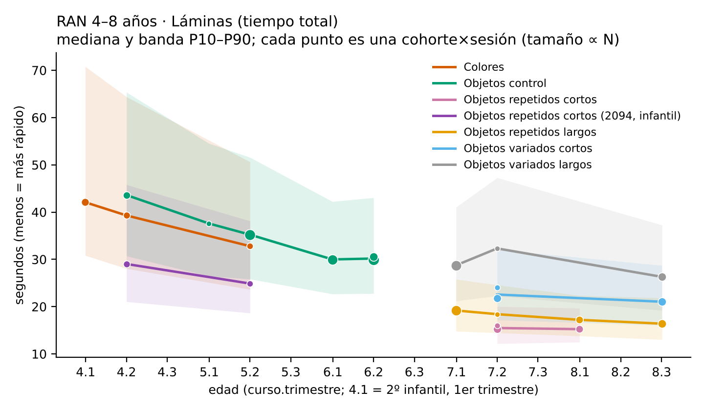
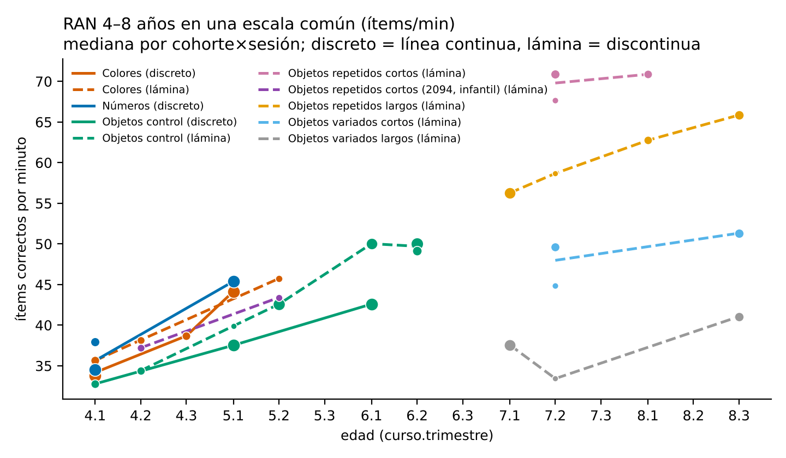
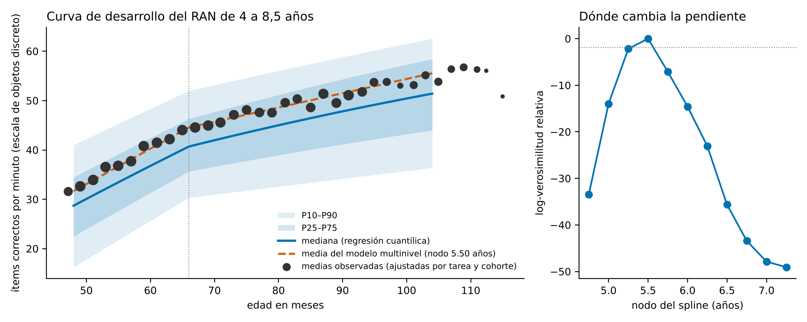
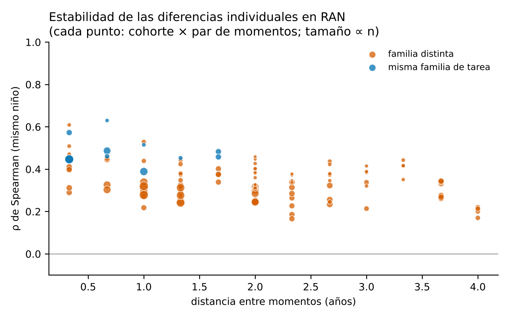
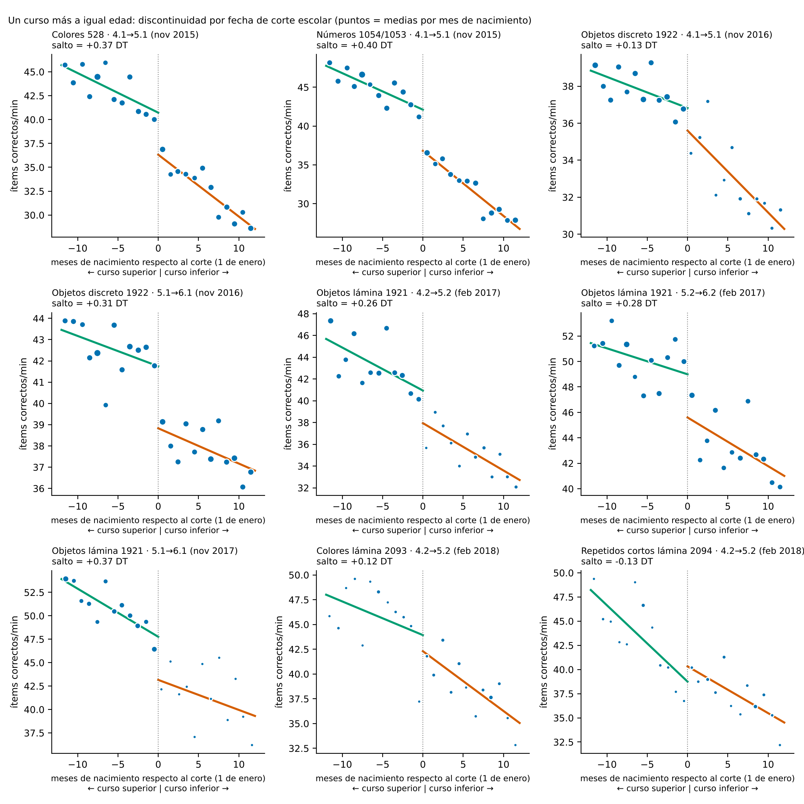
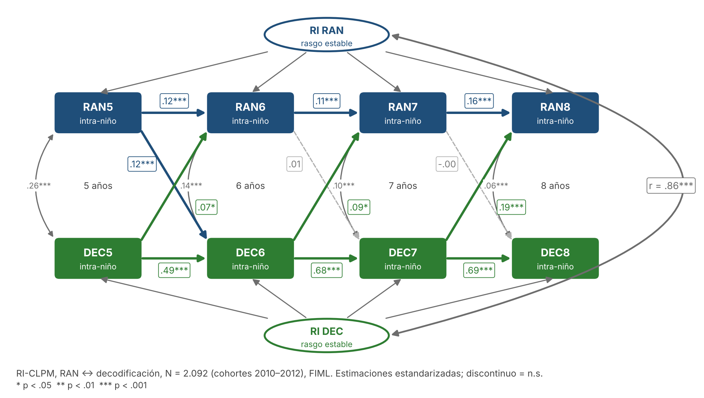

# M11 · Desarrollo del RAN de 4 a 8 años — análisis exploratorio {.unnumbered}

*Desarrollo de un estudio de la Agenda · versión 1, 29/10/2026; discontinuidad por fecha de corte añadida esa noche; síntesis, introducción y nueve contrastes de corte escolar, modelo de crecimiento, RI-CLPM y borrador del artículo, 30/10/2026. Idea de A. Giménez de la Peña; análisis exploratorio de P. J. López-Pérez.*

::: {.callout-warning}
**Página de trabajo del grupo.** Es un análisis exploratorio, no un resultado del manual. No aparece en el índice del libro: se llega desde el título del estudio en la [Agenda](../agenda.qmd#sec-agenda). No citar ni difundir fuera del grupo. Solo contiene datos agregados.
:::

[← Volver a la Agenda](../agenda.qmd#sec-agenda)

## En diez líneas

Proponemos un estudio sobre el desarrollo de la denominación rápida automatizada (RAN) entre los 4 y los 8 años con los datos de la plataforma: cinco cohortes (2010–2015), tres medidas por curso y entre 400 y 900 niños por sesión. La literatura sobre el RAN como predictor es enorme; la literatura sobre cómo cambia el propio RAN con la edad es escasa, y en español casi inexistente. Los resultados preliminares, sobre 17.160 aplicaciones limpias de 11 tareas RAN, dicen cinco cosas:

1. **Hay curva y es reproducible.** El RAN crece 0,73 DT por año hasta los 5 años y medio y 0,29 DT por año después (modelo multinivel con 3.902 niños; nodo estimado por verosimilitud). Cohortes distintas evaluadas con la misma tarea a la misma edad dan medianas casi idénticas.
2. **La edad en meses importa dentro del aula a los 4 años y deja de importar a los 7.** La correlación con la edad en meses baja de ρ ≈ .20–.28 a los 4 años a ≈ 0 a los 7–8.
3. **Las diferencias individuales son moderadamente estables**, menos que en el estudio sueco de referencia: ρ = .45–.63 a cuatro meses, .30–.45 a dos o tres años, .15–.30 de los 4 a los 8. La fiabilidad de una sola lámina limita estas cifras y es un resultado en sí mismo.
4. **A igual edad, el paso a 1º de primaria acelera el RAN** (+0,31 DT, tres contrastes concordantes; discontinuidad por fecha de corte escolar); el paso de 2º a 3º de infantil solo en uno de los tres pares de cohortes. La instrucción alfabética modifica el RAN, en contra de la tesis de que la relación RAN → lectura es unidireccional.
5. **Dentro del niño, el RAN predice el avance lector solo de los 5 a los 6 años; después es la lectura la que predice el avance en RAN** (RI-CLPM, N = 2.092; efectos .09 y .19). Entre niños, RAN y lectura correlacionan .86 como rasgos. El RAN de los 4 años predice la lectura de 6 a 8 (AUC .70–.76 con los números).

## Pregunta

¿Cómo cambia la velocidad de denominación rápida (RAN) entre los 4 y los 8 años, cuánto se estabilizan las diferencias individuales y cuándo deja de importar la edad en meses dentro del aula? Y una pregunta teórica abierta que nuestros datos pueden arbitrar: ¿modifica la instrucción lectora el RAN, o la relación es unidireccional, del RAN a la lectura?

## Qué dice la literatura

El RAN es, con la conciencia fonológica, el predictor más robusto de la lectura: r = .43 en un meta-análisis de 137 estudios [@araujo2014ran], predictor de la fluidez en cinco ortografías de distinta consistencia [@landerl2019pa], y con más peso que la conciencia fonológica conforme avanza la primaria en español [@rodriguez2015ran]. Casi toda esa literatura trata el RAN como variable independiente; los estudios sobre el desarrollo del propio RAN son pocos y miden una vez por curso.

| Estudio | Qué aporta | Límite |
|---|---|---|
| @avall2019ran; @wolff2023ran (Suecia, 4–10 años, N = 222–364) | Crecimiento mayor entre 4 y 6; diferencias individuales estables de 4 a 10; los dígitos llegan antes a la meseta que las letras; el RAN de 4 años predice fluidez y ortografía en 4º | Una medida por año |
| @mazzocco2013ran (EE. UU., infantil a 8º) | Crecimiento y estabilidad entre niños; déficits persistentes en dislexia y discalculia | Muestra clínica |
| @georgiou2006components; @georgiou2014components | El tiempo de pausa, no el de articulación, es el que se desarrolla y predice la lectura; su peso cambia con la edad | N = 62–75 |
| @lervag2009ran (Noruega) | El RAN preescolar predice el crecimiento de la fluidez; la lectura no retroalimenta el RAN | Tres cursos |
| @peterson2018literacy (gemelos); @wolff2014ran (intervención aleatorizada) | Al contrario: la alfabetización temprana acelera el RAN posterior y el entrenamiento lector lo mejora | Sin diseño por centros |
| @rodriguez2015ran; @outon2021ran (España) | RAN de 1º/2º a 6º: mejora con la edad; factores alfanumérico y no alfanumérico invariantes | Transversales; empiezan en primaria |

El hueco: ningún estudio longitudinal en ortografía transparente cubre el tramo 4–8 años con más de una medida por curso y con N suficiente para estimar la forma de la curva y la estabilidad por tramos.

## Datos disponibles

17.160 aplicaciones limpias de 11 tareas RAN en las cohortes 2010–2015, en 12 momentos entre 4.1 y 8.3. Ninguna tarea cubre sola todo el tramo, pero las familias se solapan y varias cohortes repiten la misma tarea a la misma edad.

| Familia | Formato | Momentos con datos (cohortes) |
|---|---|---|
| Colores 528 (20 ítems) | discreto | 4.1 (11, 14), 4.3 (12), 5.1 (10) |
| Colores 2093 (lámina 5 × 5) | lámina | 4.1 (15), 4.2 (13), 5.2 (12) |
| Números 1054/1053 (20 ítems) | discreto | 4.1 (11, 14), 5.1 (10) |
| Objetos control 1922 (25 ítems) | discreto | 4.1 (12), 5.1 (11), 6.1 (10) |
| Objetos control 1921 (lámina 5 × 5) | lámina | 4.2 (12), 5.1 (12), 5.2 (11), 6.1 (11), 6.2 (10, 13) |
| Objetos repetidos cortos 2094 → 1893 (DIS-ESP, 18) | lámina | 4.2 (13), 5.2 (12); 7.2 (10, 12), 8.1 (11) |
| Objetos repetidos largos 1945 (DIS-ESP, 18) | lámina | 7.1 (10), 7.2 (12), 8.1 (11), 8.3 (10) |
| Objetos variados cortos 1891 (DIS-ESP, 18) | lámina | 7.2 (10, 12), 8.3 (10) |
| Objetos variados largos 1946 (DIS-ESP, 18) | lámina | 7.1 (10), 7.2 (12), 8.3 (10) |

Las láminas de primaria son las cuatro matrices de denominación rápida de la batería DIS-ESP [@carrillo2011prevalencia]: 18 ítems, variados o repetidos × nombres cortos (sol, pie, silla) o largos (manzana, elefante, helicóptero). Formato discreto = ítems correctos por minuto; lámina = tiempo total en segundos sobre una lámina fija, o ítems por minuto cuando se conoce el número de estímulos.

## Resultados preliminares

### La curva 4–8 años

El RAN mejora deprisa entre los 4 y los 6 años y sigue mejorando, más despacio, hasta los 8. En los formatos discretos la mediana pasa de 34 a 44 ítems/min entre 4.1 y 5.1 en colores y números (≈ 1 DT por año) y de 33 a 43 entre 4.1 y 6.1 en objetos (0,5 DT por año). La lámina de objetos baja de 43,6 s en 4.2 a 37,6 (5.1), 35,2 (5.2), 30,0 (6.1) y 30,0 (6.2); entre 6.1 y 6.2 ya es plana. En primaria las láminas de objetos repetidos pasan de 19,2 s en 7.1 a 16,4 en 8.3 (−15 %): a los 7–8 años todavía hay desarrollo, cuatro veces más lento que a los 4–5.

{width="85%"}

En una escala común de ítems por minuto, la lámina de colores da los mismos valores que el formato discreto a la misma edad (35,6 frente a 33,8–35,0 en 4.1; 45,7 en 5.2 frente a 44,1 en 5.1). En primaria aparece el efecto de la longitud del nombre: con los mismos niños, repetidos cortos 68–71 ítems/min, repetidos largos 56–66, variados cortos 45–51 y variados largos 33–41.

{width="85%"}

**La curva se replica entre cohortes.** Cuando dos cohortes hicieron la misma tarea a la misma edad, sus medianas coinciden casi al segundo:

| Tarea | Momento | Cohorte A | Cohorte B |
|---|---|---|---|
| Colores discreto (ítems/min) | 4.1 | 2011: 33,8 (N = 900) | 2014: 35,0 (N = 441) |
| Números discreto (ítems/min) | 4.1 | 2011: 34,5 (N = 898) | 2014: 37,9 (N = 436) |
| Objetos lámina 1921 (s) | 6.2 | 2010: 30,0 (N = 808) | 2013: 30,5 (N = 473) |
| Objetos repetidos cortos 1893 (s) | 7.2 | 2010: 15,2 (N = 436) | 2012: 16,0 (N = 218) |
| Objetos repetidos largos 1945 (s) | 7.1 / 7.2 | 2010: 19,2 (N = 697) | 2012: 18,4 (N = 192) |

### La curva con un modelo de crecimiento multinivel

Con todas las tareas en ítems/min, un solo modelo: 16.595 aplicaciones de 3.902 niños en 99 colegios; niños (intercepto y pendiente aleatorios) dentro de colegios (intercepto); tarea y cohorte como efectos fijos; la edad en meses como tiempo, con un spline lineal cuyo nodo se busca por verosimilitud entre los 4,75 y los 7,25 años.

- **La pendiente cambia a los 5 años y medio.** El nodo con máxima verosimilitud está en 5,50 años (IC de perfil 5,25–5,50); cualquier nodo a partir de los 6 empeora el ajuste en más de 14 unidades de log-verosimilitud. Antes del nodo el RAN crece 8,6 ítems/min por año (0,73 DT/año); después, 3,5 (0,29 DT/año). El crecimiento rápido no termina al entrar en primaria sino a mitad de 3º de infantil: la instrucción de 1º añade un salto a una curva que ya se ha aplanado.
- **Los niños difieren en el ritmo de crecimiento, no solo en el nivel.** La pendiente aleatoria mejora el modelo (χ² = 215, 1 gl); su DT es 2,2 ítems/min por año. CCI del niño, descontadas tarea y cohorte, .27; del colegio, .05.
- **Percentiles por edad en meses** (regresión cuantílica; referencia objetos discreto, cohorte 2010):

| Edad (meses) | P5 | P10 | P25 | P50 | P75 | P90 | P95 |
|---|---|---|---|---|---|---|---|
| 48 | 14 | 16 | 22 | 29 | 35 | 41 | 45 |
| 54 | 18 | 21 | 27 | 33 | 39 | 45 | 49 |
| 60 | 22 | 26 | 31 | 37 | 42 | 48 | 52 |
| 66 | 27 | 30 | 36 | 41 | 46 | 52 | 56 |
| 72 | 28 | 31 | 37 | 43 | 48 | 54 | 57 |
| 84 | 30 | 33 | 40 | 46 | 52 | 57 | 60 |
| 96 | 32 | 35 | 42 | 49 | 56 | 60 | 62 |
| 102 | 32 | 36 | 44 | 51 | 58 | 62 | 64 |

{width="100%"}

La distancia P10–P90 se mantiene en unos 25 ítems/min de los 4 a los 8 años, pero pasa del 150 % de la mediana al 50 %: las diferencias individuales se comprimen conforme la tarea se automatiza, y a los 4 años seis meses de edad valen tanto como un cuartil.

### Edad relativa

Dentro de una misma sesión, los niños mayores denominan más rápido a los 4 años: ρ con la edad en meses de .21–.24 en colores y números y .18 en objetos; doce meses valen 0,6–0,8 DT. El efecto baja a ρ ≈ .15 a los 5 años, a .04–.12 a los 6 y a 0–.1 a los 7–8. Implicación para el manual: el baremo de RAN en infantil va por trimestre (o por edad en meses); en primaria basta el curso.

### Estabilidad de las diferencias individuales

| Distancia | Misma familia de tarea | Familia distinta |
|---|---|---|
| 4 meses | ρ = .45–.57 | .27–.61 |
| 8 meses | .49–.63 | .30–.51 |
| 1 año | .39–.52 | .22–.53 |
| 2 años | .39 | .25–.46 |
| 3–3,3 años | — | .10–.44 |
| 4 años (4.1 → 8.x) | — | .14–.30 |

{width="75%"}

Son cifras más bajas que las suecas, y la razón más probable es la medida: una sola lámina o 20 ítems en una pasada dan .45–.60 en el retest a cuatro meses (números y colores en la misma sesión correlacionan .58–.60; fiabilidad del compuesto .74 por Spearman-Brown). Corregida por atenuación, la estabilidad a un año rondaría .65–.75, en línea con @avall2019ran. Esto abre un segundo artículo posible sobre la fiabilidad del RAN con una sola lámina, que es lo que usan casi todas las baterías.

### Escolarización frente a maduración: un curso más a igual edad

Cohortes consecutivas evaluadas el mismo mes con la misma tarea: los nacidos en diciembre y en enero tienen la misma edad y un curso de diferencia. Es una discontinuidad por fecha de corte escolar, que separa un año de escolarización de un año de edad. Regresión lineal a cada lado del corte (±12 meses de nacimiento, errores por colegio); nueve contrastes con tres pares de cohortes y tres tareas:

| Contraste (tarea · cursos · mes, cohortes) | N | Salto a igual edad | IC 95 % | p |
|---|---|---|---|---|
| Colores 528 · 4.1→5.1 · nov 2015 (2011/2010) | 1.662 | +0,37 DT | 0,17–0,58 | < ,001 |
| Números 1054/1053 · 4.1→5.1 · nov 2015 (2011/2010) | 1.664 | +0,40 DT | 0,17–0,62 | ,001 |
| Objetos discreto 1922 · 4.1→5.1 · nov 2016 (2012/2011) | 1.255 | +0,13 DT | −0,20–0,46 | ,45 |
| Objetos lámina 1921 · 4.2→5.2 · feb 2017 (2012/2011) | 1.112 | +0,26 DT | −0,10–0,62 | ,16 |
| Colores lámina 2093 · 4.2→5.2 · feb 2018 (2013/2012) | 582 | +0,12 DT | −0,16–0,39 | ,40 |
| Repetidos cortos 2094 · 4.2→5.2 · feb 2018 (2013/2012) | 563 | −0,13 DT | −0,55–0,28 | ,53 |
| **Objetos discreto 1922 · 5.1→6.1 · nov 2016 (2011/2010)** | 1.755 | **+0,31 DT** | 0,11–0,52 | ,002 |
| **Objetos lámina 1921 · 5.2→6.2 · feb 2017 (2011/2010)** | 1.541 | **+0,28 DT** | 0,04–0,52 | ,02 |
| **Objetos lámina 1921 · 5.1→6.1 · nov 2017 (2012/2011)** | 848 | **+0,37 DT** | −0,05–0,79 | ,09 |

{width="100%"}

- **El paso a 1º de primaria acelera el RAN en los tres contrastes** en que se puede medir (dos pares de cohortes, dos formatos): combinado +0,31 DT (IC 0,16–0,45), sin heterogeneidad. A esa edad un año de maduración dentro del curso vale 0,2 DT: la instrucción lectora pesa más que la edad.
- **El paso de 2º a 3º de infantil es heterogéneo**: +0,37 y +0,40 DT con el par 2011/2010 (colores y números, noviembre de 2015), pero entre −0,13 y +0,26 y no significativo en los cuatro contrastes con los pares 2012/2011 y 2013/2012 (combinado +0,26, IC 0,15–0,37; Q = 7,7, 5 gl). No lo explica Preleo de forma limpia (la cohorte 2011, CON Preleo a los 4 años, no muestra salto frente a la 2012). Pregunta abierta: cohorte, tarea o curso escolar.
- Los saltos son iguales con y sin ajuste por el ISE del centro; los de 5→6 se mantienen en ventanas de ±3 meses.

A igual edad, el primer curso de instrucción lectora acelera el RAN: en la dirección de @peterson2018literacy y @wolff2014ran, y en contra de la unidireccionalidad de @lervag2009ran. La asimetría entre 1º de primaria y 3º de infantil sugiere que lo que acelera el RAN no es «ir al colegio» sino la instrucción alfabética.

### Dirección RAN ↔ lectura dentro del niño (RI-CLPM)

Modelo autorregresivo cruzado con intercepto aleatorio [@hamaker2015riclpm] entre RAN y decodificación en cuatro olas (cursos de 5 a 8), cohortes 2010–2012, N = 2.092, FIML. Entre niños, RAN y lectura son casi el mismo rasgo (correlación entre interceptos .86). Dentro del niño, la dirección cambia con la edad: de 5 a 6 el RAN predice el avance en decodificación (β = .12) más que al revés (.07); después el RAN deja de predecir cambios en lectura (.01, .00) y es la lectura la que predice cambios en RAN, con efectos crecientes (.09, .19). Mismo patrón que @peterson2018literacy, y misma conclusión que el corte escolar. El CLPM clásico, sin interceptos aleatorios, da efectos en ambas direcciones en todos los intervalos: por eso la literatura no se ponía de acuerdo. Cautelas: solución impropia con la cohorte 2010 sola; índices de ajuste e invarianza pendientes de lavaan.

{width="100%"}

| Efecto (estandarizado) | 5 → 6 | 6 → 7 | 7 → 8 |
|---|---|---|---|
| RAN → decodificación | .12*** | .01 | .00 |
| Decodificación → RAN | .07* | .09* | .19*** |
| Autorregresión RAN | .12 | .11 | .16 |
| Autorregresión decodificación | .49 | .68 | .69 |

::: {.callout-tip collapse="true"}
## Qué es un RI-CLPM, qué se hacía antes y cómo leer el diagrama

**El problema que resuelve.** Cuando medimos dos habilidades en los mismos niños varias veces, la pregunta interesante es de dirección: ¿el RAN empuja a la lectura, la lectura al RAN, o los dos? Durante treinta años la respuesta se buscó con el **modelo autorregresivo cruzado clásico (CLPM)**: cada habilidad en el tiempo *t* se predice por sí misma en *t−1* (flecha autorregresiva) y por la otra en *t−1* (flecha cruzada). Si la flecha RAN → lectura es mayor que lectura → RAN, se concluye que el RAN es la causa. Así argumentaron Lervåg y Hulme (2009).

**Por qué el CLPM engaña.** El CLPM mezcla dos cosas que no son lo mismo: las **diferencias estables entre niños** (Marta siempre denomina rápido y siempre lee bien) y los **cambios dentro de cada niño** (este trimestre Marta ha denominado mejor de lo que es habitual en ella). Una correlación estable entre niños, como la de .86 que encontramos entre RAN y lectura, se cuela en las flechas cruzadas y las infla en las dos direcciones, aunque dentro de ningún niño un cambio en una habilidad preceda a un cambio en la otra. Hamaker, Kuiper y Grasman (2015) lo demostraron formalmente y propusieron la corrección.

**La corrección: el intercepto aleatorio (RI).** El RI-CLPM añade a cada habilidad una variable latente, el *intercepto aleatorio*, que recoge el nivel estable del niño a lo largo de todas las olas (las elipses del diagrama). Lo que queda de cada medida una vez descontado ese nivel es su **componente dentro del niño** (las cajas): cuánto se desvía el niño en esa ola de su propia trayectoria. Las flechas autorregresivas y cruzadas se estiman solo entre esos componentes. Así, una flecha lectura → RAN de .19 quiere decir: cuando un niño lee en 2º mejor de lo que es habitual *en él*, en 3º denomina más rápido de lo habitual *en él*. Esa es la prueba exigente de direccionalidad; la correlación entre los dos interceptos (.86) es la parte «rasgo», la que ven los estudios de predicción.

**Qué se ganó aquí respecto al CLPM.** Con los mismos datos, el CLPM da efectos cruzados en las dos direcciones en todos los intervalos (RAN → lectura .21, .03, .07; lectura → RAN .14, .23, .23): la conclusión sería «relación recíproca», que es lo que publicaban unos y lo que negaban otros. El RI-CLPM separa el grano de la paja: el RAN solo predice cambios en lectura de los 5 a los 6 años, y de ahí en adelante es la lectura la que predice cambios en RAN, cada vez con más fuerza. La discrepancia entre ambos modelos explica por qué la literatura no se ponía de acuerdo, y es en sí misma un resultado del artículo.

**Cómo leer el diagrama.** Cajas azules y verdes: componentes dentro del niño de RAN y decodificación por curso. Flechas horizontales: autorregresión (cuánto persiste una desviación de una ola a la siguiente; baja en RAN, .11–.16, alta en lectura, .49–.69). Flechas diagonales: efectos cruzados; las continuas son significativas y las discontinuas grises no. Curvas verticales a la izquierda de cada columna: correlación residual dentro de la ola (lo que cambia a la vez sin orden temporal). Elipses: los interceptos aleatorios, con sus cargas fijas a 1 en cada ola y su correlación por el lateral. Los coeficientes son estandarizados.

**Requisitos y límites.** Hacen falta al menos tres olas (aquí cuatro) y muestras grandes; los intervalos entre olas deberían ser similares (aquí, un curso). Los efectos cruzados dentro del niño suelen ser pequeños en valor absoluto (.05–.20 es lo habitual) y no se deben comparar con las β de un CLPM. El modelo asume que la estructura es la misma en las tres cohortes (invarianza, pendiente de comprobar en lavaan) y, con las olas faltantes por diseño, se estima con máxima verosimilitud con información completa (FIML). Con una sola cohorte la solución fue impropia (varianza dentro del niño próxima a cero en una ola), un aviso de que el modelo pide toda la muestra.

**El antecedente en el grupo.** En el artículo de conciencia fonológica y matemáticas (cohorte 2010) se pasó de regresiones por curso a un SEM con variables latentes y un CLPM; allí los efectos cruzados entre CF y matemáticas mantenían la misma dirección en el CLPM, así que el RI-CLPM no era imprescindible. En el RAN, con una correlación de rasgo de .86, sí lo es: es el caso de libro en que el CLPM clásico da una respuesta equivocada.
:::

### Preleo y lectura

Con la condición disponible hoy solo se contrasta dentro de una cohorte en 6.2 (2013: 175 CON frente a 281 SIN), y el grupo CON es 0,40 DT más lento sin ajustar por el ISE del centro. Entre cohortes, la lámina de objetos en 6.2 da 30,0 s en 2010 (toda CON) y 30,5 s en 2013 (mixta): ninguna señal de que Preleo acelere el RAN. Compatible con @lervag2009ran, pero exige la asignación Preleo cerrada y el ajuste por ISE.

El RAN de 4.1 correlaciona con el percentil lector de 6 años (ρ = .36 colores, .49 números, .37 objetos) y la correlación se atenúa con la distancia (a los 10 años, .14–.22). AUC frente a la dificultad lectora persistente: .70–.76 con números a los 4–5 años, .63–.68 con objetos; las láminas de primaria, .70–.76.

## Cautelas e incidencias

- Sin ajuste por colegio ni por ISE; limpieza mínima documentada (hoja `0_Limpieza` de `m11_ran_desarrollo_v1.xlsx`).
- Láminas con tiempos no registrados (≈ 0,015 s) en las tres sesiones del primer trimestre de 2016/17 (2010/152, 2011/153, 2012/154); en esas sesiones vale la versión discreta (1922).
- 2013/181 (2093, 2094) y 2015/906 (2093) con tiempos ≈ 0; 2011/905 con 1891 y 1946 invertidos (posible intercambio de etiquetas, como la lista 1932 de esa sesión); 2010/189 con la mitad de los tiempos de 1891/1893 < 1 s.
- La lámina 1921 tiene 25 estímulos (5 × 5; leída en la plataforma el 30/10): todas las tareas están en ítems/min. Pendiente: confirmar que 2094 (infantil) y 1893 (primaria) son la misma lámina.
- Condición Preleo de 2011 pendiente de la v4.

## Qué cambia en el estudio

1. **Escala común** en ítems/min (hecha): la equivalencia discreto–lámina se confirma en objetos (32,8 frente a 34,4 ítems/min en 4.1–4.2 de 2012) y en colores.
2. **Curva de referencia** (primera versión hecha): modelo multinivel con nodo libre y percentiles por edad en meses. Pendiente: GAMLSS o cNORM para alisar los percentiles, cohorte como efecto cruzado y comprobación de la invarianza de la pendiente entre tareas.
3. **Estabilidad** por tramos, corregida por atenuación; RI-CLPM RAN ↔ lectura de 5 a 8 años para la unidireccionalidad, junto con la discontinuidad por fecha de corte (ya replicada en nueve contrastes; falta explicar la heterogeneidad del paso 4→5).
4. **Formatos**: números frente a colores en los mismos niños (4.1 y 5.1).
5. **Preleo**: CON − SIN a cada edad con ISE y efectos aleatorios de colegio, con la asignación v4.
6. **Ritmo**: con los tiempos ítem a ítem de 2018 en adelante, variabilidad intraindividual y pausas.

**Revistas posibles:** *Dyslexia*, *Reading and Writing*, *Scientific Studies of Reading*; en español, *Psicothema* o *Revista de Psicodidáctica*.

## Referencias de este estudio

Desarrollo del RAN: @avall2019ran, @wolff2023ran, @mazzocco2013ran, @georgiou2006components, @georgiou2014components, @outon2021ran, @rodriguez2015ran. Dirección RAN–lectura e intervención: @lervag2009ran, @peterson2018literacy, @wolff2014ran, @powell2021ran. RAN como predictor: @araujo2014ran, @landerl2019pa, @norton2012ran. Batería DIS-ESP: @carrillo2011prevalencia. Las entradas completas están en el capítulo de [referencias](../referencias.qmd).

## Borrador de introducción

*Primer borrador en español, para que A. Giménez lo reescriba; las citas están comprobadas en la tabla de literatura salvo las marcadas «por confirmar».*

La denominación rápida automatizada (RAN) —nombrar en voz alta y lo más deprisa posible una matriz de objetos, colores, dígitos o letras— es, junto a la conciencia fonológica, el predictor más robusto de la lectura en todas las ortografías alfabéticas estudiadas. Un meta-análisis de 137 estudios sitúa su correlación con la lectura en r = .43 [@araujo2014ran], y la comparación directa de cinco ortografías con distinto grado de consistencia muestra que el RAN predice la fluidez lectora en todas ellas, mientras que el papel de la conciencia fonológica depende de la lengua y del momento [@landerl2019pa]. En las ortografías transparentes, como el español, donde la precisión se alcanza pronto y la variabilidad relevante está en la velocidad, el RAN gana peso con el curso frente a la conciencia fonológica [@rodriguez2015ran].

Esa literatura trata el RAN como variable independiente. Sorprendentemente, sabemos poco de cómo cambia el propio RAN durante los años en que se usa para cribar. Los estudios con seguimiento desde la etapa preescolar son escasos y casi todos miden una vez por curso. El más completo siguió a 222 niños suecos de los 4 a los 10 años y encontró que el crecimiento mayor se concentra entre los 4 y los 6, que las diferencias individuales en RAN de objetos son estables a lo largo de todo el periodo y que los dígitos alcanzan la meseta antes que las letras [@avall2019ran; @wolff2023ran]. Los trabajos de descomposición del RAN añaden que el tiempo de pausa entre ítems, y no el de articulación, es el componente que se desarrolla y que explica la relación con la lectura, y que su peso cambia con la edad [@georgiou2006components; @georgiou2014components]. En español disponemos solo de datos transversales desde 1º de primaria [@outon2021ran; @rodriguez2015ran].

Tres preguntas siguen abiertas. La primera es la forma de la curva: si el salto entre los 4 y los 6 años es gradual o se concentra con el inicio de la instrucción lectora, algo que una medida anual no puede resolver. La segunda es la estabilidad: los valores publicados proceden de muestras pequeñas con tareas de una sola matriz, y no se ha estimado cuánto de la inestabilidad observada es fiabilidad de la medida y cuánto es cambio real. La tercera es la dirección de la relación con la lectura. @lervag2009ran no encontraron influencia de la fluidez lectora sobre el crecimiento del RAN y propusieron que el RAN refleja la integridad de circuitos de reconocimiento y denominación que la lectura recluta sin modificar; en cambio, un estudio longitudinal de gemelos halló que la alfabetización temprana sí acelera el RAN posterior [@peterson2018literacy], y una intervención lectora aleatorizada a los 9 años lo mejoró [@wolff2014ran].

El presente estudio aprovecha un diseño de cohortes múltiples con tres evaluaciones por curso escolar entre los 4 y los 8 años (N por sesión entre 400 y 900), en una ortografía transparente, con cohortes consecutivas evaluadas el mismo mes con las mismas tareas y con una intervención en lectura aplicada por colegio, para (a) estimar la curva de desarrollo del RAN y situar su punto de inflexión dentro del curso, (b) cuantificar la estabilidad de rango de las diferencias individuales por tramos de edad, corregida por la fiabilidad de la tarea, (c) comparar formatos alfanuméricos y no alfanuméricos en los mismos niños, y (d) contrastar, mediante la discontinuidad por fecha de corte escolar, si un año de escolarización modifica el RAN a igual edad. Como objetivo aplicado, los resultados fijan a qué edad conviene baremar el RAN por trimestre y a partir de cuándo basta el curso.

## Borrador del artículo

::: {.callout-note collapse="true"}
## Borrador 1 para revisión (30/10/2026) — abrir

**Para A. Giménez y J. L. Luque.** Borrador completo: resumen, introducción, método, resultados (cuatro tablas, tres figuras), discusión, referencias y lista de pendientes para los coautores.

- [Descargar el borrador en Word (.docx, 0,7 MB)](../borradores/M11_RAN_borrador_1_2026-10-30.docx)
- Documento vivo en Claude, con comentarios en línea: pedir el enlace a P. J. López (requiere acceso compartido).
- Copia de trabajo en el PC de PJ López: `PLATAFORMA\ARCHIVOS_CONTROL_JAVI\ARTICULOS_BORRADORES\RAN_M11\`.

Cómo revisar: comentarios o control de cambios en el Word, o anotaciones en el documento de Claude; las versiones nuevas se publicarán aquí con fecha (`borrador_2_…`). No difundir fuera del grupo: es un borrador no enviado.
:::

## Archivos

`04\scripts\m11_ran_desarrollo.py` y su porte `04\scripts\R\m11_ran_desarrollo.R` (salida `DIAGNOSTICO\R\m11_ran_desarrollo_R_v1.xlsx`) → `04\DIAGNOSTICO\m11_ran_desarrollo_v1.xlsx` y `DIAGNOSTICO\figs_M11\`. Propuesta completa, con borrador de introducción, en el documento del proyecto de Claude «M11 · Desarrollo del RAN de 4 a 8 años».
