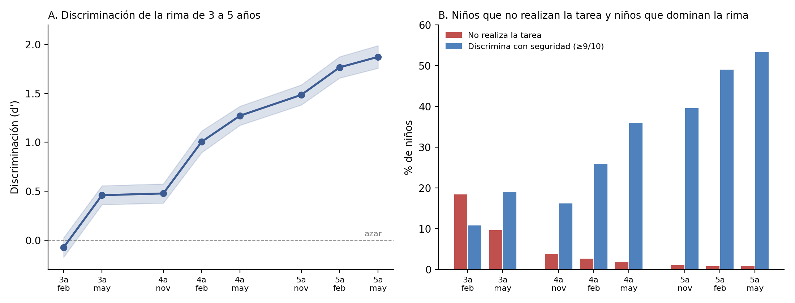
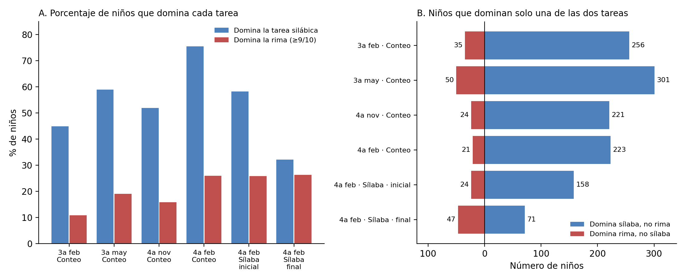
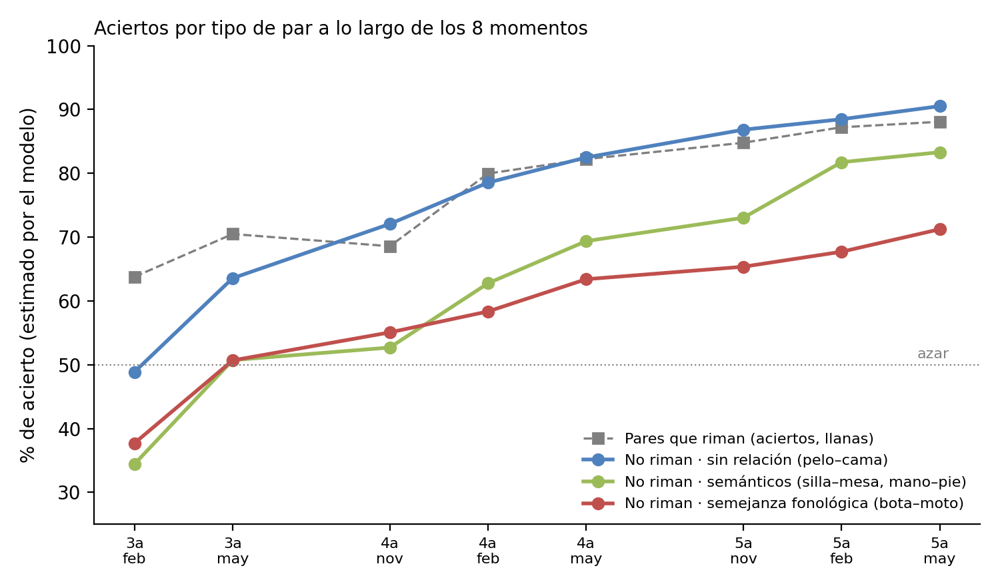
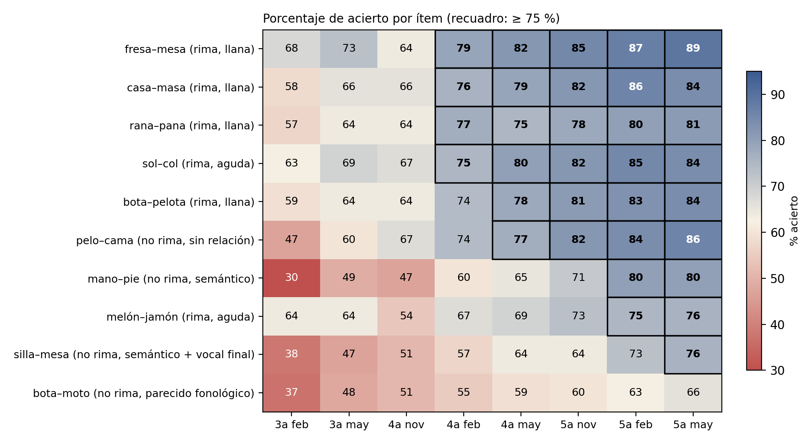

# M12 · ¿Es la rima una habilidad fonológica temprana? — seguimiento del artículo {.unnumbered}

*Página de seguimiento de un manuscrito del grupo · versión 1, 30/10/2026; análisis complementarios y revisión de literatura esa tarde. Artículo de A. Sánchez Gómez (borrador completo recibido el 30/10/2026); contraste con la ficha del manual y revisión de P. J. López-Pérez.*

::: {.callout-warning}
**Página de trabajo del grupo.** Recoge el estado de un artículo en preparación, su contraste con los datos del manual y las sugerencias de revisión. No aparece en el índice del libro: se llega desde el título del estudio en la [Agenda](../agenda.qmd#sec-agenda). No citar ni difundir fuera del grupo. Solo contiene datos agregados. Las figuras son las del borrador.
:::

[← Volver a la Agenda](../agenda.qmd#sec-agenda)

## Estado del manuscrito

| | |
|---|---|
| **Título** | ¿Es la rima una habilidad fonológica temprana? Evidencia longitudinal del desarrollo de la conciencia de rima en español |
| **Autoría** | A. Sánchez Gómez (primera autora); resto de la lista por decidir |
| **Versión recibida** | Borrador completo en español (30/10/2026): introducción, método, resultados (7 tablas, 4 figuras), discusión, conclusiones y 36 referencias. Unas 10.400 palabras sin resumen |
| **Muestra** | Cohorte 2020 (nacidos en 2020), 36 centros públicos de Málaga; 942 niños, 934 con al menos una aplicación de rima; 8 momentos de febrero de 2024 (3 años) a mayo de 2026 (5 años) |
| **Tarea del manual** | [Juicio de rima, 11795](../fichas/RIMA.qmd) |
| **Falta** | Resumen y palabras clave; declaración de ética, financiación y disponibilidad de datos; lista de autores; versión en inglés si va a una revista Q1 |
| **Sigue en el manual** | La ficha de rima no cita el artículo hasta que se publique (decisión del 23/10/2026) |

## En diez líneas

El artículo pregunta si la rima es, en español, la «primera puerta» de la conciencia fonológica que describe la literatura anglosajona. Sigue a una cohorte con la misma tarea de juicio de rima (diez pares: seis riman, cuatro no) en ocho momentos y separa, con la teoría de detección de señal, la discriminación (d′) de la tendencia a decir «sí» (c). Cuatro resultados:

1. **A los 3 años y medio no hay discriminación** (d′ = −0,07; 62 % de «sí» ante las rimas y ante los pares que no riman; 18 % no realiza la tarea). La discriminación es significativa desde mayo de 3 años (0,46) y llega a 1,87 en mayo de 5 años, pero **solo el 53 % domina la tarea (9–10 aciertos) al terminar Infantil**.
2. **La trayectoria va a saltos:** +0,53 entre febrero y mayo de 3 años, nada entre mayo de 3 y noviembre de 4 (+0,02), +0,53 entre noviembre y febrero de 4, y desaceleración al final de 5 años (+0,11, n. s.).
3. **La sílaba va antes que la rima.** En todos los momentos, los niños que dominan el conteo silábico sin dominar la rima son de 6 a 11 veces más que los del patrón inverso. La identificación de la sílaba final, en cambio, se parece a la rima: la posición final de la palabra podría ser parte de la dificultad.
4. **Lo difícil es rechazar lo que se parece.** Entre los pares que no riman, el orden de dificultad es sin relación < semánticos < semejanza fonológica parcial (*bota–moto*, 71 % de rechazo a los 5 años), y se mantiene dentro de cada niño. A los 3 años interfiere la relación semántica; a los 5, la semejanza fonológica.

La tesis: en español, donde la rima se define desde la vocal tónica y suele atravesar la frontera silábica (*fresa–mesa*: *-esa*), juzgar una rima no es reconocer una unidad compacta como en el inglés (*cat–hat*) sino comparar una secuencia de varios segmentos. No es una habilidad elemental, y conviene no usarla como tarea de entrada ni como indicador de riesgo a los 3 años.

## Objetivos, hipótesis y lo que sale

| Hipótesis | Resultado | Comentario |
|---|---|---|
| H1. Discriminación nula a los 3 años; sin techo a los 5 | Nula en febrero de 3 (d′ = −0,07); 0,46 ya en mayo de 3; 53 % de dominio en mayo de 5 | Se cumple con matices: «nula a los 3 años» debería decir «al inicio del seguimiento (3 años y medio)» |
| H2. Trayectoria no lineal | Fases de +0,53 alternan con una meseta de seis meses y una desaceleración final | Se cumple. Ver más abajo la lectura por curso escolar |
| H3. Dominio silábico antes que el de rima | Razón 6:1 a 11:1 en todos los momentos; se mantiene con criterio de rima 8/10 | Se cumple. La sílaba final (32 % de dominio) se acerca a la rima (26 %) |
| H4. Sin relación < semántico < fonológico, dentro del niño | Sin relación < (semántico = fonológico) hasta febrero de 4; después semántico < fonológico | Se cumple en parte: difiere de Carroll y Snowling (2001), donde el fonológico es más difícil desde el principio |

{width="100%"}

{width="100%"}

{width="80%"}

{width="90%"}

## Contraste con la ficha del manual

La [ficha de rima](../fichas/RIMA.qmd) usa **todas las aplicaciones del servidor de 2023 a 2026** (varias cohortes y regiones, 43–63 centros por momento) y calcula d′ **por niño** con la corrección de Hautus y promedia; el artículo usa **una cohorte de Málaga** y estima d′ **poblacional** con un modelo mixto probit sobre las respuestas a los ítems [@decarlo1998sdt]. Las conclusiones coinciden; las cifras no, y conviene saber por qué.

| Cifra | Ficha (2023–2026, todas las cohortes) | Artículo (cohorte 2020, Málaga) | Por qué difieren |
|---|---|---|---|
| No realiza la tarea, 3.2 | 14 % | 18,4 % | Muestra |
| «Sí» ante rima / no rima, 3.2 | 68 % / 52 % | 62 % / 62 % | **Por comprobar.** Si la tabla 1 del artículo incluye los 0/10 (que cuentan como «no» a todas las rimas y «sí» a todos los no rimados), las dos tasas se igualan artificialmente. Si las excluye, la diferencia es de muestra y hay que entenderla, porque H1 depende de ella |
| d′ en 3.2 | 0,45 [0,34; 0,55] | −0,07 [−0,17; 0,02] | Lo anterior, más la diferencia entre d′ individual promediado y d′ poblacional |
| d′ en 5.3 | 1,35 | 1,87 | El d′ individual con 6 + 4 ítems y corrección de Hautus está acotado (máximo 2,76) y sesgado hacia abajo; el poblacional no. Ninguno es «el bueno», pero la cifra del artículo es la que debe publicarse |
| Dominio ≥ 9/10 en 5.3 | 42 % | 53 % | Muestra (la ficha incluye Cantabria y centros sin identificar) y cohorte |
| Meseta | 3.3 → 4.3 (d′ ≈ 0,8 todo el curso de 4 años), salto en 5.1 | 3.3 → 4.1 (seis meses), saltos en 4.2 y durante 5 | La ficha mezcla cohortes; la trayectoria de una sola cohorte es más limpia |
| α | .65–.79 sin los 0/10; .70–.86 con ellos | .81 (sin especificar momento ni tratamiento de los 0/10) | Ver revisión, punto 1 |
| Estabilidad entre momentos (ρ) | .15–.41 | No se informa | Ver revisión, punto 2 |

**Resuelto el 30/10 (ver análisis complementarios):** con la cohorte 2020 y los centros de Málaga, la tabla larga del servidor da 61 % / 63 % y d′ = −0,05 en febrero de 3 años, lo mismo que el artículo. No hay artefacto de los 0/10. La diferencia con la ficha venía de mezclar cohortes, y eso destapa algo más importante: el año de aplicación.

## Análisis complementarios (30/10/2026)

Guion `04\scripts\rima_cohorte2020.py` → `04\DIAGNOSTICO\rima_cohorte2020_replica_v1.xlsx`. Tabla larga del servidor (v2), tarea 11795, primera aplicación por niño, curso y trimestre; cohorte = año de inicio del curso − edad. Centros de Málaga y centros sin identificar (la mayoría son de Málaga); sin Cantabria.

### Réplica de la tabla 1 del artículo (cohorte 2020)

| Momento | N | No realiza (%) | «Sí» rima / no rima, sin 0/10 (%) | d′ agrupado, sin 0/10 | d′ agrupado, con 0/10 | Dominio ≥ 9 (%) | Artículo: d′ · dominio |
|---|---|---|---|---|---|---|---|
| 3.2 | 568 | 17,3 | 61 / 62 | −0,02 | −0,47 | 10,7 | −0,07 · 10,8 |
| 3.3 | 402 | 10,0 | 65 / 50 | 0,40 | 0,11 | 18,7 | 0,46 · 19,0 |
| 4.1 | 455 | 4,4 | 63 / 44 | 0,49 | 0,35 | 16,9 | 0,48 · 16,2 |
| 4.2 | 424 | 5,7 | 71 / 42 | 0,75 | 0,56 | 21,9 | 1,01 · 26,0 |
| 4.3 | 349 | 2,6 | 75 / 41 | 0,90 | 0,80 | 28,4 | 1,27 · 35,9 |
| 5.1 | 458 | 1,1 | 80 / 30 | 1,36 | 1,31 | 39,7 | 1,48 · 39,5 |
| 5.2 | 642 | 0,3 | 80 / 30 | 1,37 | 1,35 | 43,2 | 1,77 · 49,0 |
| 5.3 | 463 | 0,4 | 80 / 26 | 1,50 | 1,48 | 45,1 | 1,87 · 53,2 |

- **La tabla 1 del artículo se replica** en «no realiza», tasas de «sí», d′ y dominio hasta los 4 años. Las tasas del artículo excluyen los 0/10, como deben (con ellos, d′ en 3.2 bajaría a −0,47).
- A partir de 4.2 el d′ del artículo es mayor que el agrupado (1,87 frente a 1,50 en 5.3). Es lo esperable: el modelo mixto estima un d′ **condicional** (del niño medio), que con una DT entre niños de 0,95 supera al d′ **poblacional** o agrupado. Conviene decir en el método cuál de los dos se publica; para comparar con otros estudios, que casi siempre dan el agrupado, el marginal es más útil.
- Las N difieren (568 frente a 656 en 3.2; 642 frente a 498 en 5.2) porque la tabla larga identifica centros y cohortes de otra manera. No cambia las cifras.

### El año de aplicación pesa más que la edad

Mismo momento, cohortes distintas = cursos escolares distintos de aplicación. d′ agrupado sin 0/10, N ≥ 40:

| Edad | 2023/24 | 2024/25 | 2025/26 |
|---|---|---|---|
| 3 años | 0,17 (N = 836) | 0,99 (347) | 1,57 (290) |
| 4 años | 0,36 (217) | 0,72 (1.207) | 1,15 (395) |
| 5 años | — | 1,11 (306) | 1,42 (1.711) |

En febrero de 3 años, la cohorte 2020 (aplicada en 2023/24) da d′ = −0,05 (N = 396, Málaga); la 2021 (2024/25), 0,92 (N = 64); la 2022 (2025/26), 1,56 (N = 59; Cantabria, 1,51). **A igual edad, cada curso de aplicación añade entre 0,4 y 0,8 de d′.** Dos explicaciones, no excluyentes:

1. **Aprendizaje de los evaluadores.** 2023/24 fue el primer curso de la batería de 3 años. A los 3 años hay centros de la cohorte 2020 con d′ muy negativo (−1,8 con N = 28; −1,1 con N = 20; −0,8 con N = 37): un grupo de niños no puede discriminar sistemáticamente al revés, pero un evaluador sí puede registrar al revés (acierto = «sí» en vez de acierto = correcto). En 2024/25 esos centros dan valores positivos.
2. **Selección de centros.** Las cohortes 2021 y 2022 a los 3 años tienen pocos niños y centros (64–115), que pueden ser los más implicados. Dentro de los centros que tienen las dos cohortes, la comparación va en la misma dirección en la mayoría pero con N pequeñas.

**Consecuencias para el artículo.** La «discriminación nula a los 3 años y medio» (H1) está confundida con el primer año de aplicación: en las cohortes siguientes, a esa edad, d′ ≈ 1. Y el salto de febrero a mayo de 3 años (+0,53) puede ser en parte aprendizaje de la administración. Tres cosas que hacer: (a) estimar el d′ **por centro** en 3.2 y mirar los negativos; si son errores de registro, excluirlos o invertirlos con justificación; (b) añadir al modelo un efecto aleatorio de centro sobre la **discriminación** (ahora solo lo tiene sobre el criterio; la DT de 0,37 entre centros en el modelo de ítems ya lo pedía); (c) reescribir H1 y la discusión en términos de «al inicio del seguimiento» y añadir una limitación: primer curso de aplicación. La cohorte 2021, con los mismos centros, servirá de réplica cuando llegue a 5 años (mayo de 2027).

**Consecuencias para el manual.** El baremo de 3 años no puede mezclar cursos de aplicación. La ficha de rima debe separar 2023/24 del resto o baremar desde 2024/25.

### Análisis por centro de la cohorte 2020 (petición de A. Sánchez, 30/10)

Guiones `rima_cohorte2020_centros.py` e `rima_cohorte2020_incongruencias.py` (salidas en `04\DIAGNOSTICO`; los nombres de los centros no salen de la carpeta). Para cada centro y momento: d′ agrupado, porcentaje de niños con d′ individual negativo (binomial), porcentaje con 10/10, «no realiza», y la correlación entre aciertos en pares que riman y en pares que no riman. La lógica es la de la beta por colegio de Preleo: en un centro bien registrado, a los 3 años, el niño que dice «sí» a todo acierta las rimas y falla las no rimas, así que esa correlación no puede ser fuerte y positiva; si lo es, el evaluador marcó «acierto» cuando el niño decía «sí».

| Aviso | Criterio | 3.2 | 3.3 | 4.x | 5.x |
|---|---|---|---|---|---|
| d′ invertido | más niños con d′ < 0 que > 0, p < .05, y d′ del centro < 0 | 5 centros (−0,8 a −1,8) | 2 | 1 | 0 |
| Todos perfectos | ≥ 80 % de los niños con 10/10 | 2 | 2 | 2 | 6 |
| No realiza > 30 % | | 3 | 1 | 1 | 0 |
| Correlación rima–no rima > .5 (solo a los 3 años) | | 2 | 4 | — | — |

- En **3.2, 10 de 25 centros tienen algún aviso: 249 de 570 niños (44 %)**. Sin ellos, d′ = 0,22 (N = 321) en vez de −0,02, y «no realiza» baja del 17 % al 9 %. De 4.1 en adelante los avisos son pocos y el d′ de la cohorte no cambia.
- Los centros invertidos a los 3 años tienen entre 20 % y 50 % de «sí» ante las rimas y entre 60 % y 90 % ante las no rimas: eso no lo produce ninguna forma de responder de un niño; lo produce el registro. Varios de ellos tienen además 40–77 % de 0/10, que bajo un registro invertido serían niños que dicen «no» a todo.
- Un centro aparece invertido a los 3 años y con todos los niños perfectos a los 5. Dos centros tienen todos los niños perfectos ya en febrero de 3 años, igual de improbable.
- Las pendientes de d′ sobre contar sílabas o memoria verbal por centro no discriminan (N de 10 a 40 por centro); la correlación global de d′ con contar sílabas es .17 en 3.2 y .28 en 4.1.

**Lectura.** Depurar los centros mejora la estimación de 3 años pero no la lleva al nivel de las cohortes siguientes (d′ ≈ 1): queda 0,22. Es decir, parte del efecto del año de aplicación es registro y parte es otra cosa (centros, formación de los evaluadores, familiaridad de los niños con la plataforma). Para el artículo, la decisión mínima es excluir los centros con d′ invertido o con todos perfectos a los 3 años, con el mismo criterio que se aplicó a Preleo en la cohorte 2010, e informarlo.

### Fiabilidad y estabilidad para el artículo (cohorte 2020, sin 0/10)

| Momento | α sin 0/10 | α con 0/10 | r mitades de d′ (Spearman-Brown) | ρ con el momento siguiente (aciertos · d′) |
|---|---|---|---|---|
| 3.2 | .73 | .84 | .82 | .35 · .35 (N = 304) |
| 3.3 | .75 | .83 | .78 | .21 · .16 (116) |
| 4.1 | .64 | .72 | .68 | .17 · .18 (295) |
| 4.2 | .65 | .76 | .69 | .41 · .39 (241) |
| 4.3 | .66 | .73 | .71 | .48 · .44 (146) |
| 5.1 | .65 | .70 | .73 | .44 · .44 (312) |
| 5.2 | .71 | .72 | .74 | .42 · .40 (282) |
| 5.3 | .70 | .72 | .71 | — |

Mitades: pares 1–4 y 6 frente a 5 y 7–10 (3 + 2 en cada mitad). El α = .81 del artículo corresponde a α con los 0/10 en 3 años. Para publicar: α sin 0/10 por momento (.64–.75) o, mejor, la fiabilidad de d′ por mitades (.68–.82), que es lo que se analiza. La estabilidad de .16–.48 entre momentos es un dato que falta en el artículo y que apoya su implicación práctica.

## Revisión de literatura (SciSpace, 30/10/2026)

Ocho búsquedas sobre rima en español y en ortografías transparentes, distractores, sesgo de respuesta, posición de la unidad y escolarización frente a edad. Lo que añade a las 36 referencias del borrador:

| Hueco del borrador | Qué aporta | Dónde encaja |
|---|---|---|
| Evidencia directa en español de que la rima es la tarea más difícil | @delacalle2016desarrollo: 125 prelectores de 4–5 años (BIL 3-6), la rima resulta la tarea de conciencia fonológica más difícil, por detrás de aislar y contar sílabas y fonemas. @casillas2007silaba: comparación de sílaba, principio-rima y fonema a los 5–6 años. @fumagalli2010sensibilidad: 4 años a 6.º en Argentina; las unidades finales son las más difíciles | Introducción («El papel de la lengua») y discusión («La sílaba antes que la rima») |
| Muestra grande de conciencia fonológica en español preescolar | @anthony2011spanish: más de 1.200 hispanohablantes de 3 a 6 años; la secuencia por tamaño de unidad resulta ambigua. Y @anthony2004nature: en los más pequeños la sensibilidad a la rima no se distingue de las demás formas de conciencia fonológica | Discusión: si la rima es una habilidad aparte o la misma habilidad medida con otra tarea |
| Ortografías transparentes fuera del español | @wimmer1994rhyme: en alemán la rima apenas predice la lectura en 1.º y gana peso en 3.º–4.º. @pfost2015meta: meta-análisis en alemán, la rima predice menos que el fonema. @defior2004crosslinguistic: unidades intrasilábicas en ortografías opacas, fonemas en las transparentes | Introducción y líneas futuras (validez predictiva) |
| Posición final de la palabra | @puolakanaho2003assessment: a los 3 años y medio, las unidades iniciales son más fáciles que las finales; @fumagalli2010sensibilidad | Discusión del resultado de sílaba final (hoy solo apoyado en una tarea de α = .46) |
| Escolarización frente a edad | @skibbe2012summer: crecimiento en el curso frente al verano de preescolar a 2.º; el efecto de la escuela sobre la conciencia fonológica es mediano | Discusión de la trayectoria (mesetas en verano) |
| Ortografía y juicio de rima | @castro2005ortografia (portugués): la congruencia ortográfica afecta al juicio de rima en lectores; @wagensveld2012rhyme | Limitación de la pantalla |
| Estimulación de la rima a los 3–4 años en español | @suarez2019estimulacion: programa de nueve meses en Barranquilla; mejora la segmentación, no la rima | Implicaciones |
| Clásicos que faltan | @bryant1990rhyme: rima → fonema → lectura, con contribución directa de la rima | Introducción |

No localizados en SciSpace: Herrera y Defior (2005) y Goswami, Gombert y de Barrera (1998); se mantienen en la lista para buscar a mano. No hay meta-análisis específico de rima en español; el hueco que el artículo cubre es real.

## Revisión: qué conviene cambiar antes de enviar

Ordenado por importancia. Lo que afecta a un resultado va primero; lo de redacción, al final. El punto 0 se añadió el 30/10 tras los análisis complementarios.

0. **Año de aplicación y centros (nuevo, 30/10).** Ver análisis complementarios: la discriminación nula a los 3 años y medio es específica del primer curso de aplicación (2023/24); en las cohortes siguientes, a esa edad, d′ ≈ 1. Hay centros con d′ muy negativo que apuntan a registro invertido. Antes de enviar: d′ por centro en 3.2, efecto aleatorio de centro sobre la discriminación y limitación explícita. Es el punto que más puede cambiar el artículo.
1. **Fiabilidad (método, instrumentos).** El α = .81 es α con los 0/10 a los 3 años (comprobado: .84 en 3.2 con ellos, .73 sin ellos). Un bloque de ceros infla α; sin ellas sale .64–.75 según el momento. Además, α sobre los aciertos de una tarea con seis «sí» y cuatro «no» mezcla discriminación y sesgo de respuesta: los pares que riman correlacionan entre sí por la tendencia a decir «sí», no por la habilidad. Propuesta: dar α por momento sin los 0/10, o mejor la fiabilidad de d′ (dos mitades: 3 + 2 pares frente a 3 + 2), y comentar en limitaciones que diez ítems dan una medida individual poco precisa.
2. **Estabilidad.** El artículo no informa de la correlación de un momento al siguiente en los mismos niños. En la cohorte 2020 es ρ = .16–.48 (tabla de arriba). Es un dato que un revisor pedirá y que además refuerza una de las implicaciones (no usar la tarea para decidir sobre un niño a los 3–4 años). La DT de 0,95 de la discriminación individual que estima el modelo no sustituye a la estabilidad: mide varianza entre niños, no consistencia en el tiempo.
3. **«Sin apoyo visual».** El método dice que el evaluador leía las palabras sin apoyo visual, pero la actividad 11795 muestra el par escrito en pantalla (comprobado en la plataforma el 23/10/2026). Si el niño ve la pantalla, a los 5 años algunos ya leen y pueden juzgar por la escritura (*fresa–mesa* comparten *-esa* a la vista). Hay que describirlo tal cual en el método y añadirlo a las limitaciones; si se sabe cómo se colocaba la pantalla en los centros, mejor.
4. **La trayectoria leída por curso escolar.** Los dos tramos sin avance (mayo de 3 → noviembre de 4: +0,02; mayo de 4 → noviembre de 5: +0,21) son los que atraviesan el verano; los saltos grandes (+0,53, +0,53, +0,27, +0,28) están dentro del curso. El patrón apunta a que lo que mueve la rima es la estimulación escolar, no la edad, y conecta con la [discontinuidad por fecha de corte de M11](M11.qmd). Merece un párrafo en la discusión, con la cautela de Preleo. Además, parte del salto de febrero a mayo de 3 años puede ser familiaridad con el formato (segunda vez que hacen la tarea; «no realiza» baja del 18 % al 10 %).
5. **Cifras que no cuadran entre apartados.** 942 frente a 934 niños (bien explicado, pero conviene usar siempre 934 en tablas y resumen); subgrupo con datos sociodemográficos «n = 432» en participantes y «n = 429» en robustez; «36 centros» en participantes y «23 centros» en el contraste del ISE; N de febrero de 4 años (416) muy por debajo de noviembre (567) y mayo (627), sin explicar por qué (¿centros que no evaluaron ese trimestre?). Tabla 1: 10,8 % de dominio en febrero de 3 años frente a 10,9 % en tabla 3.
6. **H1 como está escrita no se cumple del todo.** «Discriminación nula a los 3 años» choca con d′ = 0,46 en mayo de 3 años. Reformular: nula al inicio del seguimiento (3 años y medio) y sin techo al final de los 5.
7. **Contrastes múltiples.** Siete contrastes entre momentos consecutivos y varios binomiales por momento sin corrección. Con N > 400 y p < .001 casi en todo no cambia nada, pero conviene decirlo (y señalar que el único contraste marginal, +0,11 con p = .097, se interpreta como desaceleración).
8. **Un solo ítem por condición.** Ya está en limitaciones; sugerencia de redacción: en resultados, hablar de «el par *bota–moto*» y no de «el distractor fonológico», para que el lector no generalice. Lo mismo con *mano–pie* en noveno lugar (efecto de posición).
9. **Literatura en español.** Faltan los trabajos que ya mostraron en español que la rima va detrás de la sílaba en prelectores: @herrera2005prelectores y los de S. Defior (Defior y Serrano, 2011; por localizar la cita exacta). También @goswami1998analogies, que compararon analogías de rima en inglés, francés y español: es la pieza del propio grupo de Goswami que admite que la rima pesa menos en español. Con esas citas la introducción deja de apoyarse solo en Carrillo (1994), Jiménez y Ortiz (2000) y Goikoetxea (2005).
10. **Qué falta para enviar.** Resumen (≤ 250 palabras, en el orden pregunta–muestra–método–cuatro resultados–tesis), palabras clave, comité de ética y consentimiento (ya se menciona), financiación, disponibilidad de datos (agregados en el repositorio del manual sería suficiente), contribución de cada autor. Referencias: faltan DOI en una docena; @schmitterer2019grain y Gutiérrez Palma y Palma Reyes (2004) por confirmar.

Lo que **no** hay que tocar: la introducción (la distinción rima española / *rime* inglesa es el argumento del artículo y está muy bien construida), el uso de detección de señal con modelo mixto, el criterio de dominio por binomial para comparar tareas con distinto azar, y el análisis implicacional individual. Son las piezas que lo diferencian de la literatura.

## Revistas posibles

- **Applied Psycholinguistics** (donde están Carroll y Snowling 2001 y Schmitterer y Schroeder 2019: el artículo dialoga directamente con ellos). Q1 en Lingüística.
- **Reading and Writing** (Carrillo 1994, Durgunoğlu y Öney 1999, Goikoetxea 2005). Q1.
- **Journal of Child Language** o **First Language**, si se quiere subrayar la vertiente evolutiva.
- **Journal of Experimental Child Psychology**, por la detección de señal y el análisis de ítems.
- En español: *Infancia y Aprendizaje*, *Psicothema*, *Revista de Psicodidáctica* (Q1 en Educación). Más rápido, pero el argumento interlingüístico se lee mejor en inglés.

Comprobar los cuartiles JCR en Web of Science antes de decidir.

## Pendientes

| Qué | Quién | Estado |
|---|---|---|
| Replicar la tabla 1 con la tabla larga del servidor (cohorte 2020, Málaga, con y sin 0/10) | PJ López | Hecho 30/10: se replica |
| Fiabilidad por momento sin 0/10 y estabilidad entre momentos para el artículo | PJ López | Hecho 30/10 (tabla en esta página) |
| d′ por centro en 3.2 y revisión de los centros con d′ negativo (¿registro invertido?) | PJ López | Hecho 30/10: 10 centros con aviso en 3.2 |
| Decidir el criterio de exclusión de centros y rehacer los modelos | A. Sánchez y PJ López | Pendiente |
| Modelo con efecto aleatorio de centro sobre la discriminación | A. Sánchez | Pendiente |
| Decidir si 2023/24 se trata como curso piloto en el baremo de 3 años del manual | Grupo | Pendiente |
| Decidir cómo describir la pantalla en el método | A. Sánchez | Pendiente |
| Cuadrar 432/429, 36/23 centros, N de febrero de 4 | A. Sánchez | Pendiente |
| Resumen, declaraciones, autoría, revista | A. Sánchez y grupo | Pendiente |
| Versión en inglés | Por decidir | — |

## Registro

- **30/10/2026 (tarde, 2).** Análisis por centro de la cohorte 2020: avisos de registro invertido, todos perfectos, no realiza y correlación rima–no rima. Sin los centros con aviso, d′ en 3.2 = 0,22.
- **30/10/2026 (tarde).** Análisis complementarios: réplica de la tabla 1 (se replica), efecto del año de aplicación (0,4–0,8 de d′ por curso a igual edad), centros con d′ negativo a los 3 años, α y fiabilidad de d′ por mitades, estabilidad. Revisión de literatura con SciSpace (13 referencias nuevas). Punto 0 añadido a la revisión.
- **30/10/2026.** Página creada. Borrador completo recibido de A. Sánchez. Contraste con la ficha de rima y revisión en diez puntos. Figuras del borrador incorporadas. Referencias del artículo añadidas a `referencias.bib`.
- **23/10/2026.** Ficha de rima del manual publicada; se retiran de ella las citas al artículo hasta su publicación. Comprobado en la plataforma que la actividad 11795 muestra el par escrito.

## Referencias de este estudio

Marco: @bradley1983categorizing, @bryant1990rhyme, @anthony2004nature, @anthony2011spanish, @anthony2003phonological, @ziegler2005grain, @duncan1997rhyme, @carrillo1994development, @jimenez2000metalinguistic, @zugarramurdi2022orthography, @goswami1998analogies, @herrera2005prelectores, @delacalle2016desarrollo, @casillas2007silaba, @fumagalli2010sensibilidad, @defior2004crosslinguistic, @wimmer1994rhyme, @pfost2015meta. Posición, escolarización y ortografía: @puolakanaho2003assessment, @skibbe2012summer, @castro2005ortografia, @suarez2019estimulacion. Semejanza global y distractores: @treiman1982similarity, @carroll2001global, @wagensveld2012rhyme, @schmitterer2019grain. Detección de señal: @macmillan2005detection, @hautus1995corrections, @decarlo1998sdt, @fritzley2003yes. Las entradas completas están en el capítulo de [referencias](../referencias.qmd).
