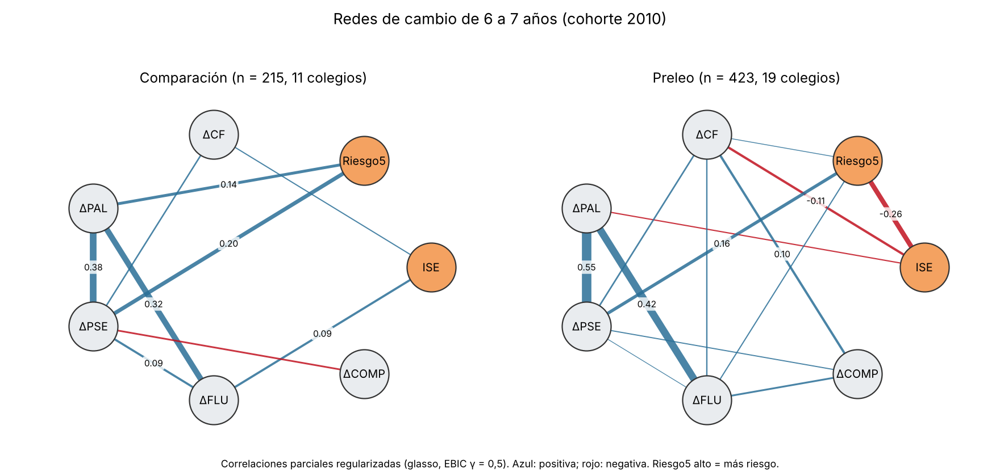
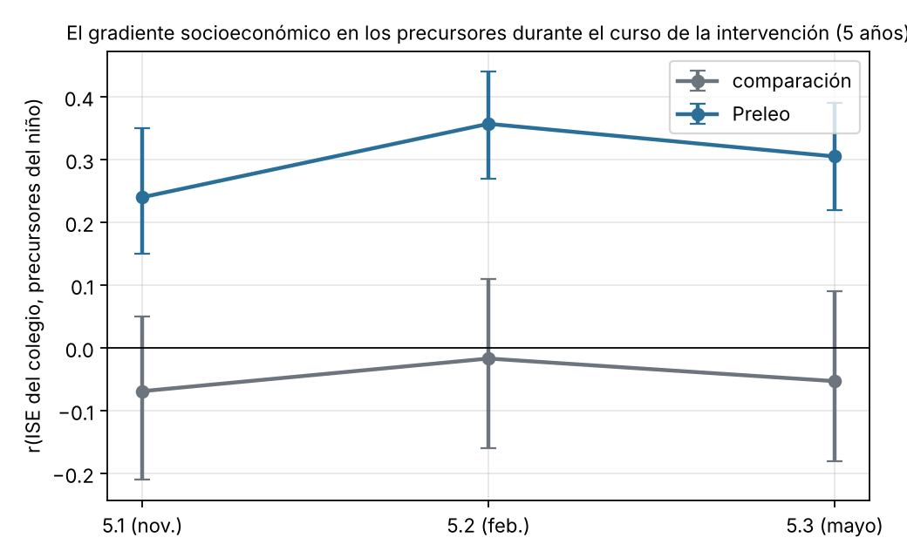
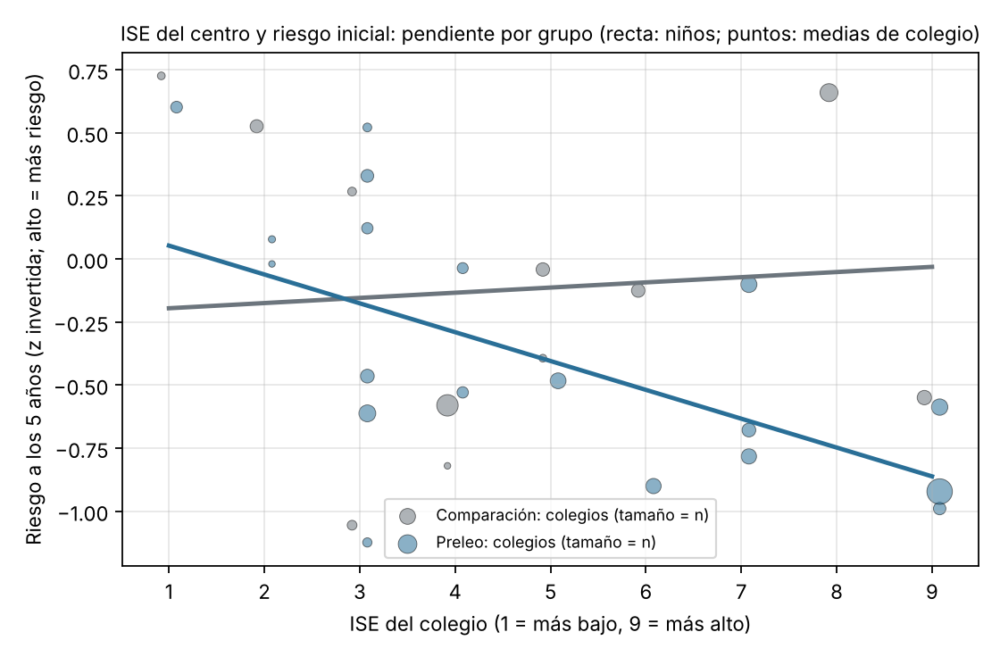
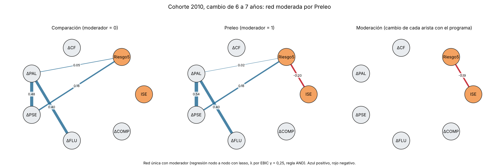
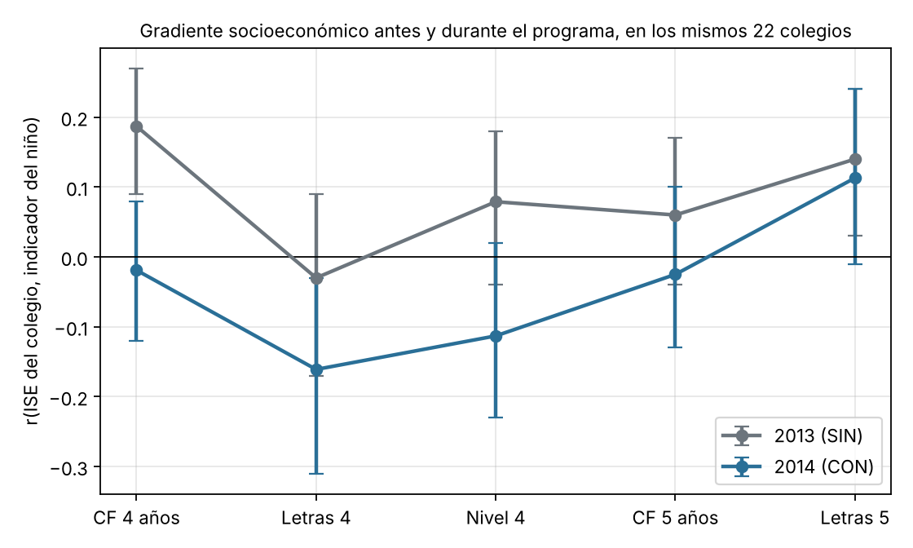
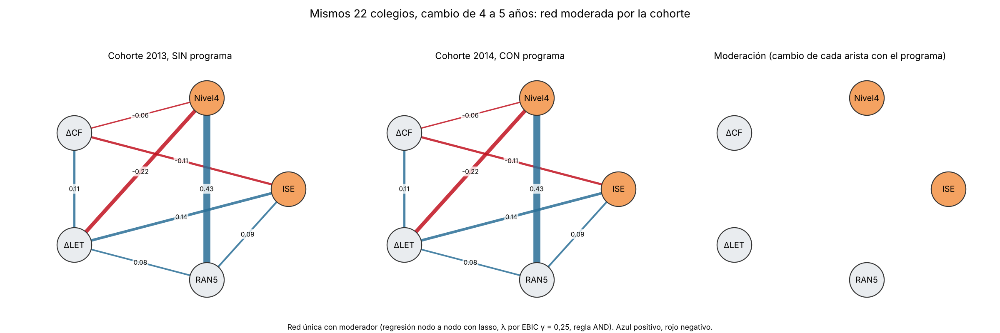

# M18 · ¿Desconecta Preleo el riesgo lector del nivel socioeconómico? — redes de cambio {.unnumbered}

*Seguimiento de un estudio propio · versión 1, 30/10/2026; versión 2 con el análisis rehecho sobre la cohorte 2010 completa y versión 3 con la red moderada y el contraste 2013/2014, 01/11/2026. Borrador en `LEEDUCA\2026\AUXI\RED` (script `REDES_AÑO.R`, `propuesta_redes_6.docx`, figuras; enero de 2026). Primer autor: P. J. López-Pérez. Añadido a la Agenda el 30/10/2026 para que no se pierda y para ir mejorándolo.*

::: {.callout-warning}
**Página de trabajo del grupo.** No aparece en el índice del libro: se llega desde el título del estudio en la [Agenda](../agenda.qmd#sec-agenda). No citar ni difundir fuera del grupo. Solo contiene datos agregados.
:::

[← Volver a la Agenda](../agenda.qmd#sec-agenda)

## Estado del borrador

| | |
|---|---|
| **Título provisional** | *Early intervention reorganizes the architecture of reading development: a network analysis of developmental change* (hay dos variantes más en el borrador) |
| **Muestra** | 506 niños de la cohorte 2010 en 20 colegios (10 Preleo, 10 de comparación; 306/200), la misma matriz de la tesis de Auxi y de «Who Benefits and Why»; datos completos a los 6 y 7 años |
| **Nodos** | Cambios de 6 a 7 años (Δ = X₇ − X₆) en conciencia fonológica, fluidez, decodificación (palabras y pseudopalabras), comprensión, más sexo, ISE (3 niveles), riesgo inicial (categórico) y CI |
| **Método** | Modelos gráficos mixtos (`mgm`, regla AND) estimados por separado en cada grupo; permutación de la **fuerza global** (B permutaciones); predictibilidad por nodo con red elástica y validación cruzada de 10 pliegues |
| **Hallazgo** | En comparación, el cambio sigue organizado por ISE y riesgo, con la decodificación aislada; en Preleo, ΔCF es el centro de la red, el ISE queda periférico y la predictibilidad de ΔCF sube de R² = .31 a .50; la de Δcomprensión pasa de −.02 a .03 |
| **Escrito** | Resumen, introducción, método, resultados (figura 1, figura S1, tabla S1) y discusión en inglés, ≈ 2.900 palabras |
| **Falta** | Las comprobaciones de abajo; indicador de uso del colegio; decidir la cohorte de réplica; lista de autores; revista |

## En cinco líneas

La idea es buena y tiene un argumento de equidad que ningún análisis de medias da: si Preleo **atenúa** la dependencia entre el nivel socioeconómico del centro y el riesgo lector, el programa no solo sube la media, sino que cambia de quién depende el progreso. El dibujo actual lo sugiere, pero cuatro explicaciones alternativas producen el mismo dibujo y hay que descartarlas antes de escribir «desconecta». El borrador compara la fuerza global de las dos redes, no la arista ISE–riesgo; con 306 frente a 200 niños la regularización deja la red pequeña más dispersa; el ISE es del colegio y Preleo también, así que con 10 centros por grupo la arista refleja diferencias entre colegios; y las puntuaciones de diferencia arrastran regresión a la media. Resueltas esas cuatro, el resultado es publicable y, con el indicador de uso como dosis, muy sólido.

## Debilidades y qué hacer con cada una

| # | Debilidad | Qué se hace | Estado |
|---|---|---|---|
| 1 | **Se contrasta la red entera, no la arista.** La permutación del script compara la fuerza global; la afirmación central es sobre ISE–riesgo (y riesgo–ΔCF) | Permutación de **cada arista** (guardar el peso en cada permutación; o `NetworkComparisonTest` con `test.edges`) e intervalo por bootstrap no paramétrico con `bootnet` en cada grupo; comprobar la estabilidad de la centralidad (CS) | Pendiente |
| 2 | **Grupos de tamaño distinto (306/200).** Con `mgm` y EBIC, la red más pequeña pierde aristas por sí sola | Repetir con submuestras de 200 en los dos grupos (varias veces) y con el mismo λ en ambos; alternativa: **una sola red moderada** (`mgm` con Preleo como moderador), que contrasta las diferencias dentro de un modelo | Pendiente |
| 3 | **Restricción de rango del ISE.** Si los colegios Preleo abarcan un abanico de ISE más estrecho, la arista se debilita sola | Comparar la distribución del ISE (y su valor continuo, no en 3 niveles) en los dos grupos; repetir en un subconjunto de ISE comparable; el emparejamiento de «Who Benefits» ya da ese subconjunto | Pendiente |
| 4 | **Pocos colegios detrás del ISE.** ISE y Preleo son de colegio: 10 centros por grupo. Las redes ignoran el anidamiento | Decirlo; comprobar con el ISE desagregado del centro (dejar un colegio fuera cada vez); si hay varianza, red con efectos de colegio parcializados (residuos de un modelo multinivel) | Pendiente |
| 5 | **Puntuaciones de diferencia.** Δ = X₇ − X₆ hereda la poca fiabilidad del cambio y la regresión a la media; la arista riesgo–ΔCF puede ser en parte artefacto (los de riesgo alto parten de más abajo y suben más) | Red con **cambio residualizado** (X₇ dado X₆) como análisis principal o de sensibilidad; usar las tres evaluaciones del curso (6.1, 6.2, 6.3, 7.1) para una pendiente en vez de una diferencia | Pendiente |
| 6 | **Variables categóricas a tres niveles en `mgm`** (ISE, riesgo). Las aristas con categóricas no tienen signo y se comparan mal entre grupos | ISE continuo (valor del centro) y riesgo continuo (compuesto a los 5 años) en un modelo gaussiano; dejar el mixto como comprobación | Pendiente |
| 7 | **Predictibilidad de la comprensión** (R² de −.02 a .03): se presenta como «acoplamiento emergente» y es ruido | Quitarlo de las conclusiones o reportarlo con intervalo | Decidido: suavizar |
| 8 | **Lenguaje causal** («reorganiza», «desconecta») con un diseño cuasiexperimental por centro | «Se asocia con una atenuación de…»; la dosis (uso del colegio) es lo que acerca a lo causal | Decidido |
| 9 | **Asignación de Preleo.** La matriz usa la de la tesis (2010); para 2010 y 2011 hay fuentes contradictorias | Confirmar que es la asignación v3; para la réplica en 2011, usar la propuesta v5 (intención de tratar) cuando el grupo la acuerde | Pendiente de Auxi y Juan Luis |
| 10 | **Grupo «control»** | En el texto, «comparación» (los centros se autoseleccionaron) | Decidido |

## Versión 2 (01/11/2026): el análisis rehecho con la cohorte completa

::: {.callout-important}
**El resultado central del borrador no se sostiene.** Con los indicadores corregidos desde la tabla larga (638 niños con las cinco medidas a 6 y a 7 años, 30 colegios, ISE y riesgo continuos), el ISE y el riesgo a los 5 años **no están conectados en los colegios de comparación** (arista 0,00; r = −0,05) y **sí en los colegios Preleo** (arista −0,26; r = −0,31). Es lo contrario de «Preleo desconecta el ISE del riesgo». Lo que sí aparece, y resiste todas las comprobaciones, es una **compensación en el crecimiento de la conciencia fonológica de 6 a 7 años**: en comparación ganan más los niños de ISE alto; en Preleo, los de ISE bajo.
:::

**Qué cambió respecto al borrador.** (1) Toda la cohorte 2010 de los 30 colegios de la tesis (`preleo_2010_indicadores_R.rds`, de `preleo_02`), no los 506; (2) ISE continuo (1–9) y riesgo continuo (compuesto de precursores a los 5 años, `PREC_5`, de la etiqueta de certeza v2), no categorías; (3) red gaussiana regularizada (glasso, EBIC γ = 0,5) en lugar del modelo mixto con nodos categóricos; (4) contraste **por arista** con 1.000 permutaciones de la condición, bootstrap de 500 por arista, 200 submuestras de igual tamaño, cada colegio fuera; (5) cambio residualizado y CI como sensibilidad; (6) la prueba directa: ISE × Preleo con errores típicos agrupados por colegio; (7) rigor de aplicación como dosis; (8) el gradiente ISE–precursores trimestre a trimestre del curso de 5 años. Guion `04\scripts\m18_redes_preleo.py` (porte a R en `scripts\R\m18_redes_preleo.R`, sin ejecutar aún); salida `04\DIAGNOSTICO\m18_redes_preleo_v1.xlsx`.

**Por qué el borrador decía otra cosa.** En la matriz de 506, la correlación bruta entre el ISE en tres niveles y el riesgo en tres niveles es −0,01 en comparación y −0,07 en Preleo: no había gradiente en ningún grupo. La arista «ISE–riesgo» del modelo mixto venía de asociaciones entre categorías sin orden, no de una relación monótona, y la regularización con 200 niños en comparación y 306 en Preleo hizo el resto. Con la cohorte completa y las variables continuas, el gradiente de los colegios Preleo se ve (los 131 niños de esos colegios que no estaban en los 506 lo tienen con r = −0,41).

### Muestra

| | Comparación | Preleo |
|---|---|---|
| Niños con las cinco medidas a 6 y 7 | 215 | 423 |
| Colegios | 11 | 19 |
| ISE: media (DT), rango | 5,2 (2,3), 1–9 | 5,8 (2,6), 1–9 |
| Riesgo a los 5 años (z, alto = más riesgo) | −0,11 | −0,50 |
| CF a 6 años (z) | 0,01 | 0,15 |
| Dificultad persistente (etiqueta v2) | 11,6 % | 10,4 % |
| De ellos, en la matriz de 506 | 190 | 292 |

Los dos grupos cubren todo el rango de ISE: no hay restricción de rango en Preleo (la debilidad 3 del borrador no se da; la hay, si acaso, en comparación, con 107 de 215 niños en ISE 4–6).

### Redes de cambio por grupo

{width="100%"}

| Arista | Preleo | Comparación | Diferencia | p (permutación) | Bootstrap Preleo | Bootstrap comparación |
|---|---|---|---|---|---|---|
| **ISE–Riesgo5** | **−0,26** | 0,00 | −0,26 | **,001** | −0,34; −0,13 (100 % ≠ 0) | 0,00; 0,07 (11 % ≠ 0) |
| **ISE–ΔCF** | **−0,11** | +0,03 | −0,14 | **,002** | −0,19; 0,00 (91 % ≠ 0) | 0,00; 0,16 (49 %) |
| ISE–ΔFLU | 0,00 | +0,10 | −0,10 | ,018 | | 0,00; 0,21 (80 %) |
| Riesgo5–ΔPAL | 0,00 | +0,14 | −0,14 | ,009 | | 0,00; 0,26 (95 %) |
| Riesgo5–ΔPSE | +0,16 | +0,20 | −0,05 | ,55 | | |
| ΔPAL–ΔPSE | +0,55 | +0,38 | +0,17 | ,08 | | |
| ΔPAL–ΔFLU | +0,42 | +0,32 | +0,10 | ,32 | | |
| ΔCF–ΔCOMP | +0,10 | 0,00 | +0,10 | ,15 | | |
| Fuerza global | 1,89 | 1,38 | +0,51 | ,22 | | |

Lectura. En Preleo el riesgo inicial depende del ISE (signo negativo: más ISE, menos riesgo) y el cambio en CF también (más ISE, **menos** ganancia: los niños de ISE bajo recuperan). En comparación, el ISE no se relaciona con el riesgo y sí, positivamente, con las ganancias en CF y en fluidez (más ISE, más ganancia), y el riesgo inicial predice más ganancia en decodificación de palabras (regresión a la media o recuperación en los de peor partida). La red de cambio es más densa en Preleo (fuerza 1,89 frente a 1,38), pero la diferencia global no es significativa.

### Las comprobaciones

| Comprobación | Resultado |
|---|---|
| **Cambio residualizado** (X7 dado X6) | Mismas aristas: ISE–Riesgo5 −0,26 frente a 0,00 (p = ,002); ISE–ΔCF −0,06 frente a +0,07 (p = ,002); ISE–ΔFLU 0,00 frente a +0,13 (p = ,03) |
| **CI como nodo** (n = 596) | ISE–Riesgo5 −0,17 frente a 0,00 (p = ,025); ISE–ΔCF −0,05 frente a +0,08 (p = ,003). El CI se conecta solo con Riesgo5 (−0,25 y −0,17), no con los cambios |
| **Submuestras de Preleo de n = 215** (200) | ISE–Riesgo5: mediana −0,19, IC −0,29; −0,06; **ninguna** submuestra llega a 0,00. ISE–ΔCF: mediana −0,03 (el 51 % quedan por debajo de la de comparación en valor absoluto): esta arista sí depende del tamaño |
| **Cada colegio fuera** (30 veces) | ISE–Riesgo5 en Preleo entre −0,30 y −0,14; en comparación entre −0,04 y +0,04. Ningún colegio sostiene el resultado por sí solo |
| **Nivel colegio** (medias) | r(ISE, riesgo medio): −0,63 en los 19 colegios Preleo; −0,17 en los 11 de comparación. r(ISE, ΔCF media): −0,42 frente a +0,23 |
| **ISE × Preleo con errores por colegio** (prueba directa) | Riesgo5: interacción −0,14 (IC −0,33; 0,06; p = ,18): pendiente +0,02 en comparación, −0,11 en Preleo; con 30 colegios no llega a la significación. **ΔCF: −0,085 (IC −0,15; −0,02; p = ,010)**; residualizado, **−0,097 (p = ,001)**: pendiente +0,05 por punto de ISE en comparación, −0,04 en Preleo. ΔPAL y ΔFLU: no. Dificultad persistente: el ISE reduce el riesgo en los dos grupos (logit −0,31 y −0,23 por punto), sin moderación. CF a los 7: +0,09 por punto en comparación, +0,02 en Preleo (p = ,095) |
| **Rigor como dosis** (dentro de Preleo) | ISE–Riesgo5: −0,18 en rigor alto (10 colegios) y −0,12 en rigor bajo (9); interacción ISE × rigor p = ,15. El rigor correlaciona con el ISE del colegio: **r = 0,45** (los centros de ISE alto aplicaron mejor) |

### Cuándo aparece el gradiente

{width="75%"}

En comparación el gradiente es nulo los tres trimestres (−0,07, −0,02, −0,05). En Preleo ya está en noviembre (0,24, IC 0,15–0,35), antes de la mayor parte del programa, y sube a 0,36 en febrero y 0,31 en mayo (intervalos solapados). Es decir: **los colegios Preleo tienen gradiente socioeconómico desde el inicio y los de comparación no**; el programa, si acaso, lo acentuó un poco durante el curso, y los centros de ISE alto fueron los que lo aplicaron con más rigor.

{width="75%"}

### Qué artículo queda

No es el artículo del borrador. Es uno más interesante y más defendible, con tres resultados:

1. **El gradiente socioeconómico en los precursores no es universal.** Once colegios de Málaga sin programa no lo muestran a los 5 años; diecinueve con programa sí. Como la asignación fue por autoselección, el gradiente puede ser una característica de los centros que se apuntaron al programa (más heterogéneos, con centros de ISE 9 y de ISE 3) más que un efecto del programa. Hay que decirlo así.
2. **Durante el curso de la intervención el gradiente no se cerró** (0,24 → 0,31) y la implementación fue mejor en los centros de ISE alto (r = 0,45). Es un resultado sobre equidad en la implementación de programas universales que casi nadie publica: el programa llega mejor donde menos falta hace.
3. **De 6 a 7 años, con el programa ya terminado, el crecimiento de la conciencia fonológica compensa**: en comparación crecen más los de ISE alto; en Preleo, los de ISE bajo (interacción p = ,001 con cambio residualizado, errores por colegio). Es la única arista que distingue las dos redes en la dirección que el borrador defendía, y es la que sostiene el título «compensación».

Título posible: *Does a universal phonological-awareness programme close or widen the socioeconomic gradient? Network and moderated-growth evidence from 30 Spanish schools.* Lo que no se puede decir: «reorganiza la arquitectura», «desconecta el riesgo del ISE».

### Lo que falta

- **Cohorte 2011** (confirmado por A. Sánchez el 31/10): los 35 colegios que entraron en 2015/16 fueron todos CON; no hay grupo de comparación interno. No sirve para replicar el contraste; sirve para la pregunta 2 (gradiente y rigor dentro de CON, con el programa desde los 4 años) y para fidelidad. El contraste limpio pendiente es 2013 (SIN) frente a 2014 (CON) en los 22 colegios comunes, pero 2014 solo llega a los 6 años: permite Δ5→6, no Δ6→7.
- Confirmar con Auxi y Juan Luis la condición de los 11 colegios de comparación en 2010 (la asignación v3 y la tesis coinciden en esta muestra).
- Red única **moderada por Preleo** (`mgm` con moderador, en R) como presentación alternativa al par de redes.
- Ejecutar el porte a R y comprobar que coincide.
- Decidir si el artículo va con la cohorte 2010 sola (30 colegios) o espera a 2013/2014 con Δ5→6.

## Versión 3 (01/11/2026): red única moderada y el contraste limpio 2013 frente a 2014

Guion `04\scripts\m18_v3_moderada_y_2013_2014.py` → `04\DIAGNOSTICO\m18_v3_resultados_v1.xlsx` (porte a R con `mgm` en la parte 3 de `scripts\R\m18_redes_preleo.R`, sin ejecutar).

### La red única moderada por Preleo (cohorte 2010, 6→7)

En lugar de estimar dos redes y compararlas, se estima **una sola red en la que cada arista puede cambiar con el programa**: regresión nodo a nodo con lasso sobre los demás nodos, la condición y los productos nodo × condición (λ por EBIC, γ = 0,25, regla AND; es el modelo de `mgm` con moderador). Las aristas de moderación son, por construcción, las que la regularización no deja a cero cuando compiten con las principales: un criterio más exigente que el contraste por permutación.

{width="100%"}

| Arista | Comparación | Preleo | Moderación | Bootstrap de la moderación (500) |
|---|---|---|---|---|
| **ISE–Riesgo5** | 0,00 | **−0,20** | **−0,19** | −0,29; 0,00 (≠ 0 en el 92 %) |
| ISE–ΔCF | 0,00 | 0,00 | 0,00 | −0,18; 0,00 (≠ 0 en el 42 %) |
| Riesgo5–ΔPSE | +0,18 | +0,18 | 0,00 | — |
| Riesgo5–ΔPAL | +0,05 | +0,02 | 0,00 | — |
| resto | 0 | 0 | 0 | ≠ 0 en < 10 % |

Con el criterio más exigente **sobrevive una sola moderación: ISE–Riesgo5**, que aparece con el programa (0,00 → −0,20). La compensación en ΔCF no llega a entrar en la red moderada (lo hace en el 42 % de las remuestras): es un efecto real pero pequeño, que el modelo de regresión con errores por colegio detecta (p = ,001) y la red regularizada no retiene. En el artículo, la red moderada es la figura principal y la moderación de ΔCF se presenta con el modelo de regresión, no con la red.

### El contraste limpio: 2013 (sin programa) frente a 2014 (con programa) en los mismos 22 colegios

Los 22 colegios que entraron en 2017/18 evaluaron a la cohorte 2013 sin programa y a la 2014 con programa desde los 4 años (confirmación de A. Sánchez, 31/10). Es el contraste que elimina la autoselección de centros. Dos límites: la tabla larga solo tiene de 2014 los momentos 4.1 a 5.2 (el curso de 5 años fue 2019/20 y se cortó en marzo; no hay 5.3 ni 6.x), así que el contraste es **el cambio de 4 a 5 años en los precursores, durante el programa**; y solo valen las tareas con el mismo código en las dos cohortes (fuera las letras de 5.1 y el RAN de colores de 4.1, que cambiaron de versión).

| | 2013 (SIN) | 2014 (CON) |
|---|---|---|
| Niños con CF y letras a 4 y a 5 | 374 | 307 |
| Colegios con ISE | 18 | 17 |
| ISE medio | 5,6 | 5,5 |
| Indicadores | CF4 (contar sílabas, emparejar sílaba inicial y final, supresión de sílaba inicial; 4.1–4.2), LET4 (letras 535, 4.2–4.3), CF5 (identificación de fonema inicial y supresión de fonema final, 5.2), LET5 (letras 67, 5.2), RAN5 (objetos, 5.1); z con referencia 2013 | |

{width="75%"}

| Qué se contrasta | 2013 (SIN) | 2014 (CON) | ISE × cohorte (errores por colegio) |
|---|---|---|---|
| r(ISE, CF a 4 años) | +0,19 (0,09; 0,27) | −0,02 (−0,12; 0,08) | nivel 4: −0,065, p = ,004 |
| r(ISE, CF a 5 años) | +0,06 (−0,04; 0,17) | −0,03 (−0,13; 0,10) | CF5 dado CF4: −0,003, p = ,95 |
| r(ISE, letras a 5) | +0,14 | +0,11 | LET5 dado LET4: +0,02, p = ,58 |
| r(ISE, ΔCF 4→5) | −0,08 | −0,01 | +0,03, p = ,69; con EF de colegio +0,003, p = ,97 |
| r(ISE, ΔLET 4→5) | +0,21 | +0,32 | +0,02, p = ,57; con EF +0,01, p = ,72 |
| r(ISE, RAN a 5) | +0,29 (0,17; 0,40) | −0,01 (−0,14; 0,13) | −0,105, p = ,002 |
| Efecto medio del programa, dentro de colegio | | | ΔCF: −0,33 (−0,72; 0,07), p = ,10; ΔLET: +0,05, p = ,63 |

Redes por cohorte (glasso, 1.000 permutaciones): ninguna arista con el ISE difiere salvo ISE–RAN5 (+0,23 en 2013, 0,00 en 2014; p = ,007). La **red moderada por la cohorte no retiene ninguna moderación** (Figura 7): la estructura del cambio 4→5 es la misma con y sin programa.

{width="100%"}

**Lectura.** En los mismos colegios, el gradiente socioeconómico en la conciencia fonológica es pequeño o nulo a los 4 y a los 5 años, con y sin programa, y el programa **no lo cambia** (interacciones en ΔCF y en CF5 dado CF4 indistinguibles de cero, también con efectos fijos de colegio). Lo único que el programa parece alterar es el gradiente del RAN a los 5 años (desaparece en 2014), que conviene tratar con cautela (RAN de 5.1, n menor). El efecto medio del programa sobre ΔCF es negativo y no significativo, pero no es interpretable como efecto del programa: la cohorte 2014 partía más alta en CF4 (+0,26) y las tareas de CF de 4 y 5 años no son las mismas.

**Qué cambia en el artículo.** El contraste limpio dice que el gradiente de los colegios Preleo de 2010 **no es un efecto del programa**: donde el programa se aplicó a cohortes consecutivas en los mismos centros, el gradiente ni aparece ni desaparece. El resultado 1 (el gradiente no es universal y es un rasgo de los centros que se autoseleccionaron) queda reforzado; el 2 (implementación mejor en los centros de ISE alto) sigue siendo de 2010; el 3 (compensación en ΔCF de 6 a 7) solo se puede comprobar en 2010, porque la cohorte 2014 no tiene datos de 6 y 7. La red moderada aporta la presentación compacta: en 2010 una sola arista cambia con el programa (ISE–Riesgo5); en 2013/2014, ninguna.

### Lo que queda para la versión 4

- Confirmar con Auxi los tres colegios de los 22 sin marca de condición en la tabla larga (dos sin ISE, excluidos) y los códigos de tarea que cambiaron entre 2013 y 2014.
- Si el grupo recupera la evaluación en papel y tableta de 2020/21 (`03_PAPEL_TABLETS_PANDEMIA`) para la cohorte 2014 a los 6 años, se puede extender el contraste limpio a Δ5→6.
- Ejecutar la parte 3 del porte a R (`mgm` con moderador, `NCT`) y comprobar.

## Lo que puede convertirlo en un artículo fuerte (v1, 30/10)

- **Indicador de uso como dosis.** `06_PRELEO_COLEGIOS\acceso_colegios_R_v1.xlsx` da la regularidad de acceso de cada colegio. Dentro del grupo Preleo, red moderada por la regularidad: si la arista ISE–riesgo se debilita más cuanto más usa el colegio la plataforma, es el mejor apoyo posible para la lectura causal.
- **Réplica en la cohorte 2011**, que tuvo el programa desde los 4 años en los mismos centros (asignación v5, pendiente).
- **Tres evaluaciones por curso**: pendientes en vez de diferencias, y redes a 6.1, 6.2, 6.3 y 7.1 para ver cuándo se atenúa la arista.
- Encaja con el artículo de compensación acotada (`2026\AUXI\FINALES`): allí Preleo comprime la distribución; aquí cambia de qué depende el progreso. Conviene que se citen mutuamente.

## Ficha para la Agenda

- **Pregunta:** ¿Atenúa Preleo la dependencia entre el nivel socioeconómico del centro, el riesgo inicial y el progreso lector de 6 a 7 años? ¿Se organiza el cambio en torno a la conciencia fonológica cuando hay programa?
- **Datos:** Cohorte 2010, 506 niños en 20 colegios (matriz de la tesis); indicador de uso por colegio; cohorte 2011 para replicar.
- **Método:** Redes de cambio con modelos gráficos mixtos y una sola red moderada por Preleo; contraste por arista con permutación y bootstrap; cambio residualizado; dosis por regularidad de uso.
- **Revistas posibles:** *Scientific Studies of Reading*, *Journal of Educational Psychology*, *Reading and Writing*, *Developmental Science*.

## Archivos

v3: `04\scripts\m18_v3_moderada_y_2013_2014.py`, `04\DIAGNOSTICO\m18_v3_resultados_v1.xlsx`. v2: `04\scripts\m18_redes_preleo.py`, `04\scripts\R\m18_redes_preleo.R` (porte), `04\DIAGNOSTICO\m18_redes_preleo_v1.xlsx`, `04\DIAGNOSTICO\figs_M18\`. `LEEDUCA\2026\AUXI\RED\REDES_AÑO.R`, `propuesta_redes_6.docx`, `Method.docx`, `Fig1_DeltaNetworks.pdf`, `FigS1_*`, `FigS2_Descriptives.png`. Datos: `data_paper.xlsx` (misma matriz que `2026\AUXI\data.xlsx`). Las comprobaciones nuevas irán a `04\scripts\R\m18_redes_preleo.R` y a `04\DIAGNOSTICO\R\`.
