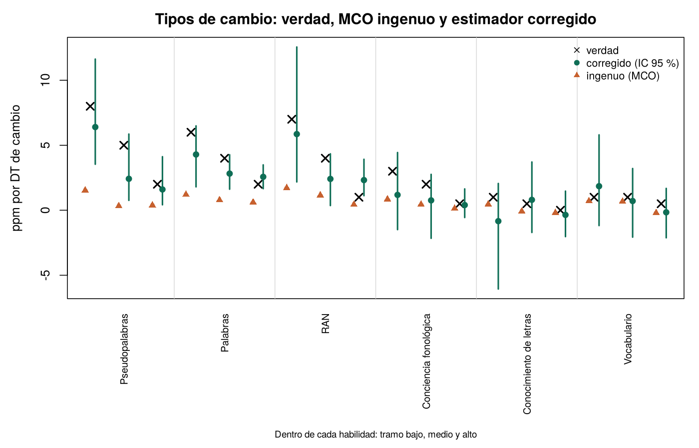
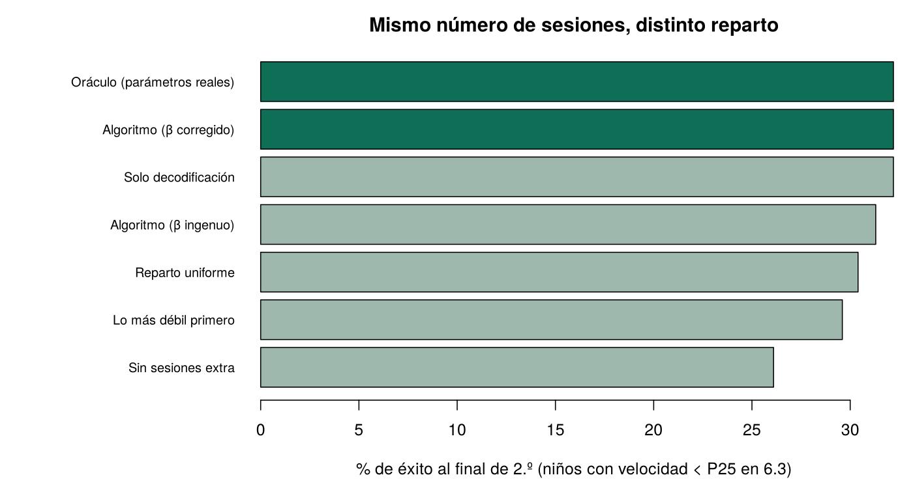

# M19 · Perfiles de éxito y algoritmo de mejora {.unnumbered}

*Desarrollo de un estudio de la Agenda · versión 1, 01/11/2026. Idea y decisión de P. J. López-Pérez (31/10/2026): pasar del perfil de riesgo al perfil de éxito. Script `R/m19_exito.R` (solo R base).*

::: {.callout-warning}
**Página de trabajo del grupo.** Todo lo que aparece aquí procede de datos simulados: sirve para comprobar el procedimiento, no describe a ningún niño ni colegio. No aparece en el índice del libro: se llega desde el título del estudio en la [Agenda](../agenda.qmd#sec-agenda). No citar ni difundir fuera del grupo.
:::

[← Volver a la Agenda](../agenda.qmd#sec-agenda)

## En cinco líneas

El informe de cribado dice quién está en riesgo. Este estudio propone que diga, para cada niño, **qué probabilidad tiene de alcanzar el criterio lector del curso siguiente, qué habilidades la limitan y cuánto se espera ganar si se trabajan**. Es el mismo modelo estadístico que el riesgo, con tres cambios: el criterio se define por curso, la velocidad lectora se usa como indicador continuo de mejora y cada habilidad tiene un «tipo de cambio» (palabras por minuto que aporta una DT más de esa habilidad) y una maleabilidad (cuánto se mueve con la práctica). Encaja con el modelo de riesgo acumulativo y resiliencia de la nueva definición de dislexia [@catts2022riesgo; @catts2026definicion].

## La ficha del alumno

La ficha muestra el perfil en percentiles, los objetivos del trimestre, la probabilidad de éxito con su intervalo, el plan de sesiones y la exposición a Preleo (condición del colegio × fidelidad) como una variable más. Los parámetros son ilustrativos.

```{=html}
<iframe src="../apps/M19_perfil_exito.html" width="100%" height="2800" style="border:0" title="Ficha de perfil de éxito (simulación)"></iframe>
```

## Diseño

| Elemento | Decisión |
|---|---|
| Criterio de éxito | Fuera de riesgo (P25; P10 como sensibilidad) en el criterio del curso siguiente, baremado en SIN: 4 años → CF y letras a final de 5; 5 → palabras y pseudopalabras a final de 1.º; 6 → fluidez a final de 2.º; 7 → fluidez y comprensión a final de 3.º |
| Segundo criterio | Comprensión lectora, modelada igual y en interacción con la fluidez (cuatro perfiles de salida) |
| Tipos de cambio | Primeras diferencias entre trimestres: ΔVL ~ Σ β·ΔS por tramo (<P25, P25–P50, >P50) + γ·VL previa + colegio + momento |
| Error de medida | Corrección por fiabilidad (método de momentos) con el error de cada tarea = √(1 − α/ω del manual); tramo asignado con la puntuación de dos momentos antes |
| Maleabilidad | Contraste SIN/CON dentro de colegio (cohortes 2013/2014, 22 colegios) convertido a sesiones con la dosis del programa; literatura para RAN y vocabulario |
| Plan | Algoritmo voraz con rendimientos decrecientes, tope en P75 y prerrequisitos |
| Control de calidad | Por colegio × sesión: completitud, tiempos plausibles, consistencia interna (β trisílabas ~ bisílabas), plausibilidad evolutiva, estabilidad de la tarea |

## Simulación con verdad conocida (01/11/2026)

2.000 niños simulados en 40 colegios con dos cohortes (SIN y CON), seis momentos de 6.1 a 7.3, con tipos de cambio, maleabilidad, dosis de Preleo, error de medida y efecto Mateo conocidos.

{width=100%}

- **El análisis ingenuo no sirve.** MCO sobre primeras diferencias recupera el 22 % del valor real: el cambio trimestral de una prueba corta es muy poco fiable. Con la corrección por fiabilidad y el tramo desfasado se recupera el 70 % y el intervalo cubre el valor real en 17 de 18 casillas. **Las fiabilidades del manual son un insumo del modelo.**
- **La maleabilidad se recupera bien** con el contraste SIN/CON (decodificación .385 frente a .40; conciencia fonológica .54 frente a .50).
- **El perfil no predice mejor que la velocidad sola.** AUC .92 en colegios no usados, bien calibrada, igual que la velocidad lectora sola. El valor del perfil está en el plan, no en la predicción.
- **El reparto de sesiones importa poco en este mundo.** Con 12 sesiones, en niños < P25: sin sesiones, 26 % de éxito; reparto uniforme o «lo más débil primero», 30 %; solo decodificación, algoritmo y oráculo, 32 %. El algoritmo evita la trampa del RAN (predice mucho, se mueve poco), pero no supera a una buena regla simple. Consecuencia: el ensayo debe contrastar el **encuadre del informe**, no el reparto.
- **El bucle cerrado no aprende con una medida por trimestre** (peso de actualización ≈ .02; ≈ .10 con 12 monitoreos). Personalizar exige medir con frecuencia la subhabilidad entrenada [@filderman2021ssmm].

{width=85%}

**Límites de la simulación:** el mundo simulado tiene casi la misma forma que el modelo; no incluye confusión por crecimiento estable correlacionado con la lectura, que es la amenaza principal de las primeras diferencias.

## Evidencia de apoyo

- El crecimiento de la fluidez en primaria es de 1–2 palabras por minuto a la semana [@tindal2013orf]; no se puede juzgar una intervención antes de 8–15 semanas de seguimiento [@ardoin2006rti; @christ2018bayes].
- Que el niño grafique su propia fluidez, se ponga metas y atribuya el éxito a la estrategia mejoró la fluidez en un ensayo aleatorizado [@didion2021mountain]: base de la versión para el alumno.
- Incluir las fortalezas en el informe eleva las expectativas del profesorado [@wellborn2012fortalezas]; la retroalimentación frecuente que llega también a la familia mejora el rendimiento [@siebert2018feedback].

## Estrategia de publicación

| | Artículo 1 | Artículo 2 |
|---|---|---|
| Diseño | Observacional y metodológico con los datos existentes; la simulación como estudio 1 | Ensayo aleatorizado por conglomerados: informe de éxito frente a informe de riesgo, misma intervención |
| Datos | Cohortes 2010–2013; maleabilidad con 2013/2014 | Un curso completo; 20–30 colegios por brazo para 0,2 DT; HRV en una submuestra |
| Formato | Informe registrado (*Registered Report*) | Preregistrado |
| Revistas | *Child Development*, *Developmental Science*; *Journal of Educational Psychology*, *Scientific Studies of Reading* | Según resultados: *Nature Human Behaviour*, *Psychological Science*; *Child Development*, *Journal of Educational Psychology* |

## Hitos (noviembre–diciembre de 2026)

| Semana | Hito |
|---|---|
| 3–6 nov | Simulación y página (hecho, 01/11) |
| 9–13 nov | Tabla maestra de colegios y condición Preleo en la matriz larga 2010 |
| 16–20 nov | Tipos de cambio y probabilidad de éxito en la cohorte 2010 |
| 30 nov–4 dic | Réplica 2011–2013 y maleabilidad con 2013/2014 |
| 9–11 dic | Documento para el grupo; datos de la práctica de [M20](M20.qmd) |
| 14–17 dic | Esquema del artículo 1 |

## Líneas que salen de aquí

- **[M20](M20.qmd)**: la práctica docente y el concurso de algoritmos con datos sintéticos generados por este script.
- **Versión para el alumno («Mi mapa lector»)**: el niño se compara solo consigo mismo, sin normas ni la palabra riesgo; por edades, de un paisaje que crece (3–5 años) a su propia curva de fluidez (6–8) y a leer sus datos (11).
- **Transferencia clínica (CMCI, Barranquilla)**: piloto de cribado de éxito y Preleo adaptado por niveles, con línea base múltiple y referencia local de baremos.

## Referencias {.unnumbered}

::: {#refs}
:::
