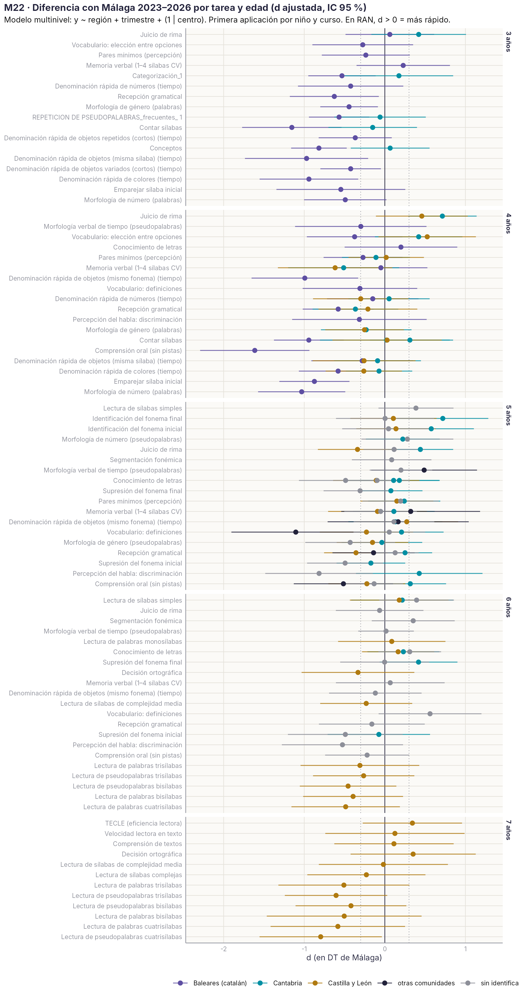
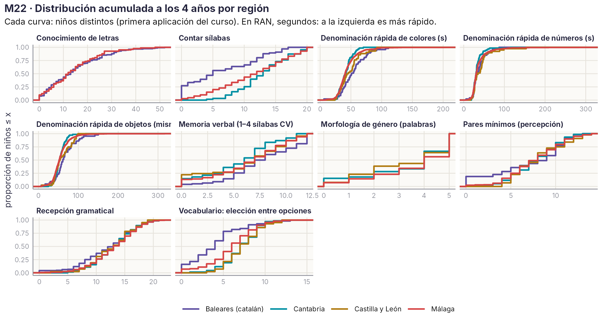
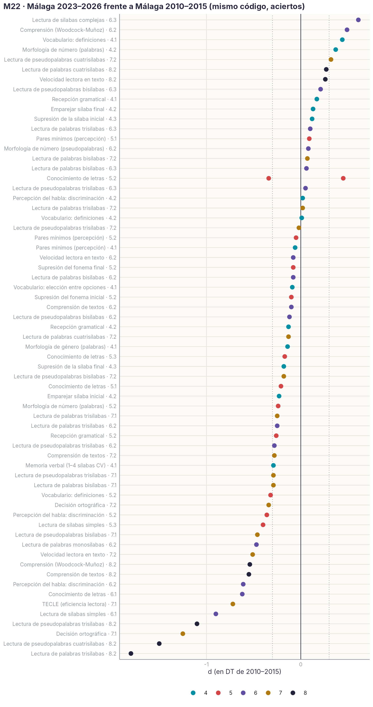
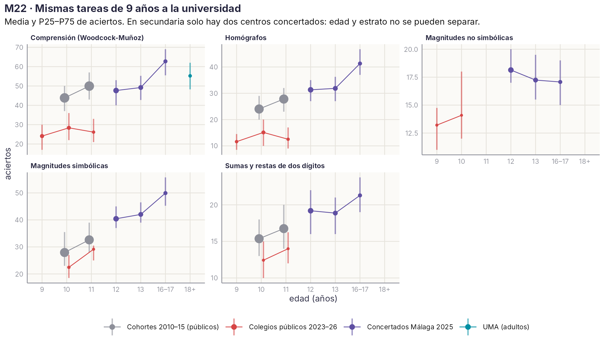

# M22 · Dinámicas poblacionales: los indicadores fuera de Málaga {.unnumbered}

*Desarrollo de un estudio de la Agenda · versión 2.1, 01/11/2026 (añade un resumen sin estadística). Idea de P. J. López-Pérez: estudiar cómo el contexto sociológico, lingüístico y de política educativa de cada comunidad se refleja en los indicadores de la plataforma. Script `R/m22_regiones.R` sobre las copias del servidor de 2023–2026. Muestra regional confirmada por A. Sánchez Gómez.*

::: {.callout-warning}
**Página de trabajo del grupo.** Proyecto interno. Solo datos agregados; los centros no se nombran y no se ordenan comunidades ni colegios. No aparece en el índice del libro: se llega desde el título del estudio en la [Agenda](../agenda.qmd#sec-agenda). No citar ni difundir fuera del grupo.
:::

[← Volver a la Agenda](../agenda.qmd#sec-agenda)

## Para leer en dos minutos

::: {.callout-tip}
## Lo esencial, sin estadística

1. **Las tareas funcionan igual fuera de Málaga.** Miden con la misma precisión en Cantabria, Castilla y León y Baleares. *Qué nos permite:* llevar la plataforma a otras comunidades sin rehacer las tareas.
2. **Un niño de Cantabria rinde como uno de Málaga de su misma edad.** *Qué nos permite:* usar, de momento, los baremos de Málaga en Cantabria.
3. **En Castilla y León van un poco por detrás, sobre todo en lectura a los 6–7 años, pero no es seguro:** son pocos colegios. *Qué nos permite:* usar los baremos de Málaga con cautela y ampliar la muestra antes de sacar conclusiones.
4. **En Baleares los niños no rinden menos; la tarea en catalán es otra tarea.** Fallan más solo donde cambian las palabras (vocabulario, sílabas, gramática). En letras, memoria y nombrar números van igual que en Málaga. *Qué nos permite:* hacer un baremo propio para la versión catalana y no comparar sus puntuaciones con las del castellano.
5. **Pesa más el colegio que la comunidad.** Dentro de una misma comunidad hay más diferencia entre colegios que entre comunidades. *Qué nos permite:* fijarnos en el contexto de cada centro (nivel socioeconómico, cómo se aplica la plataforma, Preleo) más que en la región. Enlaza con [M18](M18.qmd) y [M19](M19.qmd).
6. **Los niños de 4 años de Málaga rinden hoy como hace diez años; a los 5, algo menos en letras.** *Qué nos permite:* seguir usando los baremos de 2010–2015 a los 4 años y revisar el de letras a los 5 (posible efecto de la pandemia o de cambios en la enseñanza).
7. **Tenemos datos de secundaria que no conocíamos:** dos colegios concertados de Málaga con 237 alumnos de 12 a 17 años. *Qué nos permite:* empezar un baremo de secundaria y estudiar el alto estrato, aunque para comparar hacen falta colegios públicos de esas edades.
8. **Los niños de 9–11 años evaluados ahora en colegios públicos parecen casos derivados, no aulas completas.** *Qué nos permite:* no usarlos como referencia y pedir al ingeniero el motivo de cada evaluación.
:::

**Cómo leer la gráfica principal** (la primera de «Resultados»). Cada punto es una tarea a una edad. Si el punto está a la derecha de la línea vertical, esa comunidad rinde mejor que Málaga; a la izquierda, peor. La raya horizontal es el margen de duda: si cruza la línea vertical, no podemos asegurar que haya diferencia. Las distancias se miden en «pasos» del tamaño de la diferencia habitual entre dos niños de la misma edad: 0,2 es una diferencia pequeña, 0,5 media y 0,8 grande.

**Lo que necesitamos del grupo**

- Saber de qué colegio son «Isabel la Católica» (186 niños) y «Virgen de la Peña» (Mijas o Bembibre).
- Saber quién coordinó las aplicaciones de Baleares, Cantabria y Castilla y León, y si se evaluó a aulas enteras o a niños concretos.
- Decidir si la versión catalana merece su propio baremo y, si es así, con qué colegios de Baleares seguir.
- Marcar qué colegios consideramos de alto estrato (columna `estrato_PJ` de la tabla de centros).

## Resumen técnico

Desde 2023 la plataforma se usa fuera de Málaga: Cantabria, Castilla y León (Burgos, León, Soria, Salamanca) y Baleares, este último con versiones de las tareas en catalán. Antes de leer una diferencia entre comunidades como un efecto del contexto hay que descartar dos explicaciones más simples: que la tarea **mida distinto** (otra lengua, otros ítems) y que la muestra sea **otra** (niños derivados en lugar de aulas completas). Con esas dos cautelas, **Cantabria rinde como Málaga**, **Castilla y León algo por debajo** y **Baleares por debajo solo en las tareas que dependen de las palabras concretas**, lo que apunta al instrumento y a la lengua, no a la población. El colegio pesa tanto como la comunidad o más (ICC ≈ .20). Los dos concertados de Málaga aportan una muestra inesperada de secundaria (12–17 años) que alarga la curva hasta la universidad.

## Muestra 2023–2026

| Región | Centros | Niños (evaluación) | Edades | Lengua de las tareas |
|---|---|---|---|---|
| Málaga | 73 | ≈ 2.760 | 3–7 (y 12–17 en dos concertados) | castellano |
| Cantabria | 20 | ≈ 530 | 3–7 | castellano |
| Castilla y León | 13 | ≈ 310 | 4–8 | castellano |
| Baleares | 9 | ≈ 590 | 3–4 (marzo–abril de 2024) | catalán |
| Sin identificar | 2 (y varios con 1–3 niños) | ≈ 240 | 4–7 | castellano |

Los centros se localizaron uno a uno (comunidad, provincia, municipio y titularidad), con la confianza anotada. C. Valenciana, Sevilla y Ciudad Real tienen menos de 50 niños entre todos y no entran en las comparaciones.

**«VAL» no es valenciano.** En la nomenclatura de la plataforma, `BL_DF_VAL_…` son actividades de *velocidad de acceso al léxico* (RAN), en castellano, pensadas para trabajar la velocidad. Solo las actividades que empiezan por `BL_VAL_` (30 códigos) son versiones en catalán, y se aplicaron únicamente en Baleares. El guion enlaza cada versión catalana con su código castellano.

## Método

- Primera aplicación de cada niño en cada tarea y curso escolar. Aciertos; en RAN, el logaritmo del tiempo (signo invertido: d > 0 es más rápido).
- Celdas tarea × edad con ≥ 30 niños y ≥ 3 centros en Málaga y en otra región (89 celdas).
- Modelo multinivel por celda: y ~ región + trimestre + (1 | centro). d ajustada = coeficiente de la región / DT de Málaga.
- Selección: % de niños evaluados en aulas completas (≥ 10 niños de la misma edad, centro y mes) y % de sesiones fuera de protocolo.
- Alfa de Cronbach por región con las respuestas ítem a ítem.

## Resultados

{width=100%}

| Región | d mediana frente a Málaga | Lectura |
|---|---|---|
| Cantabria | −0,07 a +0,22 según la edad | Misma población a efectos de baremo. Algo mejor en rima (4 años, +0,7) y en identificar fonemas (5 años, +0,6 a +0,7). |
| Castilla y León | −0,1 a −0,3 | Ligeramente por debajo; en lectura de palabras y pseudopalabras a 6–7 años, −0,3 a −0,8, casi siempre con el 0 en el intervalo (≈ 6–8 centros por edad). |
| Baleares (catalán) | −0,35 a −0,5 | Por debajo en contar sílabas, vocabulario, morfología, comprensión oral y RAN de colores (−0,5 a −1,6); **igual** en RAN de números, letras, memoria verbal y pares mínimos. |

{width=100%}

- **Castellano y catalán.** Las dos ortografías son transparentes, pero el catalán tiene vocal neutra, más grupos consonánticos finales y palabras más cortas, y las versiones catalanas usan otras palabras (otra frecuencia y longitud). Las tareas sin contenido léxico salen iguales y las que dependen de las palabras concretas no. Conclusión: **los constructos son comparables; las puntuaciones brutas, no**. Se comparan curvas evolutivas, fiabilidad e invarianza, y los baremos van por estrato.
- **Fiabilidad comparable entre regiones** (letras .93–.95; rima .67–.92; vocabulario .84–.90). La morfología verbal en catalán (actividad 12323) sale toda a 0 a los 4 años: revisar la actividad.
- **El colegio pesa más que la región.** ICC de centro .10–.45 (mediana ≈ .20); la región explica menos del 15 % de la varianza entre centros.

### Málaga ahora y hace una década

{width=85%}

A los 4 años no hay cambio apreciable (d mediana ≈ +0,1). A los 5, ligera bajada en letras (−0,3) y lectura de sílabas (−0,4). A 6.2 los datos nuevos son mejores en lectura, pero proceden de 1–2 centros. La caída a 8.2 en palabras tri y cuatrisílabas es la incidencia conocida de la sesión 905.

### Secundaria y alto estrato: una muestra inesperada

Los dos centros concertados de Málaga no aplicaron la batería de infantil: evaluaron en 2025 a 237 alumnos de 12 a 17 años con la batería de 10–11 años y adultos (comprensión de Woodcock-Muñoz, homógrafos, sumas y restas, magnitudes). Son los mismos códigos que las cohortes 2010–2015 a los 10–11 años y que los estudiantes de la UMA, así que la curva se puede seguir de 9 años a la universidad.

{width=100%}

A los 12–13 años rinden como los alumnos de 11 años de los colegios públicos de 2010–2015 o algo por encima, y a los 16–17 superan a la muestra de la UMA en comprensión. **Edad y estrato van juntos**: no hay concertados de 10–11 años ni públicos de 12–17, así que la figura describe, no compara estratos. Los colegios públicos de 2023–2026 a 9–11 años rinden muy por debajo de las cohortes antiguas; casi todas sus sesiones están fuera de protocolo y probablemente son niños derivados.

## Variables de contexto (siguiente paso)

| Dimensión | Variable | Fuente |
|---|---|---|
| Socioeconómica | Renta media por hogar, riesgo de pobreza, estudios de los adultos | INE (Atlas de distribución de renta, ECV) |
| Demográfica | Alumnado extranjero, tamaño del municipio, ruralidad | INE, EDUCAbase |
| Escolar | Escolarización a 0–2 y 3 años, ratio, titularidad | EDUCAbase, Consejerías |
| Lingüística | Modelo lingüístico del centro | Consejerías |
| Política educativa | Edad de inicio de la enseñanza de la lectura, programas de cribado, refuerzo pospandemia | Normativa autonómica |
| Resultados externos | PIRLS 2021, PISA 2022 y evaluaciones de diagnóstico por comunidad | MEFP, IEA, OCDE |

Regla: cada variable al nivel al que existe (sección censal, municipio, comunidad), sin bajarla al niño.

## Límites

- Con cuatro comunidades no hay un «efecto región» estimable; el producto es descriptivo y de invarianza, no causal.
- Selección: los porcentajes de aulas completas van del 34 % al 97 % según región y edad; hace falta el motivo de cada sesión (pedido al ingeniero).
- Preleo solo se aplica en Málaga; la comparación usa todos los centros de Málaga, no solo el grupo SIN.
- Consentimientos de Cantabria, Castilla y León y Baleares: comprobar que cubren el uso para investigación ([M8](M8.qmd)).

## Pendiente

- P. J. López-Pérez marca en `centros_region_v2.csv` (columna `estrato_PJ`) los centros de alto estrato; con eso, contraste por estrato dentro de Málaga.
- Identificar «Isabel la Católica» (186 niños; sin homónimo en las regiones esperadas) y «Virgen de la Peña» (Mijas o Bembibre).
- Invarianza de medida y DIF a 4 años (Málaga, Cantabria, Castilla y León; Baleares como versión paralela).
- Tabla de contexto regional y modelo con covariables.
- Cómo explotar las actividades de velocidad de acceso al léxico (`BL_DF_VAL_`) como trabajo de la velocidad: ver cuántos niños las hacen y si cambian su RAN.
