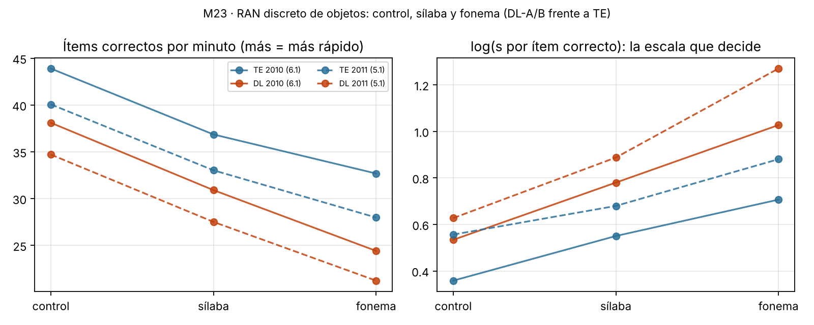

# M23 · RAN con carga fonológica: control, sílaba y fonema {.unnumbered}

*Desarrollo de un estudio de la Agenda · versión 2, 01/11/2026 (la variable dependiente pasa a ser la común de [M11](M11.qmd): ítems correctos por minuto). Experimento de J. L. Luque Vilaseca, programado en la plataforma como tareas «camufladas» dentro de las sesiones de evaluación (2016/17–2019/20); marco teórico λ–π–κ de sus borradores «Un marco bayesiano para la dislexia» (2025–2026, no citar). Análisis exploratorio de P. J. López-Pérez con los datos de la plataforma. Página abierta para discutir la propuesta y las dudas con Juan Luis.*

::: {.callout-warning}
**Página de trabajo del grupo.** Es un análisis exploratorio, no un resultado del manual. El marco λ–π–κ es un trabajo en preparación de J. L. Luque: no citar ni difundir fuera del grupo. No aparece en el índice del libro: se llega desde el título del estudio en la [Agenda](../agenda.qmd#sec-agenda). Solo contiene datos agregados.
:::

[← Volver a la Agenda](../agenda.qmd#sec-agenda)

## Para leer en dos minutos

::: {.callout-tip}
## Lo esencial, sin estadística

1. **El experimento funciona en la plataforma y se replica.** Medimos lo mismo que en M11: cuántos objetos nombra bien el niño por minuto. En tres cohortes y dos formatos, nombrar objetos cuyos nombres empiezan igual es más lento que nombrar objetos variados. Un niño de 1º nombra unos 43 objetos por minuto en la lista control, 36 en la de sílaba y 31 en la de fonema. El orden control > sílaba > fonema aparece en todas las muestras menos una.
2. **Los niños con dislexia van más lentos en las tres listas, y la diferencia crece con la carga fonológica.** En 2010 (1º de primaria), un disléxico tarda un 17 % más por objeto que un típico en la lista control y un 36 % más en la de fonema.
3. **Ese aumento no es solo «más lento en todo».** Si los disléxicos fueran simplemente más lentos en cualquier cosa, la diferencia en tiempo también crecería al alargarse la tarea. Hemos comprobado que crece **más de lo proporcional**, pero solo en la lista de fonema y solo de 5 a 6 años (cuatro de seis muestras). En la de sílaba, es proporcional. En la lista de fonema los disléxicos también se equivocan más: en formato discreto, los errores explican la mitad del efecto.
4. **A los 5 y 6 años, la condición de fonema es la mejor versión del RAN de objetos para detectar la dislexia.** En 2010 y 2011 predice la etiqueta DL mejor que la lista control (AUC ,72–,78 frente a ,65–,70). Para el manual, esto ya es aprovechable.
5. **El «coste» de cada niño se puede medir, pero con poca precisión.** Cuánto le cuesta a un niño la carga fonológica se parece poco entre dos aplicaciones (ρ ≈ ,2–,3). Sirve para comparar grupos; para el informe individual, todavía no.
6. **Preleo no cambia ese coste.** En tres meses, el coste no baja más en los típicos que en los disléxicos (si acaso al revés, sin llegar a ser significativo). Lo primero es lo que predice el marco de Juan Luis para κ; con esta muestra no podemos afirmar ninguna de las dos cosas.
7. **Antes de escribir el artículo hay que aclarar dos cosas del diseño:** qué objetos lleva cada lista (si cambian de una condición a otra, el gradiente puede deberse a los ítems y no a la fonología) y en qué orden se aplicaron las tres listas.
:::

**Lo que necesitamos de Juan Luis**

- Los ítems de las listas 1922/1924/1926 (discreto) y 1921/1923/1925 (lámina) y cómo se eligieron: frecuencia, longitud y edad de adquisición de los nombres.
- El orden de las tareas dentro de la sesión y si se contrabalanceó.
- Qué muestra y qué etiqueta usó para los resultados de la introducción de su artículo (¿cohorte 2010, niños EEG?), para no duplicar ni contradecir.
- Si quiere que este estudio sea el artículo «RAN con gradiente fonológico» de su plan, con él como primer autor.

## El experimento y la pregunta

Las tareas son tres listas de denominación rápida de objetos que solo se diferencian en la estructura fonológica de los nombres:

- **Control**: objetos sin inicio compartido (RAN clásico).
- **Sílaba**: todos los nombres empiezan por la misma sílaba.
- **Fonema**: todos los nombres empiezan por el mismo fonema.

Cada condición existe en formato **discreto** (un objeto por pantalla, 25 ítems) y en **lámina** (25 estímulos a la vez). Antes del bloque discreto hay una lista de ejemplo (1920) que sirve de práctica.

**La pregunta, en palabras del marco de Juan Luis.** Si el RAN mide lo rápido que el sistema resuelve la competencia entre candidatos léxicos, el tiempo debería crecer con el número de competidores que activa el estímulo (control < sílaba < fonema), y ese crecimiento debería ser mayor en la dislexia. Es la misma lógica que el efecto inhibitorio de la frecuencia silábica posicional, que en disléxicos españoles es casi tres veces mayor y no se reduce con la escolaridad [@luque2013psf; @luque2021psf].

## El marco λ–π–κ en una tabla

Resumen, para el grupo, del anexo de ecuaciones de Juan Luis. La lectura se modela como inferencia bayesiana sobre candidatos léxicos con tres parámetros de precisión.

| Parámetro | Qué es | Cómo se mide según el marco | Qué podemos medir con la plataforma |
|---|---|---|---|
| λ (lambda) | Precisión de la evidencia fonológica que entra (calidad de la señal) | Entrainment delta, variabilidad del tiempo de respuesta en condiciones de baja competencia | La variabilidad ítem a ítem del RAN, solo con tiempos por ítem (plataforma nueva, 2013–2014). **No hecho.** |
| π (pi) | Precisión de los *priors* fonológicos (nitidez de las categorías) | Pendiente de la percepción categorial; conciencia fonémica | Conciencia fonológica (no es lo mismo que la percepción categorial). |
| κ (kappa) | Ganancia de actualización: velocidad con que se inhiben los competidores | Efecto de frecuencia silábica, gradiente RAN | **El coste del RAN de sílaba y de fonema frente al control**, por niño. |

La predicción central para el RAN (ecuaciones 5a–5c del anexo) es

$$T_{c} = T_0 + \frac{1}{\kappa}\,\log\big(n_c \cdot \bar P_c\big),\qquad n_{\text{fonema}} > n_{\text{sílaba}} > n_{\text{control}} = 1,$$

es decir, un tiempo base común ($T_0$) más un coste competitivo multiplicado por $1/\kappa$. De aquí salen cuatro predicciones que nuestros datos pueden contrastar:

| # | Predicción del marco | Contraste con la plataforma | Resultado v1 |
|---|---|---|---|
| P1 | Gradiente fonema > sílaba > control | Medianas y orden dentro del niño | Se cumple en 5 de 6 muestras (no en 2013) |
| P2 | El gradiente se amplifica en la dislexia **más allá de un enlentecimiento general** | Interacción condición × grupo en escala logarítmica | Solo en fonema, de 5 a 6 años (4 de 6 muestras) |
| P3 | El coste ($1/\kappa$) es independiente del tiempo base ($T_0$) | Correlación del índice individual con el tiempo control | Sí: ρ entre −,13 y ,06 |
| P4 | κ no mejora con la escolaridad ni con una intervención fonológica | Cambio del coste en 3 meses por grupo; Preleo CON frente a SIN | Sin diferencias (potencia limitada) |

## Qué dice la literatura

Revisión con SciSpace (01/11/2026). Lo más relevante para situar el estudio:

| Línea | Qué aporta | Implicación para M23 |
|---|---|---|
| Frecuencia silábica posicional en español [@carreiras1993syllable; @luque2013psf; @luque2021psf] | La sílaba inicial activa competidores léxicos; el efecto inhibitorio es ~3 veces mayor en disléxicos y estable de 2º a 4º | Es el antecedente directo: M23 lleva la misma lógica al RAN |
| Semejanza fonológica en el RAN [@jones2013ran] | En adultos ingleses, las letras fonológicamente confundibles vistas en fóvea frenan más a los disléxicos | Único precedente experimental cercano; con letras, no con objetos, y en adultos |
| Interferencia en la denominación de dibujos [@wang2018blocked; @truman2006locus] | En adultos, los bloques fonológicamente homogéneos **aceleran** la denominación (preparación de la forma); en niños disléxicos, oír parte del nombre facilita más | El marco predice lo contrario (interferencia). Si nuestros datos muestran interferencia, hay que descartar que se deba a los ítems |
| Enlentecimiento proporcional [@deluca2017slowing; @martelli2014bridging] | Muchas diferencias entre disléxicos y típicos se explican por un único factor multiplicativo | Hay que contrastar la amplificación en escala logarítmica, no en segundos |
| Qué mide el RAN [@georgiou2018university; @bexkens2015inhibitory; @norton2012ran] | Acceso léxico, procesamiento serial, articulación; el control de la interferencia predice el RAN en disléxicos | El coste de fonema podría medir inhibición, no solo fonología: conviene una tarea de inhibición no verbal como control |
| Modelos bayesianos de la dislexia [@jaffedax2015implicit; @friston2010free] | La dislexia como peso inadecuado de los *priors* frente al ruido sensorial, con un modelo de dos parámetros ajustado a datos | Antecedente formal del marco λ–π–κ; muestra cómo se estiman los parámetros por sujeto |

El hueco que cubriría M23: no hay ningún estudio con niños que manipule la semejanza fonológica del RAN de objetos, con muestras de cientos de niños, de 4 a 6 años y en una ortografía transparente.

## Datos

| Cohorte | Discreto (control, sílaba, fonema) | Lámina | N con las tres condiciones | DL / TE |
|---|---|---|---|---|
| 2010 | 152 · 6.1 | 155 · 6.2 | 901 / 765 | 114 / 528 |
| 2011 | 153 · 5.1 | 156 · 5.2 | 882 / 709 | 89 / 299 |
| 2012 | 154 · 4.1 (fonema perdido, ver incidencias) | 157 · 4.2 | — / 347 | 33 / 123 |
| 2013 | — | 903 · 6.2 (plataforma nueva) | 443 | 33 / 166 |

- **Medida: la variable común de [M11](M11.qmd), ítems correctos por minuto.** Discreto = aciertos × 60 / tiempo; lámina = 25 estímulos × 60 / tiempo (la lámina no registra aciertos por ítem). Misma limpieza que M11: tiempo ≥ 5 s; discreto con algún acierto y ≤ 120 ítems/min; lámina con las dos pantallas registradas y ≤ 180 s. Se pierde < 3 % en el discreto y 11–17 % en las láminas (tiempos a cero o una sola pantalla). En los modelos se usa su inversa en escala logarítmica, log(segundos por ítem correcto), para que «más alto» signifique «más lento», como en el marco. La versión 1, solo con el tiempo, daba los mismos resultados con efectos algo menores (`m23_ran_carga_v1.xlsx`).
- **Grupos:** etiqueta de certeza v2 (lectura de 6 a 11 años frente al grupo SIN agrupado). DL = DL-A + DL-B; TE = típico estable. La etiqueta no usa ninguna tarea RAN, así que la validez no es circular. Como variable continua, el percentil lector medio de 6 a 11 años.
- **Coste:** log(T~sílaba~/T~control~) y log(T~fonema~/T~control~), con T en segundos por ítem correcto: el porcentaje de tiempo por objeto añadido por la carga fonológica.

**Incidencias nuevas** (para la hoja Incidencias del diccionario):

- **2012/154:** el código 1925 aparece 4 veces por niño (388 duplicados) con tiempos de tarea discreta; casi seguro son los tiempos de 1926 exportados con el código de la lámina. Hasta comprobarlo con el bruto, el fonema discreto de 2012 queda fuera.
- **2013/903:** en la plataforma nueva desaparece la diferencia entre sílaba y fonema (mediana 36,9 frente a 36,8 ítems/min). Hay que comprobar si las instancias 3995/3997/4046 llevan los mismos ítems que 1921/1923/1925.
- **Láminas a cero:** ≈ 10 % de tiempos 0 en 155, 156 y 903.

## Resultados v1

### 1. El gradiente

| Muestra | N | Control (ítems/min) | Sílaba | Fonema | Coste sílaba | Coste fonema | Fonema más lento que sílaba en el niño |
|---|---|---|---|---|---|---|---|
| 2010 · 6.1 discreto | 901 | 42,6 | 35,6 | 30,6 | +22 % | +42 % | 71 % |
| 2010 · 6.2 lámina | 765 | 50,2 | 39,8 | 37,0 | +27 % | +35 % | 61 % |
| 2011 · 5.1 discreto | 882 | 37,5 | 30,3 | 24,2 | +26 % | +56 % | 79 % |
| 2011 · 5.2 lámina | 709 | 43,1 | 34,1 | 29,6 | +27 % | +44 % | 69 % |
| 2012 · 4.2 lámina | 347 | 34,4 | 29,0 | 25,6 | +20 % | +37 % | 74 % |
| 2013 · 6.2 lámina | 443 | 49,6 | 36,9 | 36,8 | +35 % | +36 % | 54 % |

Medianas de ítems correctos por minuto; costes como tiempo por ítem añadido (media geométrica). **La lista de ejemplo, que va primero, es más lenta que la control** (34 frente a 43 ítems/min en 2010): hay efecto de práctica dentro del bloque. Si el orden fue siempre control → sílaba → fonema, la práctica juega en contra del gradiente y lo hace más creíble; si hubo fatiga, a favor. Hay que confirmar el orden.

### 2. Disléxicos frente a típicos: ¿amplificación o enlentecimiento general?

{width="100%"}

| Muestra | Ítems/min DL / TE: control · sílaba · fonema | Razón de tiempo por ítem DL/TE: control / sílaba / fonema | Interacción en log: sílaba × DL | fonema × DL |
|---|---|---|---|---|
| 2010 · 6.1 discreto | 38 / 44 · 31 / 37 · 24 / 33 | 1,17 / 1,23 / 1,36 | +0,05 (p = ,08) | **+0,15 (p < ,001)** |
| 2010 · 6.2 lámina | 43 / 53 · 33 / 42 · 29 / 40 | 1,22 / 1,29 / 1,38 | +0,05 (p = ,09) | **+0,12 (p < ,001)** |
| 2011 · 5.1 discreto | 35 / 40 · 28 / 33 · 21 / 28 | 1,16 / 1,21 / 1,38 | +0,04 (p = ,26) | **+0,17 (p < ,001)** |
| 2011 · 5.2 lámina | 38 / 46 · 31 / 37 · 26 / 33 | 1,20 / 1,18 / 1,30 | −0,02 | **+0,08 (p = ,04)** |
| 2012 · 4.2 lámina | 31 / 37 · 25 / 31 · 21 / 28 | 1,21 / 1,24 / 1,29 | +0,02 | +0,06 (p = ,21) |
| 2013 · 6.2 lámina | 44 / 53 · 34 / 40 · 34 / 41 | 1,21 / 1,18 / 1,20 | −0,02 | −0,01 |

Modelo mixto por muestra con intercepto aleatorio por niño. **En escala lineal (segundos por ítem), la interacción con fonema es significativa en cinco de seis muestras** (que es lo que describe la introducción del borrador de Juan Luis). **En escala logarítmica**, que descuenta el enlentecimiento proporcional, el efecto se mantiene en fonema en las cuatro muestras de 5 y 6 años de 2010 y 2011: los disléxicos tardan un 8–18 % más por objeto de lo que predice su lentitud general. En sílaba, en ninguna.

**Velocidad y errores.** En el formato discreto, la interacción con fonema era de +0,09 y +0,07 con el tiempo solo (versión 1) y sube a +0,15 y +0,17 con los ítems correctos por minuto: en la lista de fonema los disléxicos, además de ir más lentos, nombran mal más objetos. En las láminas no hay aciertos por ítem y el efecto es el mismo con las dos medidas. Para el marco, los errores son información: un competidor que gana al objetivo es exactamente lo que predice un κ bajo.

{width="70%"}

**Lectura en continuo.** Con la velocidad en la lista control fija, a peor lector (percentil medio de 6 a 11 años), mayor coste de fonema: r parcial −,11 a −,31 en las seis muestras (todas p < ,01). En sílaba, −,09 a −,31. La relación es gradual, no exclusiva de un grupo.

### 3. Un índice individual tipo κ

Siguiendo la ecuación 5 del marco, para cada niño estimamos $b_i = 1/\kappa_i$ como la pendiente de sus costes en segundos sobre los costes medios del grupo TE de su sesión (TE = 1).

| Muestra | $b$ mediano DL | $b$ mediano TE | Correlación de $b$ con el tiempo control |
|---|---|---|---|
| 2010 · 6.1 discreto | 1,43 | 0,79 | ,03 |
| 2010 · 6.2 lámina | 1,50 | 0,88 | −,13 |
| 2011 · 5.1 discreto | 1,62 | 1,10 | ,01 |
| 2011 · 5.2 lámina | 1,24 | 0,92 | ,01 |
| 2012 · 4.2 lámina | 1,33 | 0,85 | −,10 |
| 2013 · 6.2 lámina | 1,09 | 0,94 | ,06 |

Con $T$ en segundos por ítem correcto. En la mediana, los disléxicos pagan 1,3–1,8 veces el coste de los típicos (salvo en 2013), y ese coste es independiente de su velocidad básica (ρ entre −,13 y ,06). Es lo que el marco espera si $T_0$ y κ son parámetros distintos.

**El problema es la fiabilidad.** Entre la aplicación discreta y la lámina, 3–4 meses después:

| Índice | 2010 (152 → 155) | 2011 (153 → 156) |
|---|---|---|
| Lista control | ,43 | ,46 |
| Velocidad general (media de las tres) | ,62 | ,63 |
| Coste sílaba | ,21 | ,19 |
| Coste fonema | ,29 | ,23 |
| Índice $b$ (1/κ) | ,36 | ,30 |

Las diferencias entre condiciones son siempre menos fiables que las condiciones; aquí, además, cambia el formato entre las dos aplicaciones. Para estimar κ por niño hará falta un modelo jerárquico con los tiempos ítem a ítem (plataforma nueva) o más ítems por condición.

### 4. Validez: ¿añade la carga fonológica algo al RAN clásico?

| Muestra | DL / n | AUC control | AUC fonema | AUC control + coste fonema | ΔAUC (IC 95 %) |
|---|---|---|---|---|---|
| 2010 · 6.1 discreto | 114 / 642 | ,67 | ,75 | ,75 | +,07 (,03–,12) |
| 2010 · 6.2 lámina | 102 / 552 | ,70 | ,78 | ,79 | +,09 (,04–,14) |
| 2011 · 5.1 discreto | 89 / 388 | ,65 | ,73 | ,73 | +,08 (,02–,14) |
| 2011 · 5.2 lámina | 63 / 297 | ,69 | ,72 | ,72 | +,04 (,00–,10) |
| 2012 · 4.2 lámina | 33 / 156 | ,67 | ,73 | ,71 | +,03 (,00–,14) |
| 2013 · 6.2 lámina | 33 / 199 | ,69 | ,69 | ,70 | +,01 (−,00–,09) |

AUC con validación cruzada (5 particiones × 20 repeticiones); IC del ΔAUC por *bootstrap*. **La lista de fonema sola predice mejor que la control.** A los 5 y 6 años mejora la AUC entre 4 y 9 puntos. Para el manual: si solo cabe una lista RAN de objetos en la evaluación de 5–6 años, la de fonema discrimina más.

### 5. ¿Mejora el sistema? Cambio en tres meses y Preleo

- **Cambio del coste entre la primera y la segunda aplicación** (discreto → lámina): el coste de fonema baja algo más en los DL que en los TE (2010: −0,09 frente a −0,05; 2011: −0,15 frente a −0,07), sin llegar a ser significativo (p = ,37 y ,28). Puede ser regresión a la media, porque los DL parten de costes más altos; además, el cambio de formato está confundido con el tiempo, aunque afecta a los dos grupos.
- **Preleo (cohorte 2010, 34 colegios):** los colegios CON no difieren de los SIN ni en el RAN control ni en los costes (diferencias ≤ 0,04 en log, p > ,23). Según el marco, una intervención fonológica («homeostática», sobre π) no debería mover κ a corto plazo; lo observado es compatible, pero un nulo no lo demuestra.

## ¿Mide esto la «capacidad del sistema para mejorar»?

Tal como se aplicó, **no directamente**. Cada niño hizo el experimento dos veces, en formatos distintos, así que mide sobre todo el estado del sistema: cuánto le cuesta la competencia fonológica. Con los datos y la plataforma hay tres maneras de acercarlo a la mejora, de menor a mayor coste:

1. **Mejora entre aplicaciones (ya hecho, versión pobre).** Cambio del coste en tres meses, por grupo. Sin diferencia significativa y confundido con el formato.
2. **Aprendizaje dentro de la lista (datos existentes, por hacer).** Con los tiempos por ítem de la plataforma nueva (2013/903, 2013/628–629, 2014/896) se puede ajustar a cada niño una curva de aceleración a lo largo de los 25 ítems, que es la ecuación 9 del anexo ($H(t)$ con constante de tiempo $1/\kappa$), y la variabilidad ítem a ítem como indicador de λ (predicción P3 del anexo). Hay que extraer las columnas `_di` del servidor.
3. **Mejora con entrenamiento (estudio nuevo).** El marco predice que un RAN adaptativo con límites de tiempo decrecientes («intervención alostática», ecuación 15) mejora κ sin cambiar π. La plataforma puede aplicarlo como actividad de intervención y medir κ antes y después, con la condición de fonema como medida y la de control como referencia. Encaja con la maleabilidad por habilidad de [M19](M19.qmd): κ sería una de las habilidades con ganancia esperada estimable.

## Dudas sobre el diseño y el marco (para discutir con Juan Luis)

1. **Ítems.** Si los objetos cambian de una lista a otra, el gradiente puede deberse a la longitud, la frecuencia o la edad de adquisición de los nombres. Conviene leer las seis actividades en la plataforma y tabular sus ítems; si difieren, se puede ajustar ítem a ítem con los tiempos de la plataforma nueva.
2. **Orden de aplicación.** ¿Siempre control → sílaba → fonema? La práctica (la lista de ejemplo es la más lenta) va en contra del gradiente, la fatiga a favor.
3. **Facilitación frente a interferencia.** En adultos, nombrar en bloque dibujos que comparten inicio acelera la producción [@wang2018blocked], al revés de lo que predice el marco. Nuestros niños van más lentos con la carga. Si los ítems están controlados, sería un hallazgo; conviene discutir por qué los niños de 4–6 años no se benefician de la preparación de la forma.
4. **Fonema frente a sílaba.** El marco supone que un fonema inicial activa más competidores que una sílaba ($n_f > n_s$). Pero una lista que comparte sílaba también comparte fonema. ¿Se calculó $n$ con un léxico infantil (p. ej. densidad de vecindad por inicio en ESPAL o un corpus infantil)? Con esas cifras, la ecuación 5 se podría contrastar cuantitativamente.
5. **Qué es κ en el RAN.** El coste de fonema correlaciona con el control de la interferencia en otros estudios [@bexkens2015inhibitory]. ¿Distingue el marco entre inhibir competidores léxicos e inhibición general? Una tarea de inhibición no verbal de la plataforma (1863, CANUM) serviría de control.
6. **2013.** El gradiente desaparece entre sílaba y fonema en la plataforma nueva. ¿Se cambiaron las listas?

## Artículo posible

- **Título de trabajo:** *Phonological load in rapid naming: a graded cost amplified in Spanish children with dyslexia*.
- **Núcleo:** P1–P4 con las cohortes 2010 y 2011 (replicación interna) y la discusión λ–π–κ como marco; el índice individual y su fiabilidad como resultado metodológico.
- **Antes de enviar:** ítems y orden aclarados; modelo ítem a ítem en 2013–2014; control de inhibición; fonema discreto de 2012 recuperado del bruto.
- **Revistas:** *Annals of Dyslexia*, *Scientific Studies of Reading*, *Journal of Experimental Child Psychology*.

## Archivos

Script `04\scripts\m23_ran_carga_v2.py` (pandas, statsmodels, scikit-learn; variable de M11) → `04\DIAGNOSTICO\m23_ran_carga_v2.xlsx` (13 hojas, solo agregados) y `DIAGNOSTICO\figs_M23_v2\`. La v1 (solo tiempo) se conserva: `m23_ran_carga.py` → `m23_ran_carga_v1.xlsx`. Marco teórico en `2026\JUANLU\Un marco bayesiano para la dislexia\` (borradores de J. L. Luque). Documento del proyecto de Claude: `claude/M23_RAN_carga_fonologica.md`.

## Referencias {.unnumbered}

::: {#refs}
:::
