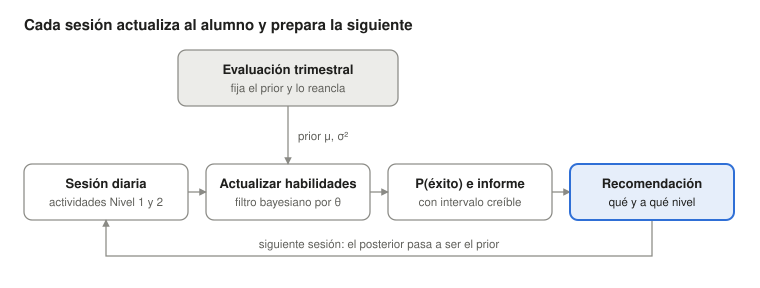

# M25 · Seguimiento diario y recomendación bayesiana {.unnumbered}

*Desarrollo de un estudio de la Agenda · versión 1, 01/11/2026. Idea surgida de una conversación de P. J. López-Pérez con J. L. Luque Vilaseca; deriva de [M19](M19.qmd). Propuesta de diseño, sin datos reales todavía. Página abierta para que Juan Luis y Auxi completen lo que conocen mejor: las actividades de Nivel 1 y 2, su aplicación en los colegios y el informe actual.*

::: {.callout-warning}
**Página de trabajo del grupo.** Es una propuesta, no un resultado del manual. No aparece en el índice del libro: se llega desde el título del estudio en la [Agenda](../agenda.qmd#sec-agenda). No contiene datos de alumnos.
:::

[← Volver a la Agenda](../agenda.qmd#sec-agenda)

## Para leer en dos minutos

::: {.callout-tip}
## Lo esencial

1. **Qué se quiere.** Que cada sesión de actividades de Nivel 1 y 2 en el colegio actualice el perfil del alumno y proponga qué trabajar en la siguiente, en un informe de resultados mejorado con el encuadre de éxito de M19.
2. **Por qué es un estudio propio.** M19 trabaja con la evaluación trimestral. Su simulación mostró que, con datos trimestrales, repartir las sesiones de forma personalizada apenas mejora al reparto uniforme (32 % frente a 30 % de éxito en niños por debajo de P25), y que el ajuste solo gana peso con monitoreos frecuentes de cada subhabilidad (de ~0,02 con uno a ~0,10 con doce). Las actividades diarias son esos monitoreos.
3. **Cómo.** Un filtro bayesiano por alumno y habilidad: la evaluación trimestral fija el punto de partida (*prior*) y cada sesión lo actualiza; el resultado de hoy es el punto de partida de mañana.
4. **Qué decide.** Qué habilidad trabajar y a qué nivel de dificultad, con un 70–85 % de aciertos previsto, respetando prerrequisitos y sin cambiar de plan cada día.
5. **Qué falta.** La plantilla actual del informe, un ejemplo del registro de actividades y saber exactamente qué son el Nivel 1 y el Nivel 2.
:::

## Pregunta de investigación

¿Mejora la lectura al final de curso una recomendación que se actualiza tras cada sesión de Nivel 1 y 2, frente al plan fijo que se deriva de la evaluación trimestral?

M25 reutiliza de M19 el criterio de éxito por curso, el modelo de probabilidad, la maleabilidad de cada habilidad y la exposición Preleo (condición × fidelidad). Añade la capa diaria: actualización, recomendación e informe.

## Modelo

{width=100%}

**Estado.** Para el alumno *i* y la habilidad *k* (conciencia fonológica, letras, decodificación, fluidez…), una habilidad latente θ con media μ y varianza σ².

**Punto de partida (evaluación trimestral).** La varianza depende de la fiabilidad ρ (α/ω) de la tarea en el manual: una tarea poco fiable da un *prior* ancho y las sesiones diarias pesan más.

$$
\mu_{ik,0} = z_{ik}^{\text{trim}}, \qquad \sigma^2_{ik,0} = (1-\rho_k)\,\sigma^2_{\text{norma}}
$$

**Entre sesiones (predicción).** θ avanza según la maleabilidad de la habilidad (m~k~, de M19), modulada por la exposición Preleo, con un ruido de proceso q~k~.

$$
\mu^{-}_{ik,t+1} = \mu_{ik,t} + m_k \cdot \text{dosis}_{ik,t}, \qquad \sigma^{2,-}_{ik,t+1} = \sigma^2_{ik,t} + q_k
$$

**Tras cada sesión (actualización).** Los aciertos ítem a ítem actualizan θ con un modelo de Rasch, P(acierto) = logit⁻¹(θ − b~j~), con b~j~ la dificultad calibrada del ítem; los tiempos entran como velocidad. Es un filtro de Kalman extendido; un beta-binomial con olvido sirve como versión simple de comparación.

**Probabilidad de éxito.** Se recalcula tras cada sesión con el modelo logístico de M19, integrando sobre la incertidumbre de θ: el informe muestra P(éxito) con un intervalo creíble.

**Anclaje trimestral.** Cada evaluación trimestral reancla el filtro. La diferencia entre lo que el filtro predijo y lo que se observa es la medida principal de calibración.

## Motor de recomendación

1. **Qué habilidad.** Muestreo de Thompson: se extrae un valor de θ de cada posterior, se calcula la ganancia en P(éxito) de una sesión más en cada habilidad y se elige la mayor. El sistema explora cuando hay incertidumbre y no se encasilla.
2. **Restricciones.** Prerrequisitos (conciencia fonológica y letras antes que decodificación) y tope en P75 de M19, con rendimientos decrecientes.
3. **A qué nivel.** Ítems cuya dificultad predice un 70–85 % de aciertos con el θ actual (zona de desarrollo próximo).
4. **Estabilidad.** El plan solo cambia cuando el intervalo creíble lo justifica, con un mínimo de sesiones por bloque.
5. **Registro.** Cada recomendación, su justificación y el pronóstico se guardan con fecha antes de la sesión, junto con lo que decide el docente (aceptar, cambiar o ignorar). Es lo que permite la validación fuera de política y un informe registrado.

## Informe mejorado

El informe parte de la plantilla actual de resultados (pendiente de incorporar) y la amplía en tres capas.

| Capa | Destinatario | Frecuencia | Contenido |
|---|---|---|---|
| Alumno | Docente | Tras cada sesión | Perfil de éxito con intervalo por habilidad; tendencia desde la sesión anterior; P(éxito) con banda; actividad y nivel para mañana, con una frase que diga por qué |
| Aula | Docente y orientación | Semanal | Quién avanza según lo previsto y quién se estanca; agrupamientos sugeridos para el Nivel 2 |
| Familia | Familias | Trimestral | Encuadre de éxito de M19 y objetivos por habilidad, sin la mecánica diaria ni percentiles sueltos |

Los profesores van siempre seudonimizados; fuera del colegio solo circulan datos agregados.

## Datos y control de calidad

| Insumo | Fuente | Estado |
|---|---|---|
| Registro por sesión: alumno, fecha, actividad, nivel, ítem, respuesta, tiempo | Plataforma, actividades de Nivel 1 y 2 | Falta el formato de exportación |
| Correspondencia actividad → habilidad | Hoja nueva en el diccionario maestro | Por crear |
| Dificultad calibrada de cada ítem (b~j~) | Respuestas `_res` de la plataforma nueva (Rasch) | Por estimar |
| Fiabilidades, maleabilidad, modelo de éxito, exposición Preleo | Manual técnico y [M19](M19.qmd) | Simulación hecha; cohorte 2010 pendiente |

**Control de calidad diario**, más ligero que el trimestral: sesiones incompletas o interrumpidas, tiempos imposibles, patrones de respuesta al azar o con una sola tecla, y cambios bruscos de θ que no se confirman en la sesión siguiente. Una sesión marcada no actualiza el filtro y queda registrada en la hoja Incidencias con su motivo.

## Diseño del estudio

1. **Simulación con verdad conocida.** Ampliar `R/m19_exito.R` con `actualizar_diario()` y `recomendar_sesion()`. Comparar el éxito final con monitoreo diario, semanal y trimestral, y con reparto uniforme, «lo más débil primero» y algoritmo. Objetivo: cuántas sesiones de monitoreo hacen que la personalización compense.
2. **Retrospectiva con datos reales.** Con los registros de actividad que ya existan, comprobar si el filtro diario predice la evaluación trimestral siguiente mejor que la anterior sola (calibración, Brier, error de predicción).
3. **Ensayo por conglomerados.** Recomendación dinámica frente a plan fijo trimestral, aleatorizado por aula o por colegio. Resultado principal: la lectura en el criterio trimestral, no las actividades practicadas.

**Riesgos.**

- *Mejorar la actividad y no la lectura.* Lo practicado mejora por exposición; por eso el resultado principal es independiente de las actividades.
- *Ruido diario.* Las sesiones cortas son poco fiables; el *prior* y el control de calidad lo amortiguan, y la simulación dirá cuánto.
- *Adherencia docente.* Se mide qué recomendaciones se siguen.
- *Preleo.* La condición de 2010/2011 sigue pendiente de cerrar; hasta entonces, sin cifras reales.

**Publicación.** Las fases 1 y 2 dan para un artículo metodológico (*Behavior Research Methods*, *Journal of Educational Psychology*). La fase 3 puede ser un brazo del ensayo de M19 (informe de éxito frente a riesgo) o un estudio aparte [@catts2022riesgo; @didion2021mountain].

## Lo que necesitamos de Juan Luis y Auxi

- ¿Qué son exactamente el Nivel 1 y el Nivel 2: niveles RTI (aula entera frente a grupo reducido) o niveles de actividad de la plataforma? ¿Qué actividades y cuántas sesiones por semana tiene cada uno?
- ¿Qué exporta hoy la plataforma de esas actividades? ¿Hay registro ítem a ítem con tiempos?
- ¿Desde qué cursos y colegios hay registros de actividad guardados para la fase retrospectiva?
- ¿Quién recibe el informe diario: solo el docente, o también orientación o logopedia?
- ¿Se puede aleatorizar por aula en el ensayo, o tiene que ser por colegio?

## Próximos pasos

- [ ] Recibir la plantilla actual del informe de resultados
- [ ] Recibir un ejemplo del registro de actividades (con datos ficticios)
- [ ] Añadir `actualizar_diario()` y `recomendar_sesion()` a `R/m19_exito.R` y simular la frecuencia de monitoreo
- [ ] Crear la hoja de correspondencia actividad → habilidad en el diccionario maestro
- [ ] Maquetar el informe nuevo en tres capas
