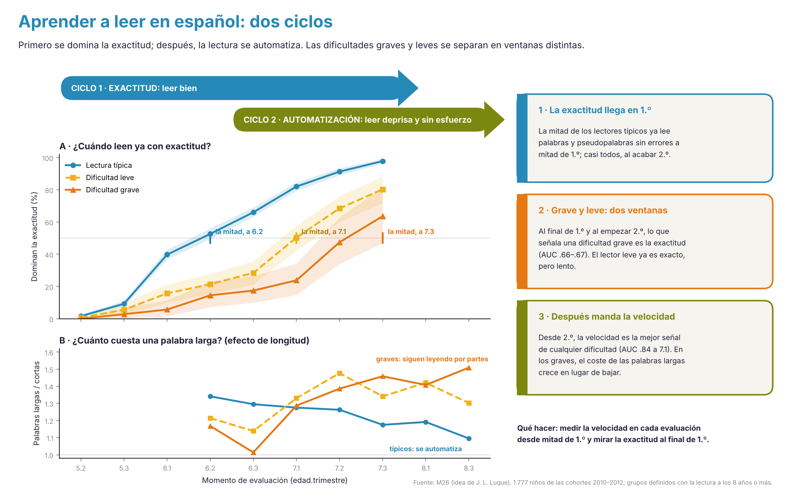

# M26 · Cuándo se domina la exactitud y cuándo se automatiza la lectura {.unnumbered}

*Desarrollo de un estudio de la Agenda · versión 2, 02/11/2026. Idea de J. L. Luque Vilaseca (mensajes del 01 y 02/11/2026), desarrollada con P. J. López-Pérez. Proyecto, esqueleto de artículo y primeros resultados con los datos de las cohortes 2010–2013 ([ir a los resultados](#primeros-resultados-02112026)).*

::: {.callout-warning}
**Página de trabajo del grupo.** Es una propuesta, no un resultado del manual. No aparece en el índice del libro: se llega desde el título del estudio en la [Agenda](../agenda.qmd#sec-agenda). No contiene datos de alumnos.
:::

[← Volver a la Agenda](../agenda.qmd#sec-agenda)

## Para leer en dos minutos

::: {.callout-tip}
## Lo esencial

1. **La idea de Juan Luis.** Aprender a leer tiene dos ciclos: primero se domina la **exactitud** (leer bien) y después se **automatiza** (leer deprisa y sin esfuerzo). Saber cuándo ocurre cada uno, en cada niño, puede ser la clave para definir los perfiles. Las diferencias entre niños pueden concentrarse en momentos concretos, y esas divergencias podrían explicar la clasificación del riesgo que propone el manual.
2. **Por qué LEEDUCA puede responderlo.** Tres evaluaciones por curso de los 4 a los 11 años, con aciertos y tiempos (por ítem en la plataforma nueva), en seis cohortes. Casi ningún estudio en el mundo tiene esa resolución temporal en una ortografía transparente.
3. **Qué se espera.** En español la exactitud llega pronto (hacia el final de 1.º) y la automatización tarda años. Los niños con dificultad persistente se separarían de los demás en dos ventanas distintas: un retraso **transitorio** en la exactitud a los 6 años y un fallo **persistente** en la automatización desde los 7.
4. **Por qué importa.** Si es así, la dificultad transitoria y la persistente del manual no serían dos grados de lo mismo, sino dos ciclos distintos que fallan. Eso cambia qué tarea mirar en cada momento y qué tipo de ayuda dar.
5. **Lo que dicen ya los datos (corregido el 02/11/2026).** Con los grupos definidos solo con la lectura cronometrada de 8 años en adelante (sin circularidad; 1.777 niños), la mitad de los típicos domina la exactitud a 6.2, la de los leves a 7.1 y la de los graves a 7.3. Lo que separa al grave del leve a los 6–7 años es la **exactitud** (AUC .66–.67); la velocidad no los separa (.44–.63). Lo que separa a cualquier dificultad de los típicos es sobre todo la **velocidad** (.77–.84 a 7.1). El efecto de longitud baja con la edad en los típicos (1,34 → 1,10) y sube en los graves (1,17 → 1,51). Todo se mantiene con grupos definidos solo con el seguimiento trimestral.
:::

## Preguntas

1. **¿Cuándo se domina la exactitud?** ¿A qué edad y trimestre alcanza cada niño una lectura exacta de letras, sílabas, palabras y pseudopalabras, y cómo varía esa edad entre niños?
2. **¿Cuándo se automatiza?** ¿Cuándo deja de crecer la velocidad, cuándo deja de importar la longitud de la palabra y cuándo se acerca la lectura de pseudopalabras a la de palabras?
3. **¿Dónde divergen las trayectorias?** ¿En qué momentos y en qué medidas se separan más los niños con dificultad persistente, transitoria y típica?
4. **¿Explican esas divergencias la clasificación del riesgo?** ¿Los perfiles que salen de los parámetros de cada niño (cuándo empieza, a qué ritmo avanza, dónde se estanca) coinciden con los niveles de certeza del manual?

## Marco teórico

| Modelo | Qué predice para este estudio |
|---|---|
| Fases del aprendizaje de palabras [@ehri2005learning] | De la decodificación secuencial, letra a letra, al reconocimiento consolidado de unidades mayores |
| Autoaprendizaje [@share1995phonological] | Cada decodificación exacta deja una huella ortográfica: la exactitud es la condición de la automatización |
| Automaticidad [@laberge1974automatic] | La automatización se ve en la velocidad, pero también en que el coste por unidad (sílaba, ítem) deja de crecer |
| Ortografías transparentes [@seymour2003foundation] | En español la exactitud se alcanza casi al terminar 1.º; la diferencia entre lenguas está en la velocidad |
| Dislexia en ortografías transparentes [@serrano2008speed; @davies2007spanish; @zoccolotti2005length] | La dificultad persistente se manifiesta como lentitud y un efecto de longitud que no desaparece, más que como errores |
| Ciclo de éxito y dificultad del manual ([Cómo estimamos el riesgo](../riesgo.qmd)) | La dificultad transitoria se resolvería al dominar la exactitud; la persistente sería un fallo de automatización |

## Hipótesis

Se registran antes de analizar los datos.

- **H1. Exactitud temprana.** La mayoría de los niños sin dificultad supera el 90 % de aciertos en palabras y pseudopalabras simples al final de 1.º (6.3); las sílabas complejas y las palabras largas tardan uno o dos trimestres más.
- **H2. Automatización lenta.** La velocidad sigue creciendo hasta 3.º–4.º; el efecto de longitud (tiempo extra por sílaba) se reduce de forma gradual y el de lexicalidad (pseudopalabras frente a palabras) se mantiene más tiempo. *(Revisada con los datos: el efecto de lexicalidad crece entre los 6 y los 8 años, porque marca la formación del léxico ortográfico.)*
- **H3. Dos ventanas de divergencia.** En exactitud, la diferencia entre niños con dificultad y típicos es máxima en 6.1–6.3 y después se cierra. En velocidad y efecto de longitud, crece desde 7.1 y no se cierra.
- **H4. Perfiles por ciclo.** Los niños con dificultad transitoria tienen una exactitud tardía pero una automatización normal; los de dificultad persistente alcanzan (tarde) la exactitud y fallan en la automatización.

## Cómo se mide

| Concepto | Medida por niño, tarea y momento | Datos |
|---|---|---|
| Exactitud | Proporción de aciertos | Todas las cohortes |
| Dominio de la exactitud | Primer momento con ≥ 90 % de aciertos que se mantiene en el siguiente | Todas las cohortes |
| Velocidad | Ítems correctos por minuto; en la plataforma nueva, tiempo mediano de los aciertos por ítem | Todas; por ítem desde 2013 |
| Efecto de longitud | Pendiente del tiempo por palabra frente al número de sílabas (listas de 1 a 4 sílabas) | Todas las cohortes con las cuatro listas |
| Efecto de lexicalidad | Tiempo en pseudopalabras dividido por el tiempo en palabras de la misma longitud | Todas |
| Estabilidad del tiempo | Coeficiente de variación del tiempo por ítem | Plataforma nueva (2013 en adelante) |
| Grupo | Niveles de certeza del manual (persistente, transitoria, típica…) | Cohortes 2010–2013 |

## Los indicadores de riesgo como estados

Los niveles de riesgo que propone el manual (típico, transitorio, persistente) no son una etiqueta fija, sino lugares por los que un niño pasa. Un **modelo multiestado** estima, momento a momento, la probabilidad de pasar de uno a otro:

- cuántos niños salen del riesgo en cada trimestre y **cuándo deja de ser probable salir**: ese momento separaría la dificultad transitoria de la persistente con un criterio empírico, no con un corte elegido;
- si esa ventana de salida coincide con el dominio de la exactitud (H4);
- qué precursores a los 4–5 años (conciencia fonológica, RAN, letras) predicen cada transición, no solo el estado final.

Así M26 valida los indicadores de riesgo del manual desde dentro: si la clasificación es buena, las transiciones deberían concentrarse en las ventanas que predicen las hipótesis.

## Patrones por perfil: la tabla que propone Juan Luis

> «Me pregunto si los niños que en 6.3 o 7.1 cometen errores de exactitud son, quizá, los que van a ser graves. En algunos momentos hay resultados que ayudan a mejorar el diagnóstico, y temprano, además de ver en qué se diferencian esos perfiles. El leve no tiene problemas de exactitud al final de los 6, pero sí de velocidad, ortografía o de otros procesos.» (J. L. Luque, 02/11/2026)

Es una predicción concreta y comprobable con los datos:

- **DL-A (grave):** exactitud baja todavía en 6.3–7.1, además de lentitud.
- **DL-B (leve):** exactitud normal al final de los 6 años; lentitud, y dificultades en ortografía u otros procesos.
- **TR (transitoria):** retraso inicial que se cierra.

Las tablas se calculan en el ordenador del proyecto con `scripts/R/m26_patrones_perfiles.R` (cohortes 2010–2013), que solo exporta agregados por grupo y momento, con un mínimo de 10 niños por celda.

```{r}
#| include: false
dir_m26 <- file.path("..", "datos", "agregados", "M26")
hay_m26 <- file.exists(file.path(dir_m26, "P1.csv"))
GR <- c("DL-A" = "DL-A · grave", "DL-B" = "DL-B · leve", "TR" = "TR · transitoria", "INT" = "INT", "TE" = "TE · típica")
lee <- function(f) utils::read.csv(file.path(dir_m26, f), encoding = "UTF-8", check.names = FALSE, stringsAsFactors = FALSE)
CLAVE <- c("LEC_LETRAS", "LEC_SILABAS_SIMPLE", "LEC_SILABAS_COMPLEJA", "LEC_PAL_2sil", "LEC_PAL_3sil", "LEC_PSEUDO_2sil", "LEC_PSEUDO_3sil", "LEC_VEL_TEXTO",
           "LEC_DECISION_ORTOGRAFICA", "LEC_LECT_COMPRENSIVA", "CF_SEGMENTACION_FONEMICA", "CF_SUPRESION_FONEMAS_TP", "RAN_COLORES", "RAN_NUMEROS", "HFON_MEMVERB_MEMORIA_VERBAL")
```

```{r}
#| results: asis
#| echo: false
if (!hay_m26) cat("::: {.callout-note appearance=\"minimal\"}\n**Pendiente de ejecutar** el script en el PC del proyecto. Cuando se ejecute, aquí aparecerán: el mapa de patrones por perfil, la exactitud frente a la velocidad por grupo y los momentos que mejor separan la dificultad grave de la leve.\n:::\n")
```

```{r}
#| label: fig-m26-mapa
#| fig-cap: "Mapa de patrones (tareas clave, 4–8 años): mediana del percentil de cada grupo (dentro de su cohorte y sesión) por tarea, medida y momento. Rojo, por debajo de la media; azul, por encima. Exactitud = aciertos; velocidad = tiempo invertido."
#| fig-height: 9
#| fig-width: 9
#| eval: !expr hay_m26
library(ggplot2)
P1 <- lee("P1.csv"); P1$mom <- sprintf("%.1f", as.numeric(P1$mom)); P1 <- P1[P1$grupo %in% c("DL-A", "DL-B", "TR", "TE") & P1$medida %in% c("aciertos", "tiempo") & as.numeric(P1$mom) <= 8.3 & P1$tarea_canonica %in% CLAVE, ]
P1$medida <- ifelse(P1$medida == "aciertos", "exactitud", "velocidad")
P1$fila <- factor(paste0(P1$tarea_canonica, " · ", P1$medida))
o <- unique(P1[order(P1$orden, P1$medida), "fila"]); P1$fila <- factor(P1$fila, levels = rev(o))
P1$grupo <- factor(GR[P1$grupo], levels = GR)
P1$mom <- factor(P1$mom, levels = unique(P1$mom[order(as.numeric(P1$mom))]))
ggplot(P1, aes(mom, fila, fill = pr_mediana)) + geom_tile(colour = "white") + facet_wrap(~grupo, nrow = 1) +
  scale_fill_gradient2(low = "#D64545", mid = "#F4F1EA", high = "#2B7BB9", midpoint = 50, limits = c(0, 100), name = "Percentil") +
  labs(x = "Momento (edad.trimestre)", y = NULL) + theme_minimal(base_size = 9) +
  theme(panel.grid = element_blank(), axis.text.x = element_text(angle = 90, vjust = .5), legend.position = "bottom")
```

```{r}
#| label: fig-m26-exactitud-velocidad
#| fig-cap: "Lectura de palabras y pseudopalabras: porcentaje de niños con exactitud por debajo del 90 % y porcentaje que lee con exactitud pero lento (≥ 90 % de aciertos y velocidad ≤ P25), por grupo y momento. Sin 8.2 (incidencia: todos los grupos caen a la vez)."
#| fig-height: 4
#| eval: !expr hay_m26
P4 <- lee("P4.csv"); P4$mom <- sprintf("%.1f", as.numeric(P4$mom)); P4 <- P4[P4$grupo %in% c("DL-A", "DL-B", "TR", "TE") & P4$mom != "8.2", ]
P4 <- rbind(data.frame(grupo = P4$grupo, mom = P4$mom, panel = "Exactitud < 90 %", v = P4$pct_inexacto),
            data.frame(grupo = P4$grupo, mom = P4$mom, panel = "Exacto pero lento", v = P4$pct_exacto_y_lento))
P4$grupo <- factor(GR[P4$grupo], levels = GR); niv <- unique(P4$mom[order(as.numeric(P4$mom))]); P4$m <- match(P4$mom, niv)
ggplot(P4, aes(m, v, colour = grupo)) + geom_line(linewidth = .8) + geom_point(size = 1.8) + facet_wrap(~panel) +
  scale_colour_manual(values = c("#D64545", "#B07A10", "#5E4FA2", "#008FA3")) +
  scale_x_continuous("Momento", breaks = seq_along(niv), labels = niv) + scale_y_continuous("% de niños", limits = c(0, 100)) +
  theme_minimal(base_size = 10) + theme(legend.position = "bottom", legend.title = element_blank(), panel.grid.minor = element_blank())
```

```{r}
#| label: fig-m26-grave-leve
#| fig-cap: "¿Cuándo se distingue la dificultad grave de la leve? AUC de cada tarea y medida para separar DL-A de DL-B, por momento (0,5 = no separa). Las celdas en blanco no tienen datos o tienen menos de 10 niños por grupo."
#| fig-height: 7
#| fig-width: 9
#| eval: !expr hay_m26
P3 <- lee("P3.csv"); P3$mom <- sprintf("%.1f", as.numeric(P3$mom)); P3 <- P3[P3$comparacion == "DL-A frente a DL-B" & P3$medida %in% c("aciertos", "tiempo") & as.numeric(P3$mom) <= 8.3 & P3$tarea_canonica %in% CLAVE, ]
P3$medida <- ifelse(P3$medida == "aciertos", "exactitud", "velocidad")
P3$fila <- paste0(P3$tarea_canonica, " · ", P3$medida); o <- unique(P3[order(P3$orden, P3$medida), "fila"]); P3$fila <- factor(P3$fila, levels = rev(o))
P3$mom <- factor(P3$mom, levels = unique(P3$mom[order(as.numeric(P3$mom))]))
ggplot(P3, aes(mom, fila, fill = auc)) + geom_tile(colour = "white") + geom_text(aes(label = sub("^0", "", sprintf("%.2f", auc))), size = 2.8) +
  scale_fill_gradient(low = "#F4F1EA", high = "#5E4FA2", limits = c(.5, 1), na.value = "white", name = "AUC") +
  labs(x = "Momento", y = NULL) + theme_minimal(base_size = 9) + theme(panel.grid = element_blank(), legend.position = "bottom")
```

### Primeros resultados (02/11/2026)

Con 2.754 niños de las cohortes 2010–2013 (114 graves, 303 leves, 557 con dificultad transitoria, 153 intermedios y 1.627 típicos), **los datos apoyan la idea de Juan Luis**:

1. **La exactitud separa al grave del leve a los 6 años.** En la lectura de palabras y pseudopalabras, la exactitud mediana a 6.3 es del 11 % en el grupo grave, del 65 % en el leve y del 94 % en el típico. Casi todos los graves (97 %) siguen por debajo del 90 % de aciertos al final de los 6 años. Para distinguir grave de leve, la exactitud a 6.2–6.3 es lo que mejor funciona (AUC .80–.83 en palabras, pseudopalabras y sílabas complejas); la velocidad no los separa en ese momento.
2. **El leve llega a la exactitud, pero no a la velocidad.** Hacia 7.1–7.3 el grupo leve alcanza una exactitud mediana del 88–90 %, y su diferencia con los típicos en exactitud se diluye (AUC de .92 a 6.3 a .58 a 8.1). En cambio, la velocidad lo separa de los típicos desde 6.2 y ya no deja de hacerlo (AUC .91–.98), igual que la decisión ortográfica (.83–.90) y el tiempo de lectura comprensiva (.94–.97). La proporción de leves que leen **con exactitud pero lento** sube del 7 % a 6.3 al 40 % a 8.1–8.3.
3. **El grave también automatiza tarde, pero va un ciclo por detrás.** Su exactitud mediana llega al 81 % a 7.3 y al 88 % a 8.3; mientras tanto, su velocidad es la más baja. Es decir: en el grave falla primero el ciclo de la exactitud y después el de la automatización; en el leve, solo el segundo.
4. **Antes de leer, la diferencia es pequeña.** A los 4–5 años, las tareas de conciencia fonológica, RAN, memoria y vocabulario separan poco al grave del leve (AUC .5–.66). Lo que más anticipa el grave es el conocimiento de letras (.64–.76) y, ya a 6.1–6.2, la segmentación y la supresión de fonemas (.75–.77).

**Lectura clínica.** A los 6 años, un niño que todavía no lee con exactitud tiene más probabilidad de acabar en el grupo grave; uno que ya lee con exactitud pero lento, en el leve. Son dos ventanas distintas y dos tipos de ayuda: precisión en la decodificación antes, fluidez y ortografía después.

**Cautelas de esta primera pasada.**

- Las etiquetas se definen con la lectura de 6 a 11 años, así que una parte de estas diferencias es circular. Lo menos circular es el contraste entre exactitud y velocidad dentro del mismo grupo y lo que ocurre antes de los 6 años.
- **A los 5 años y a 6.1, el tiempo de los graves es «mejor»** que el de los típicos (AUC por debajo de .5): leen pocos ítems y abandonan antes. La velocidad solo tiene sentido cuando hay exactitud.
- **El momento 8.2 es una incidencia:** todos los grupos caen a la vez en exactitud, probablemente por un cambio de lista o de formato en esa sesión. Hay que revisarlo en el bruto.
- El grupo grave es pequeño en las cohortes 2012 y 2013 (alrededor de 10 niños cada una).


{#fig-dos-ciclos fig-alt="Infografía con dos paneles de líneas por grupo y tres tarjetas de conclusiones."}
## Segunda fase: los dos ciclos sin circularidad

**Resultados definitivos (02/11/2026)**, con `m26_articulo_v6.R` y la prueba de solidez de `m26_articulo_v7.R`. Los grupos se definen **solo con la lectura cronometrada de 8 años en adelante** (sin 8.2): grave ≤ P10, leve P10–P25 y típico > P25 dentro de cada cohorte. Todo lo que ocurre antes de los 8 años queda libre de circularidad. Son 1.777 niños de las cohortes 2010–2012: 177 graves, 268 leves y 1.332 típicos.

::: {.callout-note collapse="true" appearance="minimal"}
## Por qué cambiaron las cifras de esta sección
Una primera versión (`m26_ciclos_v3.R`) incluía por error unos 2.100 niños con lectura a 8+ años sin tiempo ni eficiencia, que quedaban como «típicos»; con ellos, «grave» era en realidad el 22 % inferior. Las cifras de abajo son las correctas.
:::

```{r}
#| include: false
if (!exists("PAL_GRUPO")) source(file.path("..", "R", "libro.R"))
d6 <- file.path(dir_m26, "v6"); d7 <- file.path(dir_m26, "v7")
lee6 <- function(f) { x <- utils::read.csv(file.path(d6, f), encoding = "UTF-8", check.names = FALSE, stringsAsFactors = FALSE); names(x)[1] <- sub("^", "", names(x)[1]); x }
lee7 <- function(f) { x <- utils::read.csv(file.path(d7, f), encoding = "UTF-8", check.names = FALSE, stringsAsFactors = FALSE); names(x)[1] <- sub("^", "", names(x)[1]); x }
G8C <- c("Típico" = PAL_GRUPO[["azul"]], Leve = PAL_GRUPO[["amarillo"]], Grave = PAL_GRUPO[["naranja"]])
G8S <- c("Típico" = 16, Leve = 15, Grave = 17)
ordm <- function(m) { m <- sprintf("%.1f", as.numeric(m)); factor(m, levels = unique(m[order(as.numeric(m))])) }
```

### ¿Cuándo se domina la exactitud?

```{r}
#| label: fig-m26-dominio
#| fig-cap: "Porcentaje acumulado de niños que dominan la exactitud (≥ 90 % de aciertos en palabras y pseudopalabras bisílabas, mantenido en el momento siguiente), por grupo de lectura a los 8 años. Kaplan-Meier en tiempo discreto; bandas: IC 95 % por bootstrap (500 réplicas)."
#| fig-height: 3.8
R2 <- lee6("R2.csv"); R2$mom <- ordm(R2$mom); R2$g8 <- factor(R2$g8, levels = c("Típico", "Leve", "Grave"))
ggplot(R2, aes(mom, pct_domina, colour = g8, fill = g8, group = g8, shape = g8)) +
  geom_ribbon(aes(ymin = ic_inf, ymax = ic_sup), alpha = .15, colour = NA) + geom_line(linewidth = 1.1) + geom_point(size = 2.4) +
  geom_hline(yintercept = 50, linetype = "dotted", colour = "grey55") +
  scale_colour_manual(values = G8C) + scale_fill_manual(values = G8C) + scale_shape_manual(values = G8S) +
  scale_y_continuous("% que domina la exactitud", limits = c(0, 100)) + labs(x = "Momento") + tema_grupo(10)
```

```{r}
#| label: tbl-m26-dominio
#| tbl-cap: "Momento en que la mitad de cada grupo domina la exactitud (IC 95 %) y porcentaje que la domina al final de 1.º y de 2.º."
R2b <- lee6("R2b.csv"); R5 <- lee6("R5.csv"); pr <- R5[R5$analisis == R5$analisis[1], ]
knitr::kable(data.frame(Grupo = R2b$g8, `Niños con datos` = R2b$n, `La mitad domina a` = paste0(R2b$momento_mediano, " (", R2b$ic_inf, "–", R2b$ic_sup, ")"),
  `% a 6.3` = round(pr$pct_domina_6.3[match(R2b$g8, pr$g8)]), `% a 7.3` = round(pr$pct_domina_7.3[match(R2b$g8, pr$g8)]), check.names = FALSE), row.names = FALSE)
```

### ¿Cuándo se automatiza?

```{r}
#| label: fig-m26-automatizacion
#| fig-cap: "Dos marcadores de automatización dentro de cada niño y sesión: cuánto más tarda por ítem en las palabras trisílabas que en las bisílabas (longitud) y en las pseudopalabras que en las palabras (lexicalidad). Medias marginales de modelos mixtos (niño y colegio aleatorios) con IC 95 %."
#| fig-height: 3.8
R3 <- lee6("R3.csv"); R3$mom <- ordm(R3$mom); R3$g8 <- factor(R3$g8, levels = c("Típico", "Leve", "Grave"))
R3$marcador <- ifelse(grepl("^Longitud", R3$marcador), "Longitud (trisílabas / bisílabas)", "Lexicalidad (pseudopalabras / palabras)")
ggplot(R3, aes(mom, cociente, colour = g8, group = g8, shape = g8)) + geom_line(linewidth = 1) + geom_point(size = 2.2) +
  geom_errorbar(aes(ymin = ic_inf, ymax = ic_sup), width = .15, alpha = .7) + facet_wrap(~marcador) +
  geom_hline(yintercept = 1, linetype = "dotted", colour = "grey55") + scale_colour_manual(values = G8C) + scale_shape_manual(values = G8S) +
  labs(x = "Momento", y = "Cociente de tiempo por ítem") + tema_grupo(10) + theme(axis.text.x = element_text(angle = 90, vjust = .5))
```

### ¿Cuándo deja de ser probable salir del riesgo?

```{r}
#| label: fig-m26-salir
#| fig-cap: "De los niños por debajo del P25 en lectura de palabras y pseudopalabras en un trimestre, porcentaje que pasa por encima del P25 en el trimestre siguiente del mismo curso (todas las cohortes 2010–2013)."
#| fig-height: 3.2
Q3b <- lee("Q3b.csv"); Q3b$mom <- ordm(Q3b$mom)
ggplot(Q3b, aes(mom, pct_sale, group = 1)) + geom_col(fill = PAL_GRUPO[["verde"]], width = .6) + geom_text(aes(label = round(pct_sale)), vjust = -.4, size = 3, colour = PAL_GRUPO[["tinta"]]) +
  labs(x = "Trimestre de partida", y = "% que sale del riesgo") + tema_grupo(10)
```

### ¿Qué permite un diagnóstico temprano?

```{r}
#| label: tbl-m26-temprano
#| tbl-cap: "AUC en la cohorte que no se usó para ajustar el modelo (validación dejando una cohorte fuera), con IC 95 % por bootstrap. Grupos definidos con toda la lectura a 8+ años (principal) y solo con el seguimiento trimestral (sensibilidad, cohortes 2010–2011)."
R4 <- lee6("R4.csv"); R4s <- lee7("R4s.csv")
f <- function(d, et) { d$AUC <- sprintf("%.2f (%.2f–%.2f)", d$auc, d$ic_inf, d$ic_sup); w <- reshape(d[, c("momento", "comparacion", "modelo", "AUC")], idvar = c("comparacion", "modelo"), timevar = "momento", direction = "wide"); cbind(Grupos = et, w) }
w <- rbind(f(R4, "Toda la lectura a 8+"), f(R4s, "Solo seguimiento"))
names(w) <- sub("^AUC\\.", "A ", names(w)); w <- w[order(w$comparacion, w$Grupos != "Toda la lectura a 8+"), ]
knitr::kable(w, row.names = FALSE, col.names = c("Grupos", "Comparación", "Modelo", names(w)[-(1:3)]))
```

### Resultados de la segunda fase

1. **Los dos ciclos se confirman sin circularidad.** La mitad de los niños típicos domina la exactitud a 6.2, la de los leves a 7.1 y la de los graves a 7.3: el grave va **un curso por detrás**. A 6.3 domina la exactitud el 66 % de los típicos, el 28 % de los leves y el 17 % de los graves; a 7.3, el 98 %, el 80 % y el 64 %.
2. **Lo que separa grave de leve es la exactitud.** A 6.3 y 7.1, la exactitud separa los dos grupos (AUC .66–.67) y la velocidad no (.44–.48). Es lo que proponía Juan Luis: el grave todavía comete errores al final de 1.º y al empezar 2.º; el leve ya es exacto, pero lento.
3. **Lo que separa cualquier dificultad de lo típico es la velocidad.** A 7.1 la velocidad alcanza un AUC de .84, bien calibrado en la cohorte que no se usó para ajustar; la exactitud se queda en .71.
4. **La automatización se ve en el efecto de longitud.** En los típicos, el coste por ítem de una trisílaba frente a una bisílaba baja de 1,34 a 6.2 a 1,10 a 8.3. En los graves no hay efecto mientras aún no leen con exactitud (1,01 a 6.3) y después **crece** (1,51 a 8.3): leen con exactitud, pero por partes.
5. **La lexicalidad crece con el aprendizaje.** Las pseudopalabras cuestan cada vez más que las palabras (típicos: 1,11 a 6.1, 1,48 a 7.1, 1,66 a 8.3) porque las palabras conocidas se empiezan a leer por la vía léxica. Los graves no tienen esa ventaja hasta 2.º y a 8.3 llegan al nivel que los típicos tenían a 7.1. En español, la lexicalidad es un marcador del **léxico ortográfico que se forma** (hipótesis H2 corregida).
6. **El riesgo cambia mucho en 1.º y se estabiliza en 2.º.** De un trimestre al siguiente sale del riesgo entre el 31 % y el 58 % de los niños; de los que están por debajo del P10, sigue ahí el 33–56 % en 1.º y el 58–62 % en 2.º. Una sola evaluación en 1.º no basta para clasificar.
7. **Los resultados son sólidos.** Se mantienen con cortes P15/P30, con umbrales de dominio del 85 %, en los colegios sin Preleo y, sobre todo, cuando los grupos se definen **solo con el seguimiento trimestral** (sin el TECLE en papel de 2021 ni las tabletas de 2021/22): medianas 6.2, 7.2 y 7.3; exactitud .67–.70 para grave frente a leve; velocidad .88 a 7.1 para dificultad frente a típico. La excepción es el grupo grave definido con la lectura a 9+ años (50 niños), que domina la exactitud a 6.3: hay que ver qué cohortes y niños tienen datos a esa edad.

**Lectura.** Sin circularidad los AUC son moderados, pero tienen sentido teórico y se replican. El análisis factorial del capítulo 6 da la misma imagen desde la estructura: exactitud y fluidez son casi la misma habilidad a los 5–6 años (r = .94–.98) y se separan a los 7–8 (r = .74–.75).

## Cómo se analiza

1. **Edad de dominio de la exactitud.** Análisis de supervivencia con censura por intervalos (el hito ocurre entre dos evaluaciones) o modelo de riesgo en tiempo discreto: la curva del porcentaje de niños que ya domina cada tarea en cada momento, por grupo, con los niños que dejan de evaluarse como censurados. Da la edad mediana de dominio y su dispersión.
2. **Curvas de automatización.** Para la velocidad, un modelo de crecimiento no lineal con efectos mixtos (exponencial hacia una asíntota). Da tres parámetros por niño: punto de partida, ritmo y techo. Para los efectos de longitud y lexicalidad, el mismo modelo con tendencia descendente.
3. **Divergencia momento a momento.** Tamaño del efecto entre grupos y AUC de cada medida en cada momento, con intervalos por *bootstrap*. Las ventanas de máxima divergencia indican qué tarea mirar y cuándo.
4. **Transiciones de riesgo.** Modelo multiestado de Markov (típico, transitorio, persistente) con los precursores como covariables de las transiciones.
5. **Perfiles.** Clases latentes sobre los parámetros de cada niño (dominio de la exactitud, ritmo y techo de la velocidad, efecto de longitud), y su acuerdo con los niveles de certeza.
6. **Antes de los datos reales,** una simulación con los efectos esperados, como en [M10](M10.qmd), para saber qué se puede detectar con la muestra disponible.

**Cautelas.**

- **Circularidad.** Los niveles de certeza se definen con la lectura, así que una parte de la divergencia está construida de antemano. Para evitarlo, los grupos se definen con la lectura de 8 años en adelante y se estudia la divergencia antes de esa edad, o se usa un criterio externo (fluidez de Woodcock-Muñoz).
- **Techo.** Las tareas de exactitud llegan al techo, y eso puede crear convergencias aparentes. Se modela con modelos de respuesta al ítem o con la proporción de niños en el techo.
- **Calidad de los datos.** Tiempos en otra unidad y tiempos a cero (tratados como ausentes) según el [control de calidad](PRELEO_QC.qmd).
- **Cambios de tarea.** Las listas no son siempre las mismas entre cursos; se comparan dentro de tarea y momento, y se usa la escala común de M14 cuando exista.

## Figuras previstas

1. Curvas de supervivencia del dominio de la exactitud por tarea y grupo.
2. Curvas de velocidad con bandas de percentiles, de 5 a 11 años, y la asíntota estimada.
3. Efecto de longitud y de lexicalidad por momento y grupo.
4. Mapa de divergencia (tareas × momentos) coloreado por el tamaño del efecto, con las dos ventanas marcadas.
5. Perfiles: parámetros de cada niño en el plano exactitud × automatización, coloreados por nivel de certeza.

## Esqueleto del artículo

- **Título provisional:** *When is reading accurate and when does it become automatic? Two developmental windows that separate transient from persistent reading difficulties in Spanish.*
- **Autoría:** abierta; la idea es de J. L. Luque Vilaseca.
- **Introducción:** dos ciclos en el aprendizaje de la lectura; por qué las ortografías transparentes separan exactitud y velocidad; lo que no se sabe (cuándo, en cada niño, y si esos momentos distinguen la dificultad transitoria de la persistente).
- **Método:** cohortes 2010–2013, tres evaluaciones por curso; medidas de la tabla anterior; plan registrado.
- **Resultados:** H1 a H4, en el orden de las figuras.
- **Discusión:** implicaciones para los perfiles y la clasificación del riesgo, para cuándo evaluar qué y para la intervención (precisión antes, fluidez después).
- **Revistas posibles:** *Scientific Studies of Reading*, *Journal of Experimental Child Psychology*, *Reading and Writing*, *Annals of Dyslexia*.

## Relación con otros estudios

- **M4 y M7:** las curvas de velocidad son la base de los percentiles de crecimiento y del cambio mínimo relevante.
- **M10:** separa exactitud y velocidad como resultados; M26 añade cuándo.
- **M19:** los parámetros por niño pueden ser los predictores de la probabilidad de éxito.
- **M2:** los tiempos por ítem para los marcadores de automatización.

## Qué hace falta

| Qué | Quién |
|---|---|
| Revisar la incidencia de 8.2 en el bruto, y por qué los grupos de 8 años y las etiquetas de certeza no coinciden del todo | P. J. López-Pérez |
| Añadir la cohorte 2013 cuando tenga datos a los 8 años, y los datos del servidor 2023–2026 | P. J. López-Pérez |
| Confirmar qué listas de palabras se repiten igual entre cursos | Equipo, con el diccionario maestro |
| Acordar las hipótesis y el umbral de dominio (90 %) antes de los datos | J. L. Luque y grupo |
| Simulación de potencia | P. J. López-Pérez |

## Borrador del artículo

::: {.callout-note collapse="true"}
## Borrador 3 para revisión (02/11/2026) — abrir

**Para J. L. Luque.** Borrador completo para *Scientific Studies of Reading* con las cifras definitivas (`m26_articulo_v6.R`) y la prueba de solidez solo con el seguimiento trimestral (`m26_articulo_v7.R`): resumen estructurado, introducción con hipótesis, método, resultados (tres tablas y tres figuras con la paleta del grupo), discusión con limitaciones, declaraciones, referencias en APA 7 y lista de comprobación para el envío. Faltan los datos de ética y la revisión de la idea por su autor.

- [Descargar el borrador 3 en Word (.docx, 0,5 MB)](../borradores/M26_exactitud_borrador_3_2026-11-02.docx)
- Versiones anteriores: [borrador 2](../borradores/M26_exactitud_borrador_2_2026-11-02.docx) · [borrador 1](../borradores/M26_exactitud_borrador_1_2026-11-02.docx)
- Documento vivo en Claude, con comentarios en línea: pedir el enlace a P. J. López (requiere acceso compartido).
- Copia de trabajo en el PC de PJ López: `PLATAFORMA\ARCHIVOS_CONTROL_JAVI\ARTICULOS_BORRADORES\EXACTITUD_M26\`.

Cómo revisar: comentarios o control de cambios en el Word, o anotaciones en el documento de Claude; las versiones nuevas se publicarán aquí con fecha (`borrador_4_…`). No difundir fuera del grupo: es un borrador no enviado.
:::
