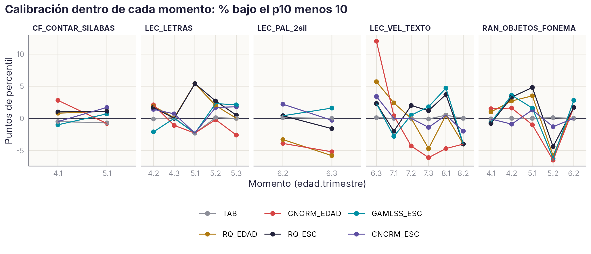
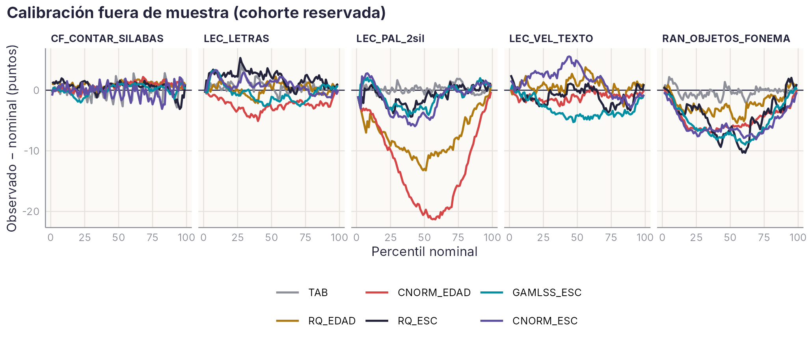
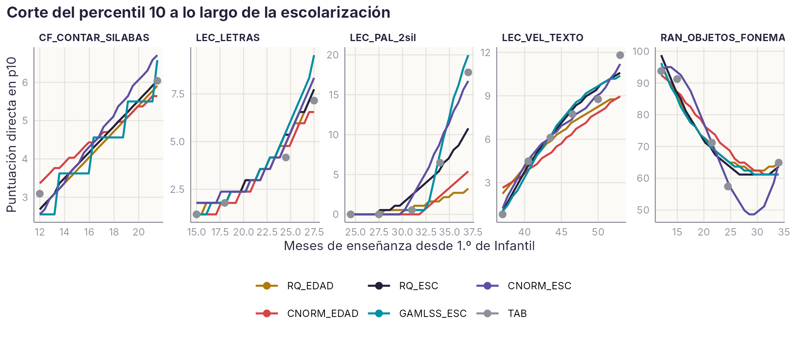

# M3 · Normas continuas: ¿edad o tiempo de enseñanza? — análisis exploratorio {.unnumbered}

*Desarrollo de un estudio de la Agenda · versión 1, 03/11/2026*

::: {.callout-warning}
**Página de trabajo del grupo.** Es un análisis exploratorio, no un resultado del manual. No aparece en el índice del libro: se llega desde el título de M3 en la [Agenda](../agenda.qmd#sec-agenda). No citar ni difundir fuera del grupo. Solo contiene datos agregados.
:::

[← Volver a la Agenda](../agenda.qmd#sec-agenda)

## Pregunta

La plataforma evalúa tres veces por curso. Hoy el servidor tiene dos tipos de baremo: una **tabla por momento** (curso × trimestre) y un **modelo continuo** que da el percentil según la **edad en meses** ([esquema de baremos](../baremos-trimestre.qmd)). M3 pregunta qué método da percentiles más precisos y, sobre todo, **sobre qué eje**: la edad del niño o el tiempo de enseñanza que lleva recibido. La lectura se enseña en la escuela, así que dos niños del mismo trimestre que se llevan 11 meses pueden leer casi igual.

## Diseño

| Elemento | Decisión |
|---|---|
| Referencia | Niños SIN Preleo del seguimiento trimestral (asignación v6), cohortes 2010, 2012, 2013 y 2014 |
| Tareas (una forma por tarea) | Palabras bisílabas (lista 71, eficiencia), letras (535, eficiencia), RAN de objetos con fonema (1925, tiempo), contar sílabas (523, aciertos 0–20) y velocidad en texto (2034, eficiencia). Entre 1.025 y 2.904 evaluaciones por tarea |
| Ejes | **Edad en meses** el día de la evaluación; **meses de enseñanza** desde 1.º de Infantil (9,5 por curso + 2,5 / 5,5 / 8,5 en noviembre, febrero y mayo) con la **edad relativa** dentro del curso (mes de nacimiento) como covariable |
| Métodos | `TAB` tabla por momento · `RQ_EDAD` regresión cuantílica por edad (el modelo continuo actual del servidor) · `CNORM_EDAD` cNORM por edad [@lenhard2018cnorm] · `RQ_ESC`, `GAMLSS_ESC` [@timmerman2021gamlss] y `CNORM_ESC` sobre los meses de enseñanza |
| GAMLSS | Box-Cox t, Box-Cox potencia exponencial o gamma generalizada (la de menor BIC); **ajustada en cero** cuando hay ≥ 2 % de ceros; **beta-binomial** para los recuentos de aciertos |
| Criterios | (1) Calibración dentro de cada momento: debe haber un 10 % de niños bajo el p10, un 25 % bajo el p25…; (2) validación cruzada reservando una cohorte; (3) cobertura; (4) estabilidad del corte p10 entre dos mitades de la muestra |
| Exclusiones | Lista 71 en 2010/6.3 y RAN 1925 en 2010/6.1 (columnas copiadas, errores conocidos de la matriz); valores imposibles; edad > 9 meses fuera de lo esperado para el curso |

## Resultados

### 1. El efecto suelo deja sin p10 a las tareas de lectura a los 5 años

En palabras bisílabas, el **40 % de los niños tiene eficiencia 0 a 5.2**, el 33 % a 5.3 y el 13 % a 6.1. Con tantos empates en la peor puntuación posible, **el percentil 10 no existe**: todos esos niños comparten el mismo percentil. Ningún método, continuo o no, puede separar un p5 de un p10 ahí. Esos momentos se excluyen de la calibración del p10 (sí entran en el ajuste). En el resto de tareas el suelo no pasa del 8 %.

**Para el manual y el servidor:** en los momentos con suelo, los niveles de dificultad «severa» (p ≤ 10) y «muy severa» (p ≤ 5) no se pueden asignar con esa tarea. Hay que avisarlo en el informe o usar otra tarea en ese momento (letras o sílabas).

### 2. Dentro de cada trimestre, el eje de la edad descalibra; el de la enseñanza, mucho menos

| Método | Error medio en p10 (puntos) | Error medio en p25 | Error medio en p50 |
|---|---|---|---|
| TAB (por construcción) | 0,3 | 0,3 | 0,3 |
| **CNORM_ESC** | **1,2** | **2,5** | **3,4** |
| GAMLSS_ESC | 1,9 | 3,4 | 4,8 |
| RQ_ESC | 1,9 | 3,8 | 5,4 |
| RQ_EDAD (modelo actual del servidor) | 2,6 | 4,7 | 7,3 |
| CNORM_EDAD | 3,1 | 6,5 | 10,6 |

*Media de las cinco tareas, momentos sin suelo, toda la referencia. Detalle por tarea y momento en `Calibracion_dentro` y `Calibracion_por_momento`.*

Los métodos por edad se equivocan de forma **sistemática**: marcan de más al empezar el curso y de menos al final. En velocidad en texto, con cNORM por edad, el 22 % de los niños queda bajo el p10 a 6.3 y solo el 4 % a 7.3. En palabras bisílabas, con el modelo actual del servidor, el 7 % a 6.2 y el 4 % a 6.3. Sobre los meses de enseñanza, el mismo cNORM deja en velocidad entre el 8 y el 13 % en todos los momentos.

{width=100%}

### 3. Fuera de muestra, las diferencias entre cohortes pesan tanto como el método

Al reservar una cohorte, todos los métodos se desvían unos 3 puntos en el p10 (de 2,9 a 3,5). Esa desviación es en buena parte **cambio real entre cohortes** (colegios, versión de la plataforma, año), no error del método. La tabla por momento es la mejor donde tiene datos (error medio 3,0), pero **solo puede baremar al 71 % de los niños reservados**: no tiene percentil para un momento que no esté en la muestra normativa. Entre los métodos continuos, todos con cobertura del 100 %, el mejor es GAMLSS sobre la enseñanza (4,7), seguido de la regresión cuantílica por edad (4,9).

{width=100%}

### 4. Estabilidad: ganancia modesta de los métodos continuos

Al partir la muestra en dos mitades (20 repeticiones), el corte p10 de la tabla por momento cambia entre 0,05 y 0,18 DT, y es el menos estable en tres de las cinco tareas. El mejor método continuo lo reduce un 70 % en palabras bisílabas, un 57 % en velocidad, un 33 % en contar sílabas y un 30 % en RAN, porque cada momento toma información de los vecinos. En letras, con momentos de más de 300 niños, la ganancia es pequeña (19 %).

{width=100%}

La figura muestra el problema de fondo en palabras bisílabas. A 6.3 (37 meses de enseñanza), los métodos por edad ponen el p10 en 3–5 palabras por minuto, cuando la tabla lo sitúa en 18. Los métodos sobre la enseñanza siguen la subida. También avisa de un riesgo: entre 5.2 y 6.2 del RAN no hay datos, y el polinomio de cNORM se hunde. Los métodos continuos **no deben interpolar huecos de más de un curso**.

## Conclusiones provisionales

1. **El modelo continuo por edad que hoy tiene el servidor debería pasar al eje de la enseñanza.** Con la misma información, reduce el error de calibración dentro de cada trimestre entre un 25 % y un 60 % (más con cNORM que con regresión cuantílica). La edad relativa entra como corrección (mes de nacimiento).
2. **Propuesta para el servidor:** la tabla por momento se mantiene como baremo publicado donde hay ≥ 200 niños. El modelo continuo sobre la enseñanza (cNORM o GAMLSS) se usa para fechas intermedias, para momentos sin muestra normativa dentro del rango y para la actualización dinámica.
3. **Marcar el efecto suelo** por tarea y momento en las fichas y en el informe.
4. **GAMLSS necesita la familia adecuada a cada medida:** ajustada en cero con suelo y beta-binomial para aciertos. Sin eso, los percentiles bajos salen muy desviados (comprobado en la v0: errores de hasta 48 puntos en contar sílabas).

## Por qué puede ser un artículo

La literatura de normas continuas usa casi siempre la edad como predictor [@lenhard2018cnorm; @timmerman2021gamlss]. Con tres evaluaciones por curso se puede separar la edad de la enseñanza recibida, y comprobar que para habilidades enseñadas en la escuela **la edad es el eje equivocado**. Enlaza con M16 (escolarización frente a maduración) y con M4+M7 (cambio entre trimestres). Revista: *Assessment*; alternativa, *Psychological Methods* si se añade una simulación.

## Próximos pasos

- Ampliar a todas las tareas de clase A, con las cohortes 2014–2015 y los datos del servidor 2020–2026 (M22), para tener más cohortes reservables.
- Normas basadas en TRI donde hay respuestas ítem a ítem (TECLE, listas de la plataforma nueva) [@heister2024normas; @urban2024normas].
- Comparar la edad relativa con el efecto del mes de nacimiento descrito en la literatura.
- Exportar el modelo elegido al formato del servidor (`BAREMOS_SERVIDOR`, fase 2).

**Reproducibilidad.** Guion `04_DICCIONARIO_PROCESADO_2026/scripts/R/m3_normas_continuas_v1.R` (paquetes `quantreg`, `gamlss` y `cNORM`). Usa la tabla larga v2, la asignación Preleo v6 y las fechas de nacimiento de `ise_sexo_nacimiento_R_v1.xlsx`. Salida completa en `DIAGNOSTICO/R/M3/m3_normas_continuas_R_v1.xlsx`; agregados en `datos/agregados/M3/v1/`. La estabilidad se calculó con 20 repeticiones (ejecución en el PC del proyecto, R 4.6.2, 03/11/2026; las demás cifras coinciden exactamente con la primera ejecución); para el artículo, 100.
