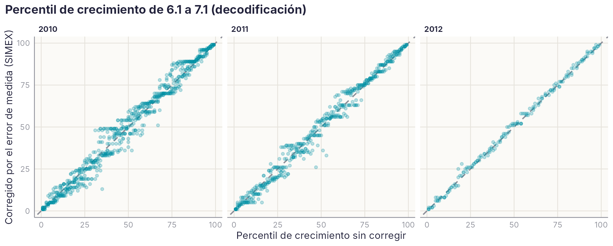
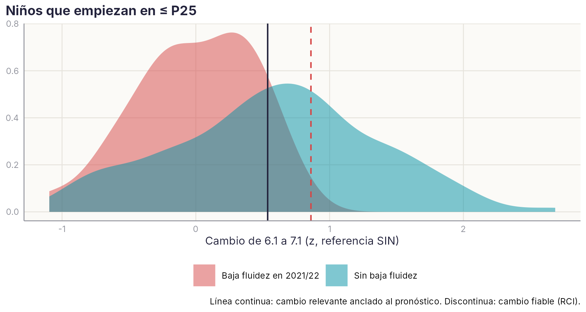

# M4 + M7 · ¿Cuándo es real e importante un cambio en lectura? — análisis exploratorio {.unnumbered}

*Desarrollo de dos estudios de la Agenda, unidos · versión 1, 28/10/2026*

::: {.callout-warning}
**Página de trabajo del grupo.** Es un análisis exploratorio, no un resultado del manual. No aparece en el índice del libro: se llega desde el título de M4 o de M7 en la [Agenda](../agenda.qmd#sec-agenda). No citar ni difundir fuera del grupo. Solo contiene datos agregados.
:::

[← Volver a la Agenda](../agenda.qmd#sec-agenda)

## Pregunta

Con tres evaluaciones por curso, el docente ve subir o bajar la puntuación de un niño de un trimestre a otro. ¿Cuándo ese cambio es **real** (mayor que el error de medida) y cuándo es **importante** (cambia el pronóstico)? M4 (percentiles de crecimiento) y M7 (cambio mínimo relevante) responden a esa misma pregunta, así que se trabajan juntos. Se comparan, para los mismos niños, tres criterios:

1. **Índice de cambio fiable** (RCI): el cambio supera lo que daría el error de medida de las dos evaluaciones.
2. **Percentil de crecimiento** (SGP): cuánto ha progresado el niño frente a los que partían de su mismo nivel, con y sin corregir el error de medida de la puntuación anterior (SIMEX).
3. **Cambio mínimo relevante anclado al pronóstico**: el cambio de 6.1 a 7.1 que mejor separa, entre los niños que empiezan bajos, a los que años después **no** tienen baja fluidez lectora en Woodcock-Muñoz (2021/22), un criterio externo y no circular.

## Diseño

| Elemento | Decisión |
|---|---|
| Medida | Decodificación: media de z de palabras y pseudopalabras bisílabas (eficiencia). Mismas listas en todas las sesiones (71/72 y 1931/1934). z dentro de cada sesión con la referencia SIN (asignación Preleo v3) |
| Cohortes y momentos | 2010 (6.1 a 8.3), 2011 y 2012 (6.1 a 7.1). Desde 6.1, porque a los 5 años hay mucho suelo |
| Momentos excluidos | 2010 a 6.2 (la lista de pseudopalabras no correlaciona con nada, r = .08) y 2010 a 6.3 (los niños no se parecen a sí mismos en ningún otro momento, r ≤ .03): parecen errores de cruce en la matriz. Van a la hoja Incidencias |
| Fiabilidad | La mayor entre la de las dos listas (Spearman-Brown) y el test-retest con el trimestre vecino. Las dos son límites inferiores |
| Ancla | Baja fluidez en Woodcock-Muñoz en 2021/22 (z ≤ −1 dentro de su edad): a los 11 años en 2010, a los 10 en 2011 y a los 9 en 2012 |
| Análisis | RCI de Jacobson y Truax; SGP por regresión cuantílica lineal (99 cuantiles), con SIMEX (30 réplicas, extrapolación cuadrática); ROC del cambio anclado con IC bootstrap; acuerdo (κ) y valor pronóstico de cada criterio |

## Qué cambio es real

**La medida es fiable, pero el cambio de un niño no tanto.** La fiabilidad de la decodificación va de .80 a .97 (mediana .88), y el test-retest entre trimestres, de .76 a .85. Aun así, para que un cambio sea fiable el niño tiene que moverse **entre 0,5 y 1,1 desviaciones típicas** respecto a sus iguales, según la cohorte y el momento.

| Intervalo | Cambio mínimo fiable (z) | Mejoran de forma fiable | Empeoran de forma fiable |
|---|---|---|---|
| De un trimestre al siguiente | 0,52–1,04 | 4–17 % | 3–16 % |
| De un curso al siguiente (6.1 → 7.1) | 0,76–0,98 | 9–21 % | 8–18 % |

- **De un trimestre a otro, casi ningún cambio individual es interpretable** en las cohortes 2010 y 2011 (4–9 % de los niños). Solo en 2012, con listas más fiables, sube al 17 %.
- **Los cambios de un año sí lo son más a menudo**, y además son los que interesan al docente.

## Qué dice el percentil de crecimiento

{width=100%}

- **Corregir el error de medida favorece a los que empiezan bajos.** Sin corregir, el SGP mediano del 20 % que empieza más bajo va de 24 a 64 según la cohorte y el momento. Con SIMEX sube a 26–74, y el del 20 % más alto baja a 31–56. Es lo que predice la literatura: el error de la puntuación anterior hace que los niños bajos parezcan crecer menos de lo que crecen [@shang2015simex; @kane2017sesgo].
- **La corrección es pequeña de un año a otro y grande de un trimestre a otro.** De 6.1 a 7.1 cambia el SGP de un niño en 1–2 puntos (correlación .99). Entre trimestres, en 4–8 puntos, y más donde la fiabilidad es menor.
- **El SGP de un trimestre no predice el del siguiente** (ρ = −.38 a −.04, en los mismos niños). Un trimestre de mucho crecimiento suele ir seguido de uno de poco: es regresión a la media. El SGP trimestral **no sirve para decisiones individuales**; el anual, con cautela y en bandas amplias [@mccaffrey2015sgp].

## Qué cambio es importante

{width=85%}

Entre los 129 niños que empiezan 1.º en P25 o menos, 29 (22 %) tienen baja fluidez lectora años después.

- **El cambio en 1.º anticipa el pronóstico** tan bien como el nivel alcanzado a 7.1 (AUC .75 frente a .74).
- **El cambio mínimo relevante es de 0,54 desviaciones típicas** (IC 95 %: 0,20–0,73). Está por debajo del cambio fiable (0,86) y muy cerca de la regla de media desviación típica (0,46). Con ese umbral, de los niños que no acaban con baja fluidez, el 55 % lo supera; de los que sí, solo el 7 %.

| Criterio de mejora de 6.1 a 7.1 (niños en ≤ P25) | Mejoran | Baja fluidez después, si mejoran | Si no mejoran |
|---|---|---|---|
| Cambio fiable (RCI) | 28 % | **0 %** | 31 % |
| SGP ≥ 65 (corregido) | 43 % | 4 % | 36 % |
| Cambio ≥ 0,54 DT (anclado) | 44 % | 4 % | 38 % |

- **Un niño que empieza bajo y mejora de forma fiable en 1.º prácticamente no acaba con baja fluidez** (0 de 36). Es la lectura más útil para el docente: la mejora fiable tranquiliza.
- **Los tres criterios coinciden bastante**: κ = .46 entre RCI y SGP, .65 entre RCI y el cambio anclado, y .75 entre SGP y el cambio anclado. El RCI es el más exigente (marca al 14 % de toda la muestra); el SGP ≥ 65 y el cambio anclado, a un 25–34 %.
- **El nivel anterior añade información al actual.** Con el mismo nivel a 7.1, el niño que venía de más abajo tiene más riesgo después (AUC .76 → .78 al añadir el nivel de 6.1). Dos evaluaciones son más fiables que una. El crecimiento no protege por sí solo: lo que importa es dónde se llega y desde dónde se viene.

## Lectura provisional

1. **Un cambio de un trimestre a otro casi nunca es interpretable en un niño concreto.** Conviene decirlo así en los informes y en el manual.
2. **El cambio de un curso sí lo es**, y el umbral relevante para el pronóstico (≈ 0,5 DT) es menor que el fiable (≈ 0,9 DT). Hay cambios importantes que todavía no son seguros.
3. **La mejora fiable en 1.º en los niños que empiezan bajos es una buena noticia con mucha certeza**: ninguno acabó con baja fluidez lectora.
4. **El SGP es útil para describir grupos y comparar centros, no para decidir sobre un niño con un solo trimestre.** Si se usa, corregido por el error de medida y en bandas.

## Qué dice la literatura

*Revisión con SciSpace del 28/10/2026.*

- **El RCI depende de la fórmula y de la fiabilidad que se use.** Jacobson y Truax es el más conservador [@marsden2011rci]; Hageman-Arrindell controla mejor los falsos positivos [@ferrerurbina2023ha]; la corrección de Speer tiene en cuenta la regresión a la media [@speer1992rci]. En lectores con dificultades, el RCI y las pendientes multinivel fueron los criterios más consistentes y con más poder predictivo [@frijters2013cambio].
- **El error de medida sesga los SGP justo en los extremos**, y SIMEX lo corrige sobre todo ahí [@shang2015simex; @kane2017sesgo]. Aun con el mejor estimador, el SGP de un alumno se equivoca unos 19 puntos percentiles de media [@mccaffrey2015sgp]. Su fiabilidad depende de cuántas puntuaciones previas se usen [@monroe2015sgp].
- **Una pendiente individual fiable necesita muchas medidas**: al menos 14 en la fluidez lectora [@christ2012cbm]. Con pocas, los estimadores bayesianos son más precisos [@christ2018bayes].
- **No hay un cambio mínimo relevante universal.** Con los mismos pacientes, 17 métodos dieron umbrales de 1,8 a 25,9 puntos [@franceschini2023mcid]. Se recomienda calcularlo en cada estudio, con al menos 20 casos por categoría del ancla y su intervalo [@ousmen2018mid; @molino2022mcid].
- **El crecimiento temprano añade predicción al nivel**, como en la doble discrepancia [@speece2001dd; @compton2006rti; @catts2015rti], pero no en los casos más resistentes [@cho2018slope]. En alemán, el 70 % de los lectores poco fluidos de 1.º lo siguen siendo en 8.º [@landerl2008fluency].

## Qué cambia en el estudio

- **Calcular las tres versiones del RCI** (Jacobson y Truax, Hageman-Arrindell y Speer) y mostrar cuántos niños cambian de categoría según la fórmula.
- **Errores típicos condicionados al nivel** con las respuestas ítem a ítem donde existan (2012), para no aplicar el mismo error a los niños bajos y a los altos [@morganlopez2022rci].
- **SGP con dos puntuaciones previas** y su fiabilidad; informar en bandas (bajo, medio, alto) y no como percentil exacto.
- **Pendientes de crecimiento con un modelo multinivel o bayesiano** con las tres evaluaciones del curso, en lugar de diferencias entre dos momentos [@christ2018bayes].
- **Ancla con más casos**: ampliar a todos los niños con dificultad inicial (no solo ≤ P25 a 6.1) y añadir la etiqueta de dificultad persistente como segunda ancla. Controlar la condición Preleo [@hather2025anchor].
- **Ancla docente**: los juicios docentes de 2010 a los 7 años permiten preguntar si el cambio relevante para el pronóstico coincide con el que percibe el docente.
- **Réplica con la velocidad lectora en texto** y comprobar si el umbral relevante es estable entre cohortes.

## Huecos que puede llenar LEEDUCA

- **Comparar en los mismos niños el RCI, el SGP corregido y un cambio anclado.** Los estudios de RCI son clínicos, los de SGP son de rendición de cuentas en EE. UU. y los de cambio mínimo relevante son médicos.
- **Un ancla pronóstica externa**, la fluidez de Woodcock-Muñoz años después, en lugar de una valoración subjetiva del cambio.
- **Datos en español sobre la interpretación del cambio con tres evaluaciones por curso**, algo que falta en las ortografías transparentes.

## Cautelas

- Solo 129 niños entran en el análisis del ancla, con 29 casos: el intervalo del umbral es amplio (0,20–0,73).
- Los momentos de 2010 a 6.2 y 6.3 se excluyen por errores de la matriz; hay que revisarlos en el bruto.
- La z se calcula con la referencia SIN; los niños con Preleo no se separan todavía.
- El criterio de Woodcock-Muñoz se aplicó a edades distintas en cada cohorte (9, 10 y 11 años).

::: {.callout-note appearance="minimal"}
**Reproducibilidad.** Guion `04_DICCIONARIO_PROCESADO_2026/scripts/R/m4m7_cambio.R`. Usa la tabla larga v2 y la asignación Preleo v3. Salida completa en `DIAGNOSTICO/R/m4m7_cambio_R_v1.xlsx`.
:::
