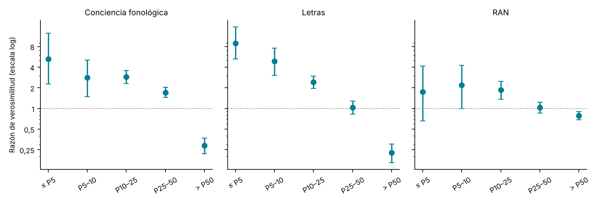
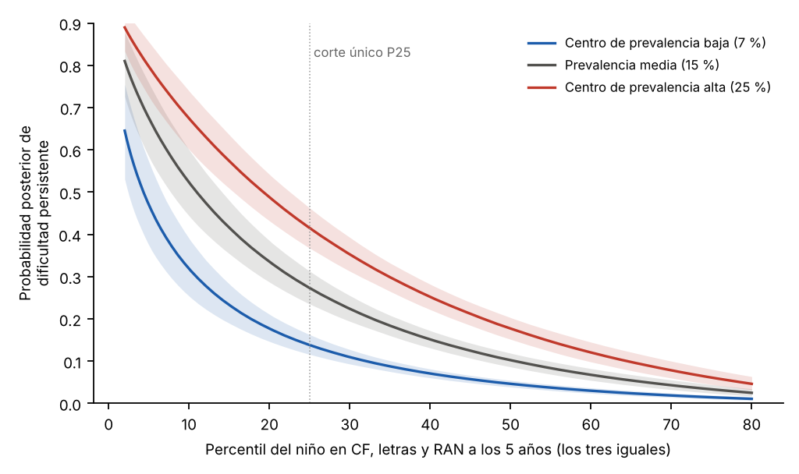

# M5 · Identificación bayesiana de la dificultad lectora — análisis exploratorio {.unnumbered}

*Desarrollo de un estudio de la Agenda · versión 1, 24/10/2026; revisión de literatura, 28/10/2026*

::: {.callout-warning}
**Página de trabajo del grupo.** Es un análisis exploratorio, no un resultado del manual. No aparece en el índice del libro: se llega desde el título del estudio en la [Agenda](../agenda.qmd#sec-agenda). No citar ni difundir fuera del grupo. Solo contiene datos agregados.
:::

[← Volver a la Agenda](../agenda.qmd#sec-agenda)

## Pregunta

¿Mejora la detección si combinamos varios indicadores con razones de verosimilitud y con la prevalencia del centro, en vez de usar un solo corte [@wagner2020prevalence; @wagner2022bayes]? La idea de fondo es dar a cada niño una **probabilidad de dificultad persistente con su intervalo**, en lugar de una etiqueta de «riesgo sí o no».

## Diseño

| Elemento | Decisión |
|---|---|
| Criterio | Dificultad persistente: DL-A + DL-B, con la etiqueta de certeza v2 ([Cómo estimamos el riesgo](../riesgo.qmd)) |
| Predictores | Conciencia fonológica, letras y RAN a los 5 años. Es la media de los trimestres, en percentil de la referencia SIN. Se exigen al menos 2 de los 3 |
| Muestra | 1.853 niños de las cohortes 2010–2013, de 57 colegios; 273 con dificultad persistente (14,7 %) |
| Validación | Se deja fuera una cohorte cada vez: se entrena con tres y se prueba con la cuarta |
| Centro | Prevalencia histórica del colegio (de las otras cohortes), encogida hacia la que corresponde a su ISE. Si el colegio no tiene historia, se usa la del ISE |

**Modelos que se comparan:**

- **A.** Un solo corte: compuesto de precursores ≤ P25. También se prueba solo CF ≤ P25.
- **B.** Razones de verosimilitud por tramos, multiplicadas («Bayes por tramos»).
- **C.** Regresión logística bayesiana con los tres indicadores, con priors poco informativos y muestreo MCMC (R-hat ≤ 1,01).
- **D.** C con la prevalencia del centro como probabilidad previa.
- **E.** C con el ISE como covariable.

## Razones de verosimilitud por tramos

La razón de verosimilitud (LR) dice cuánto cambia la probabilidad de dificultad al saber en qué tramo está el niño. Por encima de 1, la sube; por debajo, la baja.

{width=100%}

| Tramo | Conciencia fonológica | Letras | RAN |
|---|---|---|---|
| ≤ P5 | 5,3 (2,3–12,5) | **8,9** (5,3–15,4) | 1,8 (0,7–4,2) |
| P5–10 | 2,8 (1,5–5,1) | 4,9 (3,0–7,6) | 2,2 (1,0–4,3) |
| P10–25 | 2,9 (2,3–3,6) | 2,4 (2,0–3,0) | 1,9 (1,4–2,5) |
| P25–50 | 1,7 (1,5–2,0) | 1,0 (0,8–1,3) | 1,0 (0,9–1,2) |
| > P50 | **0,29** (0,22–0,37) | **0,23** (0,16–0,30) | 0,79 (0,68–0,90) |

- **Las letras son el indicador más informativo en los dos extremos.** Un niño por debajo de P5 en letras pasa de una probabilidad del 15 % a una del 61 %.
- **La conciencia fonológica sigue siendo informativa entre P25 y P50.** Ahí las letras ya no discriminan.
- **Estar por encima de la mediana en CF o en letras divide el riesgo entre 3 o 4.** Tranquiliza más de lo que alarma un resultado bajo.
- **El RAN apenas aporta a los 5 años** (LR ≈ 2 en los tramos bajos). En el modelo conjunto su OR es 0,99, lo que coincide con lo que ya se vio en [Cómo estimamos el riesgo](../riesgo.qmd).

## ¿Qué método detecta mejor?

Comparación fuera de cohorte (N = 1.853). Para que sea justa, todos los métodos señalan al mismo 20 % de niños que señala el corte único.

| Método | AUC | Calibración (pendiente) | Sensibilidad | VPP |
|---|---|---|---|---|
| A. Corte único, compuesto ≤ P25 | — | — | 0,53 | 0,39 |
| A2. Corte único, solo CF ≤ P25 | — | — | 0,40 | 0,34 |
| B. Bayes por tramos | 0,80 | **0,61** | 0,50 | 0,36 |
| **C. Logística bayesiana** | **0,82** | **0,97** | **0,56** | **0,41** |
| D. C + prevalencia del centro | 0,81 | 0,86 | 0,54 | 0,39 |
| E. C + ISE | 0,82 | 0,96 | 0,56 | 0,41 |

- **El modelo bayesiano conjunto (C) es el mejor y está bien calibrado.** Si dice 30 %, cerca del 30 % de esos niños acaban con dificultad persistente. Con el mismo número de niños señalados, su sensibilidad es del 56 %: 3 puntos más que el corte del compuesto (53 %) y 16 más que el corte de CF sola (40 %).
- **Multiplicar las LR (B) sobreestima el riesgo.** La CF y las letras están correlacionadas, así que multiplicarlas cuenta dos veces la misma información (pendiente 0,61). Por eso hay que combinar los indicadores en un modelo, no en serie.
- **La prevalencia del centro no mejora la predicción fuera de cohorte (D), y el ISE apenas aporta (E).** La prevalencia sí cambia con el nivel socioeconómico: 21 % en los colegios de ISE bajo (1–3), 13 % en el medio y 12 % en el alto. Pero los precursores del niño ya recogen buena parte de esa diferencia, y añadir el centro la cuenta dos veces. La prevalencia histórica de cada colegio, además, es ruidosa.

## La misma puntuación no significa lo mismo en todos los centros

Lo más útil para el informe es traducir el perfil del niño a una **probabilidad con su intervalo**. Esa probabilidad cambia mucho con la prevalencia del contexto.

{width=85%}

| Perfil a los 5 años | Centro con 7 % | Centro con 15 % | Centro con 25 % |
|---|---|---|---|
| Todo en P50 | 5 % (4–5) | 10 % (9–12) | 18 % (15–20) |
| RAN en P10, resto en P50 | 5 % (3–6) | 10 % (8–13) | 17 % (13–22) |
| CF en P10, resto en P50 | 10 % (8–14) | 21 % (17–27) | 34 % (27–42) |
| Letras en P10, resto en P50 | 17 % (13–20) | 32 % (26–38) | 47 % (40–53) |
| CF y letras en P25 | 14 % (12–16) | 27 % (24–31) | 42 % (38–46) |
| CF y letras en P10 | 32 % (27–38) | 53 % (47–59) | 68 % (62–73) |
| Todo en P10 | 32 % (25–39) | 52 % (44–60) | 67 % (60–74) |

- Un niño con todo en P10 tiene un 32 % de probabilidad en un centro de prevalencia baja y un 67 % en uno de prevalencia alta. El corte único les da la misma etiqueta.
- Los dos resultados no se contradicen. La prevalencia del centro no mejora el **orden** de los niños (la AUC), pero sí cambia la **probabilidad absoluta** que se comunica a la familia y al colegio. La pregunta abierta es qué prevalencia usar como referencia: la del colegio, la de su ISE o la general.

## Qué dice la literatura

*Revisión con SciSpace del 28/10/2026.*

- **Varios indicadores combinados en un modelo predicen mejor que un corte único.** @wagner2022bayes estiman modelos de regresión logística bayesiana sobre una matriz de correlaciones metaanalítica: casi todos los predictores aportan de forma independiente, y la conciencia fonológica es el mejor predictor de la decodificación pobre. @thompson2015individual siguen a niños con riesgo familiar desde los 3;6 años: el cribado no alcanza un nivel clínico aceptable hasta cerca de la entrada en primaria, cuando letras, CF y RAN juntos dan buena sensibilidad y especificidad. Presentan además la clasificación con varios cortes de probabilidad. @catts2017multifactorial encuentran que un déficit de CF en infantil multiplica por cinco la probabilidad de dislexia en 2º, y que el riesgo crece si se suman déficits de lenguaje oral y de RAN. **Coincide** con nuestro modelo C (AUC .82, pendiente .97). **Se aparta** en el RAN: para ellos suma riesgo; en LEEDUCA, a los 5 años, no (OR = .99).

- **En español, las letras pesan más que el RAN antes de los 7 años.** En 47 niños hispanohablantes seguidos de infantil a 2º, el conocimiento de letras fue el mejor predictor de la lectura de palabras y pseudopalabras de sílabas simples, y la CF, de las de sílabas complejas [@martinez2020silabica]. En 116 niños españoles, el RAN no influyó en la lectura de palabras a los 7 años, y el peso de las letras bajó con la edad mientras la CF se mantuvo [@gonzalezvalenzuela2021cognitive]. En 449 niños hispanohablantes de nivel socioeconómico bajo, el conocimiento del nombre y sonido de las letras explicó el 76 % de la varianza de la lectura de palabras a final de 1º [@porta2022lowincome]. En seis lenguas europeas (N = 2.252), la CF y el RAN pesan más en las ortografías complejas [@landerl2013predictors]. En cinco ortografías, el RAN predice sobre todo la fluidez [@landerl2019pa]. **Coincide** con las LR de M5: las letras son el indicador más informativo y el RAN el menos. El RAN puede importar más si el criterio pesa la velocidad (véase M10).

- **Multiplicar razones de verosimilitud supone independencia condicional, y eso sesga.** Si dos pruebas dependen entre sí aun conociendo el diagnóstico, sus tasas de error se subestiman [@vacek1985conditional]. @dendukuri2001bayesian proponen modelos bayesianos de efectos fijos y aleatorios que ajustan esa dependencia. Con menos de cuatro pruebas el modelo no se identifica sin priors informativos, y los intervalos salen más anchos. Una revisión de pruebas aplicadas en secuencia concluye que el rendimiento conjunto depende tanto de cada prueba como de su dependencia condicional [@fanshawe2024sequence]. **Coincide** con nuestra pendiente de .61 en el modelo B: CF y letras cuentan dos veces la misma información.

- **La prevalencia de base cambia el valor predictivo y es inestable.** Con datos públicos de tres estados de EE. UU. durante cuatro cursos, las tasas de base de los distritos casi nunca caían en el rango que permite clasificar a todos con un solo cribador, y variaban de un año a otro [@klingbeil2024baserates]. En un metaanálisis de 30 estudios de cribadores adaptativos, la sensibilidad (.77) baja y la especificidad (.83) sube cuando aumenta la tasa de base [@shen2026cat]. **Coincide** con M5: la prevalencia del centro cambia la probabilidad absoluta, no el orden. También explica por qué la prevalencia histórica de cada colegio es ruidosa.

- **Los modelos bayesianos jerárquicos son la extensión natural del cribado probabilístico.** @hall2026bayesics proponen modelos bayesianos de regresión ordinal como extensión completa de las probabilidades posteriores en el cribado escolar. Sus ventajas: cuantifican la incertidumbre y admiten estructura multinivel. Su barrera: cuesta interpretarlos y aplicarlos. **Apoya** el próximo paso 1 de M5 (efecto aleatorio de colegio).

- **Añadir información posterior al cribado reduce falsos positivos, pero el cribado en fases tiene costes.** En 355 niños de 1º, añadir el seguimiento de la fluidez en palabras y la evaluación dinámica redujo los falsos positivos, y un cribado en dos fases redujo los niños que necesitaban la batería completa [@compton2010gated]. En 366 niños de infantil, el crecimiento en la fluidez de nombrar letras añadió predicción sobre el cribado inicial [@catts2015rti]. Las medidas de respuesta a la intervención distinguieron mejor que las de infantil a los niños con riesgo persistente [@vellutino2008rti]. Pero el cribado en fases subió la especificidad a costa de la sensibilidad [@klingbeil2017multivariate]. **Coincide** con el paso 2 (la posterior de los 5 años como previa de los 6). La cautela: la lectura de 6.1 y los precursores de los 5 años no son independientes.

- **Calibración, curvas de decisión y comunicación.** Un modelo mal calibrado puede engañar y hacer daño en la toma de decisiones. Las curvas de calibración externas necesitan muestras grandes [@vancalster2019calibration]. Las curvas de decisión solo son válidas si el modelo está calibrado, porque el umbral se lee sobre el riesgo predicho [@baker2019decision]. Para comunicar, el efecto del formato depende del contexto [@visschers2009probability]. Las matrices de iconos producen estimaciones de probabilidad más exactas que los porcentajes o las frecuencias en texto [@tubau2019icons]. **No encontramos** estudios sobre cómo entienden familias y docentes una probabilidad de dificultad lectora.

## Lectura provisional

1. **Sí compensa pasar del corte a la probabilidad.** El modelo conjunto ordena mejor y, sobre todo, da una probabilidad calibrada con su intervalo. Es lo que piden la definición de 2025 y @wagner2022bayes.
2. **Las letras y la CF bastan a los 5 años.** El RAN no aporta en este momento.
3. **Las LR no se deben multiplicar** cuando los indicadores están correlacionados.
4. **El contexto importa para comunicar, no tanto para ordenar.** Antes de usar la prevalencia del centro hay que estimarla con un modelo multinivel, condicionado a los precursores, para no contar dos veces la misma información.

## Cautelas

- La etiqueta de certeza se construye con la lectura de 6 a 11 años, con la referencia SIN y la asignación Preleo v3. Con la v4 provisional el acuerdo de etiquetas es κ = .95.
- 2012 y 2013 tienen pocos casos (39 y 48).
- El ISE es del colegio, no de la familia.
- Los perfiles de la tabla son combinaciones teóricas: la de RAN en P10 con el resto en P50 es poco frecuente.

## Qué cambia en el estudio

Propuestas tras la revisión de literatura; sustituyen a los próximos pasos de la versión 1.

- **Usar como modelo principal una logística bayesiana multinivel**: efecto aleatorio de colegio y el ISE como predictor del colegio. Sustituye a D, que añade la prevalencia como previa externa y la cuenta dos veces. Informar de la varianza entre colegios y de cuánto se reduce al añadir los precursores [@hall2026bayesics; @klingbeil2024baserates].
- **Retirar B como método candidato.** Mantenerlo solo como ilustración de la dependencia condicional, con @vacek1985conditional y @dendukuri2001bayesian. Si el informe necesita LR por tramos, derivarlas del modelo conjunto (LR condicionadas a los demás indicadores).
- **Ampliar la evaluación de la calibración**: calibración global (intercepto), curva suavizada por cohorte de prueba y puntuación de Brier. Señalar que 2012 y 2013 (39 y 48 casos) no bastan para una curva de calibración estable [@vancalster2019calibration].
- **Añadir curvas de decisión** con umbrales de 10–40 %, frente a «intervenir a todos», «a ninguno» y el corte P25. Hacerlo después de comprobar la calibración en cada cohorte [@baker2019decision].
- **Completar la tabla de rendimiento** con especificidad y VPN. Simular cómo cambian el VPP y la sensibilidad con prevalencias del 7, 15 y 25 % [@shen2026cat; @petscher2011predictive].
- **Actualización secuencial sin multiplicar.** Estimar un modelo conjunto con precursores de 5 años y lectura de 6.1, o usar el logit previo como *offset* y volver a comprobar la calibración. Comparar con un cribado en dos fases y medir cuánta sensibilidad se pierde [@compton2010gated; @klingbeil2017multivariate; @fanshawe2024sequence].
- **Volver a probar el RAN con otro criterio y otra edad.** Repetir el análisis con un criterio solo de fluidez y con el RAN de 6 años. Así se distingue «el RAN no aporta» de «el RAN no aporta a este criterio» [@thompson2015individual; @landerl2019pa].
- **Probar el formato del informe antes de usarlo.** Matriz de iconos con la probabilidad y su intervalo, probada con un grupo pequeño de docentes y familias [@tubau2019icons].
- **Revistas.** *Scientific Studies of Reading* (donde publicaron @wagner2022bayes), *Annals of Dyslexia* y *Journal of Learning Disabilities*. Si el peso es metodológico, *Assessment for Effective Intervention* o *School Psychology Review*, donde están @hall2026bayesics y @shen2026cat.

## Huecos que puede llenar LEEDUCA

- **Un modelo bayesiano de cribado con datos longitudinales reales en español.** @wagner2022bayes trabajan con una matriz metaanalítica, y @hall2026bayesics con simulaciones y un ejemplo aplicado.
- **Actualización secuencial con tres evaluaciones por curso**, de los 5 a los 6 años, en la misma muestra.
- **Prevalencia por colegio y su estabilidad entre cohortes.** La literatura la estudia por distrito [@klingbeil2024baserates]; LEEDUCA puede hacerlo por centro, con el ISE.
- **Cómo entienden familias y docentes una probabilidad de dificultad lectora.** No hemos encontrado estudios sobre esto en educación.

::: {.callout-note appearance="minimal"}
**Reproducibilidad.** Guion `04_DICCIONARIO_PROCESADO_2026/scripts/m5_bayes_v1.py`. Usa `certeza_cortes_baremos_v2.xlsx`, `ise_sexo_nacimiento_v1.xlsx` y la tabla larga v2 (solo para el colegio). Salida completa en `DIAGNOSTICO/M5_bayes_resultados_v1.xlsx`.
:::
