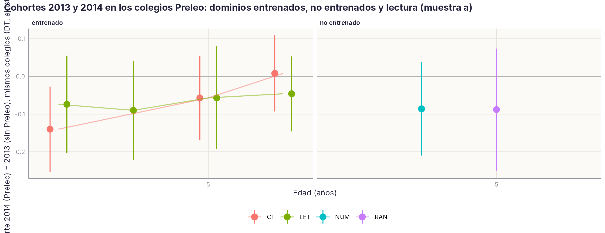

# Preleo · Efectos: plan de análisis y primeros resultados {.unnumbered}

*Página de desarrollo · versión 1, 01/11/2026. Plan fijado antes de estimar (`claude/QC_DETECTORES_INCONGRUENCIAS_v1.md`, sección 4). Script `04/scripts/R/preleo_05_efecto_tres_cohortes.R`, sobre el [control de calidad por colegio](PRELEO_QC.qmd). Cohortes 2013 y 2014 (contraste principal), 2010 (réplica de la tesis de A. Sánchez Gómez) y 2011 (dosis).*

::: {.callout-warning}
**Página de trabajo del grupo.** Solo datos agregados. Los resultados son una primera pasada con los umbrales de calidad aún en propuesta y la condición Preleo v3 (la 2011 pendiente de confirmar con A. Sánchez). No aparece en el índice del libro: se llega desde [Efectos de Preleo](../preleo/datos.qmd) y desde [M19](M19.qmd). No citar ni difundir fuera del grupo.
:::

[← Volver a «Efectos de Preleo»](../preleo/datos.qmd)

## Para leer en dos minutos

::: {.callout-tip}
## Lo esencial, sin estadística

1. **Las cohortes 2013 y 2014 son la comparación más limpia que tenemos:** los mismos colegios evaluaron a una cohorte sin Preleo y a la siguiente con él. Lo que cambia entre las dos es el programa, no el colegio.
2. **Con los datos de hoy, a los 4 y 5 años no se ve ventaja de la cohorte con Preleo** en conciencia fonológica ni en letras: las diferencias son pequeñas y, si acaso, a favor de la cohorte sin programa en algún trimestre. Falta la parte que importa de verdad: la lectura a 6–7 años, que para la cohorte 2014 cayó en la pandemia y está incompleta.
3. **En la cohorte 2010, con todos los colegios de la tesis, tampoco aparece un efecto en lectura a 6–7 años**, ni en el porcentaje de niños con dificultad persistente. Coincide con la auditoría del 20 de octubre: el efecto publicado dependía de qué colegios entraban y de cómo se trataron los datos que faltaban.
4. **El resultado es el mismo con y sin los colegios con alertas de calidad.** Lo que cambia la muestra son detalles (una sesión de letras de 2014 con los tiempos en otra unidad), no la conclusión.
5. **Lo que no podemos decir aún:** si Preleo funciona cuando se aplica con rigor (no tenemos el dato de rigor para 2013–2014 ni los registros de uso), ni qué pasa con la lectura de la cohorte 2014 después de la pandemia.
:::

## Qué cohorte responde a qué

| Cohorte | Papel | Por qué |
|---|---|---|
| 2013 (sin Preleo) y 2014 (con Preleo) | **Contraste principal** | Los mismos colegios evaluaron una cohorte sin el programa y la siguiente con él: el contraste es dentro de colegio. Tres de esos colegios no aplicaron Preleo en ninguna de las dos cohortes y sirven para estimar la deriva entre cohortes sin programa (diferencias en diferencias), aunque son pocos y entraron tarde (sin datos a 4.1) |
| 2010 (tesis: 19 colegios Preleo / 11 de comparación) | Réplica mejorada del análisis original | Plan cerrado del 20/10: los 30 colegios, línea base 5.1, mismos faltantes en los dos grupos. Mejoras: momentos trimestrales en vez de media anual, etiquetas longitudinales (DL-A/DL-B/TR/INT/TE) en vez del riesgo por terciles de CF, y el control de calidad por colegio en vez de la exclusión por pendiente negativa |
| 2011 (toda con Preleo) | Solo dosis y fidelidad | No hay grupo de comparación interno. Pendiente: rigor de aplicación por colegio y si el programa empezó a los 3 o a los 4 años |

Nombres: «grupo Preleo» y «grupo de comparación»; nunca «control».

## Comprobaciones que hacen creíble un efecto

1. **Tendencias paralelas (placebo).** La diferencia 2014 − 2013 a 4.1, antes de la exposición, debe ser ≈ 0 (|d| < 0,2) en todos los dominios.
2. **Transferencia cercana y lejana.** Preleo entrena conciencia fonológica, letras y vocabulario. Un efecto convincente aparece en lo entrenado a 5 años **y** en la lectura posterior (palabras, pseudopalabras, fluidez, 6–7 años), y **no** aparece en RAN, número ni funciones ejecutivas. Un efecto solo en lo entrenado es enseñar para el test.
3. **Dosis-respuesta.** Dentro del grupo Preleo, el efecto crece con el rigor de aplicación y, cuando lleguen del servidor, con el uso real del programa.
4. **Funcionamiento diferencial de los ítems** (pendiente de las respuestas ítem a ítem).
5. **Robustez a la calidad de los datos.** El efecto se reporta en las tres muestras del control de calidad (a completa, b sin alertas graves, c ponderada).
6. **Resultado clínico, no solo medias.** Porcentaje de alumnos con dificultad persistente (DL-A/DL-B) y OR; y la probabilidad de éxito por alumno cuando [M19](M19.qmd) esté disponible.

Puntuaciones: medida principal de cada tarea, en z dentro de cohorte × momento × tarea (tiempo con signo cambiado; **tiempo cero = no registrado**, ausente); cada dominio es la media de las z de sus tareas. Modelo: dominio ~ condición + ISE del colegio [+ mismo dominio a 4.1] + (1 | colegio).

## Resultados de la primera pasada

### Cohortes 2013 y 2014

```{r}
#| label: tbl-ef-placebo
#| tbl-cap: "Placebo: diferencia 2014 − 2013 a 4.1, antes de la exposición, en los colegios Preleo (muestra a)."
p <- read.csv("../datos/agregados/PRELEO_EFECTO/1_Placebo_41.csv", encoding = "UTF-8")
p <- p[!is.na(p$d_2014_2013_Preleo), c("dominio", "tipo", "n_Preleo", "colegios", "d_2014_2013_Preleo", "ic_lo_simple", "ic_hi_simple")]
knitr::kable(p, col.names = c("Dominio", "Tipo", "n", "Colegios", "d", "IC 95 % inf.", "IC 95 % sup."), row.names = FALSE, digits = 2)
```

A 4.1 las dos cohortes son equivalentes (|d| < 0,1 en conciencia fonológica y RAN): las tendencias paralelas se cumplen donde se pueden comprobar.

```{r}
#| label: tbl-ef-2013-2014
#| tbl-cap: "Cohorte 2014 (Preleo) − 2013 (sin Preleo) en los colegios Preleo, por dominio y momento, en las tres muestras del control de calidad. d ajustada por ISE; d (4.1) ajustada además por el mismo dominio a 4.1."
e <- read.csv("../datos/agregados/PRELEO_EFECTO/2_Efecto_2013_2014.csv", encoding = "UTF-8")
e <- e[!is.na(e$d_2014_2013_Preleo), ]
e$ic <- sprintf("%.2f [%.2f; %.2f]", e$d_2014_2013_Preleo, e$ic_lo_simple, e$ic_hi_simple)
w <- reshape(e[, c("dominio", "tipo", "mom", "muestra", "ic")], idvar = c("dominio", "tipo", "mom"), timevar = "muestra", direction = "wide")
a41 <- e[e$muestra == "a", c("dominio", "mom", "d_2014_2013_Preleo_ajust41")]
w <- merge(w, a41, by = c("dominio", "mom"), all.x = TRUE)
w <- w[order(factor(w$tipo, c("entrenado", "no entrenado", "lectura posterior")), w$dominio, w$mom), ]
knitr::kable(w[, c("tipo", "dominio", "mom", "ic.a", "ic.b", "ic.c", "d_2014_2013_Preleo_ajust41")],
             col.names = c("Tipo", "Dominio", "Momento", "a · completa", "b · sin graves", "c · ponderada", "d (4.1), a"), row.names = FALSE, digits = 2)
```

{#fig-ef-transferencia}

Lectura. Entre 4.2 y 5.2, en los dominios que Preleo entrena, la cohorte con el programa no supera a la anterior: las diferencias van de −0,14 a +0,01 DT, y las que se separan de cero lo hacen a favor de la cohorte *sin* programa (conciencia fonológica a 4.2). El patrón de transferencia (entrenado > no entrenado) no aparece. Las tres muestras coinciden salvo en letras a 5.2, donde quitar los colegios con alerta grave (la sesión 907 de 2014 tiene los tiempos de letras en otra unidad) cambia la cifra: ahí hay que resolver la incidencia antes de interpretar.

Lo que falta para que este contraste responda a la pregunta: la **lectura a 6–7 años**. La cohorte 2014 tenía 5 años en 2019/20 (el tercer trimestre se perdió con la pandemia) y 6 en 2020/21, con una evaluación reducida; a 7.1 solo hay ocho colegios. Cualquier efecto de Preleo en lectura está, en esta cohorte, confundido con el efecto de la pandemia sobre el primer curso de primaria. Las diferencias en diferencias con los tres colegios sin programa no son estimables con precisión (errores típicos de 0,4–0,7 DT).

### Cohorte 2010: réplica con los 30 colegios de la tesis

```{r}
#| label: tbl-ef-2010
#| tbl-cap: "Cohorte 2010, 30 colegios de la tesis: grupo Preleo − comparación en lectura a 6–7 años, ajustado por el mismo dominio a 5.1 e ISE, intercepto aleatorio de colegio; tres muestras."
r <- read.csv("../datos/agregados/PRELEO_EFECTO/4_Replica_2010.csv", encoding = "UTF-8")
r <- r[r$tipo == "lectura posterior" & !is.na(r$d), ]
r$ic <- sprintf("%.2f [%.2f; %.2f]", r$d, r$ic_lo, r$ic_hi)
w <- reshape(r[, c("dominio", "mom", "muestra", "ic")], idvar = c("dominio", "mom"), timevar = "muestra", direction = "wide")
w <- w[order(w$dominio, w$mom), ]
knitr::kable(w, col.names = c("Dominio", "Momento", "a · completa", "b · sin graves", "c · ponderada"), row.names = FALSE)
```

```{r}
#| label: tbl-ef-clinico
#| tbl-cap: "Cohorte 2010: alumnos con dificultad lectora persistente (DL-A o DL-B, etiqueta longitudinal) por grupo, y OR del grupo Preleo ajustada por conciencia fonológica a 5.1 (errores típicos robustos por colegio)."
k <- read.csv("../datos/agregados/PRELEO_EFECTO/5_Clinico_2010.csv", encoding = "UTF-8")
k$muestra <- c(a = "a · completa", b = "b · sin graves", c = "c · ponderada")[k$muestra]
knitr::kable(k[, c("muestra", "n", "colegios", "pct_DL_SIN", "pct_DL_CON", "OR", "ic_lo", "ic_hi")],
             col.names = c("Muestra", "n", "Colegios", "% DL comparación", "% DL Preleo", "OR", "IC inf.", "IC sup."), row.names = FALSE, digits = 2)
```

Lectura. Con los 30 colegios y la línea base a 5.1, el grupo Preleo no lee mejor que el de comparación en ningún trimestre de 6–7 años (d entre −0,14 y +0,08, todos los intervalos cruzan el cero), y el porcentaje de niños con dificultad persistente es el mismo (12–13 %; OR 1,33 [0,60; 2,95]). Quitar los colegios con alertas graves (muestra b, 20 colegios) no cambia la conclusión. Es lo que ya mostró la auditoría del 20/10 con los indicadores corregidos; aquí se confirma con las etiquetas longitudinales y con el control de calidad reportado.

### Cohorte 2011 y dosis

El rigor de aplicación por colegio solo está codificado para la cohorte 2010 (tesis). Para 2011, 2013 y 2014 la relación dosis-respuesta queda pendiente de la tabla de rigor de A. Sánchez y de los registros de uso del servidor.

## Qué hay que decidir

1. **Confirmar con A. Sánchez** (3–4/11): la condición de 2011 (¿Preleo desde los 3 o desde los 4?), el rigor de aplicación de los colegios de 2013–2014 y si los tres colegios sin programa en las dos cohortes pueden servir de comparación.
2. **Cerrar los umbrales del control de calidad** y confirmar en el bruto las alertas graves; después, fijar esta página como resultado v1.
3. **Decidir cómo tratar la pandemia** en la cohorte 2014: comparar solo hasta 5.2, o modelar el curso 2020/21 como un periodo distinto.
4. Para los artículos: (a) metodológico, los detectores de incongruencias aplicados a toda la plataforma (enlaza con M13 y M15); (b) eficacia, con 2013/2014 hasta 5.2, la réplica de 2010 con las exclusiones reportadas, y la dosis cuando esté.
