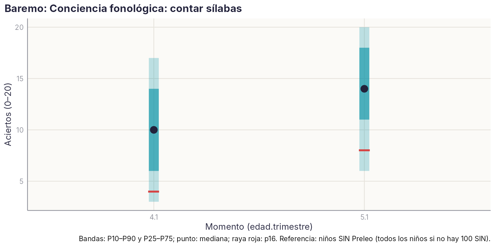

```{r}
#| include: false
source(file.path(dirname(knitr::current_input(dir = TRUE)), "..", "R", "libro.R"))
```

::: {.callout-note appearance="minimal"}
**Status:** pilot task sheet, draft of October 20, 2026, at the group's request. Short version of the common structure. The full tables are read from `datos/agregados/CF523` and update when the data are regenerated with `scripts/R/ficha_borrador_tarea.R --tarea CF523`. *Translated from the Spanish version of November 28, 2026.*
:::

**In one sentence.** It is the phonological awareness task with the most children and cohorts on the platform: about 5,800 children from six cohorts. It measures what it intends to: it is related mainly to other phonological awareness tasks, it has no floor and hardly any ceiling at age 4. But **on its own it is a weak measure**: it is not very stable from one school year to the next (r ≈ .35) and it predicts persistent reading difficulty poorly (AUC ≈ .65). It should not be used alone to classify a child. Its natural place is within a phonological awareness composite.

## Description

The examiner names the picture that appears on the screen and the child says how many syllables ("little pieces") the word has. The examiner marks the number with the mouse. There are 20 items.

| Code | Time points | Cohorts | Measure |
|---|---|---|---|
| 523 | 4.1 (sessions 67, 154, 181, 625, 894) and 5.1 (66, 153, 182, 628) | 2010–2015 | Correct responses (0–20) |

It was given on the old platform (until 2017/18) and on the new one (from 2018/19), with the same results on both (table of descriptive statistics by cohort).

### How it is programmed on the platform {.unnumbered}

```{r}
#| results: asis
plataforma_tabla(codigos = c(523))
plataforma_capturas(523, pre = "../")
```

## Theoretical framework and evidence

Phonological awareness is the ability to reflect on and manipulate the sounds of speech: words, syllables, rhymes and phonemes. With letter knowledge and rapid naming it forms the classic triad of reading predictors. Counting syllables is one of the easiest tasks on the continuum: it requires segmenting a spoken word into syllables, without removing or changing anything.

What the evidence says:

- **The phoneme level is the most predictive.** In a meta-analysis of 235 studies, phonemic awareness was the strongest correlate of word reading, above rhyme and verbal memory ([Melby-Lervåg et al., 2012](https://doi.org/10.1037/a0026744)). In longitudinal studies in German, another language with a transparent orthography, the mean relation with later reading was r = .31, and it was also larger at the phoneme level than at the rhyme level ([Pfost, 2015](https://doi.org/10.1026/0049-8637/a000141)).
- **One skill, many levels of difficulty.** In more than 1,200 Spanish-speaking children aged 3 to 6, phonological awareness tasks (word, syllable and phoneme; blending and elision) measure a single general skill, with items of very different difficulty. The stability of the skill over that period was r = .64 ([Anthony et al., 2011](https://doi.org/10.1037/a0025024)).
- **The role of the syllable in Spanish.** Sensitivity to the syllable appears early and may be especially important in Spanish ([Denton et al., 2000](https://doi.org/10.1080/027027100750061958)). In 5-year-olds, syllable blending was the task that best predicted reading one year later ([Fumagalli et al., 2014](https://doi.org/10.32348/1852.4206.v6.n3.7771)). Fine-grained segmental awareness, on the other hand, develops mainly when learning the alphabetic code ([Carrillo, 1994](https://doi.org/10.1007/BF01027086)).
- **In Spanish, letters weigh heavily.** In children aged 5 to 7, letter knowledge was the best predictor of reading simple syllables, and phonological awareness only predicted reading complex syllables ([Martínez & Goikoetxea, 2020](https://journals.copmadrid.org/psed/archivos/1135_755X_psed_26_1_0037.pdf)). There are even doubts about how much teaching phonemic awareness contributes for children learning to read in Spanish ([Goldenberg et al., 2014](https://doi.org/10.3102/0002831214529082)).
- **It can be trained, and training shows in reading.** In Spanish speakers, phonological awareness interventions improve reading accuracy (combined d ≈ 0.36; [Ripoll & Zevallos, 2023](https://doi.org/10.5209/rlog.84260)). The causal effect is better established for phonemic awareness combined with letter–sound knowledge ([Hulme et al., 2012](https://doi.org/10.1177/0956797611435921)).

What our data say:

- Syllable counting behaves like an easy task on the continuum: it is more closely related to other phonological awareness tasks than to any other domain, but it predicts reading difficulty less than letters and adds almost nothing over letters and rapid naming. This fits the literature: at ages 4–5, the syllable level is the least informative, and in Spanish letters take a good part of the prediction.
- Stability from age 4 to 5 (r ≈ .35) is far below that of the general skill in Anthony et al. (2011). This is to be expected with a single 20-item task: the error of a single task is large, and a composite reduces it.

References located with SciSpace (volumes and pages still to be checked): Anthony et al. (2011), *Journal of Educational Psychology*; Carrillo (1994), *Reading and Writing*; Denton et al. (2000), *Reading Psychology*; Fumagalli et al. (2014), *Revista Argentina de Ciencias del Comportamiento*; Goldenberg et al. (2014), *American Educational Research Journal*; Hulme et al. (2012), *Psychological Science*; Martínez & Goikoetxea (2020), *Psicología Educativa*, 26(1); Melby-Lervåg et al. (2012), *Psychological Bulletin*; Pfost (2015), *Zeitschrift für Entwicklungspsychologie und Pädagogische Psychologie*; Ripoll & Zevallos (2023), *Revista de Investigación en Logopedia*.

## Main results

```{r}
#| label: tbl-cf523-baremo
#| tbl-cap: "Syllable counting norms (correct responses), normative reference sample (non-Preleo schools)."
B <- leer("CF523", "5_Baremo_SIN")
tabla(B[, c("mom", "N", "cohortes", "P5", "P10", "P16", "P25", "P50", "P75", "P90")], c("Time point", "N", "Cohorts", "P5", "P10", "P16", "P25", "P50", "P75", "P90"), digitos = 0)
```

{width=80%}

- **Distribution.** At age 4, median of 10 correct, almost symmetrical, with no floor (≈ 3% with 0) and no ceiling (≈ 3% with 20). At age 5, median of 14, with 12% at ceiling: the task begins to fall short for the best children.
- **Reliability.** The correlation between 4.1 and 5.1 in the same children is .33–.40 in three cohorts. It is low for a 20-item task: part of it is due to real change during a year of rapid development, but it also indicates considerable error. Internal consistency (α, ω) is pending: the long table does not have the item-level responses for this task.
- **Concurrent validity.** It is more closely related to other phonological awareness tasks at the same time point (r = .40–.46) than to vocabulary (.11–.25), letters (.29) or rapid naming (.08–.16). This is the expected pattern.
- **Predictive validity.** Against persistent reading difficulty from age 6 to 11, the AUC is .66 at age 4 and .64 at age 5. Below P25 it detects 40% of future cases with 20% false positives.
- **Incremental validity.** Over letters and rapid naming, it adds very little: +0.005 in AUC at age 4 and +0.002 at age 5, with cross-validation.
- **Variables that affect it.** Relative age weighs at age 4 (d = 0.44 between children born in the first and second half of the year) and less at age 5 (d = 0.24). School socioeconomic status weighs little (d = 0.26 at age 4; null at age 5). Schools explain 14–19% of the variance.

::: {.callout-note}
## Continuous norms and floor effect (study M3, November 3, 2026)

Syllable counting is a count of 0 to 20 correct responses, so GAMLSS needs a discrete distribution (beta-binomial). With it, it is the best method out of sample (mean error of 1.4 percentile points), and all methods are within 2.3 points of the nominal P10. Floor: 4% with zero correct at 4.1.

Details in study M3.
:::

## Studies it opens up

| # | Study | Type | Question | What is already available |
| --- | --- | --- | --- | --- |
| E1 | **Phonological awareness composite by age** | Applied | Which combination of tasks (syllable counting, initial syllable matching 525, initial syllable deletion 1551, final phoneme deletion 1839) gives the most reliable and predictive composite at ages 4 and 5? | The four tasks in the same sessions in several cohorts (2011, 2013, 2014). |
| E2 | **Syllable versus phoneme in the same children** | Theoretical | Does phoneme deletion (5.2) predict more than syllable tasks (5.1), as the literature suggests? | 2011–2014 cohorts with both. |
| E3 | **Internal consistency and items** | Methodological | α, ω and the difficulty of each item: are there words that do not discriminate or that depend on dialect (syllables with diphthongs)? | Item-level responses from the new platform (2013–2015), still to be processed. |
| E4 | **One skill or several** | Theoretical | Do we replicate the single general factor structure of Anthony et al. (2011) with the platform's tasks? | Several phonological awareness tasks per time point. |
| E5 | **Relative age** | Exploratory | Does the effect of relative age at age 4 (d ≈ 0.44) explain part of the risk of children born late in the year? | Age in months (§ effects). |
| E6 | **Checking Preleo** | Hypothesis test | Preleo works on syllabic awareness at age 4: does syllable counting improve between 4.1 and 5.1 in the schools that deliver it? | 2011 cohort (proposed assignment v5). Analysis in the group's internal workspace. |

**Utility of each result.**

- **Scientific:** E2 and E4 test the sequence from syllable to phoneme in a large sample of Spanish speakers.
- **Educational:** it is a task that is easy to understand and to train in the classroom, useful for monitoring progress at age 4.
- **Clinical:** on its own it is not enough to make decisions. Within a composite, with letters and RAN, it helps to prioritize support.

## Pending issues and data issues

- **Recommended use:** as part of a phonological awareness composite, with norms by age in months at age 4.
- **Do not use alone** to decide on support: with r ≈ .35 between school years, the standard error is large.
- Compute internal consistency with the item-level data from the new platform (E3).
- Choose the best task or the best composite at each age (E1).
- Review the coding of sex before interpreting its effect (open issue common to all task sheets).

## Full tables

```{r}
#| results: asis
tablas_completas("CF523")
```
