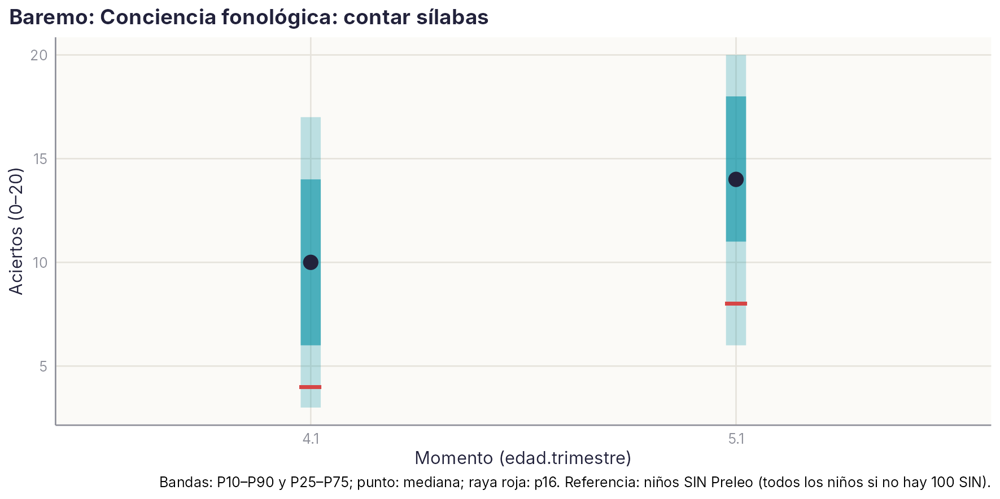

```{r}
#| include: false
source(file.path(dirname(knitr::current_input(dir = TRUE)), "..", "R", "libro.R"))
```

::: {.callout-note appearance="minimal"}
**Estado:** ficha piloto, borrador del 20/10/2026, a petición del grupo. Versión corta de la estructura común. Las tablas completas se leen de `datos/agregados/CF523` y se actualizan al regenerar los datos con `scripts/R/ficha_borrador_tarea.R --tarea CF523`.
:::

**En una frase.** Es la tarea de conciencia fonológica con más niños y cohortes de la plataforma: unos 5.800 niños de seis cohortes. Mide bien lo que pretende: se relaciona sobre todo con otras tareas de conciencia fonológica, no tiene suelo y apenas techo a los 4 años. Pero **sola es una medida débil**: es poco estable de un curso a otro (r ≈ .35) y predice poco la dificultad lectora persistente (AUC ≈ .65). No debe usarse sola para clasificar a un niño. Su lugar natural es dentro de un compuesto de conciencia fonológica.

## Descripción

El evaluador nombra el dibujo que aparece en la pantalla y el niño dice cuántas sílabas («trocitos») tiene la palabra. El evaluador marca el número con el ratón. Hay 20 ítems.

| Código | Momentos | Cohortes | Medida |
|---|---|---|---|
| 523 | 4.1 (sesiones 67, 154, 181, 625, 894) y 5.1 (66, 153, 182, 628) | 2010–2015 | Aciertos (0–20) |

Se pasó en la plataforma antigua (hasta 2017/18) y en la nueva (desde 2018/19), con los mismos resultados en ambas (tabla de descriptivos por cohorte).

### Cómo está programada en la plataforma {.unnumbered}

```{r}
#| results: asis
plataforma_tabla(codigos = c(523))
```

## Marco teórico y evidencia

La conciencia fonológica es la capacidad de reflexionar sobre los sonidos del habla y manipularlos: palabras, sílabas, rimas y fonemas. Con el conocimiento de letras y la denominación rápida forma la tríada clásica de predictores de la lectura. Contar sílabas es una de las tareas más sencillas del continuo: pide segmentar una palabra oída en sílabas, sin quitar ni cambiar nada.

Lo que dice la evidencia:

- **El nivel del fonema es el que más predice.** En un metaanálisis de 235 estudios, la conciencia fonémica fue el correlato más fuerte de la lectura de palabras, por encima de la rima y de la memoria verbal ([Melby-Lervåg et al., 2012](https://doi.org/10.1037/a0026744)). En estudios longitudinales en alemán, otra lengua de ortografía transparente, la relación media con la lectura posterior fue r = .31, y también fue mayor en el nivel del fonema que en el de la rima ([Pfost, 2015](https://doi.org/10.1026/0049-8637/a000141)).
- **Una habilidad, muchos niveles de dificultad.** En más de 1.200 niños hispanohablantes de 3 a 6 años, las tareas de conciencia fonológica (palabra, sílaba y fonema; síntesis y omisión) miden una sola habilidad general, con ítems de dificultad muy distinta. La estabilidad de la habilidad en ese periodo fue de r = .64 ([Anthony et al., 2011](https://doi.org/10.1037/a0025024)).
- **El papel de la sílaba en español.** La sensibilidad a la sílaba es temprana y podría ser especialmente importante en español ([Denton et al., 2000](https://doi.org/10.1080/027027100750061958)). En niños de 5 años, la síntesis de sílabas fue la tarea que más predijo la lectura un año después ([Fumagalli et al., 2014](https://doi.org/10.32348/1852.4206.v6.n3.7771)). En cambio, la conciencia segmental fina se desarrolla sobre todo al aprender el código alfabético ([Carrillo, 1994](https://doi.org/10.1007/BF01027086)).
- **En español, las letras pesan mucho.** Con niños de 5 a 7 años, el conocimiento de letras fue el mejor predictor de la lectura de sílabas simples, y la conciencia fonológica solo predijo la de sílabas complejas ([Martínez y Goikoetxea, 2020](https://journals.copmadrid.org/psed/archivos/1135_755X_psed_26_1_0037.pdf)). Hay incluso dudas sobre cuánto aporta enseñar conciencia fonémica a quien aprende a leer en español ([Goldenberg et al., 2014](https://doi.org/10.3102/0002831214529082)).
- **Es entrenable y su entrenamiento se nota en la lectura.** En hispanohablantes, las intervenciones con conciencia fonológica mejoran la precisión lectora (d combinado ≈ 0,36; [Ripoll y Zevallos, 2023](https://doi.org/10.5209/rlog.84260)). El efecto causal está mejor establecido para la conciencia fonémica unida al conocimiento letra-sonido ([Hulme et al., 2012](https://doi.org/10.1177/0956797611435921)).

Lo que dicen nuestros datos:

- Contar sílabas se comporta como una tarea fácil del continuo: se relaciona más con otras tareas de conciencia fonológica que con cualquier otro dominio, pero predice la dificultad lectora menos que las letras y casi no añade nada sobre letras y denominación rápida. Encaja con la literatura: a los 4–5 años, el nivel de la sílaba es el menos informativo, y en español las letras se llevan buena parte de la predicción.
- La estabilidad de 4 a 5 años (r ≈ .35) queda muy por debajo de la de la habilidad general en Anthony et al. (2011). Lo esperable con una sola tarea de 20 ítems: el error de una tarea suelta es grande, y un compuesto lo reduce.

Referencias localizadas con SciSpace (falta comprobar volúmenes y páginas): Anthony et al. (2011), *Journal of Educational Psychology*; Carrillo (1994), *Reading and Writing*; Denton et al. (2000), *Reading Psychology*; Fumagalli et al. (2014), *Revista Argentina de Ciencias del Comportamiento*; Goldenberg et al. (2014), *American Educational Research Journal*; Hulme et al. (2012), *Psychological Science*; Martínez y Goikoetxea (2020), *Psicología Educativa*, 26(1); Melby-Lervåg et al. (2012), *Psychological Bulletin*; Pfost (2015), *Zeitschrift für Entwicklungspsychologie und Pädagogische Psychologie*; Ripoll y Zevallos (2023), *Revista de Investigación en Logopedia*.

## Resultados principales

```{r}
#| label: tbl-cf523-baremo
#| tbl-cap: "Baremo de contar sílabas (aciertos), muestra de referencia normativa (centros sin Preleo)."
B <- leer("CF523", "5_Baremo_SIN")
tabla(B[, c("mom", "N", "cohortes", "P5", "P10", "P16", "P25", "P50", "P75", "P90")], c("Momento", "N", "Cohortes", "P5", "P10", "P16", "P25", "P50", "P75", "P90"), digitos = 0)
```

{width=80%}

- **Distribución.** A los 4 años, mediana de 10 aciertos, casi simétrica, sin suelo (≈ 3 % con 0) ni techo (≈ 3 % con 20). A los 5 años, mediana de 14, con un 12 % de techo: la tarea empieza a quedarse corta para los mejores.
- **Fiabilidad.** La correlación entre 4.1 y 5.1 en los mismos niños es de .33–.40 en tres cohortes. Es baja para una tarea de 20 ítems: parte se debe al cambio real en un año de desarrollo rápido, pero también indica bastante error. La consistencia interna (α, ω) queda pendiente: la tabla larga no tiene las respuestas ítem a ítem de esta tarea.
- **Validez concurrente.** Se relaciona más con otras tareas de conciencia fonológica del mismo momento (r = .40–.46) que con vocabulario (.11–.25), letras (.29) o denominación rápida (.08–.16). Es el patrón esperado.
- **Validez predictiva.** Frente a la dificultad lectora persistente de 6 a 11 años, el AUC es .66 a los 4 años y .64 a los 5. Por debajo de p25 detecta al 40 % de los futuros casos con un 20 % de falsos positivos.
- **Validez incremental.** Sobre letras y denominación rápida, añade muy poco: +0,005 de AUC a los 4 años y +0,002 a los 5, con validación cruzada.
- **Variables que la afectan.** La edad relativa pesa a los 4 años (d = 0,44 entre nacidos en el primer y el segundo semestre) y menos a los 5 (d = 0,24). El nivel socioeconómico del centro, poco (d = 0,26 a los 4 años; nulo a los 5). Los colegios explican el 14–19 % de la varianza.

## Estudios que abre

| # | Estudio | Tipo | Pregunta | Qué hay ya |
| --- | --- | --- | --- | --- |
| E1 | **Compuesto de conciencia fonológica por edad** | Aplicado | ¿Qué combinación de tareas (contar sílabas, emparejar sílaba inicial 525, omitir sílaba inicial 1551, omitir fonema final 1839) da el compuesto más fiable y predictivo a los 4 y a los 5 años? | Las cuatro tareas en las mismas sesiones de varias cohortes (2011, 2013, 2014). |
| E2 | **Sílaba frente a fonema en los mismos niños** | Teórico | ¿Predice más la omisión de fonemas (5.2) que las tareas silábicas (5.1), como apunta la literatura? | Cohortes 2011–2014 con las dos. |
| E3 | **Consistencia interna e ítems** | Metodológico | α, ω y dificultad de cada ítem: ¿hay palabras que no discriminan o que dependen del dialecto (sílabas con diptongos)? | Respuestas ítem a ítem de la plataforma nueva (2013–2015), pendientes de procesar. |
| E4 | **Una o varias habilidades** | Teórico | ¿Replicamos la estructura de un factor general de Anthony et al. (2011) con las tareas de la plataforma? | Varias tareas de CF por momento. |
| E5 | **Edad relativa** | Exploratorio | El efecto de la edad relativa a los 4 años (d ≈ 0,44) ¿explica parte del riesgo de los nacidos a final de año? | Edad en meses (§ efectos). |
| E6 | **Comprobación de Preleo** | Prueba de hipótesis | Preleo trabaja la conciencia silábica a los 4 años: ¿mejora contar sílabas entre 4.1 y 5.1 en los colegios que lo aplican? | Cohorte 2011 (asignación v5 propuesta); ver «Preleo en los datos». |

**Utilidad de cada resultado.**

- **Científica:** E2 y E4 ponen a prueba la secuencia de la sílaba al fonema en una muestra grande de hispanohablantes.
- **Educativa:** es una tarea fácil de entender y de entrenar en el aula, útil para seguir el progreso a los 4 años.
- **Clínica:** sola no sirve para decidir. Dentro de un compuesto, con letras y RAN, ayuda a priorizar apoyos.

## Pendientes e incidencias

- **Uso recomendado:** como parte de un compuesto de conciencia fonológica, con su baremo por edad en meses a los 4 años.
- **No usar sola** para decidir apoyos: con r ≈ .35 entre cursos, el error típico es grande.
- Calcular la consistencia interna con los datos ítem a ítem de la plataforma nueva (E3).
- Elegir la mejor tarea o el mejor compuesto a cada edad (E1).
- Revisar la codificación del sexo antes de interpretar su efecto (incidencia abierta común a todas las fichas).

## Tablas completas

```{r}
#| results: asis
tablas_completas("CF523")
```
