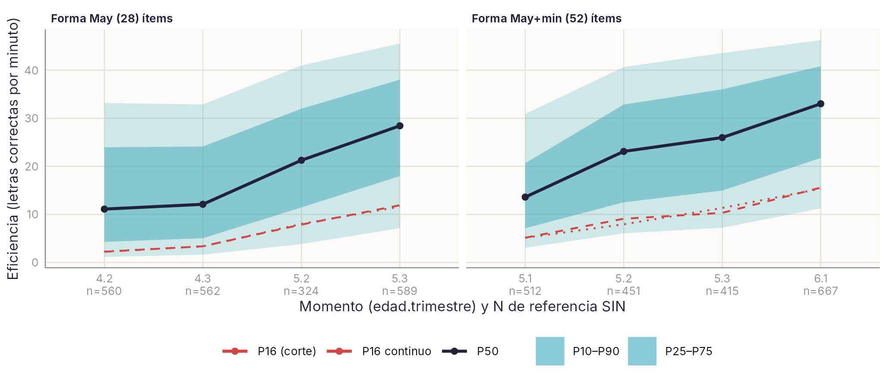
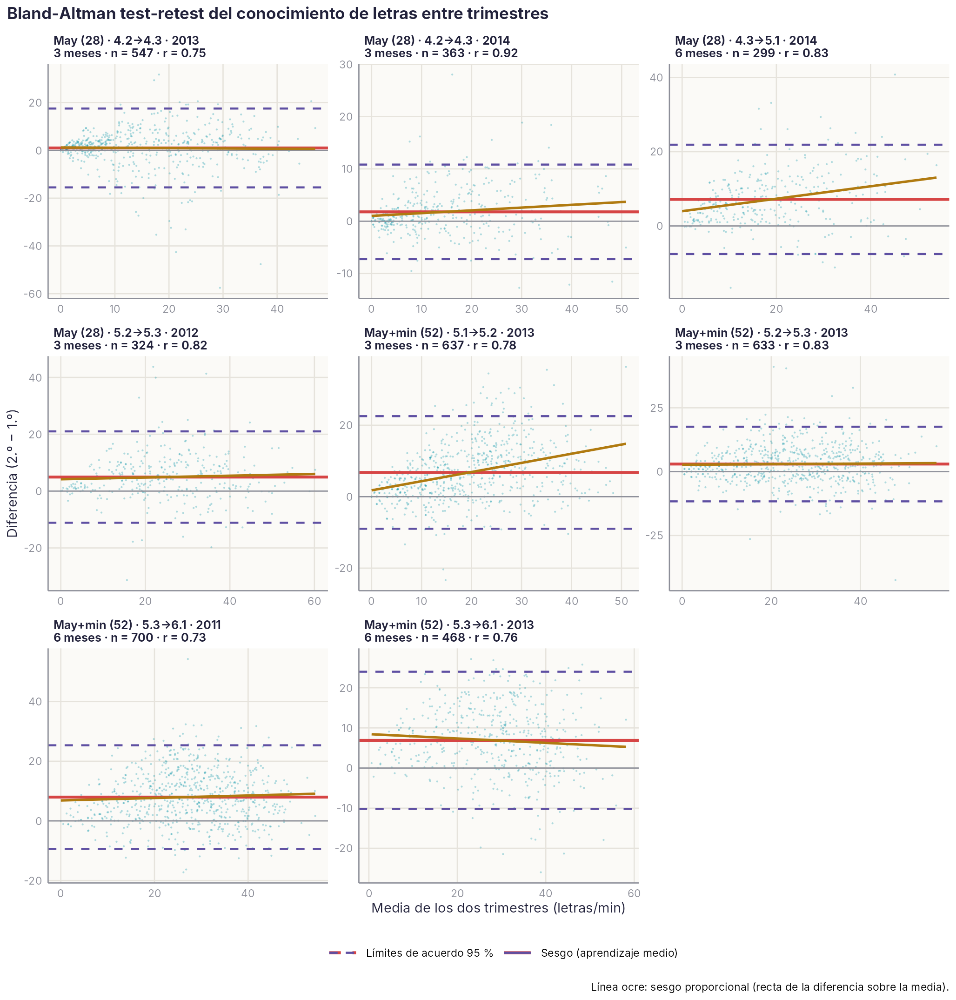
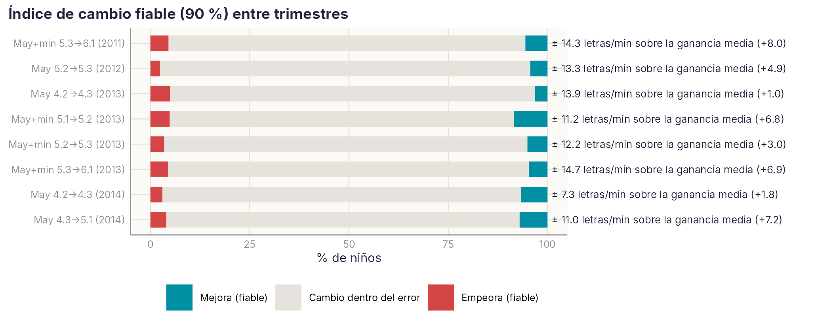
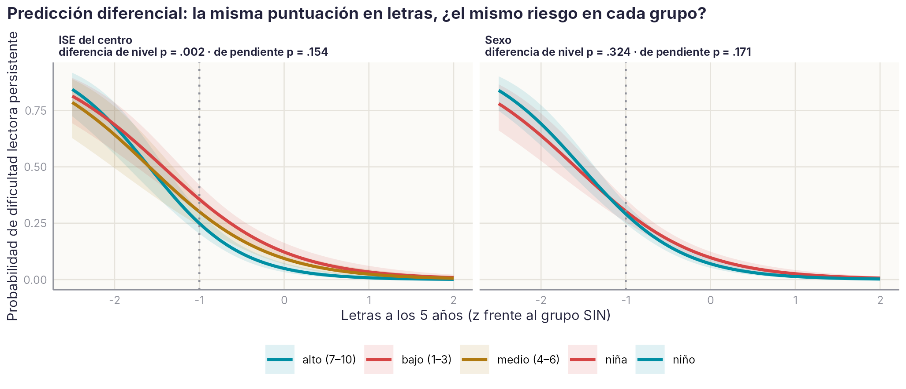

```{r}
#| include: false
source(file.path(dirname(knitr::current_input(dir = TRUE)), "..", "R", "libro.R"))
```

::: {.callout-note appearance="minimal"}
**Status:** pilot task sheet. Draft of October 19, 2026. Figures in the text come from the analyses of October 16–19; the full tables at the end are read from `datos/agregados/LET*` and update automatically when the data are regenerated. *Translated from the Spanish version of November 28, 2026. The figures inserted as images have labels in Spanish.*
:::

**Pilot task: letter knowledge (LEC\_LETRAS).** It is the most widely administered of the predictors: 10,241 valid administrations in 5 cohorts (2010–2014) and 8 time points (4.2–6.1). It is also the task with the most weight in the age-5 model of article L2 (OR 0.37 per SD). The task sheet computes all indicators with a reproducible script, `scripts/ficha_piloto_letras.py`, which produces `ficha_LET_v1.xlsx`.

Results in one line:

- **Test–retest reliability** at 3 months with the same form: r = .75–.92.
- **Predictive validity** for persistent reading difficulty from age 5: AUC = .80–.82.
- **Norms:** the school socioeconomic index (SES) changes the result much more than Preleo or sex. With the general norms, 35% of children from low-SES schools fall below P16, compared with the expected 16%.

Two data issues must be corrected before publication (section 7).

## 1. Task description

The child names letters that appear on the screen one at a time, in random order. Either the letter name or its sound is accepted. The examiner marks a correct response with the left mouse button and an error with the right one. If the child takes more than 5 s on a letter, it counts as an error. Process: phonological route, alphabetic knowledge (Reading domain).

| Form | Code | Items | Limit | Time points | Sessions |
| --- | --- | --- | --- | --- | --- |
| Uppercase letters | 535 | 28 (A–Z, LL, Ñ) | 60 s on the old platform; no effective limit on the new one (mean of 70–80 s) | 4.2, 4.3, 5.1, 5.2, 5.3 | 140, 141, 186, 187, 191, 192, 626, 627, 896 |
| Uppercase and lowercase letters | 67 | 52 (26 + 26) | 60 s | 5.1, 5.2, 5.3, 6.1 | 152, 159, 183, 628, 629, 630, 898, 907 |

**Main measure:** efficiency, in correct letters per minute (`efi` on the old platform, `ve` on the new one). Correct responses, errors and time are also recorded.

**Instruction to the child (67):** "Now you are going to see some letters. I know you are very fast, so tell me as fast as you can which letter appears on the screen."

**Not part of the task**, although the dictionary groups them under LEC\_LETRAS:

- 1887, "How does the child read the letters?": a note on whether the child says the name or the sound, not a score;
- 5431, "RAN letters card" (2014, 5.2): a RAN task.

### How it is programmed on the platform {.unnumbered}

```{r}
#| results: asis
plataforma_tabla(codigos = c(535, 67))
plataforma_capturas(c(535, 67), pre = "../")
```

## 1 bis. Theoretical framework: what letter knowledge measures and why it matters

Letter knowledge is the ability to recognize each grapheme and say its name or sound. It is the child's first contact with the alphabetic principle, the idea that letters represent speech sounds. Without that connection there can be no decoding. Together with phonological awareness and rapid naming (RAN), it is one of the three major predictors of reading and of dyslexia in alphabetic languages. All three keep their predictive value in languages with very different orthographies (Ozernov-Palchik et al., 2017; Caravolas et al., 2012).

The longitudinal evidence is consistent on four points:

- **It is the best predictor before formal instruction.** In family-risk studies, letter knowledge at age 4 was the best predictor of reading level at age 6 (Gallagher, Frith & Snowling, 2000). At age 5 it was the variable that best anticipated who would develop reading difficulty (Pennington & Lefly, 2001).
- **What it predicts is the learning trajectory.** The Jyväskylä study distinguished "delayed", "linear" and "early" letter-learning trajectories between ages 4.5 and 6.5. The delayed trajectory predicted poor reading in Grade 1 and was more frequent in children at family risk (Torppa et al., 2006). This supports measuring letters several times per school year, as LEEDUCA does, rather than once.
- **It works the same way in Spanish.** Knowledge of letter–sound correspondences predicts reading with similar weight in English, Spanish, Czech and Slovak (Caravolas et al., 2012, 2013). In Spanish, fluency in letter naming was the best precursor of early reading (De la Calle et al., 2021).
- **It depends on the environment.** It is predicted by explicit letter instruction and the family's educational level, and socioeconomic status modifies which precursors weigh most (Torppa et al., 2006; Escobar & Meneses, 2014). That is why the result should be interpreted with reference to the school SES index and exact age.

A measurement caveat: it is a "constrained" skill, with few items that almost all children master by the time they reach primary school. It therefore discriminates a lot in preschool and loses discrimination as it reaches ceiling (Bowles, Skibbe & Justice, 2011).

**What the LEEDUCA data show** (about 10,000 administrations in 5 cohorts):

- **Prediction.** Letters at age 5 predict persistent reading difficulty with an AUC of .80–.82. They are the predictor with the most weight in the age-5 model (OR 0.37 per SD), ahead of phonological awareness. RAN adds no prediction once letters are included.
- **Ceiling.** The uppercase form reaches ceiling at age 5; the 52-letter form does not.
- **Age and SES.** The result depends on relative age (children born in the first half of the year score d ≈ 0.2–0.3 higher at ages 4–5) and on the school SES index. It does not depend on Preleo or on sex.

The pattern matches the international and Spanish literature. It justifies including the task in universal screening from age 4, with norms adjusted for age and SES.

References: Bowles, Skibbe & Justice (2011), *J. Appl. Meas.*; Caravolas et al. (2012), *Psychol. Sci.*, doi:10.1177/0956797611434536; Caravolas et al. (2013), *Psychol. Sci.*, doi:10.1177/0956797612473122; De la Calle et al. (2021), *J. Learn. Disabil.*, doi:10.1177/0022219420979960; Escobar & Meneses (2014), *Estudios de Psicología*; Gallagher, Frith & Snowling (2000), *J. Child Psychol. Psychiatry*, doi:10.1111/1469-7610.00601; Ozernov-Palchik et al. (2017), *Dev. Sci.*, doi:10.1111/desc.12471; Pennington & Lefly (2001), *Child Dev.*, doi:10.1111/1467-8624.00317; Torppa et al. (2006), *Dev. Psychol.*, doi:10.1037/0012-1649.42.6.1128. Located with SciSpace; volumes and pages still to be checked.

## 2. Sample

10,241 valid administrations remain: 4,093 from non-Preleo children, 6,122 from Preleo children and 26 with no data. The Preleo condition is that of assignment v3.

Seven records were excluded:

- 2 with negative efficiency or time (2013, 5.2 and 5.3);
- 5 with more than 70 letters per minute, an impossible figure (2010, 2011 and 2014).

SES and sex are only available for the 2013 cohort (22 schools).

| Form | Time point | N | Cohorts | Non-Preleo | Preleo |
| --- | --- | --- | --- | --- | --- |
| Uppercase (535) | 4.2 | 944 | 2013, 2014 | 560 | 384 |
| Uppercase (535) | 4.3 | 1,764 | 2011, 2013, 2014 | 562 | 1,196 |
| Uppercase (535) | 5.1 | 348 | 2014 | 13 | 335 |
| Uppercase (535) | 5.2 | 327 | 2012 | 324 | 0 |
| Uppercase (535) | 5.3 | 1,201 | 2010, 2012 | 589 | 607 |
| Upper and lower (67) | 5.1 | 775 | 2013 | 512 | 263 |
| Upper and lower (67) | 5.2 | 1,047 | 2013, 2014 | 451 | 596 |
| Upper and lower (67) | 5.3 | 1,559 | 2011, 2013 | 415 | 1,138 |
| Upper and lower (67) | 6.1 | 2,276 | 2010, 2011, 2013 | 667 | 1,603 |

Time point 5.1 of form 535 has only 13 non-Preleo children, so it has no norms.

## 3. Descriptive statistics (non-Preleo group)

Mean efficiency doubles between 4.2 and 6.1, from 15 to 31 letters per minute. There is no floor effect (≤ 3.4% zeros). With 28 items, the uppercase form reaches ceiling from age 5 (16–20% get all items right). The 52-item form has almost no ceiling (≤ 2.7%), which is why it is recommended from 5.1.

| Form | Time point | N | M | SD | Median | Skewness | % floor | % ceiling |
| --- | --- | --- | --- | --- | --- | --- | --- | --- |
| 535 | 4.2 | 560 | 14.6 | 12.3 | 11.1 | 0.76 | 3.4 | 17.7 |
| 535 | 4.3 | 562 | 15.3 | 11.9 | 12.1 | 0.66 | 1.6 | 11.2 |
| 535 | 5.2 | 324 | 22.2 | 13.5 | 21.3 | 0.30 | 1.2 | 16.0 |
| 535 | 5.3 | 589 | 27.7 | 13.9 | 28.4 | −0.05 | 1.4 | 20.0 |
| 67 | 5.1 | 512 | 15.2 | 10.4 | 13.6 | 0.78 | 2.1 | 0.0 |
| 67 | 5.2 | 451 | 23.4 | 13.1 | 23.1 | 0.14 | 1.1 | 0.7 |
| 67 | 5.3 | 415 | 25.9 | 13.5 | 26.0 | 0.05 | 0.5 | 1.2 |
| 67 | 6.1 | 667 | 31.0 | 13.0 | 33.0 | −0.33 | 0.3 | 2.7 |

M and SD are in correct letters per minute. % floor = no correct responses; % ceiling = all items correct. The distribution at age 4 is positively skewed: many children know few letters. That is why the norms use percentiles and not standard scores.

## 4. Reliability

With the same form, stability over 3 months is r = .75–.92 and over 6 months r = .73–.84. The standard error of measurement (SEM) is 3–7 letters per minute. Children learn letters between terms (gains of up to d = 0.67), so these figures are a lower bound of reliability. They measure stability, not only error.

| Cohort | From → to | Form | Months | n | r | ρ | SEM |
| --- | --- | --- | --- | --- | --- | --- | --- |
| 2014 | 4.2 → 4.3 | 535 | 3 | 363 | .92 | .92 | 3.2 |
| 2013 | 4.2 → 4.3 | 535 | 3 | 547 | .75 | .78 | 6.0 |
| 2012 | 5.2 → 5.3 | 535 | 3 | 324 | .82 | .82 | 5.7 |
| 2013 | 5.1 → 5.2 | 67 | 3 | 637 | .78 | .78 | 4.7 |
| 2013 | 5.2 → 5.3 | 67 | 3 | 633 | .83 | .84 | 5.3 |
| 2014 | 4.3 → 5.1 | 535 | 6 | 299 | .84 | .85 | 4.8 |
| 2011 | 5.3 → 6.1 | 67 | 6 | 700 | .73 | .72 | 6.2 |
| 2013 | 5.3 → 6.1 | 67 | 6 | 468 | .76 | .75 | 6.3 |
| 2010 | 5.3 → 6.1 | 535 → 67 | 6 | 766 | .75 | .74 | 6.9 |
| 2013 | 4.3 → 5.1 | 535 → 67 | 6 | 406 | .73 | .77 | 6.1 |
| 2014 | 5.1 → 5.2 | 535 → 67 | 3 | 314 | .75 | .76 | 6.9 |
| 2011 | 4.3 → 5.3 | 535 → 67 | 12 | 730 | .62 | .63 | 6.8 |

SEM = SD × √(1 − r), in letters per minute.

**Internal consistency (α/ω): pending.** It requires the correct/incorrect sequence for each letter, which the long table does not store. It can be obtained from the `Respuestas_usuario` column of the new platform (2023–) or from the 2015–2018 exports in `01_BRUTOS`. With it, α, ω and the difficulty of each letter can be computed, which serves to order the items in the task sheet.

## 5. Validity

**Predictive.** From age 5, letters predict persistent reading difficulty with an AUC of .80 to .82 (cut-offs in the figure). At age 4 they predict less: .69–.73. The difficulty label is computed only from word reading, pseudoword reading and fluency, without letters, so the relation is not circular. At 6.1 the label for school years from age 7 is used.

```{r}
#| label: tbl-let-predictiva
#| tbl-cap: "Predictive validity of letters (cases = DL-A + DL-B; at 6.1, school years from age 7 only)."
V <- leer("LET", "4b_Validez_predictiva")
V$forma <- sub("May y min", "Upper and lower", sub("^May", "Uppercase", V$forma))
V$etiqueta <- sub("cursos", "school years", V$etiqueta)
names(V) <- c("Code", "Form", "Time point", "Cohorts", "n", "Cases", "Prevalence", "AUC", "CI lower", "CI upper", "Sens. P16", "Spec. P16",
              "PPV P16", "NPV P16", "ρ reading at 7", "ρ reading at 8", "Label")[seq_along(V)]
tabla(V)
```

The P16 cut-off of the non-Preleo norms has a specificity of .88–.96 and an NPV of .85–.92. Sensitivity is low (.29–.43), so the task on its own serves to rule out risk, not to detect it. For screening it must be combined with phonological awareness and early reading, as in the L2 model.

**Concurrent** (r with the mean of the tasks in each domain at the same time point):

| Domain | 4.2–4.3 | 5.1–5.3 | 6.1 |
| --- | --- | --- | --- |
| Syllable and word reading | — | .39–.76 | .77 |
| Phonological awareness | .27–.38 | .45–.58 | .64 |
| Verbal memory | — | .33 | .30 |
| RAN (speed) | — | −.09 to .28 | .22 |
| Vocabulary | — | .21 | .25 |

This is the expected pattern for an alphabetic measure. It is more closely related to reading and phonological awareness (convergent validity) than to vocabulary or RAN (discriminant). The relation with phonological awareness grows with age.

## 6. Norms and their optimization

**Proposed norms:** percentiles against the non-Preleo group of all equivalent cohorts, by form and time point. Norms are only given where there are at least 100 non-Preleo children.

| Form | Time point | Non-Preleo N | P5 | P10 | P16 | P25 | P50 | P75 | P90 | P95 | Cohorts |
| --- | --- | --- | --- | --- | --- | --- | --- | --- | --- | --- | --- |
| 535 | 4.2 | 560 | 0.0 | 1.2 | 2.2 | 4.3 | 11.1 | 24.0 | 33.2 | 38.1 | 2013, 2014 |
| 535 | 4.3 | 562 | 0.9 | 1.6 | 3.4 | 5.0 | 12.1 | 24.1 | 32.9 | 36.4 | 2013 |
| 535 | 5.2 | 324 | 2.5 | 3.8 | 7.9 | 11.4 | 21.3 | 32.0 | 41.0 | 45.3 | 2012 |
| 535 | 5.3 | 589 | 3.9 | 7.1 | 11.9 | 18.0 | 28.4 | 38.0 | 45.5 | 49.2 | 2010, 2012 |
| 67 | 5.1 | 512 | 1.1 | 3.1 | 5.1 | 7.1 | 13.6 | 20.7 | 30.9 | 35.8 | 2013 |
| 67 | 5.2 | 451 | 3.1 | 6.1 | 9.1 | 12.5 | 23.1 | 32.8 | 40.6 | 43.6 | 2013, 2014 |
| 67 | 5.3 | 415 | 4.2 | 7.2 | 10.3 | 15.0 | 26.0 | 36.0 | 43.6 | 47.4 | 2013 |
| 67 | 6.1 | 667 | 7.4 | 11.3 | 15.6 | 21.7 | 33.0 | 40.8 | 46.2 | 49.6 | 2010, 2013 |

Values in correct letters per minute.

**Are separate norms needed by SES, Preleo or sex?** The percentage of each group falling below P16 with the general norms is compared. If the norms were fair for the group, that percentage would be around 16%.

```{r}
#| label: tbl-let-reclasificacion
#| tbl-cap: "Percentage of each group below P16 with the general non-Preleo norms."
R <- leer("LET", "6d_Reclasificacion_resumen")
VARS <- c("Edad relativa (semestre de nacimiento)" = "Relative age (half of the year of birth)", "ISE del centro" = "School SES", "Preleo" = "Preleo", "Sexo" = "Sex")
GRU <- c("ene–jun (mayores)" = "Jan–Jun (older)", "jul–dic (menores)" = "Jul–Dec (younger)", "alto (7–10)" = "high (7–10)", "bajo (1–3)" = "low (1–3)",
         "medio (4–6)" = "medium (4–6)", CON = "Preleo", SIN = "non-Preleo", "niña" = "girl", "niño" = "boy")
R$variable <- ifelse(R$variable %in% names(VARS), VARS[R$variable], R$variable)
R$grupo <- ifelse(R$grupo %in% names(GRU), GRU[R$grupo], R$grupo)
names(R) <- c("Variable", "Group", "Time points", "Mean n", "% below P16 (general norms)", "% reclassified")[seq_along(R)]
tabla(R)
```

| Variable | Effect on letters | Children reclassified with their own norms | Proposed decision |
| --- | --- | --- | --- |
| School SES (2013) | d high − low = 0.34–0.46 at age 4 and 0.72–1.33 at ages 5–6; ρ = .05–.30 | 19% in low SES; 5–8% in medium and high | Revised on October 17–19: do not adjust the risk cut-off, because it would hide real risk (see 6 quater); the SES-based percentile only as context |
| Preleo | d Preleo − non-Preleo = −0.22 to +0.11, almost always non-significant | 2% | No adjustment; non-Preleo reference as in the rest of the manual |
| Sex (provisional coding) | d girl − boy = −0.09 to +0.13, n.s. | 2–4% | No adjustment |
| School | ICC = .13–.32 | — | Report the ICC. SES explains part of it (in 2013, the ICC drops from .34 to .29) |

**Preleo and SES are confounded in 2013.** In the 2013 mixed model (2,571 administrations, 570 children, 22 schools), Preleo appears to subtract when unadjusted (b = −0.36 SD). With SES in the model it changes sign (b = +0.14), and each SES point adds 0.12 SD (p = .02). Preleo was delivered mainly in low-SES schools, so comparing Preleo and non-Preleo without SES underestimates the effect of the program.

**Continuous norms.** A quantile regression of efficiency on age (linear + quadratic) was fitted by form in the non-Preleo group. The smoothed 10th–90th percentiles depart from the empirical ones by at most 1.2 letters/min in form 535 and 2.2 in form 67, less than the SEM. The continuous norms therefore work. They make it possible to give percentiles for any age in months and to cover time points with a small sample, such as 5.1 in form 535. This is the step before cNORM, which would add SES as a second variable.

{#fig-let-baremos}

## 6 bis. Update of October 17: SES for all cohorts, age in months and term

After the meeting with Juan Luis, the norms analysis was redone (`ficha_piloto_letras_v2.py`, output `ficha_LET_v2.xlsx`; v1 is kept as history) with three changes:

- School SES is taken from the 2010, 2011 and 2013 matrices and assigned by school to all cohorts. It is a fixed attribute of each school and agrees across cohorts in 97–99% of cases. Coverage: 100% in 2010, 99% in 2011, 93% in 2012 and 2013, and about 50% in 2014–2015, where school names are written differently.
- Sex and date of birth come from the master list (13,342 pupil IDs). There, H = boy and M = girl; this was checked by cross-referencing with Base\_4\_anios, where V = boy and H/M = girl.
- Age in months is computed at each assessment, taking the middle of each term as the date.

Results with all cohorts (68 schools, 1,882 children in the joint model):

| Variable | Effect | % below P16 with the general norms (16% expected) | Proposed decision |
| --- | --- | --- | --- |
| School SES | d high − low = 0.35–0.70 from 4.3; +0.07 SD per SES point | Low SES 25.8%; medium 11.0%; high 13.5% | Do not adjust the risk cut-off (see 6 quater); the SES-based percentile only as context |
| Relative age (born January–June vs. July–December) | d = 0.12–0.24 at most time points from ages 4 to 6; +0.03 SD per month (corrected October 19) | Younger 18.2%; older 11.1% | Adjust: norms by age in months, especially from ages 4 to 6 |
| Sex | d = −0.13 to +0.07, non-significant | Boys 17.0%; girls 12.6% | No adjustment; monitor in other tasks |
| Preleo | With SES in the model, b ≈ −0.04 SD (corrected October 19) | Preleo 13.9%; non-Preleo 15.8% | No adjustment |

With all cohorts, SES weighs less than with 2013 alone: 26% of low-SES children are below P16, compared with 35% before. It is still the factor that most distorts the norms. The school ICC drops from .18 to .13 when SES is added.

**Term and age in months.** The norms already go by school year × term, which is equivalent to 3-month bands. Moving to continuous norms by exact age in months reclassifies at P16 2–10% of children aged 4 to 5 and 4% at 6.1 (figures corrected on October 19, ficha\_LET\_v3.xlsx, sheet `7b_Baremo_edad_meses`). This confirms the intuition from the meeting: refining by age pays off mainly from ages 4 to 6.

**Correction of October 19.** The apparent lack of dates of birth in the 2012 cohort was a reading error: the script only read the dd/mm/yyyy format and lost dates stored as Excel dates (between 24% and 42% in the 2010–2014 cohorts). It was detected when replicating the analyses in R. With the corrected reading (`ficha_piloto_letras_v3.py`), more than 99% of the children in the master list have a valid date, the N with age in months almost doubles, and the figures in this section have been updated. The conclusions do not change.

## 6 ter. How to store the norms for the server

Proposed common format for all tasks, with letters as the first example (`04_DICCIONARIO_PROCESADO_2026/BAREMOS_SERVIDOR/`, script `exportar_baremos.py`):

1. **Cut-off table** (`baremos_LEC_LETRAS_v1.csv`), for phase 1 with fixed norms. It has one row per task × code × measure × school year × term × stratum × percentile (1–99), with the minimum raw score for each percentile. Strata are "general" (non-Preleo reference) and "low / medium / high SES" when there are at least 100 children. It is a single table for all tasks: the server imports it directly and computes the percentile with a query.
2. **Difficulty levels** (`niveles_dificultad_v1.csv`): no difficulty (> P25), mild (P17–25), moderate (P11–16), severe (P6–10) and very severe (≤ P5).
3. **Continuous model** (`baremos_LEC_LETRAS_modelo_v1.json`), for phase 2 with dynamic norms. It stores the coefficients of the quantile regression of the score on age in months and SES for percentiles 1–99. This way the server can give the percentile at any age and SES and refit the coefficients with new data.

The table and the model agree on the P16 cut-off in 83–95% of cases. The publication version of the model will be built with cNORM (R).

The document `ESQUEMA_BAREMOS_v1.md` describes the columns, use, update rules and the questions for the engineer:

- How does the server store norms today?
- Does it know the pupil's date of birth and school?
- Can it run R or Python?

## 6 quater. Rigor: agreement between terms, reliable change, precision of the percentile and differential prediction

Everything comes from `scripts/rigor_tarea.py` (reusable functions for any task), with output in `rigor_LET_v1.xlsx` and figures F2–F4. There are two new conclusions that change decisions:

1. A single term of letters is not enough to claim that a child has improved or worsened.
2. The SES-adjusted percentile should not be used to decide risk.

**Agreement between terms (Bland-Altman).**

{#fig-ficha-let-f2-blandaltman-r}

- The mean difference between terms is the group's learning: between +1 and +8 letters/min over 3–6 months. It is smallest between 4.2 and 4.3 and largest at the start of age 5.
- The limits of agreement are wide: a child can vary between −10 and +25 letters/min from one term to the next without the task failing.
- There is proportional bias at the start of learning (2013 5.1→5.2 and 2014 4.3→5.1): those who already know more letters gain more, a "Matthew effect". It disappears from 5.2.

**Reliable change (RCI, 90%).**

{#fig-ficha-let-f4-cambio-fiable-r}

- To claim that a child has really changed, a change of 11–15 letters/min above the group's mean gain is needed; 7 in the best case.
- That is why only 3–10% of children change reliably between two terms.
- For the server: the monitoring report should not flag "improves" or "worsens" with two data points from this task alone. The RCI, the trend over 3 or more time points or a composite of tasks must be used.

**Precision of the percentile.** The standard error of measurement is 4.6–6.0 letters/min. With a 90% CI:

- a child at P16 at ages 4–5 is in fact between P0 and P35–49;
- at 6.1, between P3 and P30;
- in the middle of the distribution, a P50 ranges from P27 to P74 (sheet `2_IC_percentiles`).

This reinforces two decisions: report the percentile with its band, and do not classify on the basis of a single task but of the composite (phonological awareness + letters + RAN), as in the L2 model.

**Differential prediction (Cleary).**

{#fig-ficha-let-f3-prediccion-diferencial-r}

- **Sex:** the task predicts equally well for boys and girls. Neither the intercept (p = .32) nor the slope (p = .17) differ; AUC .84 and .79. No norms by sex are needed.
- **SES:** the slope is the same (p = .15), but the intercept is not (p = .002). With the same letter score, a child from a low-SES school has a **higher** risk of persistent reading difficulty (prevalence 20.5% vs. 11.3% in high SES).
- Therefore, separate SES-based norms would place those children higher and **hide real risk** precisely where there is most. The right approach is to keep the risk cut-off with the general non-Preleo norms. The SES-based percentile, if given, is context only.
- A caveat for the team: the difficulty label is not adjusted for SES either. The higher risk in low SES may reflect both real disadvantage and a stricter criterion for those children. It should be checked with an external criterion (clinical diagnosis) when we have one.

**Pending:** differential item functioning (DIF) of each letter by sex and SES, once item-level responses are available.

::: {.callout-note}
## Continuous norms and floor effect (study M3, November 3, 2026)

The continuous model in this task sheet (quantile regression on age in months) was compared with five other methods. For letters, the axis matters little: within each time point, the error in P10 is 1.6–2.1 points with any continuous method, compared with 0.5 for the table by time point. Out of sample, the best method is cNORM on months of instruction (mean error 3.3 points, compared with 4.0 for the model by age), and it covers all children, whereas the table only covers 76%. It is proposed to move the server model to the instruction axis for consistency with the reading tasks, where age does distort calibration. The floor for letters does not exceed 6% (at 4.2).

Details in study M3.
:::

## 7. Pending issues and decisions for the team

**Data issues found while building the task sheet** (added to the Issues sheet of the dictionary):

1. **Code 1887 is averaged with letters in `certeza_cortes_baremos_v2`.** Code 1887 is the note "how does the child read the letters?". Because of this error, the LET score of 2010 and 2011 (6.1) and of 2013 (4.3 and 5.2) is halved. The rank order of the children barely changes (ρ = .92–.98), so the effect on L2 should be small. Even so, v3 must be generated without 1887 and L2 rerun before submission.
2. **Code 5431 (RAN letters card, 2014) is labeled LEC\_LETRAS.** It must move to RAN.
3. **Form 535 is not administered the same way on the two platforms.** On the old one (2010–2011) it stops at 60 s; on the new one (2012–2014) it presents all 28 letters with no limit (up to 300 s). Efficiency is comparable, but correct responses are not.
4. **The instruction for 535 says it "is only given if the child can read uppercase letters".** It must be confirmed whether a 0 at age 4 means "does not know letters" or "not administered". This affects the floor and P5.

**Missing data:**

- [x] School SES for all cohorts. Resolved on October 17 with the 2010, 2011 and 2013 matrices (section 6 bis): 93–100% coverage in 2010–2013.
- [ ] SES for 2014–2015: only about 50% coverage, because school names are written differently (e.g., "CEIP Al- Ándalus" vs. "Al-Andalus (Marbella)"). These names still need to be unified; San Ceferino has no SES.
- [x] Sex coding checked on October 17: in the master list H = boy and M = girl; in Base\_4\_anios V = boy and H/M = girl.
- [x] Review the dates of birth of the 2012 cohort: resolved on October 19 (it was a format reading error).
- [ ] Item-level responses (`Respuestas_usuario`) to compute α/ω and the difficulty of each letter.

**To decide with Juan Luis:**

- [ ] Can this task sheet serve as a template for the other tasks? It contains description, sample, descriptives, reliability, validity, non-Preleo norms and an analysis of whether the norms should be adjusted.
- [ ] How should SES be adjusted for? There are two options: continuous norms with SES as a covariate (cNORM) or a complementary percentile by SES band.
- [ ] Should only form 67 be used from 5.1? Form 535 reaches ceiling at age 5.
- [ ] Next task sheets, in order of use in the monitoring assessments: phonological awareness (syllable matching and counting), RAN of objects and reading of two-syllable words (1931).

## Full tables {.unnumbered}

All the aggregated tables for this task sheet, as produced by the analysis scripts. Click on each one to expand it.

```{r}
#| results: asis
tablas_completas("LET")
tablas_completas("LET_rigor")
```
