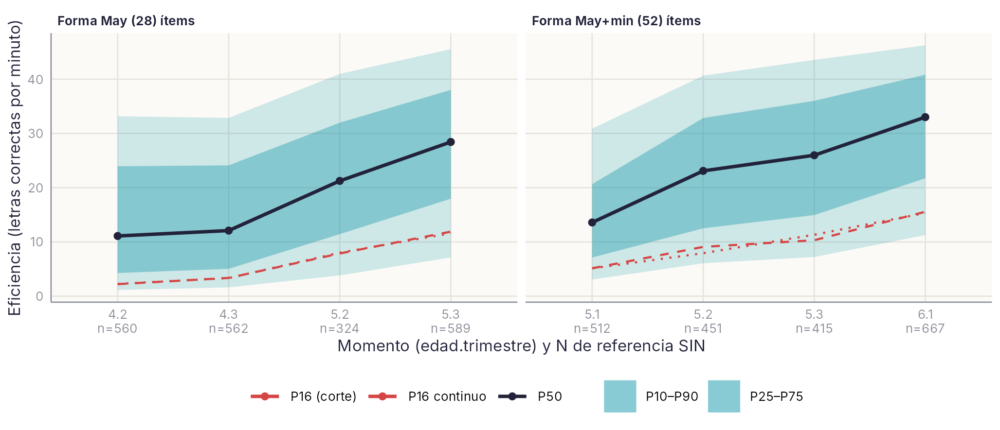
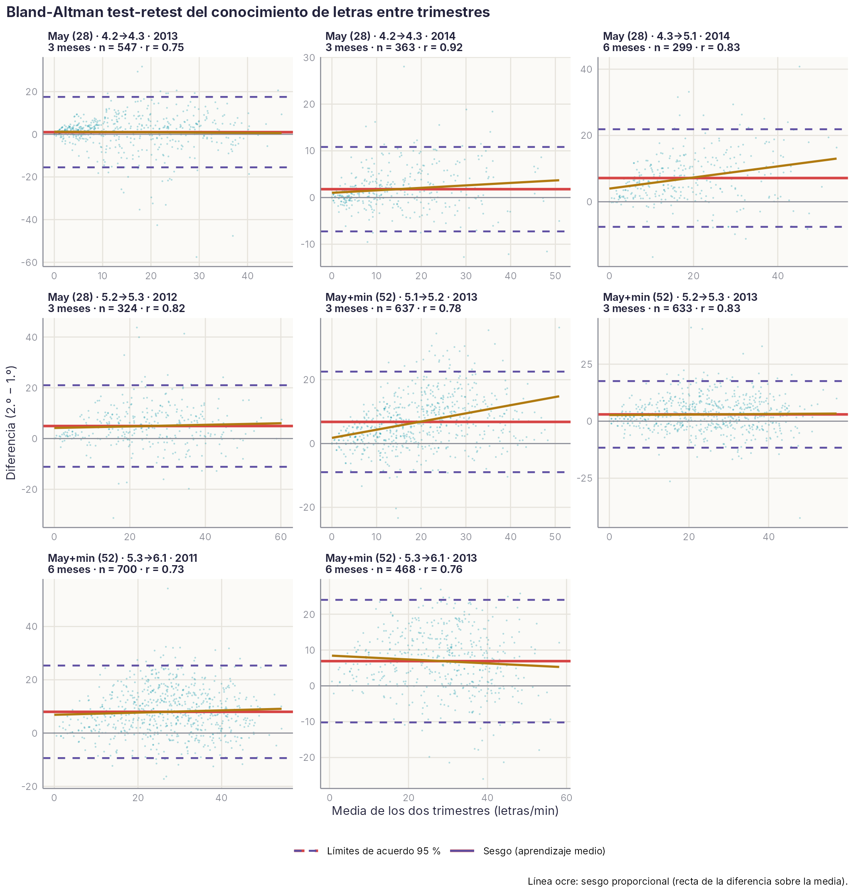
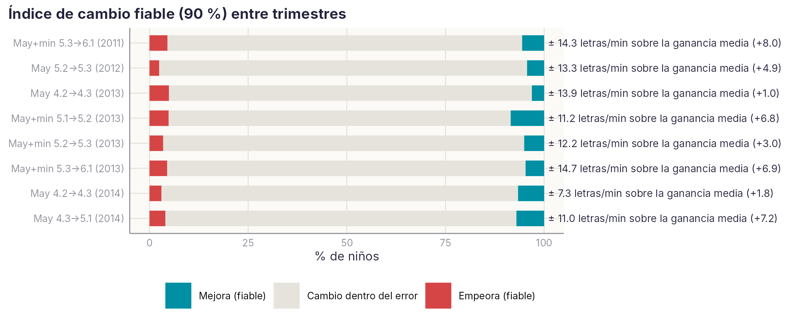
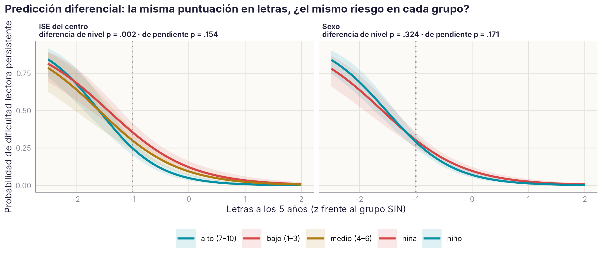

```{r}
#| include: false
source(file.path(dirname(knitr::current_input(dir = TRUE)), "..", "R", "libro.R"))
```

::: {.callout-note appearance="minimal"}
**Estado:** Ficha piloto. Borrador del 19/10/2026. Las cifras del texto proceden de los análisis del 16–19/10; las tablas completas del final se leen de `datos/agregados/LET*` y se actualizan solas al regenerar los datos.
:::

**Tarea piloto: conocimiento de letras (LEC\_LETRAS).** Es la tarea con más aplicaciones entre los predictores: 10.241 aplicaciones válidas en 5 cohortes (2010–2014) y 8 momentos (4.2–6.1). Además, es la que más pesa en el modelo de 5 años del artículo L2 (OR 0,37 por DT). La ficha calcula todos los indicadores con un script reproducible: `scripts/ficha_piloto_letras.py`, que genera `ficha_LET_v1.xlsx`.

Resultados en una línea:

- **Fiabilidad test-retest** a 3 meses con la misma forma: r = .75–.92.
- **Validez predictiva** de la dificultad lectora persistente desde los 5 años: AUC = .80–.82.
- **Baremo:** el ISE del centro cambia el resultado mucho más que Preleo o el sexo. Con el baremo general, el 35 % de los niños de colegios de ISE bajo queda por debajo de p16, frente al 16 % esperado.

Antes de publicar hay que corregir dos incidencias de datos (apartado 7).

## 1. Descripción de la tarea

El niño nombra letras que aparecen en pantalla una a una y en orden aleatorio. Vale el nombre o el sonido. El evaluador marca acierto con el botón izquierdo del ratón y error con el derecho. Si el niño tarda más de 5 s en una letra, cuenta como error. Proceso: ruta fonológica, conocimiento alfabético (dominio Lectura).

| Forma | Código | Ítems | Límite | Momentos | Sesiones |
| --- | --- | --- | --- | --- | --- |
| Letras mayúsculas | 535 | 28 (A–Z, LL, Ñ) | 60 s en la plataforma antigua; sin límite efectivo en la nueva (media de 70–80 s) | 4.2, 4.3, 5.1, 5.2, 5.3 | 140, 141, 186, 187, 191, 192, 626, 627, 896 |
| Letras mayúsculas y minúsculas | 67 | 52 (26 + 26) | 60 s | 5.1, 5.2, 5.3, 6.1 | 152, 159, 183, 628, 629, 630, 898, 907 |

**Medida principal:** eficiencia, en letras correctas por minuto (`efi` en la plataforma antigua, `ve` en la nueva). También se guardan aciertos, errores y tiempo.

**Instrucción al alumno (67):** «Ahora vas a ver unas letras. Yo sé que tú eres muy rápido/a, así que me vas a decir todo lo rápido que puedas qué letra es la que sale en la pantalla».

**No forman parte de la tarea** aunque el diccionario las agrupa en LEC\_LETRAS:

- 1887, «¿Cómo lee las letras?»: es una anotación de si el niño dice el nombre o el sonido, no una puntuación;
- 5431, «RAN letras lámina» (2014, 5.2): es una tarea RAN.

### Cómo está programada en la plataforma {.unnumbered}

```{r}
#| results: asis
plataforma_tabla(codigos = c(535, 67))
```

## 1 bis. Marco teórico: qué mide el conocimiento de letras y por qué importa

El conocimiento de letras es la capacidad de reconocer cada grafema y decir su nombre o su sonido. Es el primer contacto del niño con el principio alfabético, la idea de que las letras representan sonidos del habla. Sin esa conexión no puede haber decodificación. Junto con la conciencia fonológica y la velocidad de denominación (RAN), forma los tres grandes predictores de la lectura y de la dislexia en las lenguas alfabéticas. Los tres mantienen su valor predictivo en lenguas con ortografías muy distintas (Ozernov-Palchik et al., 2017; Caravolas et al., 2012).

La evidencia longitudinal es consistente en cuatro puntos:

- **Es el mejor predictor antes de la instrucción formal.** En estudios de riesgo familiar, el conocimiento de letras a los 4 años fue el mejor predictor del nivel lector a los 6 (Gallagher, Frith y Snowling, 2000). A los 5 años fue la variable que mejor anticipó quién desarrollaría dificultad lectora (Pennington y Lefly, 2001).
- **Lo que predice es la trayectoria de aprendizaje.** El estudio de Jyväskylä distinguió trayectorias de aprendizaje de letras «retrasadas», «lineales» y «precoces» entre los 4,5 y los 6,5 años. La trayectoria retrasada predecía una lectura pobre en primero y era más frecuente en niños con riesgo familiar (Torppa et al., 2006). Esto apoya medir las letras varias veces por curso, como hace LEEDUCA, y no una sola.
- **Funciona igual en español.** El conocimiento de las correspondencias letra-sonido predice la lectura con un peso similar en inglés, español, checo y eslovaco (Caravolas et al., 2012, 2013). En español, la fluidez en el nombrado de letras fue el mejor precursor de la lectura inicial (De la Calle et al., 2021).
- **Depende del entorno.** Lo predicen la enseñanza explícita de letras y el nivel educativo de la familia, y el nivel socioeconómico modifica qué precursores pesan más (Torppa et al., 2006; Escobar y Meneses, 2014). Por eso conviene interpretar el resultado con referencia al ISE y a la edad exacta.

Una advertencia de medida: es una habilidad «restringida», con pocos ítems que casi todos los niños dominan al llegar a primaria. Por eso discrimina mucho en infantil y pierde capacidad cuando llega el techo (Bowles, Skibbe y Justice, 2011).

**Lo que muestran los datos de LEEDUCA** (unas 10.000 aplicaciones en 5 cohortes):

- **Predicción.** Las letras a los 5 años predicen la dificultad lectora persistente con un AUC de .80–.82. Son el predictor con más peso del modelo de 5 años (OR 0,37 por DT), por delante de la CF. El RAN no añade predicción una vez incluidas las letras.
- **Techo.** La forma de mayúsculas toca techo a los 5 años; la de 52 letras, no.
- **Edad y ISE.** El resultado depende de la edad relativa (los nacidos en el primer semestre rinden d ≈ 0,2–0,3 más a los 4–5 años) y del ISE del centro. En cambio, no depende de Preleo ni del sexo.

El patrón coincide con la literatura internacional y en español. Justifica que la tarea forme parte del cribado universal desde los 4 años, con baremos ajustados por edad e ISE.

Referencias: Bowles, Skibbe y Justice (2011), *J. Appl. Meas.*; Caravolas et al. (2012), *Psychol. Sci.*, doi:10.1177/0956797611434536; Caravolas et al. (2013), *Psychol. Sci.*, doi:10.1177/0956797612473122; De la Calle et al. (2021), *J. Learn. Disabil.*, doi:10.1177/0022219420979960; Escobar y Meneses (2014), *Estudios de Psicología*; Gallagher, Frith y Snowling (2000), *J. Child Psychol. Psychiatry*, doi:10.1111/1469-7610.00601; Ozernov-Palchik et al. (2017), *Dev. Sci.*, doi:10.1111/desc.12471; Pennington y Lefly (2001), *Child Dev.*, doi:10.1111/1467-8624.00317; Torppa et al. (2006), *Dev. Psychol.*, doi:10.1037/0012-1649.42.6.1128. Localizadas con SciSpace; falta comprobar volúmenes y páginas.

## 2. Muestra

Quedan 10.241 aplicaciones válidas: 4.093 de niños SIN Preleo, 6.122 CON y 26 sin dato. La condición Preleo es la de la asignación v3.

Se excluyeron 7 registros:

- 2 con eficiencia o tiempo negativos (2013, 5.2 y 5.3);
- 5 con más de 70 letras por minuto, una cifra imposible (2010, 2011 y 2014).

El ISE y el sexo solo están disponibles en la cohorte 2013 (22 colegios).

| Forma | Momento | N | Cohortes | SIN | CON |
| --- | --- | --- | --- | --- | --- |
| Mayúsculas (535) | 4.2 | 944 | 2013, 2014 | 560 | 384 |
| Mayúsculas (535) | 4.3 | 1.764 | 2011, 2013, 2014 | 562 | 1.196 |
| Mayúsculas (535) | 5.1 | 348 | 2014 | 13 | 335 |
| Mayúsculas (535) | 5.2 | 327 | 2012 | 324 | 0 |
| Mayúsculas (535) | 5.3 | 1.201 | 2010, 2012 | 589 | 607 |
| May. y min. (67) | 5.1 | 775 | 2013 | 512 | 263 |
| May. y min. (67) | 5.2 | 1.047 | 2013, 2014 | 451 | 596 |
| May. y min. (67) | 5.3 | 1.559 | 2011, 2013 | 415 | 1.138 |
| May. y min. (67) | 6.1 | 2.276 | 2010, 2011, 2013 | 667 | 1.603 |

El momento 5.1 de la forma 535 tiene solo 13 niños SIN, así que se queda sin baremo.

## 3. Descriptivos (grupo SIN)

La eficiencia media se duplica entre 4.2 y 6.1: pasa de 15 a 31 letras por minuto. No hay efecto suelo (≤ 3,4 % de ceros). Con 28 ítems, la forma de mayúsculas tiene techo a partir de los 5 años (16–20 % aciertan todas). La forma de 52 ítems casi no tiene techo (≤ 2,7 %), y por eso es la recomendada desde 5.1.

| Forma | Momento | N | M | DT | Mediana | Asimetría | % suelo | % techo |
| --- | --- | --- | --- | --- | --- | --- | --- | --- |
| 535 | 4.2 | 560 | 14,6 | 12,3 | 11,1 | 0,76 | 3,4 | 17,7 |
| 535 | 4.3 | 562 | 15,3 | 11,9 | 12,1 | 0,66 | 1,6 | 11,2 |
| 535 | 5.2 | 324 | 22,2 | 13,5 | 21,3 | 0,30 | 1,2 | 16,0 |
| 535 | 5.3 | 589 | 27,7 | 13,9 | 28,4 | −0,05 | 1,4 | 20,0 |
| 67 | 5.1 | 512 | 15,2 | 10,4 | 13,6 | 0,78 | 2,1 | 0,0 |
| 67 | 5.2 | 451 | 23,4 | 13,1 | 23,1 | 0,14 | 1,1 | 0,7 |
| 67 | 5.3 | 415 | 25,9 | 13,5 | 26,0 | 0,05 | 0,5 | 1,2 |
| 67 | 6.1 | 667 | 31,0 | 13,0 | 33,0 | −0,33 | 0,3 | 2,7 |

M y DT están en letras correctas por minuto. % suelo = ningún acierto; % techo = todos los ítems correctos. La distribución a los 4 años es asimétrica positiva: muchos niños conocen pocas letras. Por eso el baremo usa percentiles y no puntuaciones típicas.

## 4. Fiabilidad

Con la misma forma, la estabilidad a 3 meses es r = .75–.92 y a 6 meses r = .73–.84. El error típico de medida (ETM) es de 3–7 letras por minuto. Entre trimestres los niños aprenden letras (ganancia de hasta d = 0,67), así que estas cifras son un límite inferior de la fiabilidad. Miden estabilidad, no solo error.

| Cohorte | Desde → hasta | Forma | Meses | n | r | ρ | ETM |
| --- | --- | --- | --- | --- | --- | --- | --- |
| 2014 | 4.2 → 4.3 | 535 | 3 | 363 | .92 | .92 | 3,2 |
| 2013 | 4.2 → 4.3 | 535 | 3 | 547 | .75 | .78 | 6,0 |
| 2012 | 5.2 → 5.3 | 535 | 3 | 324 | .82 | .82 | 5,7 |
| 2013 | 5.1 → 5.2 | 67 | 3 | 637 | .78 | .78 | 4,7 |
| 2013 | 5.2 → 5.3 | 67 | 3 | 633 | .83 | .84 | 5,3 |
| 2014 | 4.3 → 5.1 | 535 | 6 | 299 | .84 | .85 | 4,8 |
| 2011 | 5.3 → 6.1 | 67 | 6 | 700 | .73 | .72 | 6,2 |
| 2013 | 5.3 → 6.1 | 67 | 6 | 468 | .76 | .75 | 6,3 |
| 2010 | 5.3 → 6.1 | 535 → 67 | 6 | 766 | .75 | .74 | 6,9 |
| 2013 | 4.3 → 5.1 | 535 → 67 | 6 | 406 | .73 | .77 | 6,1 |
| 2014 | 5.1 → 5.2 | 535 → 67 | 3 | 314 | .75 | .76 | 6,9 |
| 2011 | 4.3 → 5.3 | 535 → 67 | 12 | 730 | .62 | .63 | 6,8 |

ETM = DT × √(1 − r), en letras por minuto.

**Consistencia interna (α/ω): pendiente.** Hace falta la secuencia acierto/fallo de cada letra, que la tabla larga no guarda. Puede salir de la columna `Respuestas_usuario` de la plataforma nueva (2023–) o de los volcados de 2015–2018 en `01_BRUTOS`. Con ella se calculan α, ω y la dificultad de cada letra, que sirve para ordenar los ítems de la ficha.

## 5. Validez

**Predictiva.** A partir de los 5 años, las letras predicen la dificultad lectora persistente con un AUC de .80 a .82 (cortes de la gráfica). A los 4 años predicen menos: .69–.73. La etiqueta de dificultad se calcula solo con lectura de palabras, pseudopalabras y fluidez, sin letras, así que la relación no es circular. En 6.1 se usa la etiqueta de los cursos ≥ 7 años.

```{r}
#| label: tbl-let-predictiva
#| tbl-cap: "Validez predictiva de las letras (casos = DL-A + DL-B; en 6.1, solo cursos ≥ 7)."
tabla(leer("LET", "4b_Validez_predictiva"))
```

El corte p16 del baremo SIN tiene especificidad .88–.96 y VPN .85–.92. La sensibilidad es baja (.29–.43), así que la tarea sola sirve para descartar riesgo, no para detectarlo. Como cribado debe combinarse con CF y lectura temprana, como en el modelo L2.

**Concurrente** (r con la media de las tareas de cada dominio en el mismo momento):

| Dominio | 4.2–4.3 | 5.1–5.3 | 6.1 |
| --- | --- | --- | --- |
| Lectura de sílabas y palabras | — | .39–.76 | .77 |
| Conciencia fonológica | .27–.38 | .45–.58 | .64 |
| Memoria verbal | — | .33 | .30 |
| RAN (velocidad) | — | −.09 a .28 | .22 |
| Vocabulario | — | .21 | .25 |

El patrón es el esperado para una medida alfabética. Se relaciona más con la lectura y la CF (validez convergente) que con el vocabulario o el RAN (discriminante). La relación con la CF crece con la edad.

## 6. Baremos y su optimización

**Baremo propuesto:** percentiles frente al grupo SIN Preleo de todas las cohortes equivalentes, por forma y momento. Solo hay baremo donde hay al menos 100 niños SIN.

| Forma | Momento | N SIN | P5 | P10 | P16 | P25 | P50 | P75 | P90 | P95 | Cohortes |
| --- | --- | --- | --- | --- | --- | --- | --- | --- | --- | --- | --- |
| 535 | 4.2 | 560 | 0,0 | 1,2 | 2,2 | 4,3 | 11,1 | 24,0 | 33,2 | 38,1 | 2013, 2014 |
| 535 | 4.3 | 562 | 0,9 | 1,6 | 3,4 | 5,0 | 12,1 | 24,1 | 32,9 | 36,4 | 2013 |
| 535 | 5.2 | 324 | 2,5 | 3,8 | 7,9 | 11,4 | 21,3 | 32,0 | 41,0 | 45,3 | 2012 |
| 535 | 5.3 | 589 | 3,9 | 7,1 | 11,9 | 18,0 | 28,4 | 38,0 | 45,5 | 49,2 | 2010, 2012 |
| 67 | 5.1 | 512 | 1,1 | 3,1 | 5,1 | 7,1 | 13,6 | 20,7 | 30,9 | 35,8 | 2013 |
| 67 | 5.2 | 451 | 3,1 | 6,1 | 9,1 | 12,5 | 23,1 | 32,8 | 40,6 | 43,6 | 2013, 2014 |
| 67 | 5.3 | 415 | 4,2 | 7,2 | 10,3 | 15,0 | 26,0 | 36,0 | 43,6 | 47,4 | 2013 |
| 67 | 6.1 | 667 | 7,4 | 11,3 | 15,6 | 21,7 | 33,0 | 40,8 | 46,2 | 49,6 | 2010, 2013 |

Valores en letras correctas por minuto.

**¿Hace falta un baremo distinto por ISE, Preleo o sexo?** Se compara el porcentaje de cada grupo que queda por debajo de p16 con el baremo general. Si el baremo fuera justo para el grupo, ese porcentaje rondaría el 16 %.

```{r}
#| label: tbl-let-reclasificacion
#| tbl-cap: "Porcentaje de cada grupo por debajo de p16 con el baremo general SIN."
tabla(leer("LET", "6d_Reclasificacion_resumen"))
```

| Variable | Efecto en letras | Niños reclasificados con baremo propio | Decisión propuesta |
| --- | --- | --- | --- |
| ISE del centro (2013) | d alto − bajo = 0,34–0,46 a los 4 años y 0,72–1,33 a los 5–6; ρ = .05–.30 | 19 % en ISE bajo; 5–8 % en medio y alto | Revisado el 17–19/10: no ajustar el corte de riesgo, porque ocultaría riesgo real (ver 6 quater); el percentil por ISE solo como contexto |
| Preleo | d CON − SIN = −0,22 a +0,11, casi siempre no significativo | 2 % | Sin ajuste; referencia SIN como en el resto del manual |
| Sexo (codificación provisional) | d niña − niño = −0,09 a +0,13, n.s. | 2–4 % | Sin ajuste |
| Colegio | CCI = .13–.32 | — | Informar del CCI. El ISE explica parte (en 2013, el CCI baja de .34 a .29) |

**Preleo y el ISE están confundidos en 2013.** En el modelo mixto de 2013 (2.571 aplicaciones, 570 niños, 22 colegios), Preleo parece restar sin ajustar (b = −0,36 DT). Con el ISE en el modelo cambia de signo (b = +0,14), y cada punto de ISE suma 0,12 DT (p = .02). Preleo se aplicó sobre todo en centros de ISE bajo, así que comparar CON y SIN sin el ISE subestima el efecto del programa.

**Baremo continuo.** Se ajustó una regresión cuantílica de la eficiencia sobre la edad (lineal + cuadrática), por forma y en el grupo SIN. Los percentiles 10–90 suavizados se separan de los empíricos como máximo 1,2 letras/min en la forma 535 y 2,2 en la 67, menos que el ETM. Por tanto, el baremo continuo sirve. Permite dar percentiles para cualquier edad en meses y cubrir momentos con poca muestra, como 5.1 en la forma 535. Es el paso previo a cNORM, que añadiría el ISE como segunda variable.

{#fig-let-baremos}

## 6 bis. Actualización del 17/10: ISE de todas las cohortes, edad en meses y trimestre

Tras la reunión con Juan Luis se rehizo el análisis del baremo (`ficha_piloto_letras_v2.py`, salida `ficha_LET_v2.xlsx`; la v1 queda como histórico) con tres cambios:

- El ISE del centro se toma de las matrices de 2010, 2011 y 2013 y se asigna por colegio a todas las cohortes. Es un dato fijo de cada colegio y coincide entre cohortes en el 97–99 % de los casos. Cobertura: 100 % en 2010, 99 % en 2011, 93 % en 2012 y 2013, y en torno al 50 % en 2014–2015, donde los nombres de colegio están escritos de otra forma.
- El sexo y la fecha de nacimiento salen de la lista maestra (13.342 NIE). Allí H = niño y M = niña; se ha comprobado cruzándola con Base\_4\_anios, donde V = niño y H/M = niña.
- La edad en meses se calcula en cada evaluación, tomando como fecha la mitad de cada trimestre.

Resultados con todas las cohortes (68 colegios, 1.882 niños en el modelo conjunto):

| Variable | Efecto | % por debajo de p16 con el baremo general (esperado 16 %) | Decisión propuesta |
| --- | --- | --- | --- |
| ISE del centro | d alto − bajo = 0,35–0,70 desde 4.3; +0,07 DT por punto de ISE | ISE bajo 25,8 %; medio 11,0 %; alto 13,5 % | No ajustar el corte de riesgo (ver 6 quater); el percentil por ISE solo como contexto |
| Edad relativa (nacidos de enero a junio frente a julio a diciembre) | d = 0,12–0,24 en la mayoría de los momentos de 4 a 6 años; +0,03 DT por mes (corregido el 19/10) | Menores 18,2 %; mayores 11,1 % | Ajustar: baremo por edad en meses, sobre todo de 4 a 6 años |
| Sexo | d = −0,13 a +0,07, no significativo | Niños 17,0 %; niñas 12,6 % | Sin ajuste; vigilar en otras tareas |
| Preleo | Con el ISE en el modelo, b ≈ −0,04 DT (corregido el 19/10) | CON 13,9 %; SIN 15,8 % | Sin ajuste |

Con todas las cohortes, el ISE pesa menos que con 2013 sola: un 26 % de niños de ISE bajo bajo p16, frente al 35 % anterior. Sigue siendo el factor que más desajusta el baremo. El CCI del colegio baja de .18 a .13 al añadir el ISE.

**Trimestre y edad en meses.** El baremo ya va por curso × trimestre, que equivale a tramos de 3 meses. Pasar a un baremo continuo por edad exacta en meses reclasifica en p16 al 2–10 % de los niños de 4 a 5 años y al 4 % en 6.1 (cifras corregidas el 19/10, ficha\_LET\_v3.xlsx, hoja `7b_Baremo_edad_meses`). Esto confirma la intuición de la reunión: afinar por edad compensa sobre todo de 4 a 6 años.

**Corrección del 19/10.** La supuesta falta de fechas de nacimiento de la cohorte 2012 era un error de lectura: el script solo leía el formato dd/mm/aaaa y perdía las fechas guardadas como fecha de Excel (entre el 24 % y el 42 % en las cohortes 2010–2014). Se detectó al replicar los análisis en R. Con la lectura corregida (`ficha_piloto_letras_v3.py`) hay fecha válida para más del 99 % de los niños de la lista maestra, el N con edad en meses casi se duplica y las cifras de esta sección se han actualizado. Las conclusiones no cambian.

## 6 ter. Cómo guardar los baremos para el servidor

Propuesta de formato común para todas las tareas, con letras como primer ejemplo (`04_DICCIONARIO_PROCESADO_2026/BAREMOS_SERVIDOR/`, script `exportar_baremos.py`):

1. **Tabla de puntos de corte** (`baremos_LEC_LETRAS_v1.csv`), para la fase 1 con baremos fijos. Tiene una fila por tarea × código × medida × curso × trimestre × estrato × percentil (1–99), con la puntuación directa mínima para cada percentil. Los estratos son «general» (referencia SIN) y «ISE bajo / medio / alto» cuando hay al menos 100 niños. Es una sola tabla para todas las tareas: el servidor la importa directamente y calcula el percentil con una consulta.
2. **Niveles de dificultad** (`niveles_dificultad_v1.csv`): sin dificultad (> p25), leve (p17–25), moderada (p11–16), severa (p6–10) y muy severa (≤ p5).
3. **Modelo continuo** (`baremos_LEC_LETRAS_modelo_v1.json`), para la fase 2 con baremos dinámicos. Guarda los coeficientes de la regresión cuantílica de la puntuación sobre la edad en meses y el ISE para los percentiles 1–99. Así el servidor puede dar el percentil a cualquier edad e ISE y reajustar los coeficientes con datos nuevos.

La tabla y el modelo coinciden en el corte p16 en el 83–95 % de los casos. La versión de publicación del modelo se hará con cNORM (R).

El documento `ESQUEMA_BAREMOS_v1.md` describe columnas, uso, reglas de actualización y las preguntas para el ingeniero:

- ¿Cómo guarda hoy el servidor los baremos?
- ¿Conoce la fecha de nacimiento y el colegio del alumno?
- ¿Puede ejecutar R o Python?

## 6 quater. Rigor: acuerdo entre trimestres, cambio fiable, precisión del percentil y predicción diferencial

Todo sale de `scripts/rigor_tarea.py` (funciones reutilizables para cualquier tarea), con salida en `rigor_LET_v1.xlsx` y las figuras F2–F4. Hay dos conclusiones nuevas que cambian decisiones:

1. Un solo trimestre de letras no basta para afirmar que un niño ha mejorado o empeorado.
2. El percentil ajustado por ISE no debe usarse para decidir el riesgo.

**Acuerdo entre trimestres (Bland-Altman).**

{#fig-ficha-let-f2-blandaltman-r}

- La diferencia media entre trimestres es el aprendizaje del grupo: entre +1 y +8 letras/min en 3–6 meses. Es mínima entre 4.2 y 4.3 y máxima al empezar 5 años.
- Los límites de acuerdo son amplios: un niño puede variar entre −10 y +25 letras/min de un trimestre a otro sin que la tarea falle.
- Hay sesgo proporcional al principio del aprendizaje (2013 5.1→5.2 y 2014 4.3→5.1): quien ya conoce más letras gana más, un «efecto Mateo». Desaparece a partir de 5.2.

**Cambio fiable (RCI, 90 %).**

{#fig-ficha-let-f4-cambio-fiable-r}

- Para afirmar que un niño ha cambiado de verdad hace falta un cambio de 11–15 letras/min por encima de la ganancia media del grupo; en el mejor caso, 7.
- Por eso solo el 3–10 % de los niños cambia de forma fiable entre dos trimestres.
- Para el servidor: el informe de seguimiento no debería marcar «mejora» o «empeora» con dos puntos de esta tarea sola. Hay que usar el RCI, la tendencia de 3 o más momentos o un compuesto de tareas.

**Precisión del percentil.** El error típico de medida es de 4,6–6,0 letras/min. Con IC 90 %:

- un niño en p16 a los 4–5 años está en realidad entre p0 y p35–49;
- en 6.1, entre p3 y p30;
- en el centro de la distribución, un p50 va de p27 a p74 (hoja `2_IC_percentiles`).

Esto refuerza dos decisiones: informar del percentil con su banda y no clasificar por una sola tarea, sino por el compuesto (CF + letras + RAN), como en el modelo L2.

**Predicción diferencial (Cleary).**

{#fig-ficha-let-f3-prediccion-diferencial-r}

- **Sexo:** la tarea predice igual en niños y niñas. No difieren ni el nivel (p = .32) ni la pendiente (p = .17); AUC .84 y .79. No necesita baremo por sexo.
- **ISE:** la pendiente es la misma (p = .15), pero el nivel no (p = .002). Con la misma puntuación en letras, un niño de un colegio de ISE bajo tiene **más** riesgo de dificultad lectora persistente (prevalencia 20,5 % frente a 11,3 % en ISE alto).
- Por tanto, un baremo propio por ISE situaría a esos niños más arriba y **ocultaría riesgo real** justo donde más hay. Lo correcto es mantener el corte de riesgo con el baremo general SIN. El percentil por ISE, si se da, es solo información de contexto.
- Matiz para el equipo: la etiqueta de dificultad tampoco está ajustada por ISE. Que el riesgo sea mayor en ISE bajo puede reflejar tanto desventaja real como un criterio más duro para esos niños. Conviene comprobarlo con un criterio externo (diagnóstico clínico) cuando lo tengamos.

**Pendiente:** el funcionamiento diferencial de cada letra (DIF) por sexo e ISE, cuando tengamos las respuestas ítem a ítem.

## 7. Pendientes y decisiones para el equipo

**Incidencias de datos encontradas al hacer la ficha** (se añaden a la hoja Incidencias del diccionario):

1. **El código 1887 se promedia con las letras en `certeza_cortes_baremos_v2`.** El código 1887 es la anotación «¿cómo lee las letras?». Por este error, la puntuación LET de 2010 y 2011 (6.1) y de 2013 (4.3 y 5.2) queda a la mitad. El orden de los niños apenas cambia (ρ = .92–.98), así que el efecto en L2 debería ser pequeño. Aun así, hay que generar la v3 sin 1887 y volver a correr L2 antes de enviarlo.
2. **El código 5431 (RAN letras lámina, 2014) está etiquetado como LEC\_LETRAS.** Debe pasar a RAN.
3. **La forma 535 no se aplica igual en las dos plataformas.** En la antigua (2010–2011) termina a los 60 s; en la nueva (2012–2014) presenta las 28 letras sin límite (hasta 300 s). La eficiencia es comparable, pero los aciertos no.
4. **La instrucción de la 535 dice que «se pasa sólo si el niño sabe leer mayúsculas».** Hay que confirmar si un 0 a los 4 años significa «no conoce letras» o «no se aplicó». Afecta al suelo y al P5.

**Datos que faltan:**

- [x] ISE del centro para todas las cohortes. Resuelto el 17/10 con las matrices de 2010, 2011 y 2013 (apartado 6 bis): cobertura del 93–100 % en 2010–2013.
- [ ] ISE de 2014–2015: solo cubre en torno al 50 %, porque los nombres de colegio están escritos de otra forma (p. ej. «CEIP Al- Ándalus» frente a «Al-Andalus (Marbella)»). Falta unificar esos nombres; San Ceferino no tiene ISE.
- [x] Codificación del sexo comprobada el 17/10: en la lista maestra H = niño y M = niña; en Base\_4\_anios V = niño y H/M = niña.
- [x] Revisar las fechas de nacimiento de la cohorte 2012: resuelto el 19/10 (era un error de lectura de formato).
- [ ] Respuestas ítem a ítem (`Respuestas_usuario`) para calcular α/ω y la dificultad de cada letra.

**Para decidir con Juanlu:**

- [ ] ¿Sirve esta ficha como plantilla para el resto de tareas? Contiene descripción, muestra, descriptivos, fiabilidad, validez, baremo SIN y un análisis de si conviene ajustar el baremo.
- [ ] ¿Cómo se ajusta por ISE? Hay dos opciones: un baremo continuo con el ISE como covariable (cNORM) o un percentil complementario por tramo de ISE.
- [ ] ¿Se usa solo la forma 67 desde 5.1? La forma 535 tiene techo a los 5 años.
- [ ] Próximas fichas, por orden de uso en los monitoreos: conciencia fonológica (emparejamiento y conteo de sílabas), RAN de objetos y lectura de palabras bisílabas (1931).

## Tablas completas {.unnumbered}

Todas las tablas agregadas de esta ficha, tal como salen de los scripts de análisis. Pulsa en cada una para desplegarla.

```{r}
#| results: asis
tablas_completas("LET")
tablas_completas("LET_rigor")
```
