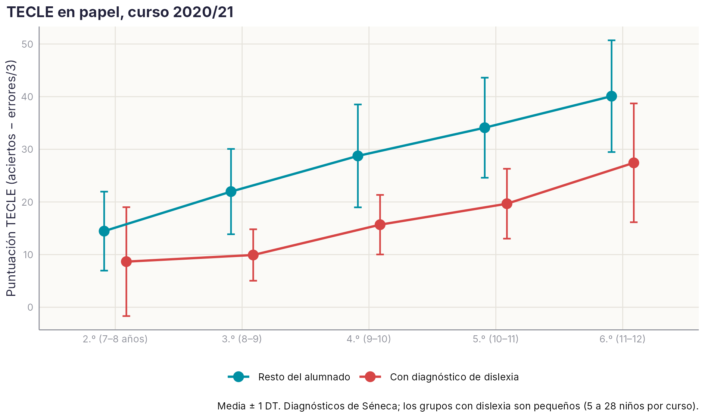
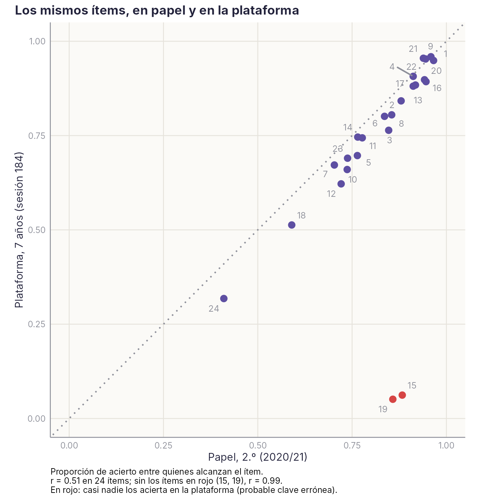
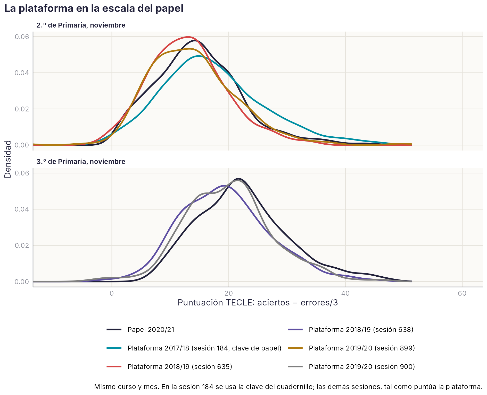
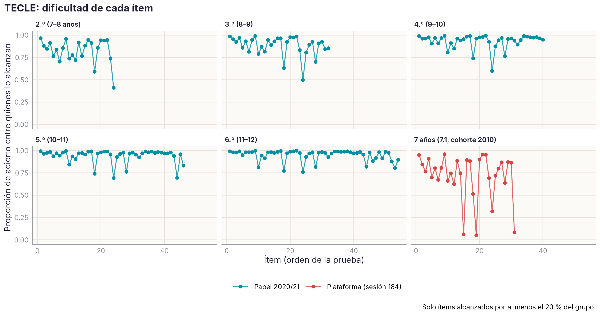
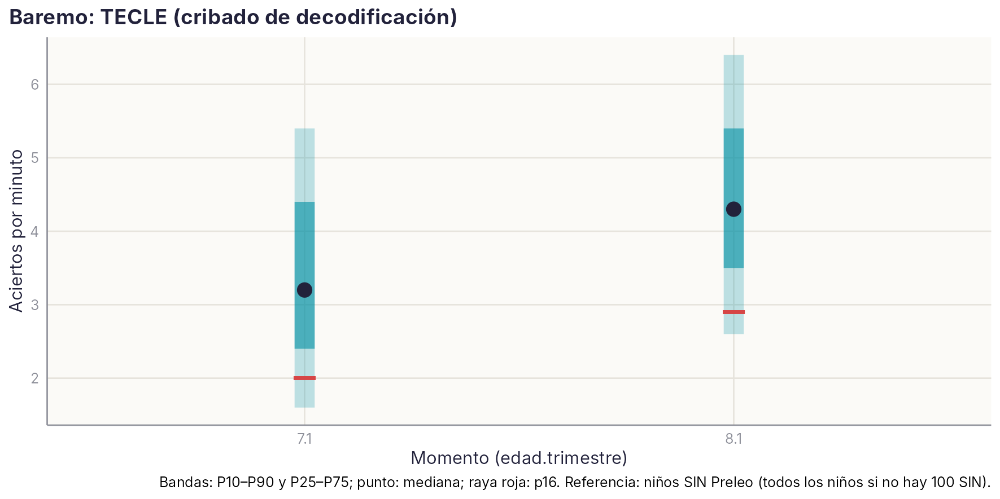

```{r}
#| include: false
source(file.path(dirname(knitr::current_input(dir = TRUE)), "..", "R", "libro.R"))
P <- leer("TECLE_papel", "P2_Descriptivos_papel")
E1 <- leer("TECLE_papel", "E1_Dificultad_papel_plataforma")
V1 <- leer("TECLE_papel", "V1_Dislexia_diagnosticada")
I7 <- leer("TECLE_papel", "I7_Recorreccion_184")
Q3 <- leer("TECLE_equiv", "Q3_Comparacion_papel")
Q4 <- leer("TECLE_equiv", "Q4_Correlaciones")
r_ <- function(x, d = 2) sub("^0", "", sprintf(paste0("%.", d, "f"), x))  # correlations and AUC: .99
grado <- function(x) sub("^([2-6])\\.º.*", "Grade \\1", x)
```

::: {.callout-note appearance="minimal"}
**Status:** pilot task sheet, draft of October 20, 2026, expanded with the 2020/21 paper TECLE and the item analysis. Tables are read from `datos/agregados/TECLE` (platform) and `datos/agregados/TECLE_papel` (paper and items), and are regenerated with `scripts/R/ficha_borrador_tarea.R --tarea TECLE` and `scripts/R/ficha_TECLE_papel_items.R`. Paper percentiles are not reproduced here: they are the norms of the normative study published by the group [@carrillo2024tecle]. *Translated from the Spanish version of November 28, 2026. The figures inserted as images have labels in Spanish.*
:::

**In one sentence.** TECLE measures **reading efficiency**: it is stable from one school year to the next, it distinguishes children with diagnosed dyslexia very well (AUC = `r r_(V1$AUC[V1$curso == "Todos (z por curso)"])`), and its items work the same on paper and on the platform (r = `r r_(E1$r_dificultad[2])`). But it anticipates comprehension poorly, and the platform version has **five items with the correct answer wrongly recorded**.

## Description

Each item shows a sentence with its last word missing. The child reads silently and chooses, from four words, the one that completes the sentence. There are 64 sentences of increasing difficulty and 5 minutes: almost nobody finishes, so the score mainly reflects **how many sentences the child reads correctly in that time**.

| | Platform | Paper |
|---|---|---|
| Code | 1930 | — |
| When | 7.1 (sessions 184, 635, 899) and 8.1 (638, 900); cohorts 2010–2012 | School year 2020/21, because of the pandemic; Grades 2 to 6 (cohorts 2013–2009) |
| Administration | Individual, on the computer | Group, in the classroom |
| Children | 1,571 at age 7 and 950 at age 8 | `r num_es(sum(P$N), 0)` in 52 schools |
| Main measure | Correct responses per minute (correct × 60 / time) | Correct − errors/3 (corrects for guessing with four options) |

On the platform, correct responses per minute are used because the actual time varies by a few seconds between children (272–302 s). With 5 minutes, 1 correct response per minute is equivalent to about 5 correct responses.

## Theoretical framework and evidence

TECLE is a brief, group-administered test of **reading efficiency**: within a fixed time, the child reads sentences silently and completes each one by choosing a word. To get it right, the child has to decode quickly and understand just enough to pick the word that fits. It is the same type of task as English-language silent sentence reading tests such as the TOSREC.

What the evidence says:

- **Origin.** M. S. Carrillo and J. Marín designed TECLE in 1997, with the collaboration of J. Alegría and A. R. Calvo, as a research instrument. It is inspired by Lobrot's L3 test, but it is not an adaptation: it has 24 more sentences, mostly short ones, so that it discriminates from the first school years. In addition, in each item two distractors are pseudowords and one is a word, all very similar to the correct word. This makes the test depend heavily on decoding and makes it useful for detecting difficulties, including dyslexia.
- **As the first stage of screening.** In Molina de Segura (Murcia), TECLE was administered in groups to 1,894 schoolchildren in Grades 2, 4 and 6 as the first stage of dyslexia screening. The cut-off at mean − 1.5 SD was equivalent to about two years of reading delay. 96% of the children it flagged then showed a phonological or orthographic deficit in the individual assessment [@carrillo2011prevalencia]. This is the most direct evidence of its validity for screening in Spanish.
- **The group's norms.** The paper normative study was carried out with 6,492 schoolchildren in Grades 2 to 6 from 53 schools in Málaga, assessed in November [@carrillo2024tecle]. These are the same paper data as in this task sheet, and that manual is the reference for interpreting paper scores.
- **Duration.** In Spain it is administered in 5 minutes. With older students, and in other studies, 3 minutes have been used; those scores are not comparable with 5-minute scores.
- **Adaptations in other Spanish-speaking countries.** There is a Uruguayan technical manual ([Cuadro et al., 2009](https://doi.org/10.22235/cp.v3i2.156)) and an Argentine adaptation with 693 students in Grades 5 to 7. In the latter, item difficulty was adequate and the score depended on grade and educational opportunities, but not on sex ([Ferreres et al., 2011](https://doi.org/10.5579/rnl.2011.0040)).
- **Silent sentence reading tests are useful for screening.** The validity of the TOSREC as a screener in response-to-intervention models has been studied specifically ([Johnson et al., 2011](https://doi.org/10.1177/1534508411395556)). In secondary school, a group sentence verification test classified almost as well as individual oral fluency ([Denton et al., 2011](https://doi.org/10.1080/10888431003623546)).
- **In the first school years it mainly measures decoding.** In Grade 1, silent and oral fluency are related but distinct skills ([Kim, Wagner & Foster, 2011](https://doi.org/10.1080/10888438.2010.493964)). In poor readers in Grade 4, decoding and fluency explain only 22% of the TOSREC ([Kang & Shin, 2019](https://doi.org/10.1080/10573569.2018.1521758)).

What our data say agrees: at ages 7–8, TECLE is closely related to word and text reading and weakly to comprehension; it depends somewhat on school socioeconomic status and hardly on sex, as in the Argentine adaptation.

**What TECLE measures within the simple view of reading.** It is a timed sentence comprehension task, so its score is an **efficiency**: sentences understood per unit of time. When comprehension is measured as a rate, and not only as correct responses, it depends more on word recognition [@ronberg2016rate]. That is why in the first school years TECLE behaves mainly as a decoding measure, and its relation with language should increase with age, as the simple view predicts [@hoover1990simple; @sanchezvincitore2022svr]. In our paper data, the relation with the Spanish language grade drops from .53 in Grade 2 to .36 in Grade 6. This fits with text comprehension in the higher grades depending increasingly on language, something a test of simple sentences does not capture. TECLE is useful for screening reading efficiency throughout primary school, but it does not replace a measure of text comprehension.

References located with SciSpace (volumes and pages still to be checked): Cuadro et al. (2009), *Ciencias Psicológicas*; Denton et al. (2011), *Scientific Studies of Reading*; Ferreres et al. (2011), *Revista Neuropsicología Latinoamericana*; Johnson et al. (2011), *Assessment for Effective Intervention*; Kang & Shin (2019), *Reading & Writing Quarterly*; Kim, Wagner & Foster (2011), *Scientific Studies of Reading*.

## Main results

### How it grows from Grade 2 to Grade 6 (paper)

{width=90%}

```{r}
#| label: tbl-tecle-papel
#| tbl-cap: "Paper TECLE, school year 2020/21: descriptive statistics by grade (score = correct − errors/3)."
P$curso_c <- paste("Grade", P$curso)
tabla(P[, c("curso_c", "N", "aciertos_M", "errores_M", "precision_pct", "punt_M", "punt_DT")],
      c("Grade", "N", "Correct", "Errors", "Accuracy %", "Mean", "SD"), digitos = 1)
```

- **It grows by about 6–7 points per grade**, with no floor or ceiling in any grade: the test works from Grade 2 to Grade 6.
- **What grows is speed, not accuracy.** Children in Grade 2 already get 84% of what they answer right; in Grade 6, 96%. The difference lies in how many sentences they read.
- **Relation with the Spanish language grade** for the first term: ρ = .53 in Grade 2, dropping to .36 in Grade 6.
- **Socioeconomic status and sex:** small effects (ρ ≤ .12 with the school index; d between −0.10 and 0.03 by sex).

### It distinguishes children with dyslexia

```{r}
#| label: tbl-tecle-dislexia
#| tbl-cap: "Children with a diagnosis of dyslexia in Séneca (the Andalusian school information system) versus the rest, by grade (paper 2020/21)."
V1$curso_c <- ifelse(grepl("^Todos", V1$curso), "All", grado(V1$curso))
V1$auc_ic <- sprintf("%s (%s–%s)", r_(V1$AUC), r_(V1$IC_inf), r_(pmin(V1$IC_sup, 1)))
V1$sens <- round(100 * V1$sens_p10); V1$esp <- round(100 * V1$esp_p10)
tabla(V1[, c("curso_c", "n_dislexia", "n_resto", "auc_ic", "d", "sens", "esp")],
      c("Grade", "Dyslexia", "Rest", "AUC (95% CI)", "d", "Sens. % (≤ P10)", "Spec. %"), digitos = 2)
```

With all grades together, the AUC is `r r_(V1$AUC[V1$curso == "Todos (z por curso)"])` and the difference is `r num_es(V1$d[V1$curso == "Todos (z por curso)"], 1)` SD. Almost 6 in 10 children with dyslexia and 1 in 10 of the rest fall below the 10th percentile of their grade. A Grade 6 child with dyslexia reads, on average, like a Grade 4 child. This is **known-groups validity**, with two caveats: the groups with dyslexia are small, and the Séneca diagnosis depends on the school having requested it.

### The same items on paper and on the platform

{width=70%}

- The 22 sentences that enough children reach in both formats have **the same difficulty on paper and on the platform** (r = `r r_(E1$r_dificultad[2])`). On the platform they are somewhat harder (`r num_es(abs(E1$dif_media_p_plataforma_menos_papel[2]) * 100, 0)` percentage points fewer correct), a small difference that may be due to format or cohort (both groups are in Grade 2).
- **Data issue: the platform's answer key.** For items 15 and 19, on paper 86–88% of those who reach them get them right, and on the platform 5–6%. The platform also stores which option each child chose, which makes it possible to check: for items **15, 19, 36 and 37**, 81–90% of children choose the booklet's correct option, but the platform accepts a different one. The same happens with item **51**, although only 9 children reach it. These are errors in the recorded key, not in the children.
- **Item 31, to be checked.** The key matches the paper one, but 77% of children choose another option, and on paper almost all get it right. Most likely the options appear on screen in a different order than in the booklet.
- **What it implies:** with the paper key, 7-year-olds go from `r num_es(I7$aciertos_M[1], 1)` to `r num_es(I7$aciertos_M[2], 1)` correct on average. The score of 8 in 10 children changes, but the rank order barely does (r = `r r_(I7$r_con_plataforma[2], 3)`), and only `r num_es(I7$pct_cambia_de_lado_p25[2], 1)`% cross the 25th percentile. The effect is on the level: **the platform norms are somewhat lower** than they should be.

### The platform on the paper scale

The platform records correct responses, errors and time, so its score can be expressed in the same way as on paper: **correct − errors/3**. This lets readers compare directly with the normative manual. No adjustment for time is needed: the test always lasts 5 minutes, and the time the platform stores is that of the last response.

{width=90%}

```{r}
#| label: tbl-tecle-equiv
#| tbl-cap: "Platform TECLE (correct − errors/3) compared with 2020/21 paper TECLE for the same grade, in November."
Q <- Q3; Q$sesiones <- as.character(Q$sesiones)
Q$puntuacion <- sub("A − E/3 con la clave de papel", "C − E/3 with the paper key", sub("^A − E/3$", "C − E/3", Q$puntuacion))
Q$curso_papel <- sub("^([2-6])\\.º \\(nov\\.\\)", "Grade \\1 (Nov.)", Q$curso_papel)
tabla(Q[, c("momento", "sesiones", "puntuacion", "curso_papel", "n_plataforma", "M_plataforma", "M_papel", "d", "pct_bajo_p25_papel")],
      c("Time point", "Session", "Score", "Paper", "n", "Platform mean", "Paper mean", "d", "% below paper P25"), digitos = 1)
```

- **It measures the same thing as correct responses per minute.** The correlation between the two scores is `r r_(min(Q4$r_ppm_punt))`–`r r_(max(Q4$r_ppm_punt))` in all sessions. Moving to the paper scale does not change the rank order of the children; it only makes comparison easier.
- **Levels are similar.** Differences from paper for the same grade range from d = `r num_es(min(Q3$d), 2)` to `r num_es(max(Q3$d), 2)`, and between 20% and 39% of platform children fall below the paper P25 (25% if they were equal).
- **But the causes cannot be separated.** Format, cohort and time point go together: the paper data are from November 2020, after the lockdown, and the platform data from 2017–2020. In addition, the new-platform sessions have not yet been rescored with the correct key, which adds a little more than one correct response on average.
- **Proposal:** give both scores in the task sheet, correct responses per minute and correct − errors/3, and build the platform norms on the paper scale once all sessions have been rescored.

### Reliability: a speeded test



Almost all sentences are easy for whoever reaches them: the hard part is reaching them. That is why, in a speeded test, internal consistency is misleading:

- with all 64 items, α = .91–.95, and the odd–even split gives more than .95. These are inflated: a child who does not reach an item scores zero on it and on all the following ones;
- with only the items reached by 90% of the grade, α = .64–.77 and ω = .63–.78. These are deflated: they are very easy items with almost no variance.

The normative manual warns of the same thing and estimates reliability by test–retest: r = .87–.91 with a four-week interval and .64–.80 with one year [@carrillo2024tecle]. In our data, **stability between administrations** is similar: r = .67–.70 from age 7 to 8 on the platform, and r = .57 between the platform in November 2019 and paper in November 2020 in the same 107 children (with a year, a change of format and the lockdown in between).

### On the platform (ages 7 and 8)

```{r}
#| label: tbl-tecle-baremo
#| tbl-cap: "TECLE norms on the platform (correct responses per minute), normative reference sample (non-Preleo schools). To be rescored with the correct key (items 15, 19, 36, 37 and 51)."
B <- leer("TECLE", "5_Baremo_SIN")
tabla(B[, c("mom", "N", "cohortes", "P5", "P10", "P16", "P25", "P50", "P75", "P90")], c("Time point", "N", "Cohorts", "P5", "P10", "P16", "P25", "P50", "P75", "P90"), digitos = 1)
```

{width=80%}

- **Distribution.** At age 7, median of 16 correct (3.2 per minute) and about 7 errors. At age 8, 21 correct (4.3 per minute). No floor or ceiling.
- **Concurrent validity.** It is related mainly to words, pseudowords and text speed (r = .69 at age 7 and .79 at age 8). Less to phonological awareness (.38–.45) and little to reading comprehension (.17–.29).
- **Against the persistent difficulty label**, the AUC is .90–.92. But the label is built with TECLE, so this is **agreement, not predictive validity**.
- **Non-circular criterion.** Against poor comprehension (≤ P25) one school year later, the AUC is .59 (age 7 → 8, 875 children).
- **Variables that affect it.** School socioeconomic status, moderately (d = 0.36 at age 7). Schools explain 6–8% of the variance.

::: {.callout-note}
## Continuous norms and floor effect (study M3, November 3, 2026)

TECLE was not included in the M3 comparison, because each cohort was assessed at a different age (7.2 in 2013, 8.2 in 2012, 10.2 in 2010) and it cannot be validated by holding out a cohort. That is precisely why it is the task that most needs continuous norms to cover the intermediate grades: they will be built when the 2014–2015 cohorts and the 2020–2026 server data are added.

Details in study M3.
:::

## Other versions (under construction)

::: {.callout-warning appearance="minimal"}
**Under construction.** These sections will be completed once the data are processed.
:::

### 3-minute version (Colombia)

Administered in Colombia with 3 minutes instead of 5, like other tasks of the DIS-ESP battery. The data are in `CUC\INVESTIGACIÓN\SIMON BOLIVAR`. The sample and the lexical adaptation need to be described and compared with the Uruguayan and Argentine norms. 3-minute scores cannot be compared directly with 5-minute scores.

### Adult version

Administered to young people and adults, also with 3 minutes, as in other studies with secondary and university students. Data in the same folder, to be processed.

### TECLE in the paper DIS-ESP battery (2007–2012)

It is one of the 11 DIS-ESP scales administered on paper before moving to the platform. There are correct responses, errors and time for 1,340 children in Grades 1 to 6, with and without dyslexia. It will go in the section of the manual devoted to DIS-ESP.

## Studies it opens up

| # | Study | Type | Question | What is already available |
|----|--------------|----------|--------------------------------|--------------|
| E1 | **Validity without circularity** | Methodological | Rebuild the reading difficulty label without TECLE: how well does TECLE at age 7 predict persistent difficulty in later school years? | Certainty labels and their script. |
| E2 | **Platform and paper on one scale** | Methodological | With almost identical item difficulty, can platform scores be equated with the paper norms? | Items in both formats; 107 children with both. |
| E3 | **Correcting the key** | Technical | Correct the key on the platform, check the order of the options for item 31, rescore sessions 635, 638, 899 and 900 using the chosen option, and rebuild the norms. | Item-by-item check of session 184. |
| E4 | **TECLE and dyslexia** | Clinical | Which TECLE cut-off best identifies dyslexia by grade? Does it add anything to the Spanish language grade? | Séneca diagnoses and grades, paper 2020/21. |
| E5 | **Poor comprehenders** | Theoretical | Does TECLE detect children who decode well but understand poorly? In the meta-analysis by Spencer and Wagner (2018), these children have an oral language deficit (d = −0.78) smaller than their comprehension deficit (d = −2.78) [@spencer2018scd]. | EDICOLE comprehension in the same sessions; SEM, STX and VOC subtests on paper. |
| E6 | **Item times** | Methodological | Do the times per sentence reveal different reading profiles with the same score? | Item times from the platform. |

**Utility of each result.**

- **Scientific:** a widely used test in Spanish, with items that work the same in two formats.
- **Educational:** the whole class in 5 minutes, from Grade 2 to Grade 6, stable from one school year to the next.
- **Clinical:** it distinguishes children with dyslexia well. A different test is needed for comprehension.

## Pending issues and data issues

- **Platform key:** wrong for items 15, 19, 36, 37 and 51 (checked in session 184 using the chosen option); item 31 to be checked on screen. The other sessions must be rescored before the platform norms are used for individual decisions.
- **Recommended use:** a quick, group measure of reading efficiency, together with the word lists. **Do not use it as a measure of comprehension.**
- **Caveats:** in the 2010 cohort, 7.1 is on the old platform and 8.1 on the new one; the 8.1 norms have only 166 non-Preleo children.
- **To be agreed with M. Carrillo:** how to present the paper data alongside her normative manual.
- Review the coding of sex on the platform (issue common to all task sheets).

## Full tables

**Platform**

```{r}
#| results: asis
tablas_completas("TECLE")
```

**Paper 2020/21 and items**

```{r}
#| results: asis
tablas_completas("TECLE_papel")
```
