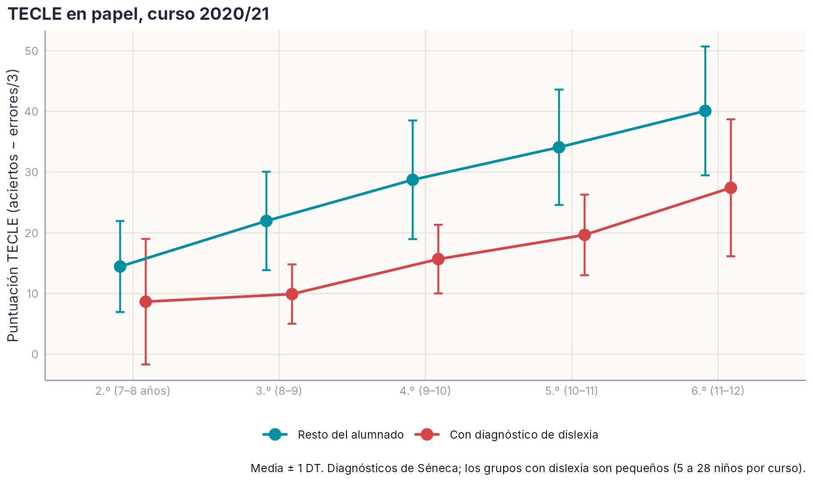
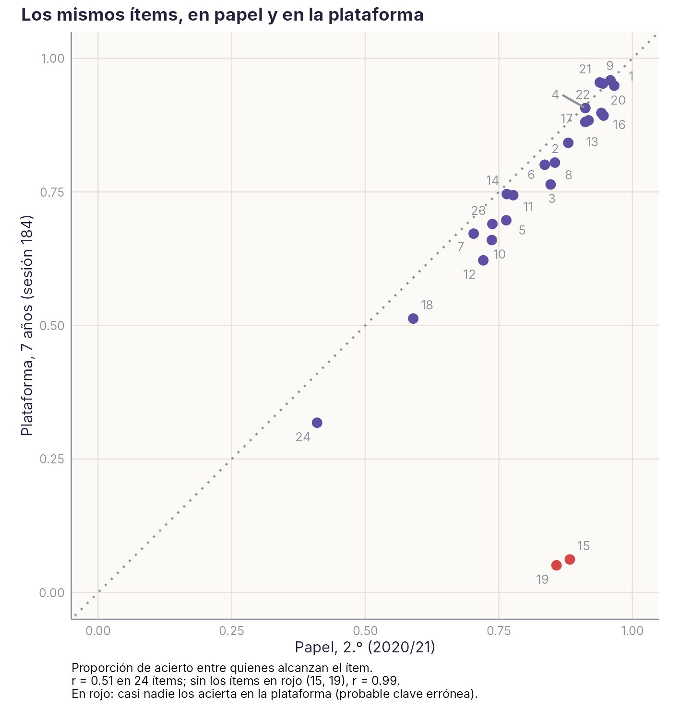
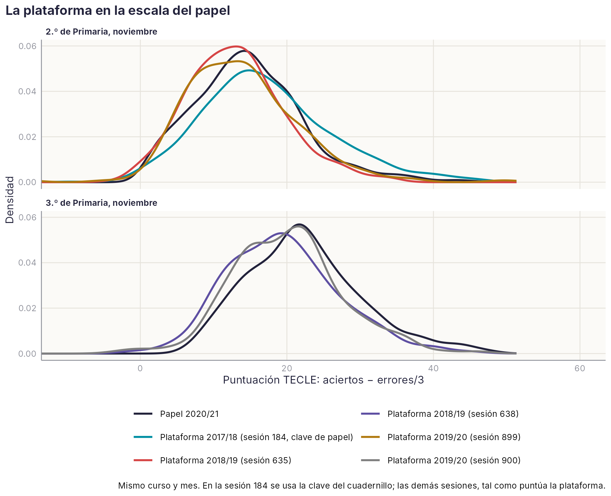
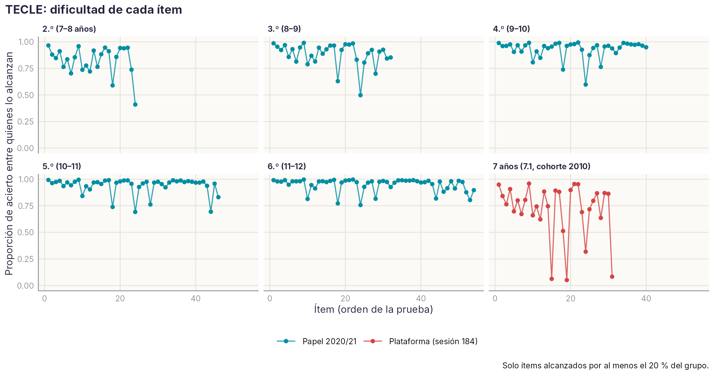
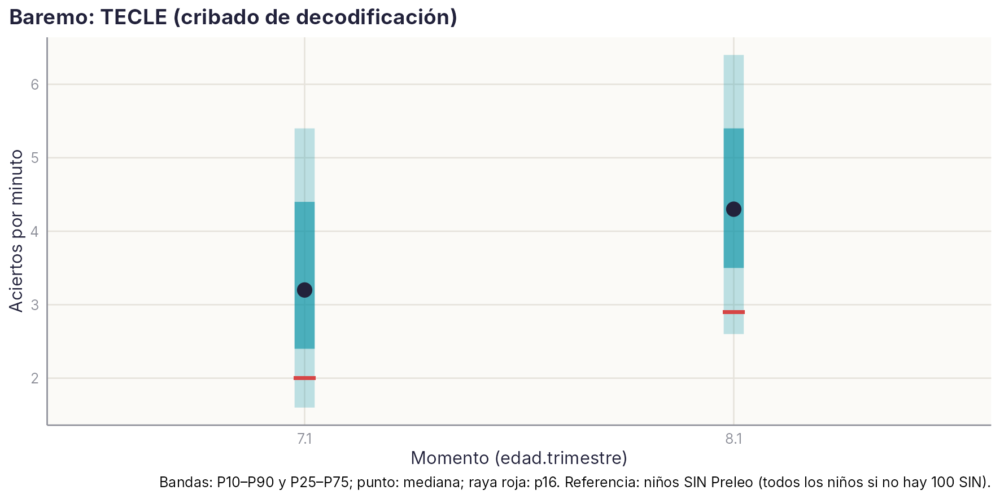

```{r}
#| include: false
source(file.path(dirname(knitr::current_input(dir = TRUE)), "..", "R", "libro.R"))
P <- leer("TECLE_papel", "P2_Descriptivos_papel")
E1 <- leer("TECLE_papel", "E1_Dificultad_papel_plataforma")
V1 <- leer("TECLE_papel", "V1_Dislexia_diagnosticada")
I7 <- leer("TECLE_papel", "I7_Recorreccion_184")
Q3 <- leer("TECLE_equiv", "Q3_Comparacion_papel")
Q4 <- leer("TECLE_equiv", "Q4_Correlaciones")
r_ <- function(x, d = 2) sub("^0", "", sprintf(paste0("%.", d, "f"), x))  # correlaciones y AUC: .99
```

::: {.callout-note appearance="minimal"}
**Estado:** ficha piloto, borrador del 20/10/2026, ampliada con el TECLE en papel de 2020/21 y el análisis de ítems. Las tablas se leen de `datos/agregados/TECLE` (plataforma) y `datos/agregados/TECLE_papel` (papel e ítems), y se regeneran con `scripts/R/ficha_borrador_tarea.R --tarea TECLE` y `scripts/R/ficha_TECLE_papel_items.R`. Los percentiles en papel no se reproducen aquí: son el baremo del estudio normativo publicado por el grupo [@carrillo2024tecle].
:::

**En una frase.** TECLE mide **eficiencia lectora**: es estable de un curso a otro, distingue muy bien a los niños con dislexia diagnosticada (AUC = `r r_(V1$AUC[V1$curso == "Todos (z por curso)"])`) y sus ítems funcionan igual en papel que en la plataforma (r = `r r_(E1$r_dificultad[2])`). Pero anticipa poco la comprensión, y la versión de la plataforma tiene **cinco ítems con la respuesta correcta mal grabada**.

## Descripción

En cada ítem aparece una frase a la que le falta la última palabra. El niño lee en silencio y elige, entre cuatro palabras, la que completa la frase. Hay 64 frases de dificultad creciente y 5 minutos: casi nadie termina, así que la puntuación refleja sobre todo **cuántas frases lee bien en ese tiempo**.

| | Plataforma | Papel |
|---|---|---|
| Código | 1930 | — |
| Cuándo | 7.1 (sesiones 184, 635, 899) y 8.1 (638, 900); cohortes 2010–2012 | Curso 2020/21, por la pandemia; 2.º a 6.º (cohortes 2013–2009) |
| Aplicación | Individual, en el ordenador | Colectiva, en el aula |
| Niños | 1.571 a los 7 años y 950 a los 8 | `r num_es(sum(P$N), 0)` en 52 centros |
| Medida principal | Aciertos por minuto (aciertos × 60 / tiempo) | Aciertos − errores/3 (corrige el azar con cuatro opciones) |

En la plataforma se usan aciertos por minuto porque el tiempo real varía unos segundos entre niños (272–302 s). Con 5 minutos, 1 acierto por minuto equivale a unos 5 aciertos.

## Marco teórico y evidencia

TECLE es una prueba breve y colectiva de **eficiencia lectora**: en un tiempo fijo, el niño lee frases en silencio y completa cada una eligiendo una palabra. Para acertar tiene que decodificar rápido y entender lo justo para escoger la palabra que encaja. Es el mismo tipo de tarea que las pruebas anglosajonas de lectura silenciosa de frases, como el TOSREC.

Lo que dice la evidencia:

- **Origen.** M. S. Carrillo y J. Marín diseñaron el TECLE en 1997, con la colaboración de J. Alegría y A. R. Calvo, como instrumento de investigación. Se inspira en la prueba L3 de Lobrot, pero no es una adaptación: tiene 24 frases más, sobre todo cortas, para que discrimine desde los primeros cursos. Además, en cada ítem dos distractores son pseudopalabras y uno es una palabra, todos muy parecidos a la palabra correcta. Así la prueba depende mucho de la decodificación y sirve para detectar dificultades, incluida la dislexia.
- **Normas del grupo.** El estudio normativo en papel se hizo con 6.492 escolares de 2.º a 6.º de 53 centros de Málaga, evaluados en noviembre [@carrillo2024tecle]. Son los mismos datos en papel de esta ficha, y ese manual es la referencia para interpretar las puntuaciones en papel.
- **Duración.** En España se aplica en 5 minutos. Con alumnado mayor, y en otros estudios, se ha usado con 3 minutos; esas puntuaciones no son comparables con las de 5.
- **Adaptaciones en otros países hispanohablantes.** Hay un manual técnico uruguayo ([Cuadro et al., 2009](https://doi.org/10.22235/cp.v3i2.156)) y una adaptación argentina con 693 alumnos de 5.º a 7.º. En esta última, los ítems tuvieron una dificultad adecuada y la puntuación dependió del curso y de las oportunidades educativas, pero no del sexo ([Ferreres et al., 2011](https://doi.org/10.5579/rnl.2011.0040)).
- **Las pruebas de lectura silenciosa de frases sirven para cribar.** La validez del TOSREC como cribado en modelos de respuesta a la intervención se ha estudiado expresamente ([Johnson et al., 2011](https://doi.org/10.1177/1534508411395556)). En secundaria, una prueba colectiva de verificación de frases clasificó casi tan bien como la fluidez oral individual ([Denton et al., 2011](https://doi.org/10.1080/10888431003623546)).
- **En los primeros cursos mide sobre todo decodificación.** En 1.º, la fluidez silenciosa y la oral son habilidades relacionadas pero distintas ([Kim, Wagner y Foster, 2011](https://doi.org/10.1080/10888438.2010.493964)). En malos lectores de 4.º, la decodificación y la fluidez explican solo el 22 % del TOSREC ([Kang y Shin, 2019](https://doi.org/10.1080/10573569.2018.1521758)).

Lo que dicen nuestros datos coincide: a los 7–8 años, TECLE se relaciona mucho con la lectura de palabras y texto y poco con la comprensión; depende algo del nivel socioeconómico del centro y apenas del sexo, como en la adaptación argentina.

Referencias localizadas con SciSpace (falta comprobar volúmenes y páginas): Cuadro et al. (2009), *Ciencias Psicológicas*; Denton et al. (2011), *Scientific Studies of Reading*; Ferreres et al. (2011), *Revista Neuropsicología Latinoamericana*; Johnson et al. (2011), *Assessment for Effective Intervention*; Kang y Shin (2019), *Reading & Writing Quarterly*; Kim, Wagner y Foster (2011), *Scientific Studies of Reading*.

## Resultados principales

### Cómo crece de 2.º a 6.º (papel)

{width=90%}

```{r}
#| label: tbl-tecle-papel
#| tbl-cap: "TECLE en papel, curso 2020/21: descriptivos por curso (puntuación = aciertos − errores/3)."
P$curso_c <- paste0(P$curso, ".º")
tabla(P[, c("curso_c", "N", "aciertos_M", "errores_M", "precision_pct", "punt_M", "punt_DT")],
      c("Curso", "N", "Aciertos", "Errores", "Precisión %", "Media", "DT"), digitos = 1)
```

- **Crece unos 6–7 puntos por curso**, sin suelo ni techo en ningún curso: la prueba sirve de 2.º a 6.º.
- **Lo que crece es la velocidad, no la precisión.** Los niños de 2.º ya aciertan el 84 % de lo que responden; los de 6.º, el 96 %. La diferencia está en cuántas frases leen.
- **Relación con la nota de Lengua** del primer trimestre: ρ = .53 en 2.º, que baja hasta .36 en 6.º.
- **Nivel socioeconómico y sexo:** efectos pequeños (ρ ≤ .12 con el índice del centro; d entre −0,10 y 0,03 por sexo).

### Distingue a los niños con dislexia

```{r}
#| label: tbl-tecle-dislexia
#| tbl-cap: "Niños con diagnóstico de dislexia en Séneca frente al resto, por curso (papel 2020/21)."
V1$curso_c <- ifelse(grepl("^Todos", V1$curso), "Todos", sub(" .*", "", V1$curso))
V1$auc_ic <- sprintf("%s (%s–%s)", r_(V1$AUC), r_(V1$IC_inf), r_(pmin(V1$IC_sup, 1)))
V1$sens <- round(100 * V1$sens_p10); V1$esp <- round(100 * V1$esp_p10)
tabla(V1[, c("curso_c", "n_dislexia", "n_resto", "auc_ic", "d", "sens", "esp")],
      c("Curso", "Dislexia", "Resto", "AUC (IC 95 %)", "d", "Sens. % (≤ p10)", "Espec. %"), digitos = 2)
```

Con todos los cursos juntos, el AUC es de `r r_(V1$AUC[V1$curso == "Todos (z por curso)"])` y la diferencia, de `r num_es(V1$d[V1$curso == "Todos (z por curso)"], 1)` DT. Por debajo del percentil 10 de su curso están casi 6 de cada 10 niños con dislexia y 1 de cada 10 del resto. Un niño de 6.º con dislexia lee, de media, como uno de 4.º. Es **validez de grupos conocidos**, con dos cautelas: los grupos con dislexia son pequeños, y el diagnóstico de Séneca depende de que el colegio lo haya pedido.

### Los mismos ítems en papel y en la plataforma

{width=70%}

- Las 22 frases que alcanzan bastantes niños en los dos formatos tienen **la misma dificultad en papel que en la plataforma** (r = `r r_(E1$r_dificultad[2])`). En la plataforma son algo más difíciles (`r num_es(abs(E1$dif_media_p_plataforma_menos_papel[2]) * 100, 0)` puntos de acierto menos), una diferencia pequeña, que puede deberse al formato o a la cohorte (los dos grupos están en 2.º).
- **Incidencia: la clave de la plataforma.** En los ítems 15 y 19, en papel acierta el 86–88 % de los que llegan a ellos y en la plataforma, el 5–6 %. La plataforma guarda además qué opción eligió cada niño, y eso permite comprobarlo: en los ítems **15, 19, 36 y 37**, el 81–90 % de los niños elige la opción correcta del cuadernillo, pero la plataforma da por buena otra. En el **51** pasa lo mismo, aunque solo llegan 9 niños. Son errores de la clave grabada, no de los niños.
- **Ítem 31, por comprobar.** La clave coincide con la de papel, pero el 77 % de los niños elige otra opción, y en papel casi todos aciertan. Lo más probable es que en la pantalla las opciones aparezcan en otro orden que en el cuadernillo.
- **Qué supone:** con la clave de papel, los niños de 7 años pasan de `r num_es(I7$aciertos_M[1], 1)` a `r num_es(I7$aciertos_M[2], 1)` aciertos de media. Cambia la puntuación de 8 de cada 10 niños, pero el orden apenas (r = `r r_(I7$r_con_plataforma[2], 3)`), y solo el `r num_es(I7$pct_cambia_de_lado_p25[2], 1)` % cruza el percentil 25. El efecto está en el nivel: **el baremo de la plataforma queda algo por debajo** de lo que debería.

### La plataforma en la escala del papel

La plataforma registra aciertos, errores y tiempo, así que su puntuación se puede expresar igual que en papel: **aciertos − errores/3**. Así el lector compara directamente con el manual normativo. No hace falta ajustar por el tiempo: la prueba dura siempre 5 minutos, y el tiempo que guarda la plataforma es el de la última respuesta.

{width=90%}

```{r}
#| label: tbl-tecle-equiv
#| tbl-cap: "TECLE de la plataforma (aciertos − errores/3) frente al papel 2020/21 del mismo curso, en noviembre."
Q <- Q3; Q$sesiones <- as.character(Q$sesiones)
tabla(Q[, c("momento", "sesiones", "puntuacion", "curso_papel", "n_plataforma", "M_plataforma", "M_papel", "d", "pct_bajo_p25_papel")],
      c("Momento", "Sesión", "Puntuación", "Papel", "n", "Media plataforma", "Media papel", "d", "% bajo el p25 del papel"), digitos = 1)
```

- **Mide lo mismo que los aciertos por minuto.** La correlación entre las dos puntuaciones es de `r r_(min(Q4$r_ppm_punt))`–`r r_(max(Q4$r_ppm_punt))` en todas las sesiones. Pasar a la escala del papel no cambia el orden de los niños; solo facilita la comparación.
- **Los niveles son parecidos.** Las diferencias con el papel del mismo curso van de d = `r num_es(min(Q3$d), 2)` a `r num_es(max(Q3$d), 2)`, y entre el 20 % y el 39 % de los niños de la plataforma queda por debajo del p25 del papel (25 % si fueran iguales).
- **Pero no se pueden separar las causas.** Formato, cohorte y momento van juntos: el papel es de noviembre de 2020, tras el confinamiento, y la plataforma de 2017–2020. Además, las sesiones de la plataforma nueva aún no están recorregidas con la clave buena, que suma algo más de un acierto de media.
- **Propuesta:** dar en la ficha las dos puntuaciones, aciertos por minuto y aciertos − errores/3, y construir el baremo de la plataforma en la escala del papel cuando estén recorregidas todas las sesiones.

### Fiabilidad: una prueba de velocidad



Casi todas las frases son fáciles para quien llega a ellas: lo difícil es llegar. Por eso, en una prueba de velocidad, la consistencia interna engaña:

- con los 64 ítems, α = .91–.95, y la división par-impar da más de .95. Están infladas: un niño que no llega a un ítem tiene cero en ese y en todos los siguientes;
- con solo los ítems que alcanza el 90 % del curso, α = .64–.77 y ω = .63–.78. Están rebajadas: son ítems muy fáciles y casi sin varianza.

El manual normativo advierte lo mismo y estima la fiabilidad por test-retest: r = .87–.91 con cuatro semanas de intervalo y .64–.80 con un año [@carrillo2024tecle]. En nuestros datos, la **estabilidad entre aplicaciones** es parecida: r = .67–.70 de 7 a 8 años en la plataforma, y r = .57 entre la plataforma en noviembre de 2019 y el papel en noviembre de 2020 en los mismos 107 niños (con un año, un cambio de formato y el confinamiento de por medio).

### En la plataforma (7 y 8 años)

```{r}
#| label: tbl-tecle-baremo
#| tbl-cap: "Baremo de TECLE en la plataforma (aciertos por minuto), muestra de referencia normativa (centros sin Preleo). Pendiente de recorregir con la clave buena (ítems 15, 19, 36, 37 y 51)."
B <- leer("TECLE", "5_Baremo_SIN")
tabla(B[, c("mom", "N", "cohortes", "P5", "P10", "P16", "P25", "P50", "P75", "P90")], c("Momento", "N", "Cohortes", "P5", "P10", "P16", "P25", "P50", "P75", "P90"), digitos = 1)
```

{width=80%}

- **Distribución.** A los 7 años, mediana de 16 aciertos (3,2 por minuto) y unos 7 errores. A los 8 años, 21 aciertos (4,3 por minuto). Sin suelo ni techo.
- **Validez concurrente.** Se relaciona sobre todo con palabras, pseudopalabras y velocidad de texto (r = .69 a los 7 años y .79 a los 8). Menos con conciencia fonológica (.38–.45) y poco con comprensión lectora (.17–.29).
- **Frente a la etiqueta de dificultad persistente**, el AUC es .90–.92. Pero la etiqueta se construye con TECLE, así que es **acuerdo, no validez predictiva**.
- **Criterio no circular.** Frente a la baja comprensión (≤ p25) un curso después, el AUC es .59 (7 → 8 años, 875 niños).
- **Variables que la afectan.** El nivel socioeconómico del centro, moderadamente (d = 0,36 a los 7 años). Los colegios explican el 6–8 % de la varianza.

## Otras versiones (en construcción)

::: {.callout-warning appearance="minimal"}
**En construcción.** Estos apartados se completarán cuando se procesen los datos.
:::

### Versión de 3 minutos (Colombia)

Aplicada en Colombia con 3 minutos en lugar de 5, igual que otras tareas de la batería DIS-ESP. Los datos están en `CUC\INVESTIGACIÓN\SIMON BOLIVAR`. Habrá que describir la muestra y la adaptación léxica, y comparar con las normas uruguaya y argentina. Las puntuaciones de 3 minutos no se pueden comparar directamente con las de 5.

### Versión para adultos

Aplicada a jóvenes y adultos, también con 3 minutos, como en otros estudios con alumnado de secundaria y universitario. Datos en la misma carpeta, pendientes de procesar.

### TECLE en la batería DIS-ESP en papel (2007–2012)

Forma parte de las 11 escalas de DIS-ESP aplicadas en papel antes de pasar a la plataforma. Hay aciertos, errores y tiempo de 1.340 niños de 1.º a 6.º, con y sin dislexia. Irá en el apartado del manual dedicado a DIS-ESP.

## Estudios que abre

| # | Estudio | Tipo | Pregunta | Qué hay ya |
|----|--------------|----------|--------------------------------|--------------|
| E1 | **Validez sin circularidad** | Metodológico | Rehacer la etiqueta de dificultad lectora sin TECLE: ¿cuánto predice TECLE a los 7 años la dificultad persistente de los cursos siguientes? | Etiquetas de certeza y su guion. |
| E2 | **Plataforma y papel en una escala** | Metodológico | Con la dificultad de los ítems casi idéntica, ¿se pueden equiparar las puntuaciones de la plataforma con las normas en papel? | Ítems de los dos formatos; 107 niños con los dos. |
| E3 | **Corregir la clave** | Técnico | Corregir la clave en la plataforma, comprobar el orden de las opciones del ítem 31, recorregir las sesiones 635, 638, 899 y 900 con la opción elegida y rehacer el baremo. | Comprobación ítem a ítem de la sesión 184. |
| E4 | **TECLE y dislexia** | Clínico | ¿Qué punto de corte de TECLE identifica mejor la dislexia por curso? ¿Añade algo a la nota de Lengua? | Diagnósticos de Séneca y notas, papel 2020/21. |
| E5 | **Malos comprendedores** | Teórico | ¿Detecta TECLE a los niños que decodifican bien pero comprenden mal? En el metaanálisis de Spencer y Wagner (2018), estos niños tienen un déficit de lenguaje oral (d = −0,78) menor que el de comprensión (d = −2,78) [@spencer2018scd]. | Comprensión EDICOLE en las mismas sesiones; subpruebas SEM, STX y VOC en papel. |
| E6 | **Tiempos por ítem** | Metodológico | ¿Revelan los tiempos por frase perfiles de lectura distintos con la misma puntuación? | Tiempos por ítem de la plataforma. |

**Utilidad de cada resultado.**

- **Científica:** una prueba muy usada en español, con ítems que funcionan igual en dos formatos.
- **Educativa:** toda la clase en 5 minutos, de 2.º a 6.º, estable de un curso a otro.
- **Clínica:** distingue bien a los niños con dislexia. Para la comprensión hace falta otra prueba.

## Pendientes e incidencias

- **Clave de la plataforma:** errónea en los ítems 15, 19, 36, 37 y 51 (comprobado en la sesión 184 con la opción elegida); ítem 31 por comprobar en pantalla. Hay que recorregir el resto de sesiones antes de usar el baremo de la plataforma para decisiones individuales.
- **Uso recomendado:** medida rápida y colectiva de eficiencia lectora, junto a las listas de palabras. **No usar como medida de comprensión.**
- **Cautelas:** en la cohorte 2010, 7.1 está en la plataforma antigua y 8.1 en la nueva; el baremo de 8.1 tiene solo 166 niños sin Preleo.
- **Pendiente de acordar con M. Carrillo:** cómo presentar los datos en papel junto a su manual normativo.
- Revisar la codificación del sexo en la plataforma (incidencia común a todas las fichas).

## Tablas completas

**Plataforma**

```{r}
#| results: asis
tablas_completas("TECLE")
```

**Papel 2020/21 e ítems**

```{r}
#| results: asis
tablas_completas("TECLE_papel")
```
