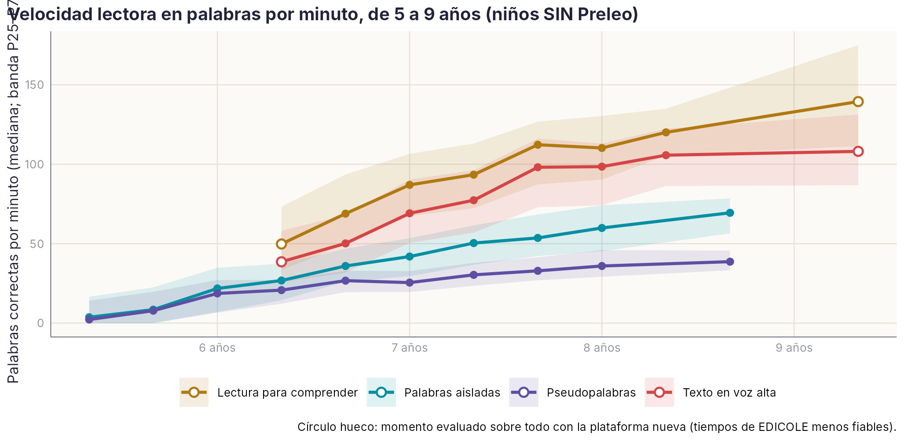
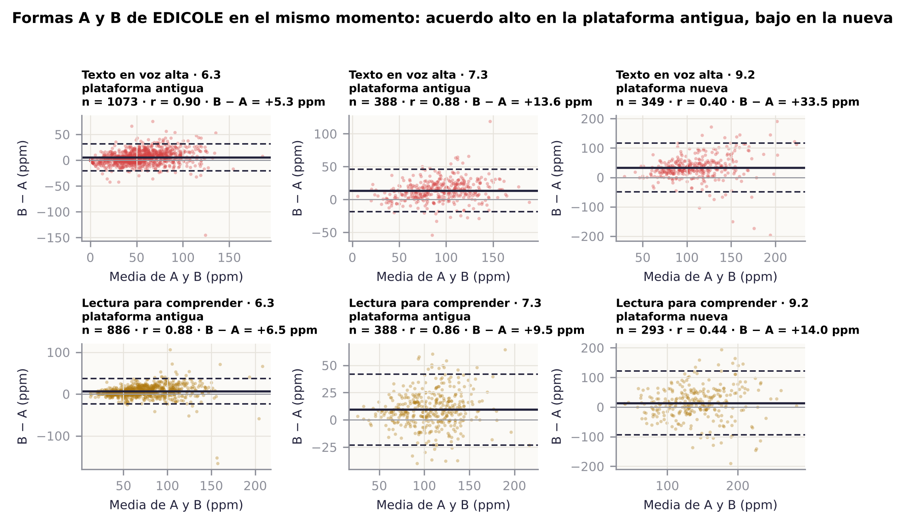
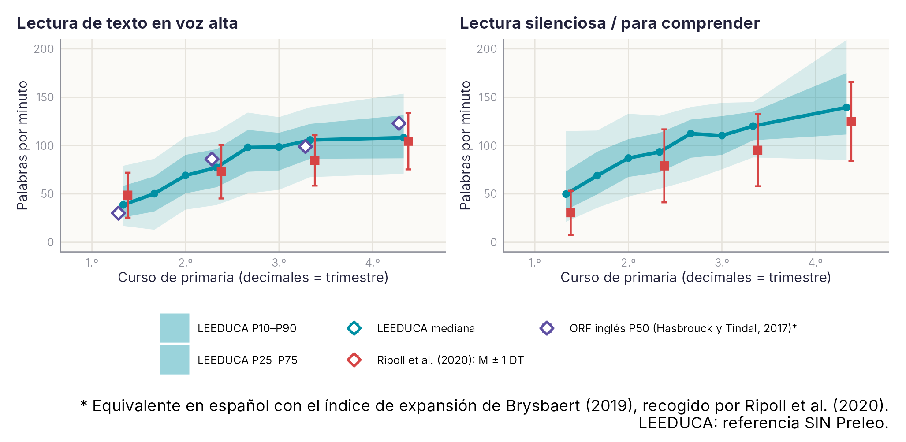
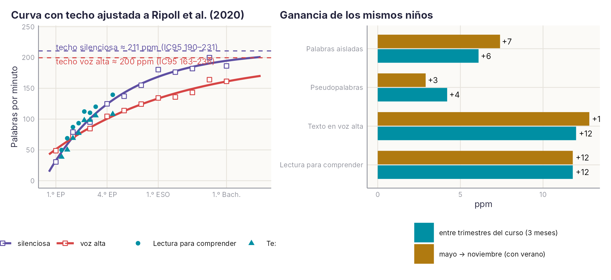
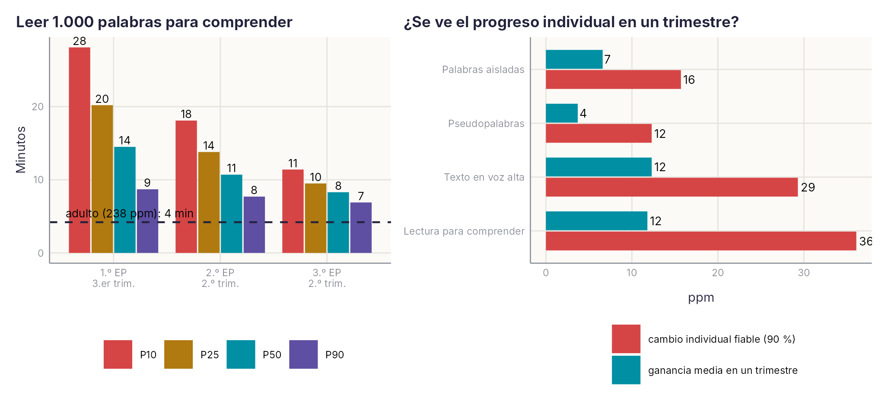
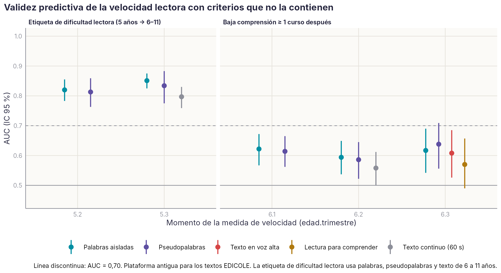

```{r}
#| include: false
source(file.path(dirname(knitr::current_input(dir = TRUE)), "..", "R", "libro.R"))
MEDIDA_EN <- c("Palabras aisladas" = "Isolated words", "Pseudopalabras" = "Pseudowords", "Texto en voz alta" = "Text read aloud",
               "Lectura para comprender" = "Reading for comprehension", "Texto continuo (60 s)" = "Continuous text (60 s)")
```

::: {.callout-note appearance="minimal"}
**Status:** pilot task sheet. Draft of October 19, 2026. Figures in the text come from the analyses of October 19; the full tables at the end are read from `datos/agregados/VEL*` and update automatically when the data are regenerated. *Translated from the Spanish version of November 27, 2026. The figures inserted as images have labels in Spanish.*
:::

**Words correct per minute (WCPM)** is a unit that teachers and families understand, and it can be computed for all reading tasks on the platform. In the 2010–2015 cohorts, the median of the non-Preleo group for text read aloud goes from 50 WCPM at the end of Grade 1 to about 100 WCPM at the end of Grade 2. With isolated words, from 36 to 69 WCPM between the end of Grade 1 and the end of Grade 3.

Three caveats before using it:

- **New platform.** EDICOLE times on the new platform (since 2018) are unreliable: forms A and B correlate only .40–.50, compared with .86–.90 on the old platform.
- **Forms A and B.** They are not equivalent: form B yields 5–14 WCPM more.
- **Reading and comprehension.** EDICOLE speed and comprehension are barely related (ρ = .1–.3).

This is a draft to test the task sheet structure with widely used tasks. Script: `scripts/velocidad_lectora.py`; output: `velocidad_lectora_v1.xlsx`.

## 0. Theoretical framework: from speed to comprehension

**What fluency is.** Reading fluently means reading accurately, at a good pace and with the intonation that the meaning of the text requires. Speed is only one of its parts. In the simple view of reading, fluency is the bridge between decoding and comprehension: if recognizing words takes little effort, resources are left for understanding [@hoover1990simple].

**What the evidence in Spanish says:**

- **Fluency is one of the components most closely related to comprehension.** In a meta-analysis of 33 studies with monolingual Spanish-speaking children, the strongest relations with comprehension were those of fluency and phonological awareness [@baker2022components].
- **The weight of speed decreases across school years.** In Spanish children, automaticity in word reading explains comprehension mainly in Grade 2; in Grade 4 prosody gains weight [@calet2015fluency]. In Chilean children in Grades 2 and 3, vocabulary and oral comprehension weighed more than speed [@quezada2024chile]. This is the pattern of the simple view in a transparent orthography: decoding is mastered early and language takes over afterwards [@sanchezvincitore2022svr; @lervag2018comprehension].
- **Prosody keeps its relation with comprehension.** A meta-analysis in Spanish speakers estimates it at r = .46, the same in primary and secondary school [@roldan2022prosodia]. In Grade 4, text prosody, and not speed, added to the explanation of comprehension beyond decoding and language [@veenendaal2015prosody].
- **Fluency can be improved.** In Spanish speakers from the final year of preschool to Grade 6, interventions on speed or fluency have a mean effect of 0.47 [@ripoll2024intervenciones].

**Why the two EDICOLE readings matter.** Children adjust the way they read to the goal. Faced with a meaningful text they adopt a fluent reading that is hard to modify; with isolated words, on the other hand, they follow instructions to go slower or faster more readily [@bowey1984strategy]. Reading silently speeds up text processing. This harms comprehension if the child regulates their own reading, but the effect disappears if it is ensured that the child processes the text [@carretti2012silente]. In addition, comprehension measured as **correct responses per minute** is more closely related to word reading than comprehension measured as correct responses alone [@ronberg2016rate].

**What it implies for the platform:**

- **The weak relation between EDICOLE speed and comprehension (ρ = .1–.3) is not a flaw of the task.** It is what is expected when decoding is already mastered and the text is short.
- **The second reading makes it possible to measure comprehension as efficiency** (correct responses per minute of reading) and to check whether the child adjusts their pace to the goal. This is the idea of experiment E8 in § 4 sexies.
- **The platform does not measure prosody,** which is the component that remains most closely tied to comprehension. Recording the text reading (at least in a subsample) would make it possible to score it.

## 1. Measures and computation of WCPM

The number of words in each text was taken from the activity material in the web catalog.

| Measure | Codes | Material | WCPM computation | Time points |
| --- | --- | --- | --- | --- |
| Isolated words | 71 (age 5); 73 and 1931 | List of 12 two-syllable words | correct × 60 / time | 5.2–8.3 |
| Pseudowords | 72; 74 and 1934 | List of 12 two-syllable pseudowords | correct × 60 / time | 5.2–8.3 |
| Text read aloud (EDICOLE) | A: 2034, 10740, 4099 · B: 2035, 10737, 3979 | A: 68 words in 11 lines · B: 62 in 9 | words × (correct lines / lines) × 60 / time | 6.2–11.2 |
| Reading for comprehension (EDICOLE) | A: 2044, 10741, 4098 · B: 2045, 10738, 3981 | The same texts; the child presses a key when finished | words × 60 / time | 6.1–11.2 |
| Continuous text with a 60 s limit | 1090 | 157 words in 60 segments | segments × 157/60 × 60 / time | 5.3, 6.2, 8.3 |

Comprehension: correct responses to the EDICOLE questions (A: 2041, 10742, 4097; B: 2042, 10739, 3983).

2,200 records with missing or negative times or times under 3 s were excluded, together with 646 with impossible speeds: more than 250 WCPM in lists or 300 WCPM in texts.

**Update of October 19 (J. L. Luque): the two EDICOLE readings have different instructions.** In the first, children are asked to read quickly ("text read aloud"). In the second, they are asked to read slowly to answer questions ("reading for comprehension"). It is the same text: it has the same number of words and lines in both measures, in both form A and form B. This changes how reading for comprehension is interpreted:

- **It is a rereading.** It comes out 15–30 WCPM faster even though children are asked to go slowly. Most likely familiarity with the text (a rereading effect) plays a role, and perhaps also silent reading.
- **It is not comparable with the silent reading of published norms**, which is always a first reading (§ 4 bis).
- **The difference between the two readings is an implicit experiment.** It measures the gain from rereading and whether the child adjusts their speed to the task (E8, § 4 sexies).

It remains to be confirmed whether the second reading is silent and whether the child sees the questions before reading.

## 1 bis. Sample

Full table by measure, time point and cohort (with sessions, schools, % with SES index, % with age and % girls) in `ficha_velocidad_indicadores_R_v1.xlsx`, sheet `1_Muestra`. Summary:

| Measure | In the analyses | Administrations | Children | Cohorts | Time points |
| --- | --- | --- | --- | --- | --- |
| Isolated words | yes | 12,821 | 3,190 | 2010–2013 | 5.2 to 8.3 |
| Pseudowords | yes | 10,033 | 2,800 | 2010–2013 | 5.2 to 8.3 |
| Text read aloud | yes (old platform) | 4,282 | 1,750 | 2010, 2011 | 6.2 to 7.3 |
| Text read aloud | no (new platform) | 4,819 | 2,689 | 2010–2012, 2014, 2015 | 6.2 to 11.2 |
| Reading for comprehension | yes (old platform) | 4,190 | 1,719 | 2010, 2011 | 6.2 to 7.3 |
| Reading for comprehension | no (new platform) | 4,389 | 2,489 | 2010–2012, 2014, 2015 | 6.2 to 11.2 |
| Continuous text (60 s) | yes | 2,929 | 2,512 | 2010–2013 | 5.3, 6.2, 8.3 |

Platform: old up to the 2017/18 school year, new from 2018/19 (including session 905 of the 2011 cohort). EDICOLE texts on the new platform are counted but not analyzed: their times are unreliable (§ 3).

**Sample limitations.**

- **The reliable EDICOLE texts come from two cohorts and ages 6 to 7.** From age 8 there are only new-platform data.
- **The non-Preleo group depends on few cohorts.** The 2011 cohort has no non-Preleo group, so the text norms come only from 2010 (about 250 non-Preleo children per time point), and those for 7.3 and 8.x from 110–165 children.
- **Coverage of variables.** The SES index is available for 91–100% of children on the old platform (0% in 2014 and 2015; 44% in 2012 at 9.2). Date of birth is available for 96–100%, except at 10.2 and 11.2.

**Data cleaning** (sheet `0_Limpieza`):

| Reason | Words | Pseudowords | Text read aloud | Reading for comprehension | Continuous text |
| --- | --- | --- | --- | --- | --- |
| Missing time or under 3 s | 447 | 1,053 | 227 | 219 | 254 |
| Impossible speed (> 250 WCPM in lists, > 300 in texts) | 0 | 0 | 157 | **483** | 6 |

Reading for comprehension loses 483 cases to impossible speed (more than 300 WCPM). Since it is a rereading, some of them may be skimming a text the child already knows. In any case, it is not a complete reading. It is a response validity indicator worth recording (§ 4 sexies, E4).

## 2. Growth and norms in words per minute

Speed grows quickly in Grades 1 and 2 and slows down in Grade 3. Reading a meaningful text is between 1.4 and 2 times faster than reading isolated words, and these are always faster than pseudowords.

{#fig-ficha-vel-f1-crecimiento-ppm-r}

Norms of the non-Preleo group in WCPM (time points with N ≥ 100; full table with P5–P95 in sheet `1_Baremo_SIN_ppm`):

| Measure | Time point | N | P10 | P25 | P50 | P75 | P90 | Minutes for 1,000 words (P50) |
| --- | --- | --- | --- | --- | --- | --- | --- | --- |
| Isolated words | 6.3 | 581 | 14 | 26 | 36 | 47 | 56 | 28 |
| Isolated words | 7.2 | 245 | 25 | 37 | 50 | 62 | 74 | 20 |
| Isolated words | 8.3 | 110 | 41 | 56 | 69 | 79 | 85 | 14 |
| Pseudowords | 6.3 | 579 | 12 | 20 | 27 | 33 | 39 | 37 |
| Pseudowords | 8.3 | 112 | 26 | 33 | 39 | 46 | 54 | 26 |
| Text read aloud | 6.3 | 572 | 13 | 32 | 50 | 68 | 86 | 20 |
| Text read aloud | 7.2 | 465 | 39 | 57 | 77 | 96 | 115 | 13 |
| Text read aloud | 8.2 | 140 | 67 | 86 | 106 | 122 | 140 | 9.5 |
| Reading for comprehension | 6.3 | 247 | 36 | 50 | 69 | 94 | 116 | 15 |
| Reading for comprehension | 7.2 | 464 | 55 | 72 | 93 | 113 | 131 | 11 |
| Reading for comprehension | 8.2 | 140 | 88 | 105 | 120 | 135 | 145 | 8.3 |

Time points at ages 9 to 11 exist (N = 280–430), but they have been left out of the figure and the summary table because they come from the new platform (section 3).

## 3. Reliability

**Forms A and B at the same time point.** This is a classic use of Bland-Altman: two versions of the same test, given to the same child on the same day.

{#fig-ficha-vel-f2-formas-ab}

- **On the old platform (6.3 and 7.3) the forms are reliable** (r = .86–.90), but not equivalent: form B yields 5–14 WCPM more. There are two possible explanations: form B is easier, or the line-based count is not the same (9 long lines vs. 11 short ones). For the norms, each form needs its own table or an equating equation.
- **On the new platform (8.2–11.2) agreement collapses** (r = .40–.51) and the limits of agreement widen from ±30 to ±100 WCPM. Test–retest between 7.2 and 8.2 in 2011 is r = .27, with a mean drop of 50 WCPM, which is impossible. What the time counts in those versions (10737, 10740, 10738 and 10741) needs to be checked with the platform engineer: whether it includes the instructions, whether it is timed differently, or whether the key is pressed differently. Until then, norms should not be built for those time points.

**Test–retest between consecutive terms** (old platform, sheet `2_Test_retest`):

| Measure | r between terms | Minimum reliable change (90%) |
| --- | --- | --- |
| Isolated words | .72–.90 | 9–22 WCPM |
| Pseudowords | .68–.84 | 10–17 WCPM |
| Text read aloud | .73–.87 | 21–34 WCPM |
| Reading for comprehension | .56–.84 | 29–46 WCPM |

Reading aloud is more stable than reading for comprehension. The latter depends on when the child presses the key, which adds noise.

**Update of October 19.** The timing problem does not depend only on the 107 prefix. Session 905 (2011 cohort, 8.2, school year 2019/20) uses the old codes 2034 and 2044 and also gives anomalous times (about 50 WCPM lower). Filtering must use the session or the school year, not only the code. The non-Preleo norms are not affected, because 2011 has no non-Preleo group.

## 4. Validity

Spearman correlations at the same time point, on the old platform (sheet `4_Validez_correlaciones`):

| Relation | ρ |
| --- | --- |
| Words ↔ pseudowords | .74–.95 |
| Words ↔ text read aloud | .75–.88 |
| Text read aloud ↔ reading for comprehension | .80–.92 |
| Speed ↔ EDICOLE comprehension | .10–.30 |

All speed measures measure the same thing: fast decoding. The relation with comprehension is low, and on the new platform it becomes null or negative. There are two likely reasons:

- the EDICOLE texts are short and easy, so comprehension has a ceiling (median of 7 out of 10 correct);
- in Spanish, from Grade 2 on, speed no longer limits comprehension for most children.

For the manual: speed in WCPM is a good indicator of fluency, but it is no substitute for a measure of comprehension.

Predictive validity, WCPM at age 6 against later reading difficulty, is missing. It is circular, because the difficulty label already uses these tasks. It must be done against comprehension or TECLE in later school years.

## 4 bis. Comparison with the literature

For comparison, all references have been converted to words per minute. There are three sources: the meta-analysis by Ripoll, Tapia and Aguado (2020) on Spanish-speaking students, the English oral reading fluency (ORF) norms by Hasbrouck and Tindal (2017), and the PROLEC-R speed norms (seconds to read 40 words, converted to WCPM). Script: `velocidad_contexto.py`; output: `velocidad_contexto_v1.xlsx`.

{#fig-ficha-vel-f3-literatura-r}

| Grade | Ripoll, aloud: M (±1 SD) | English ORF, P50\* | LEEDUCA, aloud: P50 (P10–P90) | Ripoll, silent: M | LEEDUCA, for comprehension: P50 |
| --- | --- | --- | --- | --- | --- |
| Grade 1 | 49 (25–72) | 30 | 6.2: 39 (17–79) · 6.3: 50 (13–86) | 30 | 6.2: 50 · 6.3: 69 |
| Grade 2 | 73 (45–101) | 86 | 7.2: 77 (39–115) | 79 | 7.2: 93 |
| Grade 3 | 85 (59–111) | 99 | 8.2: 106 (67–140) | 95 | 8.2: 120 |
| Grade 4 | 104 (75–134) | 123 | 9.2: 108 (71–154) † | 125 | 9.2: 140 † |

\* Spanish equivalent according to Brysbaert (2019), as reported by Ripoll et al. (2020). † New platform (2012 cohort); provisional.

What it shows:

- **Reading aloud, Grades 1, 2 and 4 match the meta-analysis.** In Grade 3 we are about 20 WCPM faster. There are three explanations, not mutually exclusive: the Grade 3 figure comes from a single cohort (2010, N = 140); our text is short (62–68 words) and simple; and our WCPM counts correct lines, not correct words, and Ripoll finds that measures in words per minute give higher values than those in words correct in Grades 1–3.
- **Reading for comprehension is 15–25 WCPM faster than the silent reading in the meta-analysis, but the comparison is not valid.** According to J. L. Luque, it is the second reading of the same text (§ 1), whereas the meta-analysis covers first readings. Moreover, there are only 2–4 studies per grade there, and in our data the time ends when the child presses the key. For comparison with the literature, text read aloud (first reading) is used.
- **PROLEC-R fits our lists.** In Grade 2, its "slow" category in word reading is equivalent to 26–33 WCPM; in our norms for 7.2, P10 is 25 and P25 is 37. For pseudowords, its Grade 2 "slow" is equivalent to 18–22 WCPM, between our P10 (16) and P25 (24). They are different tasks (40 words of varying length vs. 12 two-syllable words), but PROLEC-R "slowness" falls roughly at our P10–P20.
- **The original EDICOLE is a silent reading test** administered in groups, according to the material in the test folder. On the platform, the same text is read twice with different instructions (quickly, and slowly to answer questions). It remains to be confirmed with the engineer whether the second reading is silent.

The most relevant point for publication: Ripoll et al. (2020) point to the scarcity of speed data referring to a specific term as a major gap, and they find differences between terms in Grades 1 and 2. LEEDUCA has three measurements per school year, with Ns in the hundreds per time point. WCPM norms by term from Grade 1 to Grade 3 fill exactly that gap.

## 4 ter. Does speed have a ceiling?

There are two different questions.

**First: does speed level off with age?** Yes. An exponential curve with an asymptote fitted to the means of the meta-analysis (Grade 1 to Year 11) gives a ceiling of about 200 WCPM reading aloud (95% CI: 163–236) and about 211 WCPM reading silently (190–231). Brysbaert (2019) places adults at 183 WCPM reading aloud and 238 silently. Reading aloud, the limit is set largely by speech rate; reading silently, the curve keeps rising into adolescence. Our medians for Grades 1 to 3 fall on the steep part of the curve. Estimating the ceiling with our own data would require the time points at ages 9–11, which are not reliable today (new platform).

{#fig-ficha-vel-f4-asintota-r}

With the **same children** measured twice, the mean gain in text read aloud is 12 WCPM per term. From May to November there are 6 months, with the summer in between and about two and a half months of school, and the gain is almost the same (13 WCPM). Summer does not make children lose speed, but it does not make it grow either. Note: comparing medians of different time points gave a misleading "flat summer", because it mixed cohorts and dropouts. That is why the gain is always computed with paired data.

**Second: does the child perform better if hurried?** That is another question. With more time pressure, speed is usually gained and accuracy lost. In slow readers in Grades 2 and 4, rising from about 35 to about 90 WCPM was not accompanied by better comprehension (O'Connor, 2018, cited in Ripoll et al., 2020). All we have is a weak natural experiment: letter task 535 had a 60 s limit on the old platform and none on the new one, and efficiency at the same age is similar. These are different cohorts, so it is not proof. If of interest, the platform would allow a clean experiment: the same text with and without a visible timer, randomly assigned within each classroom.

## 4 quater. Time cost and individual progress

{#fig-ficha-vel-f5-coste-tiempo-r}

| Reading for comprehension | P10 | P50 | P90 | Adult (238 WCPM) |
| --- | --- | --- | --- | --- |
| Grade 1, 3rd term: minutes for 1,000 words | 28 | 14 | 9 | 4 |
| Grade 2, 2nd term | 18 | 11 | 8 | 4 |
| Grade 3, 2nd term | 11 | 8 | 7 | 4 |
| Multiplier relative to an adult, Grade 2 | ×4.3 | ×2.5 | ×1.8 | ×1 |

The sentence for teachers and families comes from the multiplier: **what takes an adult 10 minutes of reading takes a Grade 2 child at the 10th percentile about 43**, and a typical child about 25. It is a figure computed from our own data. What is missing is how many words a child reads per day in class. It can be measured by counting the words in a week's materials in two or three classrooms: a simple, new data point of our own.

The limits of this estimate: speed is measured with short, easy texts; with long texts fatigue appears, and comprehension adds time. It must be presented as an estimate, not as a diagnosis.

**Can a child's progress be seen within one term? Hardly ever.** In text read aloud, the typical child gains 12 WCPM per term, but a change of about 29 WCPM is needed to distinguish it from measurement error at 90%. For isolated words: 7 vs. 16. This is the figure that calls for the most humility in a report. Individual progress is seen over a school year, not a term. Three decisions for the report follow from this:

- report the trend with three or more measurements, not the difference between two;
- flag as change only what departs from the expected gain by more than the threshold;
- study whether averaging forms A and B raises reliability enough to shorten the interval.

## 4 quinquies. Classroom report prototype

Interactive prototype with 24 students **simulated** from the norms: [LEEDUCA classroom report](https://claude.ai/artifact/T3XUc3Jg9XgWHmnBe9cEeM) (*in Spanish*). It has five parts:

- summary of the classroom against the reference;
- map of each child on the levels of the norms, with their 90% margin of error (±22 WCPM);
- table with change since November, judged against the expected gain and the reliable change threshold;
- calculator of daily reading time per student, with the comparison with an adult;
- sheet for the family in plain language, with a "What this report does not say" section.

It is intended to be shown to the group directors, the engineer and two or three teachers before it is programmed on the server.

## 4 sexies. Classical psychometric indicators

Script `scripts/R/ficha_velocidad_indicadores.R`; output `ficha_velocidad_indicadores_R_v1.xlsx`. EDICOLE texts from the old platform only.

### Descriptive statistics (non-Preleo group, WCPM)

| Measure | Time point | N | M | SD | Mdn | Skewness | % reading 0 | % error-free |
| --- | --- | --- | --- | --- | --- | --- | --- | --- |
| Isolated words | 5.2 | 723 | 9.3 | 11.8 | 3.7 | 1.36 | **37** | 20 |
| Isolated words | 5.3 | 707 | 13.2 | 14.5 | 8.5 | 1.11 | **29** | 29 |
| Isolated words | 6.1 | 571 | 22.5 | 17.1 | 21.8 | 0.44 | 10 | 42 |
| Isolated words | 6.3 | 581 | 35.8 | 15.6 | 35.9 | −0.33 | 3 | 51 |
| Isolated words | 7.3 | 162 | 54.6 | 18.1 | 53.6 | −0.11 | 0 | **89** |
| Isolated words | 8.3 | 110 | 66.8 | 17.6 | 69.4 | −0.37 | 0 | **94** |
| Pseudowords | 5.2 | 285 | 7.5 | 9.6 | 2.2 | 1.28 | **44** | 13 |
| Pseudowords | 6.3 | 579 | 25.9 | 10.8 | 26.7 | −0.29 | 3 | 21 |
| Pseudowords | 8.3 | 112 | 39.5 | 10.9 | 38.7 | 0.54 | 0 | 59 |
| Text read aloud | 6.3 | 251 | 54.5 | 28.2 | 52.8 | 0.69 | 2 | 0 |
| Text read aloud | 7.1 | 256 | 67.4 | 28.9 | 68.3 | −0.16 | 3 | 62 |
| Text read aloud | 7.3 | 156 | 95.0 | 32.0 | 98.1 | −0.15 | 0 | 2 |
| Reading for comprehension | 6.3 | 247 | 75.1 | 36.4 | 68.9 | 1.51 | 1 | — |
| Reading for comprehension | 7.3 | 153 | 106.8 | 29.9 | 112.3 | −0.19 | 0 | — |
| Continuous text (60 s) | 5.3 | 299 | 16.8 | 15.1 | 13.0 | 0.90 | 22 | — |
| Continuous text (60 s) | 6.2 | 554 | 35.4 | 20.0 | 34.4 | 0.86 | 3 | — |

All time points, with P10, P90 and kurtosis, in sheet `2_Descriptivos_SIN`. "% error-free": lists with all 12 items correct; text read aloud with all lines correct.

- **Floor effect at age 5.** Between 29% and 44% read no word or pseudoword. P16 equals 0 and cannot be used as a cut-off; the useful cut-off is "reads 0 words" (see validity).
- **No ceiling effect in speed**, but there is one in accuracy from age 7: 89–94% read all 12 words correctly. From then on, the list discriminates only by time. This is the argument for expressing the result in WCPM rather than in correct responses.
- **Text read aloud changes from one time point to another in accuracy** (0% error-free at 6.3, 62% at 7.1, 2% at 7.3). The most likely cause is alternation between forms A and B, or of the criterion for a correct line. Still to be checked (data issue).

### Score range

```{r}
#| include: false
DV <- leer("VEL_indicadores", "2_Descriptivos_SIN")
DV <- DV[DV$medida %in% c("Palabras aisladas", "Pseudopalabras", "Texto en voz alta", "Lectura para comprender"), ]
DV$medida <- factor(MEDIDA_EN[DV$medida], levels = unname(MEDIDA_EN[1:4]))
nx <- sum(extremo(DV), na.rm = TRUE)
```

To show the **spectrum of responses**, two ranges are given for each time point (non-Preleo group, WCPM). The **usual range** goes from the 1st to the 99th percentile: it covers 98% of the children and is barely affected by recording errors. The **observed range** (minimum–maximum) is given after cleaning, but a single value can shift it a lot, so it should be read together with the warning.

In reading speed the range has a reading of its own. **At the bottom** it is 0 WCPM at almost all time points up to age 7: there are children who do not yet read any word. **At the top** there is no test ceiling, because WCPM depends on time. The limit is set by articulation rate (the estimated ceiling is about 200 WCPM reading aloud; § 4 ter).

```{r}
#| label: tbl-vel-rango
#| tbl-cap: "Score range in WCPM (non-Preleo group). Warning: the maximum or minimum is more than 2 SD away from P99 or P1."
tabla_rango(DV, grupo = "medida")
```

```{r}
#| label: fig-vel-rango
#| fig-cap: "Spectrum of reading speed scores by time point (non-Preleo group)."
#| fig-height: 6.5
fig_rango(DV, grupo = "medida", unidad = "Words correct per minute")
```

There are `r nx` time points with an extreme value. The clearest case is isolated words at 6.2: the maximum is 217 WCPM, more than three times P99 (65 WCPM). No 6-year-old reads twelve words like that: it is almost certainly a timing error that the current filter (more than 250 WCPM) lets through. **Proposal:** set plausibility limits by age, for example the time point's P99 plus 3 SD, and check those cases in the raw data before reporting the range as a property of the test (new data issue).

The range by cohort also showed very low values in the 2021/22 sessions (948–950). **This has now been clarified:** those codes (10680–10686, 10757 and 10758) are not reading lists aloud but a **group lexical decision task on tablets** ("is this a word?"), which the dictionary had assigned to these tasks by mistake. It has been corrected; see [Validity against an external criterion](../criterio-woodcock.en.qmd). In the full tables, the range for all measures is in sheet `2_Descriptivos_SIN`.

### Reliability

See § 3: test–retest between terms with Bland-Altman and the reliable change threshold, and EDICOLE forms A and B. Internal consistency is missing: the lists have item-level responses and times on the new platform (\_res, \_di), so α and ω can be computed (E5).

### Predictive validity without circularity

**The problem.** The reading difficulty label (DL-A/B, school years at ages 6–11) is built from words, pseudowords and text speed. If a measure at ages 6 to 8 "predicts" that label, it partly predicts itself: AUCs come out between 0.85 and 0.95 (sheet `3_Validez_predictiva`, rows 3c) and must not be presented as predictive validity. Two criteria that do not contain the measure are used:

- **3a.** Measure at age 5 against the label at ages 6–11. It is the same kind of task, but measured earlier and with data that do not enter the label.
- **3b.** Measure at age 6 against poor comprehension (≤ P25 of the non-Preleo group) at least one school year later. Comprehension is not part of the label.

{#fig-ficha-vel-f6-validez-comprension-r}

| Criterion | Measure | Time point | n | Cases | AUC (95% CI) | Cut-off | Sens. | Spec. |
| --- | --- | --- | --- | --- | --- | --- | --- | --- |
| 3a label | Isolated words | 5.2 | 514 | 70 | 0.82 (0.78–0.86) | reads 0 | 0.86 | 0.73 |
| 3a label | Isolated words | 5.3 | 989 | 138 | **0.85** (0.83–0.88) | reads 0 | 0.74 | 0.82 |
| 3a label | Pseudowords | 5.3 | 197 | 25 | 0.83 (0.78–0.88) | reads 0 | 0.72 | 0.79 |
| 3a label | Continuous text | 5.3 | 683 | 78 | 0.80 (0.76–0.83) | reads 0 | 0.78 | 0.72 |
| 3b comprehension | Isolated words | 6.1 | 762 | 137 | 0.62 (0.57–0.67) | P16 / P25 | 0.26 / 0.42 | 0.88 / 0.77 |
| 3b comprehension | Pseudowords | 6.3 | 367 | 70 | 0.64 (0.56–0.71) | P16 / P25 | 0.33 / 0.47 | 0.84 / 0.73 |
| 3b comprehension | Text read aloud | 6.3 | 364 | 68 | 0.61 (0.53–0.69) | P16 / P25 | 0.37 / 0.46 | 0.82 / 0.74 |
| 3b comprehension | Reading for comprehension (speed) | 6.3 | 359 | 66 | 0.57 (0.49–0.66) | P16 / P25 | 0.32 / 0.39 | 0.88 / 0.78 |

How to read it:

- **At age 5, speed on the lists predicts later reading difficulty very well** (AUC 0.80–0.85). A simple cut-off that a teacher can understand ("reads no word in the 3rd term of the final year of preschool") identifies 3 out of 4 children with difficulty, with 18% false positives.
- **Speed at age 6 predicts later comprehension poorly** (AUC 0.56–0.64). This is to be expected: comprehension also depends on oral language (simple view of reading). In addition, the comprehension criterion is a score based on few questions and of low reliability, which lowers the AUC. It is a lower bound.
- **For reviewers:** the AUC against the label from age 6 is presented only as agreement with the criterion, never as prediction.

### Variables that influence scores

Summary of all time points (Cohen's d in non-Preleo units; school = ICC). Details in `4a_Efectos_detalle`.

| Measure | SES (d high − low) | Relative age (d Jan–Jun − Jul–Dec) | Sex (d girl − boy) | Preleo (d Preleo − non-Preleo) | School (ICC) |
| --- | --- | --- | --- | --- | --- |
| Isolated words | **0.22 to 0.50** (Mdn 0.35) | 0.03 to 0.27 | −0.17 to −0.03 | −0.17 to 0.10 | 0.10–0.16 |
| Pseudowords | 0.09 to 0.48 (Mdn 0.34) | 0.03 to 0.26 | −0.20 to 0.00 | −0.21 to 0.12 | 0.08–0.16 |
| Text read aloud | **0.32 to 0.53** (Mdn 0.42) | 0.07 to 0.29 | −0.05 to 0.00 | −0.11 to 0.16 | 0.09–0.16 |
| Reading for comprehension | 0.14 to 0.53 (Mdn 0.45) | 0.12 to 0.30 | −0.08 to −0.02 | −0.04 to 0.22 | 0.05–0.17 |
| Continuous text (60 s) | 0.25 to 0.44 | 0.09 to 0.28 | −0.08 to 0.01 | −0.17 to 0.13 | 0.08–0.20 |

- **SES weighs more on speed than on letters or RAN** (d ≈ 0.35–0.45 vs. ≈ 0.2). It is significant at almost all time points. This makes sense: fluency depends on how much one reads, and that varies with the environment.
- **Relative age weighs less than in letters** and fades over the years.
- **Preleo does not change speed** consistently at any time point.
- **Sex: a result to be checked.** Girls come out somewhat slower on the lists (d ≈ −0.10; p < .05 at 7 of 20 time points). This runs against what is usual in Spanish, where girls equal or outperform boys. Before interpreting it, the coding of sex in the master list (H/M) must be checked again against Base\_4\_anios (V/H/M), where H means different things (data issue).

### Differential prediction (criterion 3b)

First measure at ages 6–7 against later poor comprehension. 2010 cohort.

| Measure | Variable | Group | n | % poor comprehension | Identified at mean speed | AUC | p intercept | p slope |
| --- | --- | --- | --- | --- | --- | --- | --- | --- |
| Text read aloud | Sex | Girl / boy | 159 / 205 | 26 / 13 | 23 / 10 | 0.63 / 0.59 | **.001** | .35 |
| Text read aloud | SES | Low / medium / high | 128 / 107 / 129 | 24 / 18 / 14 | 18 / 16 / 13 | 0.65 / 0.55 / 0.55 | .34 | .54 |
| Isolated words | Sex | Girl / boy | 353 / 434 | 24 / 13 | 22 / 12 | 0.64 / 0.61 | **< .001** | .57 |
| Isolated words | SES | Low / medium / high | 234 / 218 / 335 | 22 / 18 / 15 | 17 / 19 / 15 | **0.74** / 0.55 / 0.55 | .28 | **.003** |

- **Sex:** at the same speed, "girls" are flagged with poor comprehension twice as often. It is the same unexpected result as above and reinforces the suspicion about the coding. **It is not interpreted until checked.**
- **SES:** there is no intercept bias. The word list predicts better in low-SES schools (AUC 0.74 vs. 0.55; p = .003): where children read less, speed says more about the child. It needs confirmation in another cohort.

### Innovations compared with the classic task sheet (map for reviewers)

| What a reviewer asks for (Standards, 2014) | Where it is | What we add |
| --- | --- | --- |
| Sample and data cleaning | § 1 bis | Platform, sessions, coverage of SES and age; impossible speeds as a response validity indicator |
| Descriptives, floor and ceiling | § 4 sexies | Ceiling in accuracy and not in speed: justifies WCPM |
| Reliability | § 3 | Bland-Altman and reliable change threshold in WCPM (§ 4 quater) |
| Concurrent validity | § 4 | Comparison with Ripoll et al. (2020), ORF and PROLEC-R in the same unit (§ 4 bis) |
| Predictive validity | § 4 sexies | Non-circular criteria; "reads 0" cut-off for the floor |
| Fairness (bias) | § 4 sexies | Differential prediction by sex and SES |
| Norms | § 2 | Term vs. school year (general analysis); curve with a ceiling (§ 4 ter) |
| Utility | § 4 quater and quinquies | Minutes per 1,000 words; classroom report |

### Studies it opens up

| # | Study | Type | What is already available |
| --- | --- | --- | --- |
| E1 | What does speed at age 6 add to accuracy in predicting comprehension? Fluency as a bridge between decoding and comprehension | Theoretical | Lists, texts and comprehension in the same children (2010, 2011) |
| E2 | Individual growth curve (mixed models) and summer effect | Methodological | Paired gains (§ 4 ter) |
| E3 | SES and fluency: an effect of reading practice? Does speed predict better in low-SES schools? | Hypothesis test | Effects and differential prediction in this task sheet |
| E4 | "Too fast" reading in reading for comprehension as a sign that the child does not read the text (483 cases) | Implicit experiment | Times and comprehension accuracy |
| E5 | α/ω and item-by-item time curve of the lists | Methodological | \_res and \_di data from the new platform |
| E6 | Equate EDICOLE forms A and B and recover the new-platform times | Methodological | § 3; question to the engineer |
| E7 | Words vs. pseudowords: lexical and sublexical routes in a transparent language | Theoretical | Both lists in the same children from age 5 to 8 |
| E8 | Rereading and instruction: speed gain from the first reading ("quickly") to the second ("slowly, to understand") of the same text. Who adjusts speed to the task? Does that ability predict comprehension? | Implicit experiment | Both readings, with their times and comprehension accuracy, in the same children (2010, 2011) |

::: {.callout-note}
## Continuous norms and floor effect (study M3, November 3, 2026)

For text reading speed (form 2034), continuous norms by age deviate systematically within the school year. With cNORM by age, 22% of children fall below P10 at 6.3 and only 4% at 7.3. Using months of instruction, the same method stays between 8% and 13% at all time points. The table by time point remains the published reference; the continuous model on months of instruction is proposed for intermediate dates. Floor: 8% zeros at 6.3.

Details in study M3 (group's internal workspace).
:::

## 5. Use in the classroom and in the report; pending tasks

**In the server report**, the result can be given like this: "Reads 45 words per minute aloud; half of their school year reads 77 or more (15th percentile)". The "minutes for 1,000 words" column makes it possible to estimate how long each student will take to read a text. For example, a 300-word text takes a typical Grade 2 child about 4 minutes, and more than twice as long for a child at P10.

**Pending:**

- [ ] Confirm with the engineer how EDICOLE time is measured on the new platform (10737–10741).
- [ ] Confirm with the engineer the procedure for the second EDICOLE reading: it is already known to be the same text with the instruction to read slowly (J. L. Luque, October 19). It remains to know whether it is silent and whether the child sees the questions first. Also the count for reading aloud: correct lines or words.
- [ ] Equate forms A and B, or give norms by form.
- [ ] Move the norms to age in months and include SES, as in the letters task sheet.
- [ ] Predictive validity against comprehension and TECLE in later school years.
- [x] ~~Compare with published reading speed values in Spanish~~ (done: section 4 bis). Cuetos et al. (PROLEC-R, original edition) and the additional online references still to be added.
- [ ] Count the words read per day in two or three classrooms (a week's materials), for the time calculator.
- [ ] Review the classroom report prototype with teachers and with the engineer.
- [ ] Consider the experiment with and without a visible timer.

## Full tables {.unnumbered}

All the aggregated tables for this task sheet, as produced by the analysis scripts. Click on each one to expand it.

```{r}
#| results: asis
tablas_completas("VEL")
tablas_completas("VEL_contexto")
tablas_completas("VEL_indicadores")
```
