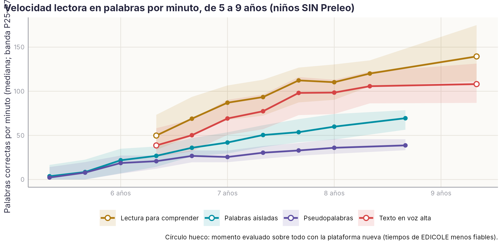
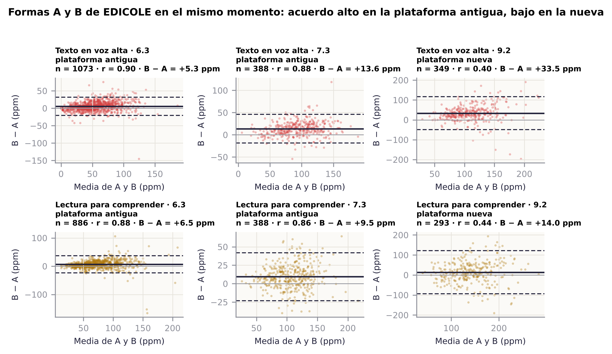
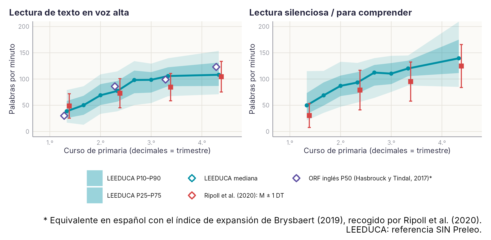
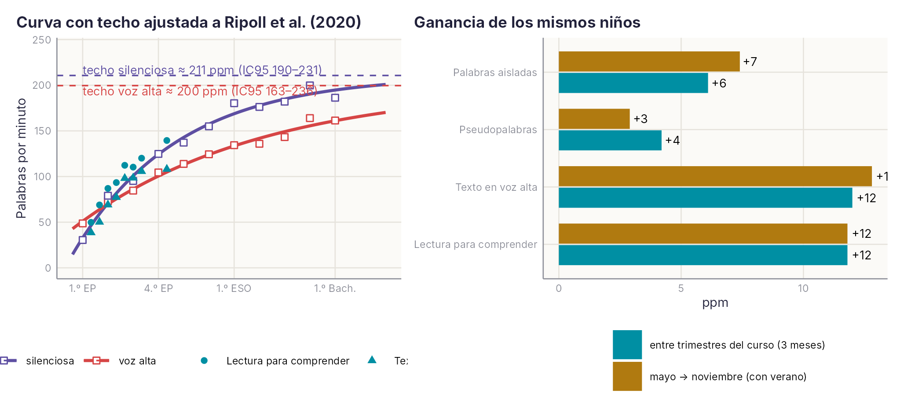
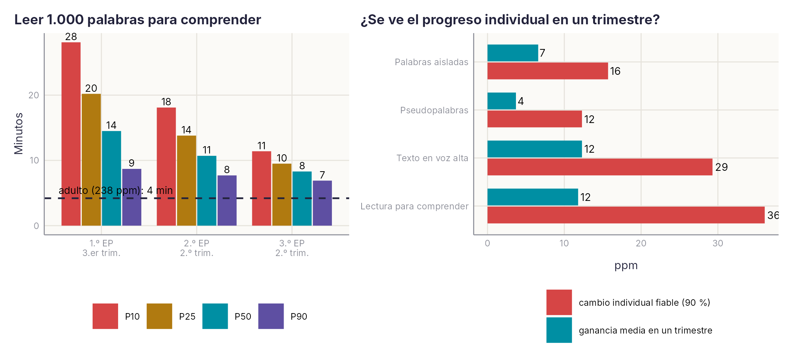
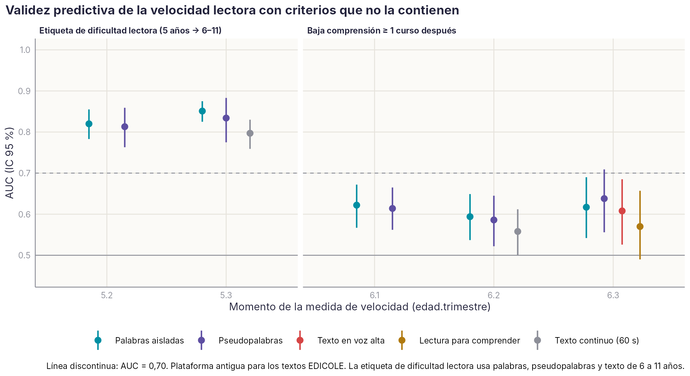

```{r}
#| include: false
source(file.path(dirname(knitr::current_input(dir = TRUE)), "..", "R", "libro.R"))
```

::: {.callout-note appearance="minimal"}
**Estado:** Ficha piloto. Borrador del 19/10/2026. Las cifras del texto proceden de los análisis del 19/10; las tablas completas del final se leen de `datos/agregados/VEL*` y se actualizan solas al regenerar los datos.
:::

**Palabras correctas por minuto (ppm)** es una unidad que entienden maestros y familias, y se puede calcular para todas las tareas de lectura de la plataforma. En las cohortes 2010–2015, la mediana del grupo SIN en texto en voz alta pasa de 50 ppm a finales de 1.º a unas 100 ppm a finales de 2.º. Con palabras aisladas, de 36 a 69 ppm entre finales de 1.º y de 3.º.

Tres advertencias antes de usarlo:

- **Plataforma nueva.** Los tiempos de EDICOLE en la plataforma nueva (desde 2018) son poco fiables: las formas A y B solo correlacionan .40–.50, frente a .86–.90 en la antigua.
- **Formas A y B.** No son equivalentes: la B da 5–14 ppm más.
- **Lectura y comprensión.** La velocidad y la comprensión de EDICOLE apenas se relacionan (ρ = .1–.3).

Es un borrador para probar la estructura de ficha con tareas muy usadas. Script: `scripts/velocidad_lectora.py`; salida: `velocidad_lectora_v1.xlsx`.

## 1. Medidas y cálculo de ppm

El número de palabras de cada texto se ha tomado del material de la actividad en el catálogo web.

| Medida | Códigos | Material | Cálculo de ppm | Momentos |
| --- | --- | --- | --- | --- |
| Palabras aisladas | 71 (5 años); 73 y 1931 | Lista de 12 bisílabas | aciertos × 60 / tiempo | 5.2–8.3 |
| Pseudopalabras | 72; 74 y 1934 | Lista de 12 bisílabas | aciertos × 60 / tiempo | 5.2–8.3 |
| Texto en voz alta (EDICOLE) | A: 2034, 10740, 4099 · B: 2035, 10737, 3979 | A: 68 palabras en 11 líneas · B: 62 en 9 | palabras × (líneas correctas / líneas) × 60 / tiempo | 6.2–11.2 |
| Lectura para comprender (EDICOLE) | A: 2044, 10741, 4098 · B: 2045, 10738, 3981 | Los mismos textos; el niño pulsa al terminar | palabras × 60 / tiempo | 6.1–11.2 |
| Texto continuo con límite de 60 s | 1090 | 157 palabras en 60 segmentos | segmentos × 157/60 × 60 / tiempo | 5.3, 6.2, 8.3 |

Comprensión: aciertos en las preguntas de EDICOLE (A: 2041, 10742, 4097; B: 2042, 10739, 3983).

Se excluyeron 2.200 registros con tiempo ausente, negativo o menor de 3 s, y 646 con velocidades imposibles: más de 250 ppm en listas o de 300 ppm en textos.

**Actualización del 19/10 (Juan Luis): las dos lecturas de EDICOLE tienen instrucciones distintas.** En la primera se pide leer rápido («texto en voz alta»). En la segunda se pide leer despacio para contestar preguntas («lectura para comprender»). Es el mismo texto: tiene el mismo número de palabras y de líneas en las dos medidas, tanto en la forma A como en la B. Esto cambia cómo se interpreta la lectura para comprender:

- **Es una relectura.** Sale 15–30 ppm más rápida aunque se pide ir despacio. Lo más probable es que pese la familiaridad con el texto (efecto de relectura), y quizá también que se lea en silencio.
- **No es comparable con la lectura silenciosa de los baremos publicados**, que es siempre una primera lectura (§ 4 bis).
- **La diferencia entre las dos lecturas es un experimento implícito.** Mide la ganancia por relectura y si el niño ajusta su velocidad a la tarea (E8, § 4 sexies).

Queda por confirmar si la segunda lectura es en silencio y si el niño ve las preguntas antes de leer.

## 1 bis. Muestra

Tabla completa por medida, momento y cohorte (con sesiones, colegios, % con ISE, % con edad y % de niñas) en `ficha_velocidad_indicadores_R_v1.xlsx`, hoja `1_Muestra`. Resumen:

| Medida | En los análisis | Aplicaciones | Niños | Cohortes | Momentos |
| --- | --- | --- | --- | --- | --- |
| Palabras aisladas | sí | 12.821 | 3.190 | 2010–2013 | 5.2 a 8.3 |
| Pseudopalabras | sí | 10.033 | 2.800 | 2010–2013 | 5.2 a 8.3 |
| Texto en voz alta | sí (plataforma antigua) | 4.282 | 1.750 | 2010, 2011 | 6.2 a 7.3 |
| Texto en voz alta | no (plataforma nueva) | 4.819 | 2.689 | 2010–2012, 2014, 2015 | 6.2 a 11.2 |
| Lectura para comprender | sí (plataforma antigua) | 4.190 | 1.719 | 2010, 2011 | 6.2 a 7.3 |
| Lectura para comprender | no (plataforma nueva) | 4.389 | 2.489 | 2010–2012, 2014, 2015 | 6.2 a 11.2 |
| Texto continuo (60 s) | sí | 2.929 | 2.512 | 2010–2013 | 5.3, 6.2, 8.3 |

Plataforma: antigua hasta el curso 2017/18, nueva desde 2018/19 (incluye la sesión 905 de la cohorte 2011). Los textos EDICOLE de la plataforma nueva se cuentan, pero no se analizan: sus tiempos no son fiables (§ 3).

**Límites de la muestra.**

- **Los textos EDICOLE fiables son de dos cohortes y de 6 a 7 años.** Desde 8 años solo hay datos de la plataforma nueva.
- **El grupo SIN depende de pocas cohortes.** La cohorte 2011 no tiene SIN, así que los baremos de texto salen solo de 2010 (unos 250 niños SIN por momento) y los de 7.3 y 8.x, de 110–165 niños.
- **Cobertura de variables.** El ISE está en el 91–100 % de los niños en la plataforma antigua (en 2014 y 2015, 0 %; en 2012 a 9.2, 44 %). La fecha de nacimiento está en el 96–100 %, salvo 10.2 y 11.2.

**Depuración** (hoja `0_Limpieza`):

| Motivo | Palabras | Pseudopalabras | Texto en voz alta | Lectura para comprender | Texto continuo |
| --- | --- | --- | --- | --- | --- |
| Tiempo ausente o menor de 3 s | 447 | 1.053 | 227 | 219 | 254 |
| Velocidad imposible (> 250 ppm en listas, > 300 en textos) | 0 | 0 | 157 | **483** | 6 |

La lectura para comprender pierde 483 casos por velocidad imposible (más de 300 ppm). Al ser una relectura, una parte puede ser lectura en diagonal de un texto que el niño ya conoce. En cualquier caso, no es una lectura completa. Es un indicador de validez de la respuesta que conviene registrar (§ 4 sexies, E4).

## 2. Crecimiento y baremo en palabras por minuto

La velocidad crece rápido en 1.º y 2.º y se frena en 3.º. Leer un texto con sentido es entre 1,4 y 2 veces más rápido que leer palabras sueltas, y estas son siempre más rápidas que las pseudopalabras.

{#fig-ficha-vel-f1-crecimiento-ppm-r}

Baremo del grupo SIN en ppm (momentos con N ≥ 100; tabla completa con P5–P95 en la hoja `1_Baremo_SIN_ppm`):

| Medida | Momento | N | P10 | P25 | P50 | P75 | P90 | Minutos para 1.000 palabras (P50) |
| --- | --- | --- | --- | --- | --- | --- | --- | --- |
| Palabras aisladas | 6.3 | 581 | 14 | 26 | 36 | 47 | 56 | 28 |
| Palabras aisladas | 7.2 | 245 | 25 | 37 | 50 | 62 | 74 | 20 |
| Palabras aisladas | 8.3 | 110 | 41 | 56 | 69 | 79 | 85 | 14 |
| Pseudopalabras | 6.3 | 579 | 12 | 20 | 27 | 33 | 39 | 37 |
| Pseudopalabras | 8.3 | 112 | 26 | 33 | 39 | 46 | 54 | 26 |
| Texto en voz alta | 6.3 | 572 | 13 | 32 | 50 | 68 | 86 | 20 |
| Texto en voz alta | 7.2 | 465 | 39 | 57 | 77 | 96 | 115 | 13 |
| Texto en voz alta | 8.2 | 140 | 67 | 86 | 106 | 122 | 140 | 9,5 |
| Lectura para comprender | 6.3 | 247 | 36 | 50 | 69 | 94 | 116 | 15 |
| Lectura para comprender | 7.2 | 464 | 55 | 72 | 93 | 113 | 131 | 11 |
| Lectura para comprender | 8.2 | 140 | 88 | 105 | 120 | 135 | 145 | 8,3 |

Los momentos de 9 a 11 años existen (N = 280–430), pero se han dejado fuera de la gráfica y de la tabla resumida porque proceden de la plataforma nueva (apartado 3).

## 3. Fiabilidad

**Formas A y B en el mismo momento.** Es un uso clásico del Bland-Altman: dos versiones del mismo test, aplicadas al mismo niño el mismo día.

{#fig-ficha-vel-f2-formas-ab}

- **En la plataforma antigua (6.3 y 7.3) las formas son fiables** (r = .86–.90), pero no equivalentes: la B da 5–14 ppm más. Hay dos explicaciones posibles: la B es más fácil, o el recuento por líneas no es igual (9 líneas largas frente a 11 cortas). Para el baremo, cada forma necesita su propia tabla o una ecuación de equiparación.
- **En la plataforma nueva (8.2–11.2) el acuerdo se hunde** (r = .40–.51) y los límites de acuerdo pasan de ±30 a ±100 ppm. El test-retest entre 7.2 y 8.2 en 2011 es r = .27, con una caída media de 50 ppm, que es imposible. Hay que revisar con el ingeniero qué cuenta el tiempo en esas versiones (10737, 10740, 10738 y 10741): si incluye las instrucciones, si se cronometra de otra forma o si se pulsa de forma distinta. Hasta entonces, esos momentos no deben baremarse.

**Test-retest entre trimestres consecutivos** (plataforma antigua, hoja `2_Test_retest`):

| Medida | r entre trimestres | Cambio mínimo fiable (90 %) |
| --- | --- | --- |
| Palabras aisladas | .72–.90 | 9–22 ppm |
| Pseudopalabras | .68–.84 | 10–17 ppm |
| Texto en voz alta | .73–.87 | 21–34 ppm |
| Lectura para comprender | .56–.84 | 29–46 ppm |

La lectura en voz alta es más estable que la lectura para comprender. Esta depende de cuándo pulsa el niño, y eso añade ruido.

**Actualización del 19/10.** El problema de tiempos no depende solo del prefijo 107. La sesión 905 (cohorte 2011, 8.2, curso 2019/20) usa los códigos antiguos 2034 y 2044 y también da tiempos anómalos (unas 50 ppm menos). Para filtrar hay que usar la sesión o el curso escolar, no solo el código. El baremo SIN no se ve afectado, porque 2011 no tiene grupo SIN.

## 4. Validez

Correlaciones de Spearman en el mismo momento, en la plataforma antigua (hoja `4_Validez_correlaciones`):

| Relación | ρ |
| --- | --- |
| Palabras ↔ pseudopalabras | .74–.95 |
| Palabras ↔ texto en voz alta | .75–.88 |
| Texto en voz alta ↔ lectura para comprender | .80–.92 |
| Velocidad ↔ comprensión de EDICOLE | .10–.30 |

Todas las medidas de velocidad miden lo mismo: decodificación rápida. La relación con la comprensión es baja, y en la plataforma nueva se vuelve nula o negativa. Hay dos razones probables:

- los textos de EDICOLE son cortos y fáciles, así que la comprensión tiene techo (mediana de 7 de 10 aciertos);
- en español, a partir de 2.º, la velocidad deja de limitar la comprensión en la mayoría de los niños.

Para el manual: la velocidad en ppm es un buen indicador de fluidez, pero no sustituye a una medida de comprensión.

Falta la validez predictiva, ppm a los 6 años frente a la dificultad lectora posterior. Tiene circularidad, porque la etiqueta de dificultad ya usa estas tareas. Hay que hacerla frente a la comprensión o al TECLE de cursos posteriores.

## 4 bis. Comparación con la literatura

Para comparar, todas las referencias se han pasado a palabras por minuto. Las fuentes son tres: el metaanálisis de Ripoll, Tapia y Aguado (2020) sobre alumnado hispanohablante, las normas de fluidez oral en inglés de Hasbrouck y Tindal (2017), y los baremos de velocidad de PROLEC-R (segundos para leer 40 palabras, convertidos a ppm). Script: `velocidad_contexto.py`; salida: `velocidad_contexto_v1.xlsx`.

{#fig-ficha-vel-f3-literatura-r}

| Curso | Ripoll, voz alta: M (±1 DT) | ORF inglés, P50\* | LEEDUCA, voz alta: P50 (P10–P90) | Ripoll, silenciosa: M | LEEDUCA, para comprender: P50 |
| --- | --- | --- | --- | --- | --- |
| 1.º EP | 49 (25–72) | 30 | 6.2: 39 (17–79) · 6.3: 50 (13–86) | 30 | 6.2: 50 · 6.3: 69 |
| 2.º EP | 73 (45–101) | 86 | 7.2: 77 (39–115) | 79 | 7.2: 93 |
| 3.º EP | 85 (59–111) | 99 | 8.2: 106 (67–140) | 95 | 8.2: 120 |
| 4.º EP | 104 (75–134) | 123 | 9.2: 108 (71–154) † | 125 | 9.2: 140 † |

\* Equivalente en español según Brysbaert (2019), tal como lo recoge Ripoll et al. (2020). † Plataforma nueva (cohorte 2012); provisional.

Qué se ve:

- **En voz alta, 1.º, 2.º y 4.º coinciden con el metaanálisis.** En 3.º somos unas 20 ppm más rápidos. Hay tres explicaciones que no se excluyen: el dato de 3.º sale de una sola cohorte (2010, N = 140); nuestro texto es corto (62–68 palabras) y sencillo; y nuestra ppm cuenta líneas correctas, no palabras correctas, y Ripoll encuentra que las medidas en palabras por minuto dan valores más altos que las de palabras correctas en 1.º–3.º.
- **La lectura para comprender es 15–25 ppm más rápida que la silenciosa del metaanálisis, pero la comparación no es válida.** Según Juan Luis, es la segunda lectura del mismo texto (§ 1), mientras que el metaanálisis recoge primeras lecturas. Además, allí solo hay 2–4 estudios por curso, y en nuestro dato el tiempo acaba cuando el niño pulsa. Para comparar con la literatura se usa el texto en voz alta (primera lectura).
- **PROLEC-R encaja con nuestras listas.** En 2.º, su categoría «lento» en lectura de palabras equivale a 26–33 ppm; en nuestro baremo de 7.2, el P10 es 25 y el P25 es 37. En pseudopalabras, su «lento» de 2.º equivale a 18–22 ppm, entre nuestro P10 (16) y P25 (24). Son tareas distintas (40 palabras de longitud variable frente a 12 bisílabas), pero la «lentitud» de PROLEC-R cae más o menos en nuestro P10–P20.
- **El original de EDICOLE es una prueba de lectura silenciosa** y de aplicación colectiva, según el material de la carpeta de pruebas. En la plataforma, el mismo texto se lee dos veces con instrucciones distintas (rápido y despacio para contestar). Queda confirmar con el ingeniero si la segunda lectura es en silencio.

Lo más relevante para publicar: Ripoll et al. (2020) señalan como «gran carencia» la escasez de datos de velocidad referidos a un trimestre concreto, y encuentran diferencias entre trimestres en 1.º y 2.º. LEEDUCA tiene tres mediciones por curso, con N de cientos por momento. Un baremo de ppm por trimestre de 1.º a 3.º cubre exactamente ese hueco.

## 4 ter. ¿Tiene techo la velocidad?

Hay dos preguntas distintas.

**Primera: ¿se aplana la velocidad con la edad?** Sí. Una curva exponencial con techo ajustada a las medias del metaanálisis (1.º EP a 1.º Bach.) da un techo de unas 200 ppm en voz alta (IC 95 %: 163–236) y de unas 211 ppm en silenciosa (190–231). Brysbaert (2019) sitúa al adulto en 183 ppm en voz alta y 238 en silenciosa. En voz alta, el límite lo pone en buena parte la velocidad del habla; en silenciosa, la curva sigue subiendo en la adolescencia. Nuestras medianas de 1.º a 3.º caen sobre el tramo empinado de la curva. Para estimar el techo con datos propios harían falta los momentos de 9–11 años, que hoy no son fiables (plataforma nueva).

{#fig-ficha-vel-f4-asintota-r}

Con los **mismos niños** medidos dos veces, la ganancia media en texto en voz alta es de 12 ppm por trimestre. De mayo a noviembre son 6 meses, con el verano en medio y unos dos meses y medio de clase, y la ganancia es casi la misma (13 ppm). El verano no hace perder velocidad, pero tampoco la hace crecer. Ojo: comparar medianas de momentos distintos daba un «verano plano» engañoso, porque mezclaba cohortes y bajas. Por eso la ganancia se calcula siempre con datos emparejados.

**Segunda: ¿rinde más el niño si se le mete prisa?** Es otra pregunta. Con más presión de tiempo se suele ganar velocidad y perder precisión. En lectores lentos de 2.º y 4.º, subir de unas 35 a unas 90 ppm no se acompañó de mejor comprensión (O'Connor, 2018, citado en Ripoll et al., 2020). Lo único que tenemos es un experimento natural débil: la tarea de letras 535 tenía límite de 60 s en la plataforma antigua y no en la nueva, y la eficiencia a la misma edad es parecida. Son cohortes distintas, así que no es una prueba. Si interesa, la plataforma permitiría un experimento limpio: el mismo texto con y sin cronómetro visible, asignado al azar dentro de cada aula.

## 4 quater. Coste en tiempo y progreso individual

{#fig-ficha-vel-f5-coste-tiempo-r}

| Lectura para comprender | P10 | P50 | P90 | Adulto (238 ppm) |
| --- | --- | --- | --- | --- |
| 1.º EP, 3.er trimestre: minutos para 1.000 palabras | 28 | 14 | 9 | 4 |
| 2.º EP, 2.º trimestre | 18 | 11 | 8 | 4 |
| 3.º EP, 2.º trimestre | 11 | 8 | 7 | 4 |
| Multiplicador frente al adulto, 2.º EP | ×4,3 | ×2,5 | ×1,8 | ×1 |

La frase para docentes y familias sale del multiplicador: **lo que a un adulto le cuesta 10 minutos de lectura, a un niño de 2.º en el percentil 10 le cuesta unos 43**, y a uno típico, unos 25. Es una cifra calculada con datos propios. Lo que falta es saber cuántas palabras lee un niño al día en clase. Se puede medir contando las palabras de los materiales de una semana en dos o tres aulas: es un dato propio sencillo y nuevo.

Los límites de esta cuenta: la velocidad se mide con textos cortos y fáciles; en textos largos aparece la fatiga, y comprender añade tiempo. Hay que presentarlo como estimación, no como diagnóstico.

**¿Se ve el progreso de un niño en un trimestre? Casi nunca.** En texto en voz alta, el niño típico gana 12 ppm por trimestre, pero hace falta un cambio de unas 29 ppm para distinguirlo del error de medida al 90 %. En palabras aisladas: 7 frente a 16. Es la cifra que pide más humildad en un informe. El progreso individual se ve a lo largo de un curso, no de un trimestre. De ahí salen tres decisiones para el informe:

- dar la tendencia con tres o más mediciones, no la diferencia entre dos;
- marcar como cambio solo lo que se aleja de la ganancia esperada más que el umbral;
- estudiar si promediar las formas A y B sube la fiabilidad lo bastante para acortar el plazo.

## 4 quinquies. Prototipo de informe de aula

Prototipo interactivo con 24 alumnos **simulados** a partir del baremo: [Informe de aula LEEDUCA](https://claude.ai/artifact/T3XUc3Jg9XgWHmnBe9cEeM). Tiene cinco partes:

- resumen del aula frente a la referencia;
- mapa de cada niño sobre los niveles del baremo, con su margen de error del 90 % (±22 ppm);
- tabla con el cambio desde noviembre, juzgado frente a la ganancia esperada y el umbral de cambio fiable;
- calculadora del tiempo diario de lectura por alumno, con la comparación con el adulto;
- ficha para la familia en lenguaje llano, con el bloque «Lo que este informe no dice».

Está pensado para enseñarlo a Juan Luis, Auxi, al ingeniero y a dos o tres docentes antes de programarlo en el servidor.

## 4 sexies. Indicadores psicométricos clásicos

Script `scripts/R/ficha_velocidad_indicadores.R`; salida `ficha_velocidad_indicadores_R_v1.xlsx`. Textos EDICOLE solo de la plataforma antigua.

### Descriptivos (grupo SIN, ppm)

| Medida | Momento | N | M | DT | Md | Asimetría | % lee 0 | % sin errores |
| --- | --- | --- | --- | --- | --- | --- | --- | --- |
| Palabras aisladas | 5.2 | 723 | 9,3 | 11,8 | 3,7 | 1,36 | **37** | 20 |
| Palabras aisladas | 5.3 | 707 | 13,2 | 14,5 | 8,5 | 1,11 | **29** | 29 |
| Palabras aisladas | 6.1 | 571 | 22,5 | 17,1 | 21,8 | 0,44 | 10 | 42 |
| Palabras aisladas | 6.3 | 581 | 35,8 | 15,6 | 35,9 | −0,33 | 3 | 51 |
| Palabras aisladas | 7.3 | 162 | 54,6 | 18,1 | 53,6 | −0,11 | 0 | **89** |
| Palabras aisladas | 8.3 | 110 | 66,8 | 17,6 | 69,4 | −0,37 | 0 | **94** |
| Pseudopalabras | 5.2 | 285 | 7,5 | 9,6 | 2,2 | 1,28 | **44** | 13 |
| Pseudopalabras | 6.3 | 579 | 25,9 | 10,8 | 26,7 | −0,29 | 3 | 21 |
| Pseudopalabras | 8.3 | 112 | 39,5 | 10,9 | 38,7 | 0,54 | 0 | 59 |
| Texto en voz alta | 6.3 | 251 | 54,5 | 28,2 | 52,8 | 0,69 | 2 | 0 |
| Texto en voz alta | 7.1 | 256 | 67,4 | 28,9 | 68,3 | −0,16 | 3 | 62 |
| Texto en voz alta | 7.3 | 156 | 95,0 | 32,0 | 98,1 | −0,15 | 0 | 2 |
| Lectura para comprender | 6.3 | 247 | 75,1 | 36,4 | 68,9 | 1,51 | 1 | — |
| Lectura para comprender | 7.3 | 153 | 106,8 | 29,9 | 112,3 | −0,19 | 0 | — |
| Texto continuo (60 s) | 5.3 | 299 | 16,8 | 15,1 | 13,0 | 0,90 | 22 | — |
| Texto continuo (60 s) | 6.2 | 554 | 35,4 | 20,0 | 34,4 | 0,86 | 3 | — |

Todos los momentos, con P10, P90 y curtosis, en la hoja `2_Descriptivos_SIN`. «% sin errores»: listas con los 12 ítems bien; texto en voz alta con todas las líneas bien.

- **Efecto suelo a los 5 años.** Entre un 29 y un 44 % no lee ninguna palabra o pseudopalabra. El p16 vale 0 y no se puede usar como corte; el corte útil es «lee 0 palabras» (ver validez).
- **Sin efecto techo en la velocidad**, pero sí en la exactitud desde los 7 años: el 89–94 % lee bien las 12 palabras. A partir de ahí, la lista discrimina solo por el tiempo. Es el argumento para expresar el resultado en ppm y no en aciertos.
- **El texto en voz alta cambia de un momento a otro en exactitud** (0 % sin errores a 6.3, 62 % a 7.1, 2 % a 7.3). Lo más probable es que se alterne la forma A o B, o el criterio de línea correcta. Está pendiente de comprobar (incidencia).

### Fiabilidad

Está en el § 3: test-retest entre trimestres con Bland-Altman y umbral de cambio fiable, y formas A y B de EDICOLE. Falta la consistencia interna: las listas tienen respuestas y tiempos ítem a ítem en la plataforma nueva (\_res, \_di), así que se pueden calcular α y ω (E5).

### Validez predictiva sin circularidad

**El problema.** La etiqueta de dificultad lectora (DL-A/B, cursos 6–11) se construye con palabras, pseudopalabras y velocidad de texto. Si una medida de 6 a 8 años «predice» esa etiqueta, en parte se predice a sí misma: los AUC salen de 0,85 a 0,95 (hoja `3_Validez_predictiva`, filas 3c) y no se deben presentar como validez predictiva. Se usan dos criterios que no contienen la medida:

- **3a.** Medida a los 5 años frente a la etiqueta de 6–11 años. Es la misma clase de tarea, pero medida antes y con datos que no entran en la etiqueta.
- **3b.** Medida a los 6 años frente a baja comprensión (≤ p25 SIN) al menos un curso después. La comprensión no forma parte de la etiqueta.

{#fig-ficha-vel-f6-validez-comprension-r}

| Criterio | Medida | Momento | n | Casos | AUC (IC 95 %) | Corte | Sens. | Esp. |
| --- | --- | --- | --- | --- | --- | --- | --- | --- |
| 3a etiqueta | Palabras aisladas | 5.2 | 514 | 70 | 0,82 (0,78–0,86) | lee 0 | 0,86 | 0,73 |
| 3a etiqueta | Palabras aisladas | 5.3 | 989 | 138 | **0,85** (0,83–0,88) | lee 0 | 0,74 | 0,82 |
| 3a etiqueta | Pseudopalabras | 5.3 | 197 | 25 | 0,83 (0,78–0,88) | lee 0 | 0,72 | 0,79 |
| 3a etiqueta | Texto continuo | 5.3 | 683 | 78 | 0,80 (0,76–0,83) | lee 0 | 0,78 | 0,72 |
| 3b comprensión | Palabras aisladas | 6.1 | 762 | 137 | 0,62 (0,57–0,67) | p16 / p25 | 0,26 / 0,42 | 0,88 / 0,77 |
| 3b comprensión | Pseudopalabras | 6.3 | 367 | 70 | 0,64 (0,56–0,71) | p16 / p25 | 0,33 / 0,47 | 0,84 / 0,73 |
| 3b comprensión | Texto en voz alta | 6.3 | 364 | 68 | 0,61 (0,53–0,69) | p16 / p25 | 0,37 / 0,46 | 0,82 / 0,74 |
| 3b comprensión | Lectura para comprender (velocidad) | 6.3 | 359 | 66 | 0,57 (0,49–0,66) | p16 / p25 | 0,32 / 0,39 | 0,88 / 0,78 |

Cómo leerla:

- **A los 5 años, la velocidad en listas predice muy bien la dificultad lectora posterior** (AUC 0,80–0,85). Un corte sencillo y comprensible para un docente («no lee ninguna palabra en el 3.er trimestre de 3.º de infantil») detecta a 3 de cada 4 niños con dificultad, con un 18 % de falsos positivos.
- **La velocidad a los 6 años predice poco la comprensión posterior** (AUC 0,56–0,64). Es esperable: la comprensión depende también del lenguaje oral (visión simple de la lectura). Además, el criterio de comprensión es una puntuación de pocas preguntas y poco fiable, lo que rebaja el AUC. Es un límite inferior.
- **Para revisores:** el AUC frente a la etiqueta a partir de 6 años se presenta solo como acuerdo con el criterio, nunca como predicción.

### Variables que influyen

Resumen de todos los momentos (d de Cohen en unidades SIN; colegio = CCI). Detalle en `4a_Efectos_detalle`.

| Medida | ISE (d alto − bajo) | Edad relativa (d ene–jun − jul–dic) | Sexo (d niña − niño) | Preleo (d CON − SIN) | Colegio (CCI) |
| --- | --- | --- | --- | --- | --- |
| Palabras aisladas | **0,22 a 0,50** (Md 0,35) | 0,03 a 0,27 | −0,17 a −0,03 | −0,17 a 0,10 | 0,10–0,16 |
| Pseudopalabras | 0,09 a 0,48 (Md 0,34) | 0,03 a 0,26 | −0,20 a 0,00 | −0,21 a 0,12 | 0,08–0,16 |
| Texto en voz alta | **0,32 a 0,53** (Md 0,42) | 0,07 a 0,29 | −0,05 a 0,00 | −0,11 a 0,16 | 0,09–0,16 |
| Lectura para comprender | 0,14 a 0,53 (Md 0,45) | 0,12 a 0,30 | −0,08 a −0,02 | −0,04 a 0,22 | 0,05–0,17 |
| Texto continuo (60 s) | 0,25 a 0,44 | 0,09 a 0,28 | −0,08 a 0,01 | −0,17 a 0,13 | 0,08–0,20 |

- **El ISE pesa más en la velocidad que en letras o RAN** (d ≈ 0,35–0,45 frente a ≈ 0,2). Es significativo en casi todos los momentos. Tiene sentido: la fluidez depende de cuánto se lee, y eso varía con el entorno.
- **La edad relativa pesa menos que en letras** y se diluye con los años.
- **Preleo no cambia la velocidad** en ningún momento de forma consistente.
- **Sexo: resultado a revisar.** Las niñas salen algo más lentas en las listas (d ≈ −0,10; p < .05 en 7 de 20 momentos). Va en contra de lo habitual en español, donde las niñas igualan o superan a los niños. Antes de interpretarlo, hay que volver a comprobar la codificación del sexo en la lista maestra (H/M) frente a Base\_4\_anios (V/H/M), donde H significa cosas distintas (incidencia).

### Predicción diferencial (criterio 3b)

Primera medida a 6–7 años frente a baja comprensión posterior. Cohorte 2010.

| Medida | Variable | Grupo | n | % baja comprensión | Id. con velocidad media | AUC | p intercepto | p pendiente |
| --- | --- | --- | --- | --- | --- | --- | --- | --- |
| Texto en voz alta | Sexo | Niña / niño | 159 / 205 | 26 / 13 | 23 / 10 | 0,63 / 0,59 | **.001** | .35 |
| Texto en voz alta | ISE | Bajo / medio / alto | 128 / 107 / 129 | 24 / 18 / 14 | 18 / 16 / 13 | 0,65 / 0,55 / 0,55 | .34 | .54 |
| Palabras aisladas | Sexo | Niña / niño | 353 / 434 | 24 / 13 | 22 / 12 | 0,64 / 0,61 | **< .001** | .57 |
| Palabras aisladas | ISE | Bajo / medio / alto | 234 / 218 / 335 | 22 / 18 / 15 | 17 / 19 / 15 | **0,74** / 0,55 / 0,55 | .28 | **.003** |

- **Sexo:** con la misma velocidad, a las «niñas» se les marca con baja comprensión el doble de veces. Es el mismo resultado inesperado de arriba y refuerza la sospecha sobre la codificación. **No se interpreta hasta comprobarla.**
- **ISE:** no hay sesgo de intercepto. La lista de palabras predice mejor en ISE bajo (AUC 0,74 frente a 0,55; p = .003): donde se lee menos, la velocidad dice más del niño. Pide confirmarlo en otra cohorte.

### Innovaciones frente a la ficha clásica (mapa para revisores)

| Lo que pide un revisor (Standards, 2014) | Dónde está | Lo que añadimos |
| --- | --- | --- |
| Muestra y depuración | § 1 bis | Plataforma, sesiones, cobertura de ISE y edad; las velocidades imposibles como indicador de validez de la respuesta |
| Descriptivos, suelo y techo | § 4 sexies | Techo en exactitud y no en velocidad: justifica la ppm |
| Fiabilidad | § 3 | Bland-Altman y umbral de cambio fiable en ppm (§ 4 quater) |
| Validez concurrente | § 4 | Comparación con Ripoll et al. (2020), ORF y PROLEC-R en la misma unidad (§ 4 bis) |
| Validez predictiva | § 4 sexies | Criterios no circulares; corte «lee 0» para el suelo |
| Equidad (sesgo) | § 4 sexies | Predicción diferencial por sexo e ISE |
| Baremos | § 2 | Trimestre frente a curso (análisis general); curva con techo (§ 4 ter) |
| Utilidad | § 4 quater y quinquies | Minutos por 1.000 palabras; informe de aula |

### Estudios que abre

| # | Estudio | Tipo | Qué hay ya |
| --- | --- | --- | --- |
| E1 | ¿Qué añade la velocidad a 6 años sobre la exactitud para predecir la comprensión? Fluidez como puente entre decodificación y comprensión | Teórico | Listas, textos y comprensión en los mismos niños (2010, 2011) |
| E2 | Curva de crecimiento individual (modelos mixtos) y efecto del verano | Metodológico | Ganancias emparejadas (§ 4 ter) |
| E3 | ISE y fluidez: ¿efecto de la práctica lectora? ¿Predice mejor la velocidad en ISE bajo? | Prueba de hipótesis | Efectos y predicción diferencial de esta ficha |
| E4 | Lectura «demasiado rápida» en la lectura para comprender como señal de que el niño no lee el texto (483 casos) | Experimento implícito | Tiempos y aciertos de comprensión |
| E5 | α/ω y curva de tiempos ítem a ítem de las listas | Metodológico | Datos \_res y \_di de la plataforma nueva |
| E6 | Equiparar las formas A y B de EDICOLE y recuperar los tiempos de la plataforma nueva | Metodológico | § 3; pregunta al ingeniero |
| E7 | Palabras frente a pseudopalabras: ruta léxica y subléxica en una lengua transparente | Teórico | Las dos listas en los mismos niños de 5 a 8 años |
| E8 | Relectura e instrucción: ganancia de velocidad de la primera lectura («rápido») a la segunda («despacio para comprender») del mismo texto. ¿Quién ajusta la velocidad a la tarea? ¿Predice esa capacidad la comprensión? | Experimento implícito | Las dos lecturas, con sus tiempos y aciertos de comprensión, en los mismos niños (2010, 2011) |

## 5. Uso en el aula y en el informe; pendientes

**En el informe del servidor**, el resultado puede darse así: «Lee 45 palabras por minuto en voz alta; la mitad de su curso lee 77 o más (percentil 15)». Tiene la misma lógica que el ejercicio de clase sobre funciones ejecutivas: con la velocidad de cada alumno se estima cuánto tardará en leer un texto. La columna «minutos para 1.000 palabras» lo hace directamente. Por ejemplo, un texto de 300 palabras lleva unos 4 minutos a un niño típico de 2.º y más del doble a uno en P10.

**Pendientes:**

- [ ] Confirmar con el ingeniero cómo se mide el tiempo de EDICOLE en la plataforma nueva (10737–10741).
- [ ] Confirmar con el ingeniero el procedimiento de la segunda lectura de EDICOLE: ya se sabe que es el mismo texto con instrucción de leer despacio (Juan Luis, 19/10). Falta saber si es en silencio y si el niño ve las preguntas antes. También el recuento de la lectura en voz alta: líneas correctas o palabras.
- [ ] Equiparar las formas A y B, o dar un baremo por forma.
- [ ] Pasar el baremo a edad en meses e incluir el ISE, como en la ficha de letras.
- [ ] Validez predictiva frente a comprensión y TECLE de cursos posteriores.
- [x] ~~Comparar con valores publicados de velocidad lectora en español~~ (hecho: apartado 4 bis). Falta añadir Cuetos et al. (PROLEC-R, edición original) y las referencias que Pedro encontró en línea.
- [ ] Contar las palabras que se leen al día en dos o tres aulas (materiales de una semana), para la calculadora de tiempo.
- [ ] Revisar el prototipo de informe de aula con docentes y con el ingeniero.
- [ ] Valorar el experimento con y sin cronómetro visible.

## Tablas completas {.unnumbered}

Todas las tablas agregadas de esta ficha, tal como salen de los scripts de análisis. Pulsa en cada una para desplegarla.

```{r}
#| results: asis
tablas_completas("VEL")
tablas_completas("VEL_contexto")
tablas_completas("VEL_indicadores")
```
