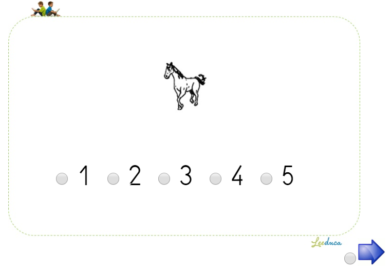
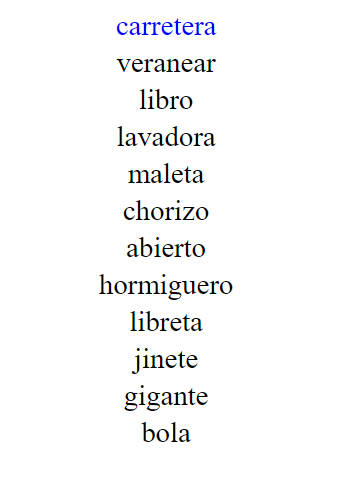

# The LEEDUCA platform {#sec-plataforma}

```{r}
#| include: false
source(file.path(dirname(knitr::current_input(dir = TRUE)), "R", "libro.R"))
dir_cat <- file.path(raiz_libro(), "datos", "agregados", "CATALOGO")
C <- utils::read.csv(file.path(dir_cat, "Catalogo.csv"), encoding = "UTF-8", check.names = FALSE, stringsAsFactors = FALSE)
S <- utils::read.csv(file.path(dir_cat, "Sesiones.csv"), encoding = "UTF-8", check.names = FALSE, stringsAsFactors = FALSE, colClasses = "character")
P <- plataforma_actividades()
n_eval <- sum(C$estado == "evaluación")
tc <- table(factor(C$clase, levels = c("A", "B", "C")))
n_evaluador <- if (nrow(P)) sum(grepl("evaluador", P$respuesta, ignore.case = TRUE)) else NA
n_nino <- if (nrow(P)) sum(grepl("niño", P$respuesta, ignore.case = TRUE)) else NA
```

::: {.callout-note appearance="minimal"}
**Status:** first draft (November 2, 2026) of chapter 3 of the manual. It brings together material previously spread across the data extraction guide, the task catalog, the reading of the activities on the platform and the draft of Technical Manual 8. Sections marked **Pending** need data or confirmation from the team. *Translated from the Spanish version of November 27, 2026.*
:::

**In one sentence.** LEEDUCA is a web platform of the University of Málaga that presents the tasks on the school's computer, records responses and response times, and organizes the assessment of children aged 3 to 11 in short sessions, three times per school year, to follow reading development and identify early those who fall behind.

## Chapter map

| Section | What it answers | Status |
|---|---|---|
| What it was designed for · Where it comes from | Design principles and history, from DIS-ESP to the current platform | Draft; dates of the platform change missing |
| How it is administered | Who administers, how it is scored and how long it takes | Draft: individual administration with an examiner in 50 of the 63 activities reviewed |
| How it is organized · What it records | Activities, sessions, records, item-level accuracy and times | Draft |
| What it assesses · Sessions and cohorts | Tasks by domain and class; time points with data by cohort | Tables computed from the catalog |
| Versions and formats | Paper, tablet, age 3, Catalan and Valencian | Draft; equivalence studied only for TECLE |
| Data quality | Known issues and how they are handled | List of issues and inconsistency checks |

The analyses behind these sections are in the group's internal workspace (restricted access).

## What it was designed for

The platform answers a practical problem: assessing **all** children in a school, several times per school year, with the resources the school already has. Its design principles, set out in earlier drafts of the manual, are four:

1. **Continuous assessment.** Three assessments per school year, in late November, mid-February and late May, to see whether instruction is working and whether each child is progressing like their peers.
2. **Short sessions.** Each session lasts 15 minutes at most. Tasks are therefore brief and target a specific skill, which changes from one session to the next: for example, counting syllables in November and matching final syllables in February.
3. **Increasing difficulty.** Tasks are ordered by difficulty within and across school years, to avoid ceiling effects and to discriminate among children near the mean, not only those with a clear delay.
4. **Simple administration.** Stimulus presentation, recording and scoring are done by the platform. This reduces differences between examiners and allows school staff to administer the assessment after brief training.

Besides assessment, the platform hosts the group's **intervention programs**: Preleo (universal, intensification and review) for preschool, and Leetrea, for reading at ages 6 to 8, whose screening is made up of the tasks for ages 6 to 11. This manual deals mainly with assessment; intervention appears where it affects the interpretation of scores (see [The Preleo program](preleo/programa.en.qmd) and [The Leetrea program](preleo/leetrea.en.qmd)).

## Where it comes from

| Stage | Years | What changes |
|---|---|---|
| **DIS-ESP on paper** | 2007–2012 | Carrillo and Alegría's battery, with 11 scales, administered on paper in Málaga. Group screening with TECLE and individual assessment of the phonological and orthographic routes [@carrillo2011prevalencia]. |
| **Old platform** | until 2017 | First cohorts (2010–2012). Adds the precursors from age 4 and the three assessments per school year. Records accuracy, errors, time and efficiency per task. |
| **New platform** | from 2017/18 | Also records the response and the time of **each item**. This is what makes it possible to compute α, ω and item response models. |
| **Pandemic** | 2020–2022 | Some assessments are done on paper or with tablets, sometimes in groups and without an external examiner (see [Validity against the Woodcock-Muñoz battery](criterio-woodcock.en.qmd)). |
| **Age 3 and new versions** | from 2023/24 | Own battery for age 3, Catalan and Valencian versions, and use in schools in other Spanish regions and in Colombia. |

**Pending:** exact dates of the platform change and of the versions, known to the platform's engineering team.

## How it is administered

**Who assesses.** Specialists at each school (speech and language teachers, speech-language therapists) and student trainees, after brief training. Before starting, meetings are held with speech and language teachers and preschool teachers to explain the aims, requirements and procedures.

**Whom.** All children enrolled in the participating school years, including those with difficulties or who are learning Spanish. To compute task properties and norms, those cases are excluded afterwards (**pending:** document the exclusion criteria in chapter 4).

**How.** In most tasks administration is **individual**: the child sits with the examiner in front of the computer, the platform presents the stimulus and the examiner marks with the mouse whether the response is correct. Of the `r nrow(P)` activities whose configuration has been reviewed on the platform, the examiner responds in `r n_evaluador` and the child in `r n_nino`. There are three exceptions worth distinguishing when interpreting the data:

- **Self-administered tasks**, in which the child responds with the mouse (for example, the numerical cognition tasks of 2021/22).
- **Group tasks**, such as screening with TECLE or decoding and vocabulary in a multiple-choice format, answered by a whole group at once.
- **Recorded stimuli**, which the child hears through headphones (phoneme and syllable deletion, verbal memory). This way everyone hears the stimulus in the same way, regardless of the examiner's voice.

## How it is organized

The platform is built on three elements:

- **Activity.** A specific task with its items, instructions and configuration. Each one has a numeric code (e.g., 1931 = reading of two-syllable words). There are more than 12,000 activities, most of them for intervention.
- **Session.** A list of activities administered together. In assessments, each session is a battery for one age and term of a specific school year, with a three-digit code (e.g., 184 = battery for age 7, first term of 2017/18). There are 86 assessment sessions with content, using 464 different activities.
- **Record.** Each time a child completes an activity, a row with their results is saved. This is what is downloaded for analysis.

In this manual each activity is assigned to a **canonical task**: the same task even if its code changes between cohorts or it has several forms. The master dictionary stores this equivalence, and the [Task catalog](catalogo.en.qmd) shows it task by task.

### Task types

Activities are built with a small number of presentation **engines**. The engine determines what the child sees, who responds and what can be measured:

| Engine | What it does | Examples |
|---|---|---|
| Pictures | Shows a picture; the examiner marks correct or incorrect, or the child chooses between buttons | Counting syllables, initial syllable deletion |
| Reading | A written stimulus on screen, with time per item or in total | Letters, syllables, rhyme judgment |
| List | A vertical list that the child reads aloud; the current word is highlighted | Words and pseudowords |
| Rapid naming | Pictures, colors or digits that the child names as fast as possible, one by one or on a card | RAN of colors, objects and digits |
| Decision | The examiner marks yes or no, or correct or incorrect, for a stimulus | Phoneme identification, phoneme blending |
| Sound | Recorded stimuli that the child hears through headphones | Phoneme deletion, verbal memory |
| Choice | The child chooses among options, with or without a time limit | Orthographic decision, comprehension, magnitudes |
| Group | Choice among options, administered to a group at once | Decoding and vocabulary screening |

::: {layout-ncol=3}
{.lightbox}

{.lightbox}

{.lightbox}
:::

*Screen formats (2018 screenshots). Each task sheet includes 2026 screenshots of the activity itself. The platform's interface is in Spanish.*

### What it records

| | Old platform (until 2017) | New platform (from 2017/18) |
|---|---|---|
| **Per task** | Correct responses, errors, total time and efficiency | Correct responses, errors, total time and speed |
| **Per item** | No | Response (correct or incorrect) and time for each item |
| **Other** | — | Date and time, session, term, number of words in text tasks |

Item-level data are what make possible what this manual adds to the previous ones: internal consistency with ω, item response models, session validity indicators and response time models (see [How each task sheet is built](metodo.en.qmd)).

With these measures, each task is summarized in a **main measure** according to its family: correct responses in accuracy tasks, stimuli per second in rapid naming, words per minute in reading fluency, and so on. In the manual all of them are presented so that **higher is better** (see [How tasks are grouped](https://abarejo.github.io/leeduca-manual/agrupacion.html#sec-familias) (*in Spanish*)).

## What it assesses

The catalog contains `r nrow(C)` canonical tasks from the 2010–2015 cohorts (`r n_eval` assessment tasks; the rest are experimental or under review). At present, `r tc[["A"]]` are class A (enough reliability and sample size for a full task sheet and norms), `r tc[["B"]]` class B and `r tc[["C"]]` class C (see [Limitations and data quality](limites.en.qmd#sec-clases)).

```{r}
#| label: tbl-plataforma-dominios
#| tbl-cap: "Catalog tasks by domain and quality class."
DOM <- c(HFON = "Phonological skills", LECTURA = "Reading", L_ORAL = "Oral language", ESCRITURA = "Spelling and writing", MATE = "Numerical cognition",
         HVIS = "Visual-attentional skills", F_EJEC = "Executive functions", INTELIGENCIA = "Nonverbal reasoning", EXPERIMENTO = "Experimental tasks")
T <- as.data.frame.matrix(table(factor(C$dominio, levels = names(DOM)), factor(C$clase, levels = c("A", "B", "C"))))
T <- data.frame(Domain = DOM[rownames(T)], T, Total = rowSums(T), check.names = FALSE)
T <- T[T$Total > 0, ]
names(T)[2:4] <- paste("Class", names(T)[2:4])
rownames(T) <- NULL
tabla(T)
```

Batteries change with age. At ages 4 and 5 the **precursors** predominate (letter knowledge, phonological awareness, rapid naming, verbal memory and oral language); from age 6, **reading** of syllables, words, pseudowords and texts, fluency and comprehension. The composition of each battery by age is in [How tasks are grouped](https://abarejo.github.io/leeduca-manual/agrupacion.html) (*in Spanish*) and, with a proposed minimum core, in [Tasks by age](https://abarejo.github.io/leeduca-manual/fichas/por_edad.html) (*in Spanish*).

## Sessions and cohorts

Each cohort (year of birth) is assessed with the batteries for its age and term. The **time point** is written age.term: 5.1 is the first term of the final year of preschool and 7.2 the second term of Grade 2.

```{r}
#| label: tbl-plataforma-cohortes
#| tbl-cap: "Time points with data in the catalog by cohort (2010–2015 cohorts)."
S$N <- as.numeric(S$N)
co <- sort(unique(S$cohorte))
T <- do.call(rbind, lapply(co, function(k) {
  s <- S[S$cohorte == k, ]
  m <- sort(unique(s$momento)); m <- m[order(as.numeric(m))]
  data.frame(Cohort = k, Sessions = length(unique(s$sesion)), Tasks = length(unique(s$tarea_canonica)),
             `Time points` = paste(m, collapse = ", "), `Maximum N in one session` = format(max(s$N, na.rm = TRUE), big.mark = ","), check.names = FALSE)
}))
tabla(T)
```

Not all cohorts have the same time points: the first ones start at age 5, the 2014 and 2015 cohorts lose time points because of the pandemic, and some sessions in the cohort files are incomplete. That is why norms are computed by task and time point with all the cohorts that have that time point, taking as reference the children from schools without Preleo (see [Norms by school year or by term](baremos-trimestre.en.qmd)).

The number of children and schools by cohort and time point and the [sample flow diagram](estudio-normativo.en.qmd#sec-flujo-muestra) are in chapter 4 (Normative study).

## Versions and formats

| Version | What it is | Status in the manual |
|---|---|---|
| **Paper** | DIS-ESP (2007–2012) and TECLE on paper in 2020/21 | TECLE: paper–platform equivalence already studied (see [TECLE](fichas/TECLE.en.qmd)). DIS-ESP: own chapter ([The DIS-ESP battery](https://abarejo.github.io/leeduca-manual/dis-esp.html) (*in Spanish*)) |
| **Tablet** | 2021/22 sessions (e.g., 948), group-administered: lexical decision, homographs, mathematics | Treated as tasks distinct from reading aloud |
| **Age 3** | Own battery since 2023/24 (sessions 988–992) | Inventory in [Battery for age 3](https://abarejo.github.io/leeduca-manual/fichas/TRES_ANIOS.html) (*in Spanish*); no norms yet |
| **Catalan and Valencian** | The same tasks, in schools in the Balearic Islands and the Valencian Community | Need their own norms |
| **Colombia** | Clinical and school use; TECLE with 3 minutes instead of 5 | Pending: task sheet or appendix |
| **Adults** | Battery for university students and adults | Outside the scope of this version |

The current server data (since October 2023) already include more than 6,500 users from about 360 schools, in and outside Málaga. They will be used to enlarge the samples and to build norms for the new versions.

## The DIS-ESP battery

DIS-ESP is the direct antecedent of the platform: many LEEDUCA tasks come from it and keep their project code on the platform. The catalog has `r sum(grepl("DIS-ESP", C$bateria))` DIS-ESP tasks, `r sum(C$bateria == "LEEDUCA y DIS-ESP", na.rm = TRUE)` of them shared with LEEDUCA. Among the DIS-ESP tasks are TECLE, rapid naming of objects on a card and several reading and spelling tasks.

The tests, their rationale, the two-stage procedure and which of them moved to the platform are described in the chapter [The DIS-ESP battery](https://abarejo.github.io/leeduca-manual/dis-esp.html) (*in Spanish*) (November 8, 2026). **Pending** (with Marisol Carrillo): what changed in each test when it moved to the platform, and the paper norms that are still available.

## Data quality: what you need to know

The platform changed format several times, and the data for each cohort were exported and processed at different times. Before using a task, its known issues must be checked. The main ones detected so far are:

- **Times in a different unit**: ×1000 in the old platform (2011 and 2012 cohorts) and in one later session (letters in session 907 of 2014).
- **Times recorded as zero** for some children in some sessions, especially in rapid naming.
- **Columns copied by mistake** in two 2010 sessions (184 and 189) and **incomplete sessions** in the cohort files.
- **A wrong answer key** in TECLE (five items), still present in the current version of the platform.
- **Misassigned tasks**: the 2021/22 group lexical decision task was confused with list reading.

All of them are listed in the issues sheet of the master dictionary, and each task sheet records its own. The criteria for classifying tasks by the quality of their data are in [Limitations and data quality](limites.en.qmd).
