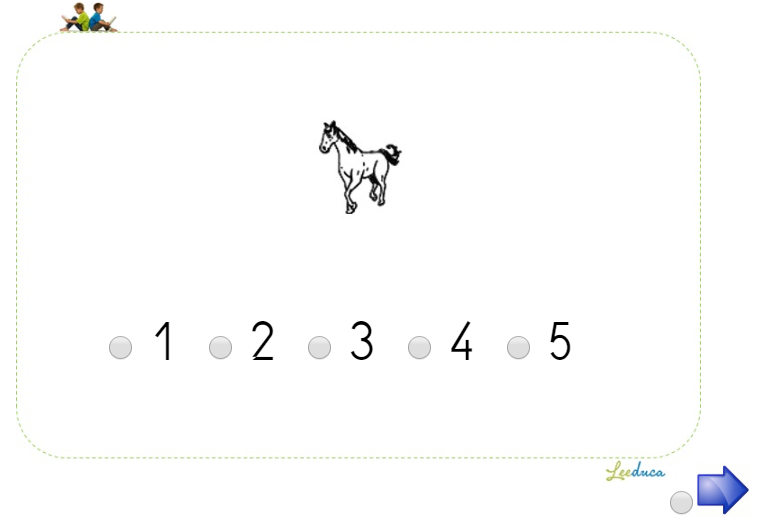
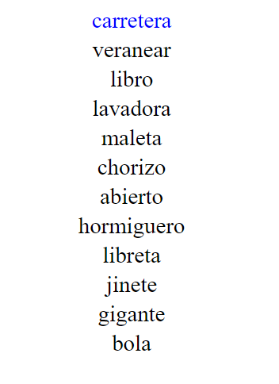

# La plataforma LEEDUCA {#sec-plataforma}

```{r}
#| include: false
source(file.path(dirname(knitr::current_input(dir = TRUE)), "R", "libro.R"))
dir_cat <- file.path(raiz_libro(), "datos", "agregados", "CATALOGO")
C <- utils::read.csv(file.path(dir_cat, "Catalogo.csv"), encoding = "UTF-8", check.names = FALSE, stringsAsFactors = FALSE)
S <- utils::read.csv(file.path(dir_cat, "Sesiones.csv"), encoding = "UTF-8", check.names = FALSE, stringsAsFactors = FALSE, colClasses = "character")
P <- plataforma_actividades()
n_eval <- sum(C$estado == "evaluación")
tc <- table(factor(C$clase, levels = c("A", "B", "C")))
n_evaluador <- if (nrow(P)) sum(grepl("evaluador", P$respuesta, ignore.case = TRUE)) else NA
n_nino <- if (nrow(P)) sum(grepl("niño", P$respuesta, ignore.case = TRUE)) else NA
```

::: {.callout-note appearance="minimal"}
**Estado:** primer borrador (02/11/2026) del capítulo 3 del manual, para revisar en la reunión del grupo. Reúne lo que ya estaba repartido en la guía de extracción de datos, el catálogo de tareas, la lectura de las actividades en la plataforma y el borrador del Manual técnico 8. Los apartados marcados **Pendiente** necesitan datos o confirmación del equipo; las preguntas abiertas están al final.
:::

**En una frase.** LEEDUCA es una plataforma web de la Universidad de Málaga que presenta las tareas en el ordenador del colegio, registra las respuestas y los tiempos, y organiza la evaluación del alumnado de 3 a 11 años en sesiones cortas, tres veces por curso, para seguir el aprendizaje de la lectura y detectar pronto a quien se queda atrás.

## Para qué se diseñó

La plataforma responde a un problema práctico: evaluar a **todo** el alumnado de un centro, varias veces por curso, con los recursos que el centro ya tiene. Sus principios de diseño, recogidos en los borradores anteriores del manual, son cuatro:

1. **Evaluación continua.** Tres evaluaciones por curso, a finales de noviembre, a mediados de febrero y a finales de mayo, para ver si la instrucción funciona y si cada niño progresa como sus compañeros.
2. **Sesiones cortas.** Cada sesión dura 15 minutos como máximo. Por eso las tareas son breves y apuntan a una habilidad concreta, que cambia de una sesión a otra: por ejemplo, contar sílabas en noviembre y emparejar sílabas finales en febrero.
3. **Dificultad creciente.** Las tareas se ordenan por dificultad dentro del curso y entre cursos, para evitar el efecto techo y distinguir también a los niños que están cerca de la media, no solo a los que tienen un retraso claro.
4. **Aplicación sencilla.** La presentación de los estímulos, el registro y la corrección los hace la plataforma. Así se reducen las diferencias entre evaluadores y la evaluación la puede hacer personal del centro con una formación breve.

Además de evaluar, la plataforma aloja los **programas de intervención** del grupo: Preleo (universal, intensificación, repaso) y Leetrea. Este manual trata solo la parte de evaluación; la intervención aparece cuando afecta a la interpretación de las puntuaciones (ver [El programa Preleo](preleo/programa.qmd)).

## De dónde viene

| Etapa | Años | Qué cambia |
|---|---|---|
| **DIS-ESP en papel** | 2007–2012 | Batería de Carrillo y Alegría, con 11 escalas, aplicada en papel en Málaga. Cribado colectivo con TECLE y evaluación individual de las rutas fonológica y ortográfica [@carrillo2011prevalencia]. |
| **Plataforma antigua** | hasta 2017 | Primeras cohortes (2010–2012). Añade los precursores desde los 4 años y las tres evaluaciones por curso. Registra aciertos, errores, tiempo y eficiencia por tarea. |
| **Plataforma nueva** | desde 2017/18 | Registra además la respuesta y el tiempo de **cada ítem**. Es la que permite calcular α, ω y modelos de ítems. |
| **Pandemia** | 2020–2022 | Parte de las evaluaciones se hacen en papel o con tabletas, a veces de forma colectiva y sin evaluador externo (ver [Validez frente a la batería Woodcock-Muñoz](criterio-woodcock.qmd)). |
| **3 años y nuevas versiones** | desde 2023/24 | Batería propia de 3 años, versiones en catalán y valenciano y uso en centros de otras comunidades y de Colombia. |

**Pendiente:** fechas exactas del cambio de plataforma y de las versiones, que conoce el equipo de ingeniería de la plataforma.

## Cómo se aplica

**Quién evalúa.** Los especialistas de cada centro (maestros de Audición y Lenguaje, logopedas) y estudiantes en prácticas, tras una formación breve. Antes de empezar se hacen reuniones con el profesorado de Audición y Lenguaje y de Infantil para explicar los objetivos, los requisitos y los procedimientos.

**A quién.** A todo el alumnado matriculado en los cursos participantes, también al que tiene dificultades o está aprendiendo español. Para calcular las propiedades de las tareas y los baremos, esos casos se excluyen después (**pendiente:** documentar los criterios de exclusión en el capítulo 4).

**Cómo.** En la mayoría de las tareas la aplicación es **individual**: el niño se sienta con el evaluador frente al ordenador, la plataforma presenta el estímulo y el evaluador marca con el ratón si la respuesta es correcta. De las `r nrow(P)` actividades cuya configuración se ha leído en la plataforma, en `r n_evaluador` responde el evaluador y en `r n_nino` el propio niño. Hay tres excepciones que conviene distinguir al interpretar los datos:

- **Tareas autoaplicadas**, en las que el niño responde con el ratón (por ejemplo, las de cognición numérica de 2021/22).
- **Tareas colectivas**, como el cribado con TECLE o la decodificación y el vocabulario en formato de elección, que responde un grupo a la vez.
- **Estímulos grabados**, que el niño escucha con auriculares (supresión de fonemas y sílabas, memoria verbal). Así todos oyen el estímulo igual, sin depender de la voz del evaluador.

## Cómo está organizada

La plataforma se basa en tres elementos:

- **Actividad.** Una tarea concreta con sus ítems, instrucciones y configuración. Cada una tiene un código numérico (p. ej., 1931 = lectura de palabras bisílabas). Hay más de 12.000 actividades, la mayoría de intervención.
- **Sesión.** Una lista de actividades que se aplican juntas. En las evaluaciones, cada sesión es una batería de una edad y un trimestre de un curso escolar concreto, con un código de tres cifras (p. ej., 184 = batería de 7 años, primer trimestre de 2017/18). Hay 86 sesiones de evaluación con contenido, que usan 464 actividades distintas.
- **Registro.** Cada vez que un niño hace una actividad se guarda una fila con sus resultados. Es lo que se descarga para el análisis.

En este manual, cada actividad se asigna a una **tarea canónica**: la misma tarea aunque cambie de código entre cohortes o tenga varias formas. El diccionario maestro guarda esa equivalencia, y el [Catálogo de tareas](catalogo.qmd) la muestra tarea por tarea.

### Tipos de tarea

Las actividades se construyen con unos pocos **motores** de presentación. El motor determina qué ve el niño, quién responde y qué se puede medir:

| Motor | Qué hace | Ejemplos |
|---|---|---|
| Imágenes | Muestra un dibujo; el evaluador marca acierto o error, o el niño elige entre botones | Contar sílabas, supresión de la sílaba inicial |
| Lectura | Un estímulo escrito por pantalla, con tiempo por ítem o total | Letras, sílabas, juicio de rima |
| Lista | Una lista vertical que el niño lee en voz alta; la palabra que toca se resalta | Palabras y pseudopalabras |
| Denominación rápida | Imágenes, colores o dígitos que el niño nombra lo más deprisa posible, uno a uno o en lámina | RAN de colores, objetos y números |
| Decisión | El evaluador marca sí o no, o acierto o error, ante un estímulo | Identificar fonemas, síntesis fonémica |
| Sonido | Estímulos grabados que el niño oye con auriculares | Supresión de fonemas, memoria verbal |
| Elección | El niño elige entre opciones, con o sin tiempo límite | Decisión ortográfica, comprensión, magnitudes |
| Colectiva | Elección entre opciones, aplicada a un grupo a la vez | Cribado de decodificación y vocabulario |

::: {layout-ncol=3}
{.lightbox}

{.lightbox}

{.lightbox}
:::

*Formatos de pantalla (capturas de 2018). En cada ficha hay capturas de 2026 de la propia actividad.*

### Qué registra

| | Plataforma antigua (hasta 2017) | Plataforma nueva (desde 2017/18) |
|---|---|---|
| **Por tarea** | Aciertos, errores, tiempo total y eficiencia | Aciertos, fallos, tiempo total y velocidad |
| **Por ítem** | No | Respuesta (acierto o fallo) y tiempo de cada ítem |
| **Otros** | — | Fecha y hora, sesión, trimestre, número de palabras en las tareas de texto |

Los datos ítem a ítem son los que hacen posible lo que este manual añade a los anteriores: consistencia interna con ω, modelos de respuesta al ítem, indicadores de validez de la sesión y modelos de tiempos de respuesta (ver [Cómo se construye cada ficha](metodo.qmd)).

Con estas medidas, cada tarea se resume en una **medida principal** según su familia: aciertos en las de precisión, estímulos por segundo en la denominación rápida, palabras por minuto en la fluidez lectora, etc. En el manual todas se presentan de modo que **más alto es mejor** (ver [Cómo se agrupan las tareas](agrupacion.qmd#sec-familias)).

## Qué evalúa

El catálogo recoge `r nrow(C)` tareas canónicas de las cohortes 2010–2015 (`r n_eval` de evaluación; el resto, experimentales o en revisión). Hoy, `r tc[["A"]]` son de clase A (fiabilidad y muestra suficientes para tener ficha completa y baremo), `r tc[["B"]]` de clase B y `r tc[["C"]]` de clase C (ver [Límites y calidad de los datos](limites.qmd#sec-clases)).

```{r}
#| label: tbl-plataforma-dominios
#| tbl-cap: "Tareas del catálogo por dominio y clase de calidad."
DOM <- c(HFON = "Habilidades fonológicas", LECTURA = "Lectura", L_ORAL = "Lenguaje oral", ESCRITURA = "Escritura", MATE = "Cognición numérica",
         HVIS = "Habilidades visoatencionales", F_EJEC = "Funciones ejecutivas", INTELIGENCIA = "Razonamiento no verbal", EXPERIMENTO = "Tareas experimentales")
T <- as.data.frame.matrix(table(factor(C$dominio, levels = names(DOM)), factor(C$clase, levels = c("A", "B", "C"))))
T <- data.frame(Dominio = DOM[rownames(T)], T, Total = rowSums(T), check.names = FALSE)
T <- T[T$Total > 0, ]
names(T)[2:4] <- paste("Clase", names(T)[2:4])
rownames(T) <- NULL
tabla(T)
```

Las baterías cambian con la edad. A los 4 y 5 años predominan los **precursores** (conocimiento de letras, conciencia fonológica, denominación rápida, memoria verbal y lenguaje oral); desde los 6 años, la **lectura** de sílabas, palabras, pseudopalabras y textos, la fluidez y la comprensión. La composición de cada batería por edad está en [Cómo se agrupan las tareas](agrupacion.qmd) y, con un núcleo mínimo propuesto, en [Tareas por edad](fichas/por_edad.qmd).

## Sesiones y cohortes

Cada cohorte (año de nacimiento) se evalúa con las baterías de su edad y trimestre. El **momento** se escribe edad.trimestre: 5.1 es el primer trimestre de 3.º de Infantil y 7.2 el segundo de 2.º de Primaria.

```{r}
#| label: tbl-plataforma-cohortes
#| tbl-cap: "Momentos con datos en el catálogo por cohorte (cohortes 2010–2015)."
S$N <- as.numeric(S$N)
co <- sort(unique(S$cohorte))
T <- do.call(rbind, lapply(co, function(k) {
  s <- S[S$cohorte == k, ]
  m <- sort(unique(s$momento)); m <- m[order(as.numeric(m))]
  data.frame(Cohorte = k, Sesiones = length(unique(s$sesion)), Tareas = length(unique(s$tarea_canonica)),
             Momentos = paste(m, collapse = ", "), `N máximo en una sesión` = format(max(s$N, na.rm = TRUE), big.mark = "."), check.names = FALSE)
}))
tabla(T)
```

Las cohortes no tienen todas los mismos momentos: las primeras empiezan a los 5 años, las de 2014 y 2015 pierden momentos por la pandemia, y algunas sesiones de los archivos de cohorte están incompletas. Por eso los baremos se calculan por tarea y momento con todas las cohortes que tienen ese momento, tomando como referencia los niños de centros sin Preleo (ver [Baremo por curso o por trimestre](baremos-trimestre.qmd)).

**Pendiente:** número de niños y de colegios por cohorte y momento con datos válidos, y diagrama de flujo de la muestra. Va en el capítulo 4 (Estudio normativo).

## Versiones y formatos

| Versión | Qué es | Situación en el manual |
|---|---|---|
| **Papel** | DIS-ESP (2007–2012) y TECLE en papel en 2020/21 | TECLE: equivalencia papel–plataforma ya estudiada (ver [TECLE](fichas/TECLE.qmd)). DIS-ESP: pendiente de decidir dónde va |
| **Tableta** | Sesiones de 2021/22 (p. ej., la 948), colectivas: decisión léxica, homógrafos, matemáticas | Se tratan como tareas distintas de las de lectura en voz alta |
| **3 años** | Batería propia desde 2023/24 (sesiones 988–992) | Inventario en [Batería de 3 años](fichas/TRES_ANIOS.qmd); sin baremo todavía |
| **Catalán y valenciano** | Las mismas tareas, en centros de Baleares y de la Comunidad Valenciana | Necesitan baremo propio |
| **Colombia** | Uso clínico y escolar; TECLE con 3 minutos en lugar de 5 | Pendiente: ficha o anexo |
| **Adultos** | Batería para estudiantes universitarios y adultos | Fuera del alcance de esta versión |

Los datos actuales del servidor (desde octubre de 2023) incluyen ya más de 6.500 usuarios de unos 360 centros, dentro y fuera de Málaga. Servirán para ampliar las muestras y para los baremos de las nuevas versiones (ver el estudio M22 en la [Agenda](agenda.qmd)).

## La batería DIS-ESP

DIS-ESP es el antecedente directo de la plataforma: muchas tareas de LEEDUCA vienen de ella y conservan su código de proyecto en la plataforma. En el catálogo hay `r sum(grepl("DIS-ESP", C$bateria))` tareas de DIS-ESP, `r sum(C$bateria == "LEEDUCA y DIS-ESP", na.rm = TRUE)` de ellas compartidas con LEEDUCA. Entre las de DIS-ESP están TECLE, la denominación rápida de objetos en lámina y varias tareas de lectura y ortografía.

**Pendiente** (con Marisol Carrillo): la lista de las 11 escalas, cuáles se pasaron a la plataforma y con qué cambios, y los baremos en papel que se conservan.

## Calidad de los datos: lo que hay que saber

La plataforma cambió varias veces de formato, y los datos de cada cohorte se exportaron y procesaron en momentos distintos. Antes de usar una tarea hay que conocer sus incidencias. Las principales ya detectadas son:

- **Tiempos en otra unidad**: ×1000 en la plataforma antigua (cohortes 2011 y 2012) y en alguna sesión posterior (letras en la sesión 907 de 2014).
- **Tiempos a cero** en parte de los niños de algunas sesiones, sobre todo en la denominación rápida.
- **Columnas copiadas por error** en dos sesiones de 2010 (184 y 189) y **sesiones incompletas** en los archivos de cohorte.
- **Una clave errónea** en TECLE (cinco ítems), que sigue en la versión actual de la plataforma.
- **Tareas mal asignadas**: la decisión léxica colectiva de 2021/22 se confundía con la lectura de listas.

Todas están en la hoja de incidencias del diccionario maestro, y cada ficha recoge las suyas. Los criterios para clasificar las tareas según la calidad de sus datos están en [Límites y calidad de los datos](limites.qmd).

## Preguntas para el grupo

1. **Aplicación individual o colectiva.** El índice decía «aplicación colectiva en el aula». Por la configuración de las actividades, la mayoría de las tareas de las cohortes son individuales con evaluador. ¿Lo describimos así, con las excepciones colectivas y autoaplicadas?
2. **Fechas.** ¿Cuándo exactamente se pasó de la plataforma antigua a la nueva y cuándo empezaron las versiones en catalán y valenciano?
3. **Evaluadores.** ¿Quién aplicó en cada cohorte (maestros de AL, logopedas, estudiantes en prácticas, equipos de orientación)? ¿Se guarda en algún sitio?
4. **DIS-ESP.** ¿Va aquí, como antecedente, o en un capítulo propio?
5. **Capturas.** ¿Usamos en este capítulo una captura por tipo de tarea, de 2026, en lugar de las de 2018?
