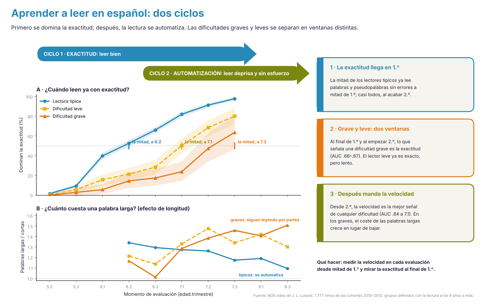

# Resultados globales {#sec-resultados-globales}

```{r}
#| include: false
source(file.path(dirname(knitr::current_input(dir = TRUE)), "R", "libro.R"))
dir_cat <- file.path(raiz_libro(), "datos", "agregados", "CATALOGO")
C <- utils::read.csv(file.path(dir_cat, "Catalogo.csv"), encoding = "UTF-8", check.names = FALSE, stringsAsFactors = FALSE)
ES <- utils::read.csv(file.path(dir_cat, "Estabilidad.csv"), encoding = "UTF-8", check.names = FALSE, stringsAsFactors = FALSE)
FAM <- c(A = "Precisión", B = "Denominación rápida", C = "Fluidez lectora oral", D = "Eficiencia con tiempo limitado",
         E = "Decisión con tiempo de respuesta", F = "Amplitud y memoria", G = "Comprensión")
f2 <- function(x) ifelse(is.na(x), "—", sub("^(-?)0", "\\1", sprintf("%.2f", x)))
rango <- function(e) { e <- suppressWarnings(as.numeric(strsplit(as.character(e), ", ")[[1]])); e <- e[!is.na(e)]; if (!length(e)) "—" else if (length(e) == 1) as.character(e) else paste0(min(e), "–", max(e)) }
A <- C[C$clase == "A", ]
```

::: {.callout-note appearance="minimal"}
**Estado:** primer borrador (02/11/2026) del capítulo 6 del manual, para la reunión del grupo. Por ahora reúne la **tabla resumen de las tareas de clase A** y la **estabilidad longitudinal**, calculadas con las tablas agregadas del catálogo. La estructura factorial y la invarianza están **pendientes** y se indica cómo se harán.
:::

**En una frase.** Este capítulo da la visión de conjunto que no cabe en ninguna ficha: qué tareas tienen hoy calidad suficiente, cuánto se mantienen las diferencias entre niños de un trimestre a otro y de un curso a otro, y cómo se organizan las habilidades a cada edad.

## Mapa del capítulo

| Apartado | Qué responde | Estado | Estudio que lo desarrolla |
|---|---|---|---|
| 6.1 Tareas de clase A | Qué tareas tienen hoy calidad suficiente para una ficha completa | Tabla de las 32 tareas de clase A | M2, [M14](desarrollos/RADAR.qmd) (una escala de decodificación de 4 a 11 años) |
| 6.2 Estabilidad longitudinal | Cuánto se mantienen las diferencias entre niños | Estabilidad por familia y separación entre evaluaciones; estabilidad del riesgo trimestre a trimestre en [M26](desarrollos/M26.qmd) | [M4+M7](desarrollos/M4M7.qmd), [M26](desarrollos/M26.qmd) |
| 6.3 Estructura de las habilidades | Cómo se organizan las habilidades a cada edad | Redes exploratorias por edad; análisis factorial confirmatorio por edad (02/11): exactitud y fluidez se separan desde los 7 años | M1 (redes del desarrollo lector), M9 (modelos dinámicos), [M14](desarrollos/RADAR.qmd) |
| 6.4 Invarianza | Si las tareas miden igual por sexo, formato y periodo | TECLE papel–plataforma y predicción diferencial en letras; resto pendiente | M6, [M22](desarrollos/M22.qmd) |
| Los dos ciclos de la lectura | Cuándo se domina la exactitud y cuándo se automatiza | Resultados y borrador de artículo | [M26](desarrollos/M26.qmd) |

Los estudios con enlace ya tienen página con análisis; los demás están planteados en la [Agenda](agenda.qmd).


## 6.1 Tareas de clase A

Hoy hay `r nrow(A)` tareas de clase A: fiabilidad y muestra suficientes, sin avisos pendientes (criterios en [Límites y calidad de los datos](limites.qmd#sec-clases)). Son las que tendrán ficha completa y baremo en la primera versión del manual.

```{r}
#| label: tbl-tareas-a
#| tbl-cap: "Tareas de clase A: familia, edades, muestra y fiabilidad disponible."
T <- data.frame(
  Tarea = A$tarea,
  Familia = FAM[A$familia],
  Edades = vapply(A$edades, rango, ""),
  Cohortes = vapply(A$cohortes, function(x) { k <- sort(as.integer(strsplit(as.character(x), ", ")[[1]])); if (length(k) > 1 && all(diff(k) == 1)) paste0(k[1], "–", k[length(k)]) else paste(k, collapse = ", ") }, ""),
  Sesiones = A$n_sesiones,
  `N máx. por sesión` = format(A$N_max_sesion, big.mark = "."),
  `α (2021)` = f2(A$alfa_2021),
  `Estabilidad ρ` = f2(A$estabilidad_rho),
  check.names = FALSE)
T <- T[order(T$Familia, T$Tarea), ]; rownames(T) <- NULL
tabla(T, pie = "α: consistencia interna de 2021 con las respuestas por ítem (en tareas con tiempo limitado sobrestima la fiabilidad). Estabilidad: correlación de rangos entre aplicaciones sucesivas a los mismos niños (mediana de los pares con 12 meses o menos de separación). — = sin dato.")
```

```{r}
#| include: false
nA_fam <- table(factor(A$familia, levels = names(FAM)))
```

Lo que se ve:

- **Predominan las tareas de precisión y de fluidez lectora.** De las `r nrow(A)` tareas, `r nA_fam[["A"]]` son de precisión y `r nA_fam[["C"]]` de fluidez lectora oral. La denominación rápida, clave en el modelo de riesgo, todavía no llega a clase A en ninguna de sus formas: no le falta calidad, le faltan datos para comprobarla (no tiene α y pocas veces se repite la misma forma a los mismos niños).
- **Una tarea de clase A necesita revisión antes de usarse:** la inhibición tiene un α muy alto pero su medida está pospuesta hasta revisar cómo se puntúa. Las clases se calculan con reglas automáticas, y el grupo puede corregirlas.
- **La fiabilidad disponible es desigual.** Varias tareas de clase A se apoyan solo en la estabilidad o solo en el α de 2021. El cálculo de ω con las respuestas por ítem de la plataforma nueva completará la columna (ver [Método psicométrico](metodo-psicometrico.qmd)).

## 6.2 Estabilidad longitudinal

La estabilidad dice cuánto se mantiene el orden de los niños entre dos evaluaciones. Depende de la fiabilidad de la tarea y de cuánto cambian los niños entre medias, así que baja a medida que se separan las evaluaciones.

```{r}
#| label: tbl-estabilidad-familia
#| tbl-cap: "Estabilidad (ρ mediana) por familia de tarea y separación entre evaluaciones."
ES$familia <- C$familia[match(ES$tarea_canonica, C$tarea_canonica)]
ES$sep <- cut(ES$meses, c(0, 4, 8, 12, Inf), labels = c("≤ 4 meses", "5–8 meses", "9–12 meses", "> 12 meses"))
ES <- ES[!is.na(ES$familia), ]
M <- tapply(ES$r, list(factor(ES$familia, levels = names(FAM)), ES$sep), median)
Np <- tapply(ES$r, list(factor(ES$familia, levels = names(FAM))), length)
T <- data.frame(Familia = FAM[rownames(M)], `Pares de sesiones` = as.integer(Np[rownames(M)]), check.names = FALSE)
T <- cbind(T, as.data.frame(apply(M, 2, f2), stringsAsFactors = FALSE))
T <- T[!is.na(T$`Pares de sesiones`), ]; rownames(T) <- NULL
tabla(T, pie = sprintf("Correlación de rangos entre dos aplicaciones de la misma tarea a los mismos niños, en %d pares de sesiones de %d tareas (cohortes 2010–2015). — = sin pares con esa separación.", nrow(ES), length(unique(ES$tarea_canonica))))
```

```{r}
#| label: fig-estabilidad
#| fig-cap: "Estabilidad mediana entre dos aplicaciones de la misma tarea según los meses que las separan, por familia de tarea (solo familias con 10 pares de sesiones o más). Los puntos grises son los pares de sesiones."
#| fig-height: 4.4
#| fig-width: 7.5
library(ggplot2)
ES$Familia <- factor(FAM[ES$familia], levels = FAM)
mid <- c("≤ 4 meses" = 3, "5–8 meses" = 6.5, "9–12 meses" = 10.5, "> 12 meses" = 18)
fams <- names(which(table(ES$Familia) >= 10))
D <- aggregate(r ~ Familia + sep, data = ES[ES$Familia %in% fams, ], FUN = median)
D$x <- mid[as.character(D$sep)]
ggplot() +
  geom_hline(yintercept = c(.4, .6), linetype = "dotted", colour = "grey55") +
  geom_jitter(data = transform(ES, xm = mid[as.character(sep)]), aes(xm, r), colour = "grey75", size = 1.2, alpha = .6, width = .5, height = 0) +
  geom_line(data = D, aes(x, r, colour = Familia), linewidth = .9) +
  geom_point(data = D, aes(x, r, colour = Familia), size = 2.4) +
  scale_x_continuous("Meses entre las dos aplicaciones", breaks = mid, labels = names(mid)) +
  scale_y_continuous("Estabilidad (ρ)", limits = c(-.1, 1), breaks = seq(0, 1, .2)) +
  guides(colour = guide_legend(nrow = 2)) +
  theme_minimal(base_size = 11) + theme(legend.position = "bottom", legend.title = element_blank(), panel.grid.minor = element_blank())
```

Lo que se ve:

- **La fluidez lectora es la medida más estable dentro del curso**: entre trimestres (≤ 4 meses) su estabilidad mediana ronda .76, frente a .51 en las tareas de precisión, y se mantiene por encima de .60 hasta los 12 meses. Es coherente con que la velocidad lectora sea el mejor indicador para el seguimiento en una ortografía transparente.
- **Más allá de un año, la estabilidad cae en todas las familias.** En parte es cambio real, y en parte que la «misma» tarea cambia de lista o de texto entre cursos. Hay que comprobarlo antes de interpretar la estabilidad a largo plazo.
- **Las tareas de precisión de Infantil son menos estables**, en parte por el techo y por los pocos ítems, y en parte porque a esas edades los niños cambian mucho. Las líneas punteadas marcan los umbrales del semáforo (.40 y .60).
- **La estabilidad de la etiqueta de dificultad es alta en los primeros cursos y baja después.** De los niños por debajo del percentil 10 a los 6 años, el 89 % sigue por debajo del 25 a los 7; desde el percentil 25, el 78 %. De los 7 a los 8 años esas cifras bajan al 66 % y el 51 %. Por eso el manual define la dificultad con toda la trayectoria y no con una sola evaluación (ver [Cómo estimamos el riesgo](riesgo.qmd)).

## 6.3 Estructura de las habilidades

**Lo que hay.** Un análisis exploratorio de redes por edad (modelos gráficos gaussianos) muestra cómo se organizan las tareas a los 4, 5, 6 y 7 años y cómo se densifica la red al aprender a leer (ver [Cómo se agrupan las tareas](agrupacion.qmd)).

**Análisis factorial confirmatorio por edad (02/11/2026).** Con `cap6_estructura_cfa_v1.R` se ajustaron, en cada edad de 4 a 8 años, tres modelos con las tareas de clase A del **seguimiento trimestral** (sin las evaluaciones en papel ni en tabletas): un factor general (M1), los factores esperados del manual con al menos dos indicadores (M2: conciencia fonológica, conocimiento alfabético, exactitud de decodificación y fluidez; comprensión y vocabulario no llegaron a dos indicadores) y el mismo modelo con exactitud y fluidez unidas (M3). Los indicadores son puntuaciones normales dentro de cohorte y sesión, promediadas por niño en el curso (lavaan, MLR con información completa).

```{r}
#| label: tbl-cfa
#| tbl-cap: "Ajuste de los modelos factoriales por edad. CFI y RMSEA robustos; SRMR. A los 4 años solo hay tres indicadores de conciencia fonológica (modelo saturado) y a los 5 años la escasa cobertura conjunta de algunas tareas hace inestables los índices robustos: se dan solo como orientación."
d6 <- file.path(raiz_libro(), "datos", "agregados", "CAP6")
F1 <- utils::read.csv(file.path(d6, "F1_ajuste.csv"), encoding = "UTF-8", check.names = FALSE); names(F1)[1] <- "edad"
F1 <- F1[F1$edad >= 5, ]
nomm <- c(M1_un_factor = "M1 · un factor", M2_esperado = "M2 · factores esperados", M3_DEC_FLU_unidos = "M3 · exactitud y fluidez unidas")
tf <- data.frame(Edad = F1$edad, Modelo = nomm[F1$modelo], Factores = F1$factores, Indicadores = F1$indicadores, `Niños` = format(F1$n, big.mark = "."),
                 CFI = num_es(F1$cfi.robust, 3), RMSEA = num_es(F1$rmsea.robust, 3), SRMR = num_es(F1$srmr, 3), BIC = format(round(F1$bic), big.mark = "."), check.names = FALSE)
knitr::kable(tf, row.names = FALSE, align = c("l", "l", rep("r", 7)))
```

```{r}
#| label: fig-dec-flu
#| fig-cap: "Correlación del factor de exactitud de decodificación con la fluidez y con la conciencia fonológica (modelo M2) según la edad. Exactitud y fluidez son casi la misma habilidad a los 5 y 6 años y se separan desde los 7. Las barras son ±2 errores típicos."
#| fig-width: 6.5
#| fig-height: 3.4
F3 <- utils::read.csv(file.path(d6, "F3_correlaciones.csv"), encoding = "UTF-8", check.names = FALSE); names(F3)[1] <- "edad"
cc <- F3[F3$modelo == "M2_esperado" & ((F3$factor_1 == "DEC" & F3$factor_2 == "FLU") | (F3$factor_1 == "DEC" & F3$factor_2 == "FON")), ]
cc$par <- ifelse(cc$factor_2 == "FLU", "Exactitud – fluidez", "Exactitud – conciencia fonológica")
ggplot(cc, aes(factor(edad), r, colour = par, group = par, shape = par)) +
  geom_line(linewidth = 1.1) + geom_point(size = 3) + geom_errorbar(aes(ymin = r - 2 * ee, ymax = r + 2 * ee), width = .08) +
  scale_colour_manual(values = c(`Exactitud – fluidez` = PAL_GRUPO[["azul"]], `Exactitud – conciencia fonológica` = PAL_GRUPO[["naranja"]])) +
  scale_y_continuous(limits = c(.4, 1), breaks = seq(.4, 1, .1)) +
  labs(x = "Edad (años)", y = "Correlación entre factores") + tema_grupo(10)
```

**Lo que dicen.** Desde los 6 años, el modelo con los factores esperados ajusta claramente mejor que un factor general (a los 6 años, CFI .94 frente a .84; a los 7 y 8, .93–.94 frente a .77–.80), con un RMSEA todavía algo alto (.09–.10) que mejorará al añadir comprensión y otras tareas. Las cargas son altas: exactitud .62–.95, fluidez .65–.94, conciencia fonológica .64–.87.

El resultado más interesante es la relación entre **exactitud y fluidez**. A los 5 y 6 años sus factores correlacionan .98 y .94: son prácticamente la misma habilidad, porque leer con exactitud y leer deprisa todavía van juntos. A los 7 y 8 años la correlación baja a .75 y .74, y separarlas mejora mucho el ajuste (CFI .93 frente a .80 si se unen). Es la huella estructural de los **dos ciclos de la lectura** que describe [M26](desarrollos/M26.qmd): cuando la mayoría ya lee con exactitud, las diferencias entre niños pasan a estar en la automatización. La conciencia fonológica se va desligando también de la lectura con la edad (con la exactitud, de .82 a los 6 años a .66–.69 a los 7–8; con la fluidez, de .75 a .56).

**Pendiente.** Añadir comprensión, vocabulario y denominación rápida cuando tengan indicadores suficientes; repetir por cohorte y comprobar la invarianza entre edades (M14); contrastar con las redes de M1.

## 6.4 Invarianza

**Lo que hay.** Equivalencia papel–plataforma de TECLE, con su conversión a una escala común (ver [TECLE](fichas/TECLE.qmd)), y predicción diferencial por sexo y nivel socioeconómico en la ficha de letras.

**Pendiente.** Invarianza de medida por sexo, formato (plataforma, papel, tableta) y periodo (antes y después de la pandemia) en las tareas de clase A. Se desarrolla en M6 y, para las regiones y lenguas, en M22.

## 6.5 Los dos ciclos de la lectura

El estudio [M26](desarrollos/M26.qmd) resume en una imagen cómo se aprende a leer en español con los datos de la plataforma: primero se domina la exactitud, durante 1.º, y después la lectura se automatiza; las dificultades graves y leves se separan en ventanas distintas.

{#fig-dos-ciclos-rg fig-alt="Infografía con dos paneles de líneas por grupo y tres tarjetas de conclusiones."}

## Preguntas para el grupo

1. ¿Os parece suficiente, para la primera versión, la tabla de tareas A con la estabilidad, dejando la estructura factorial y la invarianza para la segunda?
2. La denominación rápida no tiene ninguna tarea de clase A por falta de datos de fiabilidad. ¿La incluimos igualmente con ficha completa, como excepción justificada por su papel en el modelo de riesgo?
